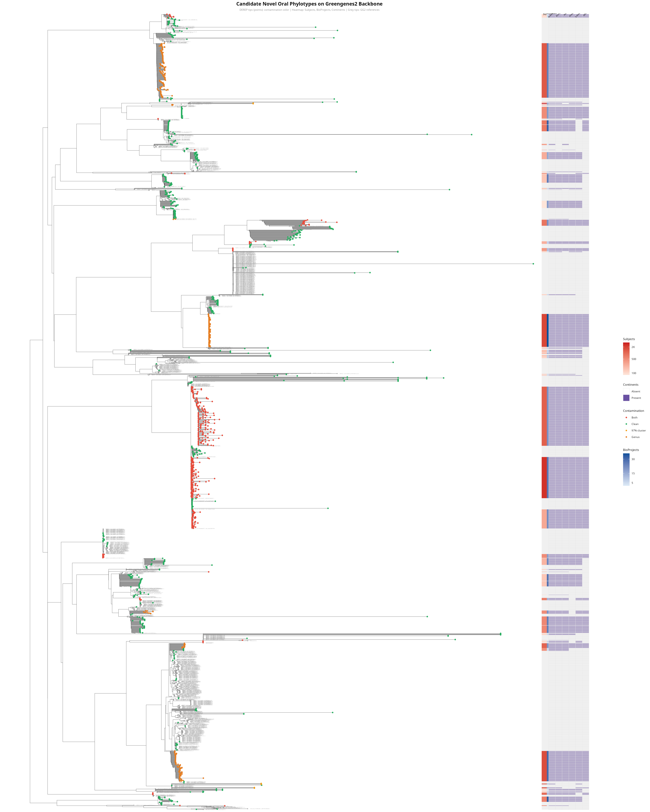

# Novel Oral Taxa Not in HOMD — Analysis Report (Updated)

**Date**: 2026-07-28

> **Note**: This is a summary report. See `pipeline_report_comprehensive.md` for the complete pipeline documentation with figures and full phylotype list (56 candidate novel oral phylotypes).

## ASV Funnel — Each Filter Step

| Step | Start | Kept | Removed | Remaining % |
|------|-------|------|---------|-------------|
| Total ASVs (334 BioProjects) | 3,396,776 | 3,396,776 | 0 | 100% |
| Dereplication (99% OTUs) | 3,396,776 | 2,844,174 | 552,602 | 83.7% |
| HOMD capture (identity >=97%) | 2,844,174 | 997,603 | 997,603 | 35.1% |
| HOMD-uncaptured candidates | 2,844,174 | 1,846,571 | 997,603 | 64.9% |
| Support floor (>=2 BP, >=50 reads) | 1,846,571 | 69,820 | 1,776,751 | 3.8% |
| Chimera removal (vsearch uchime_ref) | 69,820 | 54,254 | 15,566 | 77.7% |
| Contamination firewall | 54,254 | 47,159 | 7,095 | 86.9% |
| SEPP phylotype clusters | 47,159 | 23,088 | 24,071 | 49.0% |
| Candidate novel phylotypes (gates) | 23,088 | 56 | 23,032 | 0.2% |
| **Final (manual curation)** | 56 | **51** | 5 | **91.1%** |

**Reduction**: 3,396,776 total ASVs → **51 candidate novel oral phylotypes** (66603x)

### Contamination Firewall Details

| Evidence Layer | Candidates Flagged |
|----------------|-------------------|
| Literature auto_remove (contaminant genus) | 340 |
| Literature flag_review | 85 |
| Genus-level decontam (pooled) | 643 |
| In cross-lab contaminant catalog | 1,583 |
| Residence fail (oral-vs-blank) | 4,444 |
| **Any flag** | **7,095** |
| **Clean (no flag)** | **47,159** |

### Manually Removed (5 phylotypes)

| Genus | Reason | Phylotypes |
|-------|--------|------------|
| Pseudomonas | flag_review — known reagent contaminant (Salter 2014) | EDGE_301803 |
| Acinetobacter | flag_review — known reagent contaminant (Salter 2014) | EDGE_315416 |
| Brevundimonas | flag_review — known environmental contaminant (Salter 2014) | EDGE_215543 |
| Blautia | auto_remove — obligate gut anaerobe | EDGE_615564 |
| Bacteroides | auto_remove — gut genus, not oral | EDGE_137864 |

## Final Classification

| Classification | Count | Meaning |
|---------------|-------|---------|
| **novel_all_refs** | **14** | Not in HOMD, GG2, or SILVA — candidate **new species/lineages** |
| **known_not_in_homd** | **37** | In GG2/SILVA but absent from HOMD — candidate **additions to oral catalog** |
| **Total** | **51** | |

## Top Candidate Novel Oral Phylotypes

| Phylotype | Novelty | Genus | Subjects | BPs | Reads | Tier |
|-----------|---------|-------|----------|-----|-------|------|
| EDGE_342214 | known_not_HOMD | Unknown | 3,328 | 23 | 52,938 | ? |
| EDGE_393610 | known_not_HOMD | Incertae Sedis | 2,547 | 27 | 6,372,739 | ? |
| EDGE_488261 | **NOVEL_ALL** | Unknown | 1,867 | 17 | 184,768 | ? |
| EDGE_112323 | known_not_HOMD | Capnocytophaga | 1,846 | 36 | 887,163 | ? |
| EDGE_489621 | known_not_HOMD | Incertae Sedis | 1,676 | 30 | 298,425 | ? |
| EDGE_488275 | **NOVEL_ALL** | Unknown | 1,491 | 13 | 473,423 | ? |
| EDGE_392764 | known_not_HOMD | Streptobacillus | 1,368 | 25 | 2,012,125 | ? |
| EDGE_393623 | known_not_HOMD | Incertae Sedis | 1,208 | 21 | 3,698,157 | ? |
| EDGE_490476 | known_not_HOMD | Incertae Sedis | 1,104 | 20 | 70,727 | ? |
| EDGE_430609 | known_not_HOMD | Thermus | 960 | 11 | 47,764 | ? |
| EDGE_140733 | **NOVEL_ALL** | Blvii28 wastewater-sludge grou | 803 | 21 | 40,426 | ? |
| EDGE_284787 | known_not_HOMD | Unknown | 758 | 32 | 273,859 | ? |
| EDGE_615564 | known_not_HOMD | Blautia | 664 | 13 | 326,767 | ? |
| EDGE_660042 | known_not_HOMD | Unknown | 660 | 33 | 56,264 | ? |
| EDGE_657631 | known_not_HOMD | Eperythrozoon | 628 | 3 | 46,722 | ? |
| EDGE_606903 | known_not_HOMD | Unknown | 556 | 25 | 192,253 | ? |
| EDGE_309337 | known_not_HOMD | Unknown | 513 | 19 | 217,622 | ? |
| EDGE_655198 | known_not_HOMD | Phascolarctobacterium | 510 | 18 | 900,492 | ? |
| EDGE_610908 | known_not_HOMD | Incertae Sedis | 494 | 20 | 17,797 | ? |
| EDGE_490475 | known_not_HOMD | Unknown | 460 | 5 | 30,517 | ? |

## Methods

| Step | Method | Tool |
|------|--------|------|
| ASV collection | DADA2 across 334 BioProjects | QIIME2 |
| Dereplication | 99% operational taxonomic units | VSEARCH |
| HOMD mapping | Global identity (--iddef 1), id>=97% | VSEARCH |
| Chimera removal | Reference-based (--uchime_ref) vs HOMD+GG2+SILVA | VSEARCH |
| Genus annotation | 97% identity vs derep SILVA 138.2 DB | VSEARCH |
| Decontam (genus) | Prevalence mode (threshold=0.5), within-study + pooled | R/decontam |
| Literature screen | contaminant_reference_genera.tsv (Salter 2014 + Weyrich 2019) | Verified manually |
| Oral-vs-blank residence | Prevalence ratio (min_oral_prev=0.01) | Custom Python |
| Phylogenetic placement | SEPP fragment insertion onto Greengenes2 backbone | QIIME2 |
| Phylotype definition | Tree-edge clustering + 5-gate filter | Custom Python |
| Multi-DB novelty | Global alignment vs HOMD, GG2, SILVA | VSEARCH |
| Credibility scoring | Multi-evidence weighted scoring | Custom Python |

---
*Report generated 2026-07-23. Updated from 2026-07-21 version.*
*Key changes: removed qcov from HOMD definition, genus-level decontam with all 1,469 controls, multi-layer contamination evidence, SEPP phylogenetic placement.*
