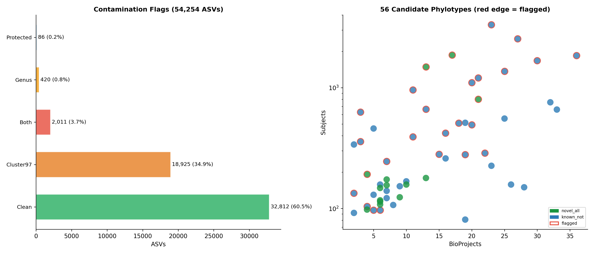
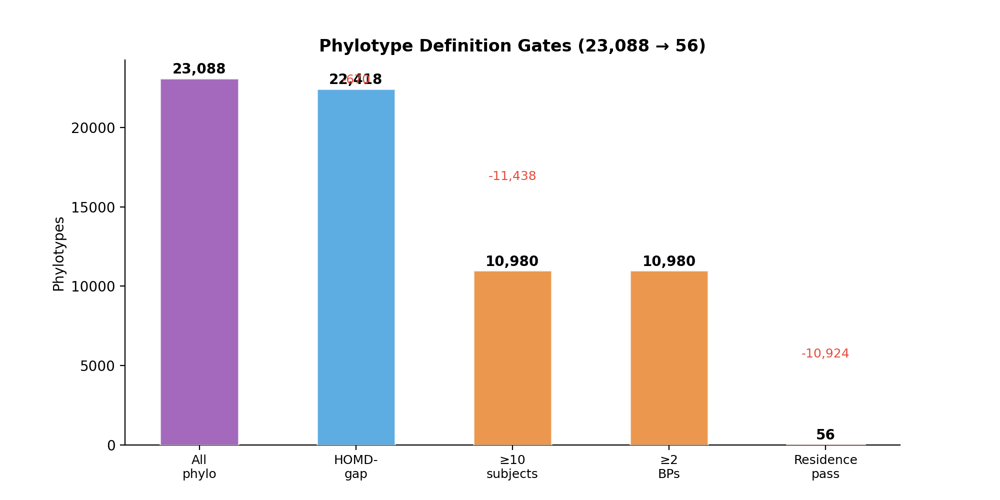

# Comprehensive Pipeline Report: Novel Oral Taxa Not in HOMD

## Funnel Overview

| Step | Phase | Input | Output | Removed | % Kept | Note |
|------|-------|-------|--------|---------|--------|------|
| ASV collection + exact dereplication | 1 | — | 2,844,174 | — | — | 100% identical sequences collapsed |
| HOMD-uncaptured (id<97% or no hit) | 1 | 2,844,174 | 1,843,301 | 1,000,873 | 64.8% | qcov NOT used |
| Support floor (≥2 BP, ≥50 reads) | 1 | 1,843,301 | 69,820 | 1,773,481 | 3.8% | Keeps rare tail |
| Chimera removal (vsearch uchime_ref) | 1 | 69,820 | 54,254 | 15,566 | 77.7% | Cross-study chimeras |
| Contamination flags (2-stage) | 2 | 54,254 | **54,254** | **0 (flags only)** | 100% | Records evidence, no deletion |
| SEPP placement (GG2 tree) | 4 | 54,254 | 54,132 | 122 | 99.8% | QIIME2 fragment-insertion |
| Tree-edge phylotype clustering | 4 | 54,132 | 23,088 | — | — | 2.34 ASVs/phylotype |
| Phylotype gates (1-5) | 3+4 | 23,088 | 56 | 23,032 | 0.2% | 56 candidate novel phylotypes |
| Novelty classification | 4 | 56 | **56** | — | — | 14 novel_all + 42 known_not |

**All 54,254 ASVs are retained throughout.** Contamination flags are added as columns, not used for deletion.

---

## Phase 1 — Candidate Generation

### Step 1: ASV Collection + Dereplication
**Script**: `01_collect_asvs_and_abundance.py`
- 334 BioProjects, DADA2 output loaded
- Group by exact sequence (100%). Each unique → `DEREP_XX`
- Raw ASVs: 3,396,776 → Derep: 2,844,174 (removed 552,602 duplicates)
- Mapping: `asv_abundance_metadata.tsv` tracks `renamed_asv_id → derep_id`
- **Data**: `collect_stats.json`

### Step 2: HOMD Mapping (identity-only) + Support Floor
**Script**: `02_align_homd_and_summarize.py` → `01_export_homd_uncaptured_candidates.py`
- vsearch `--usearch_global` vs HOMD V16.03; true identity = `(alnlen-mism-gaps)/ql*100`
- **HOMD-uncaptured**: identity < 97% OR no HOMD hit. qcov NOT used (`--qcov-min 0`).
- **Support floor**: ≥2 BioProjects AND ≥50 reads (applied after HOMD definition)
- **Data**: `candidate_summary.tsv`

| Stage | Count |
|-------|-------|
| Derep input | 2,844,174 |
| HOMD-uncaptured (id<97%) | 1,843,301 |
| After support floor | **69,820** |

### Step 3: Chimera Removal
**Script**: `03_chimera_removal.sbatch` → vsearch `--uchime_ref` vs HOMD+GG2+SILVA
- Input: 69,820 → Non-chimeric: **54,254** → Chimeric: 15,566 (22.3%)
- **Data**: `exact_derep_chimera_annotated.tsv` → `is_chimera`

---

## Phase 2 — Contamination Firewall (Two-Stage Flagging)

Per plan Steps 4-8: decontam within blanks → cross-lab catalog → extend literature blacklist → record per-ASV evidence. **All 54,254 ASVs are retained.** Flags are recorded as additional columns.

### Stage 1: 97% Clustering with Control ASVs

**Goal**: Identify candidate ASVs that are ≥ 97% identical to HOMD-uncaptured sequences found in negative control samples.

**Inputs**:
- 14,685 control ASV sequences (from `contaminant_catalog.fasta`, derived from 1,469 control samples across 20 BioProjects)
- 54,254 candidate ASV sequences

**Method**: vsearch `--cluster_fast --id 0.97` on combined set of 68,939 sequences. Parse clusters: if a candidate ASV shares a 97% OTU cluster with at least one HOMD-uncaptured (identity < 97%) control ASV, it receives a `cluster97_contaminant` flag.

**Rationale**:
- Control ASVs with HOMD identity ≥ 97% are likely oral bacteria that leaked into controls (cross-contamination) — they do NOT trigger the flag
- Control ASVs with HOMD identity < 97% are themselves HOMD-uncaptured — they are suspicious because they are not known oral bacteria yet appear in controls
- 97% OTU level allows for DADA2 boundary differences (1-2 bp) that exact sequence matching would miss

**Result**:

| Category | Candidates | % of 54,254 |
|----------|-----------|-------------|
| Clean (no cluster with control ASV) | 33,260 | 61.3% |
| Cluster with HOMD-captured control ASV (≥97%) | — | Not flagged (known oral ×-contamination) |
| **Flagged: cluster with HOMD-uncaptured control ASV** | **20,994** | **38.7%** |

**Data**: `tmp_97cluster/clusters.uc` → parsed → `candidates_flagged_updated.tsv` column `cluster97_contaminant`

### Stage 2: Extended Genus Reference

**Goal**: Extend the curated literature blacklist with genera found in control ASVs that are **absent from HOMD entirely**. Then flag candidate ASVs whose genus matches this extended reference.

**HOMD genus list**: Parsed from `/beegfs/huangxiaochang/global_oral/HOMD_16S_rRNA_RefSeq_V16.03.taxonomy` (6,600 entries, 251 unique genera).

**Extension logic** (per plan Step 5: "extends the curated literature blacklist"):

| Source | Genera | Rule |
|--------|--------|------|
| Literature base (`contaminant_reference_genera.tsv`) | 94 | Verified against Salter 2014 + Weyrich 2019 |
| Control ASVs, genus NOT in HOMD | **891** | Empirically observed in our controls, absent from HOMD |
| Control ASVs, genus IS in HOMD | — | NOT added (genus is known to oral microbiome) |
| Protected: oral_core genera | 32 | NEVER removed |

**Why exclude HOMD-present genera?** If a genus is in HOMD (e.g., Streptococcus, Prevotella), its appearance in controls is likely oral-to-control cross-contamination during DNA extraction, not evidence of contamination. Adding such genera would falsely flag genuine oral ASVs.

**891 new genera added to the extended reference** (all absent from HOMD, found in control samples).

**Result**:

| Category | Candidates | % of 54,254 |
|----------|-----------|-------------|
| Clean (genus not in extended reference) | 51,414 | 94.8% |
| **Flagged: genus in extended reference** | **2,754** | **5.1%** |
| Protected: oral_core | 86 | 0.2% |

**Data**: `candidates_flagged_updated.tsv` columns `genus_contaminant`, `oral_core_protected`

### Combined Flag Distribution

| Flag level | Candidates | % | Evidence |
|-----------|-----------|----|----------|
| **clean** | 32,812 | 60.5% | No evidence from any layer |
| **soft_flag_cluster97** | 18,925 | 34.9% | 97% cluster with HOMD-uncaptured control ASV |
| **hard_flag_both** | 2,011 | 3.7% | cluster97 + genus both flagged |
| **soft_flag_genus** | 420 | 0.8% | Genus in extended reference only |
| **protected_oral_core** | 86 | 0.2% | oral_core genus (protected) |

**Per-ASV tracking** (plan Step 8): Each ASV has columns `cluster97_contaminant`, `genus_contaminant`, `oral_core_protected`, `contamination_flag` recording which evidence flagged it.

**File**: `05_integrated_candidates/candidates_flagged_updated.tsv` (54,254 rows × 16 cols)

---

## Phase 3 — Oral-Residence Test

Per plan Step 9: "Test residence against blanks, not gut."

**Script**: `04_oral_vs_blank_enrichment.py`

For each candidate ASV in the 20 blank-bearing BioProjects:
- oral_prevalence ≥ 0.01 (≥73 of 7,281 oral samples)
- oral_mean_abundance > blank_mean_abundance
- blank_prevalence ≤ 0.10 OR oral/blank ratio ≥ 5.0

| Measure | Value |
|---------|-------|
| Features tested | 6,294 |
| Residence pass | 79 |
| Residence fail | 6,215 |

A phylotype passes if ≥ 1 member ASV passes (permissive).

---

## Phase 4 — Phylotype-Level Analysis

### Step 1: SEPP Placement
**Script**: `05c_sepp_place.sbatch` → QIIME2 `q2-fragment-insertion sepp` on GG2 backbone
- 54,254 submitted → 54,132 placed (99.8%)

### Step 2: Phylotype Gates
**Script**: `06_define_phylotypes.py`

| Gate | Criterion | Pass | Fail | % Pass |
|------|-----------|------|------|--------|
| 1 | HOMD-gap (nearest GG2 ref NOT in HOMD) | 22,418 | 670 | 97.1% |
| 2 | ≥10 subjects | 10,980 | 11,438 | 49.0% |
| 3 | ≥2 BioProjects | 10,980 | 0 | 100% |
| 4 | ≥1 member passing residence test | **56** | 10,924 | 0.5% |
| 5 | ≥1 non-chimeric member | 56 | 0 | 100% |

### Step 3: Novelty Classification
**Script**: `07_multidb_novelty.py` — vsearch vs HOMD, GG2, SILVA

| Class | Count | Definition |
|-------|-------|------------|
| **novel_all_refs** | **14** | <97% to all 3 databases → candidate new species |
| **known_not_in_homd** | **42** | ≥97% to GG2/SILVA but NOT HOMD → HOMD gap |

### Contamination Concern on Phylotypes

Of the 56 candidate novel phylotypes, contamination flags are recorded per-phylotype based on member ASV flags. These are annotations for review, not automatic exclusions.

### Complete List of 56 Candidate Novel Phylotypes

| Phylotype | Novelty | Genus | Subj | BPs | Reads | ASVs | C97 | GenF | Concern |
|-----------|---------|-------|------|-----|-------|------|-----|------|---------|
| EDGE_101602 | **NOVEL** | Unknown | 117 | 6 | 2,360 | 3 | 0 | 0 | clean |
| EDGE_111272 | known | Unknown | 153 | 9 | 4,311 | 4 | 0 | 0 | clean |
| EDGE_112323 | known | Capnocytophaga | 1,846 | 36 | 887,163 | 112 | 0 | 3 | genus |
| EDGE_135701 | known | Unknown | 130 | 5 | 2,554 | 3 | 0 | 0 | clean |
| EDGE_137864 | known | Bacteroides | 393 | 11 | 1,179,219 | 10 | 10 | 1 | BOTH |
| EDGE_140427 | known | Incertae Sedis | 246 | 7 | 51,875 | 9 | 7 | 1 | BOTH |
| EDGE_140733 | **NOVEL** | Blvii28 wastewater-sludge | 803 | 21 | 40,426 | 20 | 13 | 1 | BOTH |
| EDGE_15856 | **NOVEL** | Unknown | 124 | 9 | 11,948 | 4 | 0 | 0 | clean |
| EDGE_160013 | known | Treponema | 104 | 4 | 2,805 | 2 | 0 | 1 | genus |
| EDGE_160023 | known | Unknown | 81 | 19 | 22,454 | 25 | 0 | 0 | clean |
| EDGE_175610 | **NOVEL** | Unknown | 148 | 6 | 2,199 | 1 | 0 | 0 | clean |
| EDGE_176467 | known | Unknown | 158 | 6 | 3,507 | 3 | 0 | 0 | clean |
| EDGE_19603 | known | Unknown | 168 | 10 | 23,276 | 5 | 0 | 0 | clean |
| EDGE_207640 | known | Unknown | 158 | 26 | 22,400 | 29 | 0 | 0 | clean |
| EDGE_215543 | known | Brevundimonas | 422 | 16 | 88,739 | 3 | 2 | 2 | BOTH |
| EDGE_229563 | known | Unknown | 107 | 8 | 3,095 | 2 | 0 | 0 | clean |
| EDGE_262631 | known | Unknown | 260 | 16 | 41,707 | 24 | 0 | 0 | clean |
| EDGE_263382 | known | Tepidimonas | 359 | 3 | 31,597 | 1 | 1 | 1 | BOTH |
| EDGE_265582 | known | Unknown | 339 | 2 | 22,613 | 4 | 0 | 0 | clean |
| EDGE_27881 | **NOVEL** | Unknown | 179 | 13 | 11,094 | 4 | 0 | 0 | clean |
| EDGE_284787 | known | Unknown | 758 | 32 | 273,859 | 36 | 0 | 0 | clean |
| EDGE_301803 | known | Pseudomonas | 281 | 15 | 532,940 | 2 | 2 | 2 | BOTH |
| EDGE_30676 | **NOVEL** | Unknown | 174 | 7 | 12,454 | 9 | 0 | 0 | clean |
| EDGE_309337 | known | Unknown | 513 | 19 | 217,622 | 39 | 0 | 0 | clean |
| EDGE_315416 | known | Acinetobacter | 280 | 19 | 888,053 | 3 | 0 | 2 | genus |
| EDGE_342214 | known | Unknown | 3,328 | 23 | 52,938 | 3 | 3 | 0 | cluster97 |
| EDGE_365498 | **NOVEL** | Unknown | 158 | 10 | 11,253 | 2 | 0 | 0 | clean |
| EDGE_392759 | known | Incertae Sedis | 97 | 5 | 84,176 | 12 | 10 | 1 | BOTH |
| EDGE_392764 | known | Streptobacillus | 1,368 | 25 | 2,012,125 | 185 | 0 | 2 | genus |
| EDGE_393610 | known | Incertae Sedis | 2,547 | 27 | 6,372,739 | 140 | 115 | 10 | BOTH |
| EDGE_393615 | known | Incertae Sedis | 288 | 22 | 393,015 | 65 | 61 | 2 | BOTH |
| EDGE_393623 | known | Incertae Sedis | 1,208 | 21 | 3,698,157 | 201 | 110 | 11 | BOTH |
| EDGE_395278 | **NOVEL** | Unknown | 156 | 7 | 6,686 | 2 | 0 | 0 | clean |
| EDGE_430609 | known | Thermus | 960 | 11 | 47,764 | 7 | 7 | 2 | BOTH |
| EDGE_468429 | known | Unknown | 122 | 7 | 3,343 | 4 | 0 | 0 | clean |
| EDGE_470252 | **NOVEL** | Unknown | 98 | 4 | 6,635 | 6 | 0 | 0 | clean |
| EDGE_488261 | **NOVEL** | Unknown | 1,867 | 17 | 184,768 | 3 | 3 | 0 | cluster97 |
| EDGE_488275 | **NOVEL** | Unknown | 1,491 | 13 | 473,423 | 3 | 3 | 0 | cluster97 |
| EDGE_489621 | known | Incertae Sedis | 1,676 | 30 | 298,425 | 103 | 0 | 3 | genus |
| EDGE_490475 | known | Unknown | 460 | 5 | 30,517 | 10 | 0 | 0 | clean |
| EDGE_490476 | known | Incertae Sedis | 1,104 | 20 | 70,727 | 16 | 0 | 4 | genus |
| EDGE_497065 | known | Dubosiella | 97 | 6 | 2,442 | 6 | 6 | 1 | BOTH |
| EDGE_502385 | known | Eperythrozoon | 134 | 2 | 5,726 | 1 | 1 | 1 | BOTH |
| EDGE_553807 | known | Unknown | 226 | 23 | 23,886 | 23 | 0 | 0 | clean |
| EDGE_593012 | **NOVEL** | Unknown | 108 | 6 | 15,256 | 5 | 0 | 0 | clean |
| EDGE_606903 | known | Unknown | 556 | 25 | 192,253 | 55 | 0 | 0 | clean |
| EDGE_610908 | known | Incertae Sedis | 494 | 20 | 17,797 | 11 | 0 | 2 | genus |
| EDGE_615564 | known | Blautia | 664 | 13 | 326,767 | 8 | 8 | 1 | BOTH |
| EDGE_626242 | known | Unknown | 92 | 2 | 7,056 | 1 | 0 | 0 | clean |
| EDGE_643266 | known | Unknown | 150 | 28 | 64,185 | 41 | 0 | 0 | clean |
| EDGE_643642 | **NOVEL** | Incertae Sedis | 192 | 4 | 1,991 | 1 | 1 | 1 | BOTH |
| EDGE_650048 | **NOVEL** | Unknown | 114 | 6 | 6,325 | 3 | 0 | 0 | clean |
| EDGE_655198 | known | Phascolarctobacterium | 510 | 18 | 900,492 | 13 | 12 | 3 | BOTH |
| EDGE_6559 | known | Unknown | 140 | 7 | 4,833 | 2 | 0 | 0 | clean |
| EDGE_657631 | known | Eperythrozoon | 628 | 3 | 46,722 | 2 | 1 | 1 | BOTH |
| EDGE_660042 | known | Unknown | 660 | 33 | 56,264 | 18 | 0 | 0 | clean |

## Output Files

| File | Rows | Description |
|------|------|-------------|
| `01_candidates/candidates_all.tsv` | 69,820 | HOMD-uncaptured + support floor |
| `02_chimera/candidates_all_nonchimeric.tsv` | 54,254 | Non-chimeric candidates |
| `05_integrated_candidates/candidates_flagged_updated.tsv` | 54,254 × 16 | **Final table with contamination flags** |
| `05_integrated_candidates/integrated_candidate_annotations.tsv` | 54,254 × 42 | Full annotation (decontam, catalog, literature) |
| `06_phylotypes_sepp/phylotypes_candidate_novel.tsv` | 56 | Pipeline output: candidate novel phylotypes |
| `07_novelty_sepp/phylotypes_novelty_classified.tsv` | 56 | Multi-DB novelty |
| `analysis_report/blank_free_limitations.md` | — | Limitations for 316 blank-free studies |
