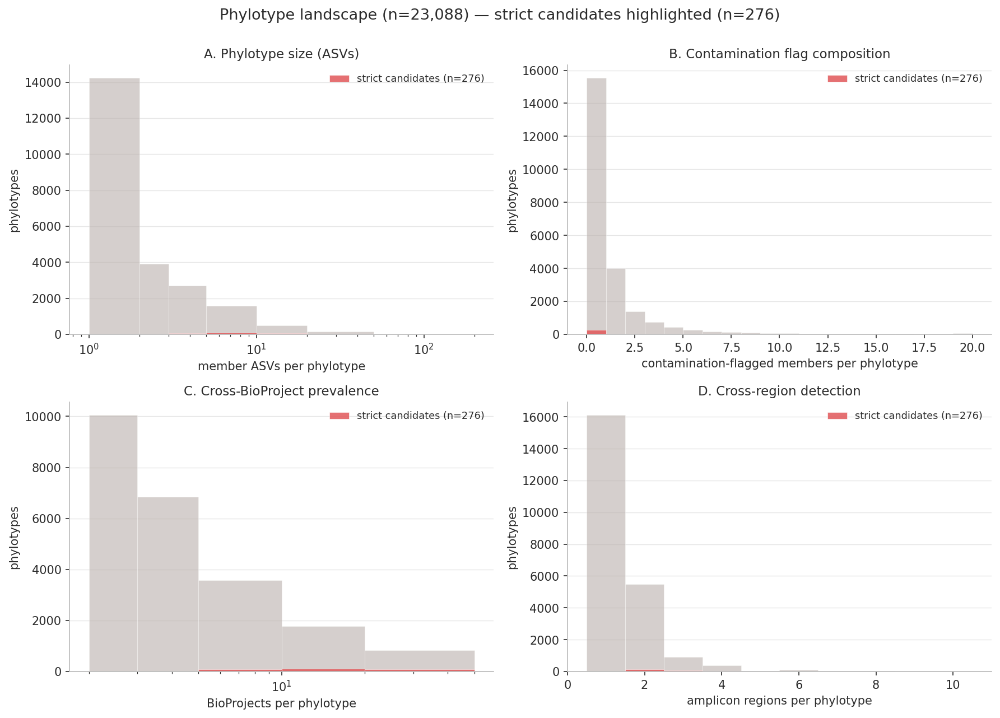
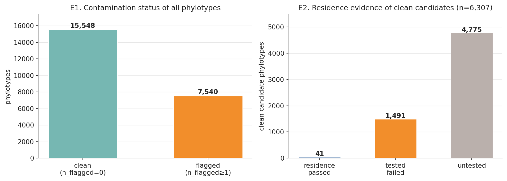
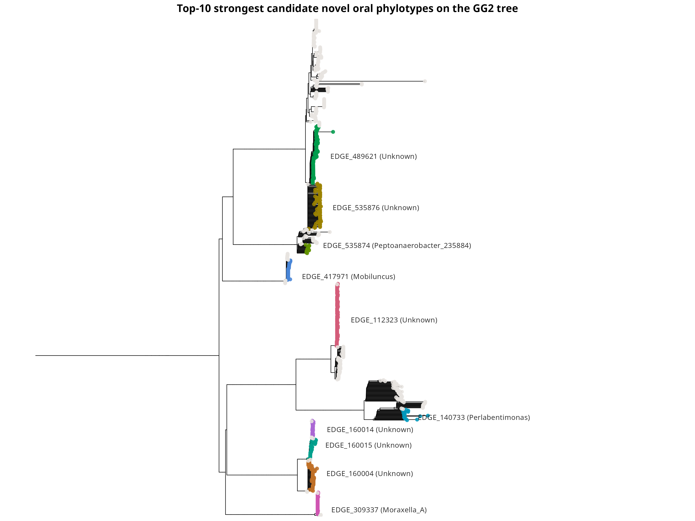
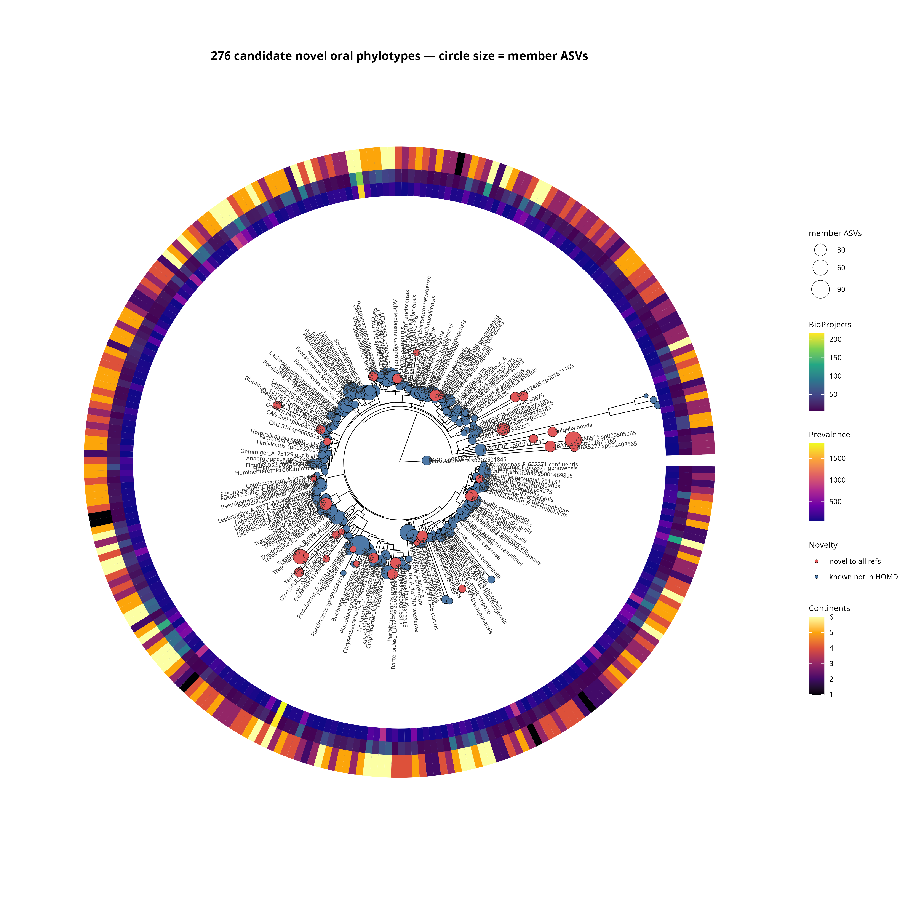

# Identification of Novel Oral Taxa Absent from the HOMD Reference Database

**pipeline_v2** — SEPP phylogenetic placement · support-only floor · report-don't-adjudicate · 2026-08-04

> Each step shows the **actual code that ran** and the **code that produced every number**.
> The pipeline annotates authenticity signals (contamination, residence) but **never
> deletes** on them — the phylotype composition is reported honestly, and the strongest
> candidates are highlighted on the tree.

---

## Overview

| Stage | Count |
|------:|------:|
| ASVs screened (334 BioProjects) | 3,396,776 |
| Dereplicated → HOMD-uncaptured & non-chimeric | 1,136,142 |
| **Support floor (≥2 BioProjects, ≥50 reads — support only)** | **54,290** (34,640 clean + 19,650 flagged) |
| SEPP-placed ASVs | 54,277 |
| **Phylotypes (tree-edge clusters)** | **23,088** |
| **Candidate novel (≥10 subjects, not HOMD-captured)** | **11,348** |
| Clean phylotypes (no flagged member) | 15,548 |
| **Clean candidates** | **6,307** |
| **Strongest candidates (clean, subj≥50, BP≥5, ≥2 regions)** | **276** |



---

## Step 01 — Candidate generation & chimera removal

```python
# 01_chimera_removal.py — reuses precomputed HOMD + chimera annotations
df   = pd.read_csv("homd_mapping/exact_derep_homd_annotated.tsv", sep="\t")   # 2,844,174
chim = pd.read_csv("chimera_removal/exact_derep_chimera_annotated.tsv", sep="\t")
candidates = df[df["homd_uncaptured"] & ~chim["is_chimera"]].copy()
```

```python
len(df)                            # 2,844,174  dereplicated
df["homd_uncaptured"].sum()        # 1,846,571  HOMD-uncaptured (64.9%)
chim["is_chimera"].sum()           #   744,715  chimeric (26.2%)
len(candidates)                    # 1,136,142  kept
```

---

## Step 02 — Contamination & residence firewall (annotation only, no deletion)

Each ASV is annotated with three independent authenticity signals; **nothing is
removed here**:

```python
# 02_contamination_firewall.py — two contamination layers
# layer 1: 97% clustering with control-derived ASVs → any cluster with a control flags all members
# layer 2: genus in literature blacklist (via GG2 taxonomy) → flagged
candidates["contamination_flag"] = candidates["stage1_cluster97_flag"] | candidates["stage2_genus_flag"]

# 02b_annotate_residence.py — oral-vs-blank residence (from strict 04), annotation only
fw["residence_pass"]    = fw["derep_id"].isin(residence_pass_set)
fw["residence_untested"]= ~fw["derep_id"].isin(evaluated_set)      # untested → kept
```

```python
fw["contamination_flag"].value_counts()      # False 949,644 | True 186,498
fw["residence_pass"].sum()                   # 79
fw["residence_untested"].mean()              # 99.4%  (only 20/334 BioProjects have blanks)
```

---

## Step 03 — Support floor: **support only**

```python
# 04_support_floor.py — flagged ASVs that reach the floor are RETAINED (with annotations)
passed = (df["n_bioprojects"] >= 2) & (df["total_reads"] >= 50)
```

```python
passed.sum()                        # 54,290
passed_df["contamination_flag"].sum()   # 19,650  flagged ASVs kept (not deleted)
```

---

## Step 04 — SEPP placement

```bash
qiime fragment-insertion sepp \
  --i-representative-sequences candidates.qza \
  --i-reference-database 2022.10.backbone.sepp-reference.qza \
  --p-threads 28 --o-tree tree.qza --o-placements placements.qza
```

```python
# 05d parse — best placement = argmax like_weight_ratio → edge_num
best_idx = np.argmax([p[2] for p in positions])
```

```python
placed = len(reused) + len(new)     # 54,132 reused + 145 newly placed = 54,277
```

---

## Step 05 — Phylotype definition (tree-edge clusters)

```python
# 05_phylotype_analysis.py — ASVs on the same tree edge = one phylotype
sepp_all["phylotype_id"] = "EDGE_" + sepp_all["edge_num"].astype(str)
```

```python
len(phylo)                              # 23,088  phylotypes
(phylo["n_asvs"] > 1).sum()             #  8,851  multi-ASV (cross-region unification)
```

---

## Step 06 — Multi-database novelty

```python
# 06_novelty_classification.py — each phylotype rep vs HOMD, GG2, SILVA (iddef 2, ≥97%)
def classify(row):
    if homd >= 97:            return "homd_captured"
    elif gg2 >= 97 or silva >= 97: return "known_not_in_homd"
    else:                     return "novel_all_refs"
```

```python
phylo_novel["novelty_class"].value_counts()
# known_not_in_homd    18793
# novel_all_refs        4272
# homd_captured           23
phylo_novel["candidate_novel"] = (subjects >= 10) & (novelty != "homd_captured")
phylo_novel["candidate_novel"].sum()     # 11,348  candidate novel
```

---

## Step 07 — Aggregate, report, don't adjudicate

```python
# 06b_aggregate_phylotypes.py — per-phylotype member composition; NO exclusion
for each phylotype:  n_flagged = #members with contamination_flag
                     n_residence_pass = #members that passed oral-vs-blank
                     n_untested        = #members never testable
clean_phylotype = (n_flagged == 0)
support_score   = max_prevalence * n_bioprojects_total * n_regions
```

```python
# composition across all 23,088 phylotypes
clean_phylotypes        = 15,548        # no flagged member
candidate novel         = 11,348
clean candidates        =  6,307
```



---

## Strongest candidates (tree highlights) — 276

Cutoffs set from the actual distribution (there are abundant clean candidates at every
support level — no parameter forcing needed):

```python
strict = clean & candidate_novel \
       & (max_prevalence >= 50) & (n_bioprojects_total >= 5) & (n_regions >= 2)
```

```python
len(strict)                       # 276   (239 known_not_in_homd + 37 novel_all_refs)
strict["max_prevalence"].median() # 88.5 subjects
strict["n_bioprojects_total"].median()  # 14 BioProjects
strict["n_regions"].median()      # 3 amplicon regions
```



The tree shows the top-10 strongest candidates (each phylotype a distinct colour) embedded
among GG2 references (gray). Rings: subjects, BioProjects, amplicon regions,
residence-passed members, contamination-flagged members.



All 276 strongest candidates on the GG2 tree (circular layout, pruned to the representative
ASV of each phylotype — no reference tips). Each **phylotype = one circle**: circle size =
number of member ASVs, fill = novelty class (red = novel to all refs, blue = known not in
HOMD). Species labels are shown only where a name was resolved (186/276); the rest stay
unlabelled to avoid clutter. Rings: max prevalence (subjects), BioProjects, continents.

---

## Supplementary table

`pipeline_v2/07_supplementary_table.tsv` — all **23,088** phylotypes × 26 columns:
`phylotype_id, strict_candidate, novelty_class, candidate_novel, rep_derep_id,
rep_gg2_genus, gg2_target, n_members, n_clean, n_flagged, n_residence_pass, n_tested,
n_untested, max_prevalence, n_bioprojects_total, n_continents, n_regions, regions,
total_reads_sum, clean_phylotype, support_score, homd_best_id, gg2_best_id,
silva_best_id, homd_target, silva_target`.

---

## Key design decisions (revised)

1. **Residence test lives in the firewall step** (02) as annotation only — it is an
   authenticity signal like the contamination flag, and no ASV is deleted on it.
2. **Support floor is support-only** (03): flagged ASVs that reach the floor are
   retained with their annotations. Earlier code wrongly applied
   `clean = ~contamination_flag` here, silently deleting 19,650 support-passing ASVs;
   that filter is removed.
3. **No adjudication at phylotype level**: composition (flagged / residence / untested)
   is reported per phylotype; the reader sees it. Only the *highlighting* on the tree
   uses the strongest-evidence definition (clean + high support).

## Limitations

1. **Residence coverage**: oral-vs-blank is testable in only 20/334 BioProjects
   (99.4% of ASVs untested); untested is not penalized.
2. **Blacklist is annotation-dependent**: only ASVs with an assignable genus are
   screened by the literature genus list; sequence-level 97% control-catalog matching
   covers the rest.
3. **97% identity to full-length refs is approximate**: phylotypes are defined on
   ~277–460 bp fragments.
