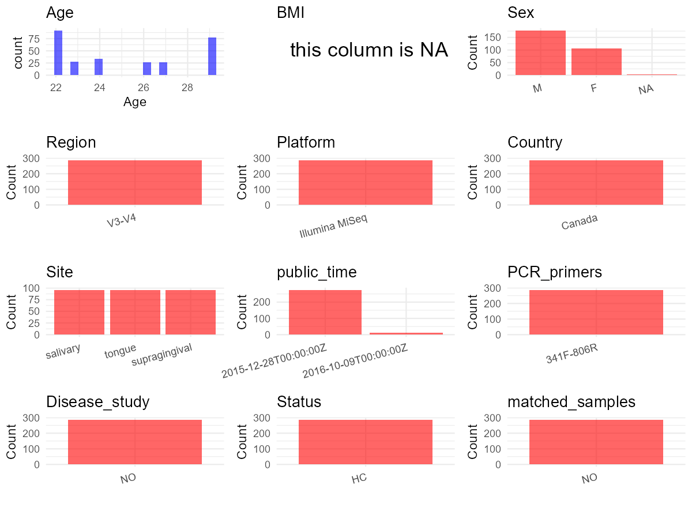

R Notebook: Metadata Processing Workflow
================

# Step 1: Obtain Initial Metadata from Each Project

To obtain the initial metadata: 1. Search for the BioProject ID (e.g.,
“PRJEBXXXX”) on the [NCBI SRA
website](https://www.ncbi.nlm.nih.gov/Traces/study/). 2. In the “Select”
table, click on “Metadata” and download the file. 3. The downloaded file
is typically named “SraRunTable.csv” and contains metadata for the
project.

``` r
# Load necessary libraries
library(dplyr)
library(ggplot2)
library(cowplot)

# Set working directory (update this path to your local directory)
setwd("D:/studylearning/董彪师兄项目/任务/修改20250922/PRJEB11529")
initial_meta<-read.csv("SraRunTable.csv",header = T)
head(initial_meta)
```

    ##          Run Assay.Type BioProject    BioSample    Bytes            Center.Name
    ## 1 ERR1109390   AMPLICON PRJEB11529 SAMEA3643973 20573023 UNIVERSITY OF WATERLOO
    ## 2 ERR1109391   AMPLICON PRJEB11529 SAMEA3644062 37386189 UNIVERSITY OF WATERLOO
    ## 3 ERR1109392   AMPLICON PRJEB11529 SAMEA3644063 23821284 UNIVERSITY OF WATERLOO
    ## 4 ERR1109393   AMPLICON PRJEB11529 SAMEA3644064 22277602 UNIVERSITY OF WATERLOO
    ## 5 ERR1109394   AMPLICON PRJEB11529 SAMEA3644065 19350925 UNIVERSITY OF WATERLOO
    ## 6 ERR1109395   AMPLICON PRJEB11529 SAMEA3644066 24079527 UNIVERSITY OF WATERLOO
    ##   Consent DATASTORE.filetype DATASTORE.provider
    ## 1  public   fastq,run.zq,sra     ena,gs,ncbi,s3
    ## 2  public   fastq,run.zq,sra     ena,gs,ncbi,s3
    ## 3  public   fastq,run.zq,sra     ena,gs,ncbi,s3
    ## 4  public   fastq,run.zq,sra     ena,gs,ncbi,s3
    ## 5  public   fastq,run.zq,sra     ena,gs,ncbi,s3
    ## 6  public   fastq,run.zq,sra     ena,gs,ncbi,s3
    ##                           DATASTORE.region ENA.FIRST.PUBLIC..run.
    ## 1 ena,gs.us-east1,ncbi.public,s3.us-east-1             2015/12/27
    ## 2 ena,gs.us-east1,ncbi.public,s3.us-east-1             2015/12/27
    ## 3 ena,gs.us-east1,ncbi.public,s3.us-east-1             2015/12/27
    ## 4 ena,gs.us-east1,ncbi.public,s3.us-east-1             2015/12/27
    ## 5 ena,gs.us-east1,ncbi.public,s3.us-east-1             2015/12/27
    ## 6 ena,gs.us-east1,ncbi.public,s3.us-east-1             2015/12/27
    ##   ENA.LAST.UPDATE..run. Experiment  external_id      INSDC_center_name
    ## 1            2018/11/16 ERX1188921 SAMEA3643973 UNIVERSITY OF WATERLOO
    ## 2            2018/11/16 ERX1188922 SAMEA3644062 UNIVERSITY OF WATERLOO
    ## 3            2018/11/16 ERX1188923 SAMEA3644063 UNIVERSITY OF WATERLOO
    ## 4            2018/11/16 ERX1188924 SAMEA3644064 UNIVERSITY OF WATERLOO
    ## 5            2018/11/16 ERX1188925 SAMEA3644065 UNIVERSITY OF WATERLOO
    ## 6            2018/11/16 ERX1188926 SAMEA3644066 UNIVERSITY OF WATERLOO
    ##     INSDC_first_public    INSDC_last_update INSDC_status     Instrument
    ## 1 2015-12-27T17:02:18Z 2015-11-03T23:35:22Z       public Illumina MiSeq
    ## 2 2015-12-27T17:02:18Z 2015-11-03T23:35:29Z       public Illumina MiSeq
    ## 3 2015-12-27T17:02:18Z 2015-11-03T23:35:29Z       public Illumina MiSeq
    ## 4 2015-12-27T17:02:19Z 2015-11-03T23:35:29Z       public Illumina MiSeq
    ## 5 2015-12-27T17:02:18Z 2015-11-03T23:35:29Z       public Illumina MiSeq
    ## 6 2015-12-27T17:02:18Z 2015-11-03T23:35:29Z       public Illumina MiSeq
    ##   Library.Name LibraryLayout LibrarySelection LibrarySource        Organism
    ## 1  unspecified        PAIRED              PCR   METAGENOMIC oral metagenome
    ## 2  unspecified        PAIRED              PCR   METAGENOMIC oral metagenome
    ## 3  unspecified        PAIRED              PCR   METAGENOMIC oral metagenome
    ## 4  unspecified        PAIRED              PCR   METAGENOMIC oral metagenome
    ## 5  unspecified        PAIRED              PCR   METAGENOMIC oral metagenome
    ## 6  unspecified        PAIRED              PCR   METAGENOMIC oral metagenome
    ##   Platform          ReleaseDate          create_date version  Sample.Name
    ## 1 ILLUMINA 2015-12-28T00:00:00Z 2015-12-28T08:44:00Z       1 SAMEA3643973
    ## 2 ILLUMINA 2015-12-28T00:00:00Z 2015-12-28T08:44:00Z       1 SAMEA3644062
    ## 3 ILLUMINA 2015-12-28T00:00:00Z 2015-12-28T08:44:00Z       1 SAMEA3644063
    ## 4 ILLUMINA 2015-12-28T00:00:00Z 2015-12-28T08:44:00Z       1 SAMEA3644064
    ## 5 ILLUMINA 2015-12-28T00:00:00Z 2015-12-28T08:44:00Z       1 SAMEA3644065
    ## 6 ILLUMINA 2015-12-28T00:00:00Z 2015-12-28T08:44:00Z       1 SAMEA3644066
    ##   Sample_name SRA.Study subject_id Submitter_Id ENA_first_public
    ## 1   Oral_TS_8 ERP012926          6    Oral_TS_8       2015/12/27
    ## 2  Oral_TS_97 ERP012926          4   Oral_TS_97       2015/12/27
    ## 3  Oral_TS_98 ERP012926          5   Oral_TS_98       2015/12/27
    ## 4  Oral_TS_99 ERP012926          6   Oral_TS_99       2015/12/27
    ## 5 Oral_TS_100 ERP012926          7  Oral_TS_100       2015/12/27
    ## 6 Oral_TS_101 ERP012926          8  Oral_TS_101       2015/12/27
    ##   ena_last_update     INSDC_center_alias AvgSpotLen    Bases
    ## 1       2015/11/3 UNIVERSITY OF WATERLOO        502 29603944
    ## 2       2015/11/3 UNIVERSITY OF WATERLOO        502 53903254
    ## 3       2015/11/3 UNIVERSITY OF WATERLOO        502 34345836
    ## 4       2015/11/3 UNIVERSITY OF WATERLOO        502 32146072
    ## 5       2015/11/3 UNIVERSITY OF WATERLOO        502 28139108
    ## 6       2015/11/3 UNIVERSITY OF WATERLOO        502 34937694
    ##   geo_loc_name_country geo_loc_name_country_continent
    ## 1               Canada                  North America
    ## 2               Canada                  North America
    ## 3               Canada                  North America
    ## 4               Canada                  North America
    ## 5               Canada                  North America
    ## 6               Canada                  North America
    ##   geographic_location_.country_and.or_sea. isolation_source Sample_ID
    ## 1                                   Canada               SP    SP6x1D
    ## 2                                   Canada               SP    SP4x7D
    ## 3                                   Canada               SP    SP5x7D
    ## 4                                   Canada               SP    SP6x7D
    ## 5                                   Canada               SP    SP7x7D
    ## 6                                   Canada               SP    SP9x7D
    ##   time_point i5_index_id index2 Index_ID Index sample_plate sample_well Site
    ## 1          1                                                                
    ## 2          7                                                                
    ## 3          7                                                                
    ## 4          7                                                                
    ## 5          7                                                                
    ## 6          7                                                                
    ##   time_points ena_first_public ena_last_update.1 scientific_name
    ## 1          NA                                                   
    ## 2          NA                                                   
    ## 3          NA                                                   
    ## 4          NA                                                   
    ## 5          NA                                                   
    ## 6          NA

``` r
library(readxl)
ESM <- read_excel("41522_2016_11_MOESM2_ESM.xlsx",skip = 3)
ESM <- ESM[,c(1,3,4)]
colnames(ESM) <- c("subject_id","Age","Sex")
initial_meta_cbind <- left_join(initial_meta,ESM,by="subject_id")
table(initial_meta_cbind$Age,initial_meta_cbind$Sex)
```

    ##     
    ##       F  M
    ##   22 29 63
    ##   23  0 28
    ##   24  0 33
    ##   26  0 27
    ##   27 27  0
    ##   29 50 27

``` r
# Display the first few rows of the metadata
head(initial_meta_cbind)
```

    ##          Run Assay.Type BioProject    BioSample    Bytes            Center.Name
    ## 1 ERR1109390   AMPLICON PRJEB11529 SAMEA3643973 20573023 UNIVERSITY OF WATERLOO
    ## 2 ERR1109391   AMPLICON PRJEB11529 SAMEA3644062 37386189 UNIVERSITY OF WATERLOO
    ## 3 ERR1109392   AMPLICON PRJEB11529 SAMEA3644063 23821284 UNIVERSITY OF WATERLOO
    ## 4 ERR1109393   AMPLICON PRJEB11529 SAMEA3644064 22277602 UNIVERSITY OF WATERLOO
    ## 5 ERR1109394   AMPLICON PRJEB11529 SAMEA3644065 19350925 UNIVERSITY OF WATERLOO
    ## 6 ERR1109395   AMPLICON PRJEB11529 SAMEA3644066 24079527 UNIVERSITY OF WATERLOO
    ##   Consent DATASTORE.filetype DATASTORE.provider
    ## 1  public   fastq,run.zq,sra     ena,gs,ncbi,s3
    ## 2  public   fastq,run.zq,sra     ena,gs,ncbi,s3
    ## 3  public   fastq,run.zq,sra     ena,gs,ncbi,s3
    ## 4  public   fastq,run.zq,sra     ena,gs,ncbi,s3
    ## 5  public   fastq,run.zq,sra     ena,gs,ncbi,s3
    ## 6  public   fastq,run.zq,sra     ena,gs,ncbi,s3
    ##                           DATASTORE.region ENA.FIRST.PUBLIC..run.
    ## 1 ena,gs.us-east1,ncbi.public,s3.us-east-1             2015/12/27
    ## 2 ena,gs.us-east1,ncbi.public,s3.us-east-1             2015/12/27
    ## 3 ena,gs.us-east1,ncbi.public,s3.us-east-1             2015/12/27
    ## 4 ena,gs.us-east1,ncbi.public,s3.us-east-1             2015/12/27
    ## 5 ena,gs.us-east1,ncbi.public,s3.us-east-1             2015/12/27
    ## 6 ena,gs.us-east1,ncbi.public,s3.us-east-1             2015/12/27
    ##   ENA.LAST.UPDATE..run. Experiment  external_id      INSDC_center_name
    ## 1            2018/11/16 ERX1188921 SAMEA3643973 UNIVERSITY OF WATERLOO
    ## 2            2018/11/16 ERX1188922 SAMEA3644062 UNIVERSITY OF WATERLOO
    ## 3            2018/11/16 ERX1188923 SAMEA3644063 UNIVERSITY OF WATERLOO
    ## 4            2018/11/16 ERX1188924 SAMEA3644064 UNIVERSITY OF WATERLOO
    ## 5            2018/11/16 ERX1188925 SAMEA3644065 UNIVERSITY OF WATERLOO
    ## 6            2018/11/16 ERX1188926 SAMEA3644066 UNIVERSITY OF WATERLOO
    ##     INSDC_first_public    INSDC_last_update INSDC_status     Instrument
    ## 1 2015-12-27T17:02:18Z 2015-11-03T23:35:22Z       public Illumina MiSeq
    ## 2 2015-12-27T17:02:18Z 2015-11-03T23:35:29Z       public Illumina MiSeq
    ## 3 2015-12-27T17:02:18Z 2015-11-03T23:35:29Z       public Illumina MiSeq
    ## 4 2015-12-27T17:02:19Z 2015-11-03T23:35:29Z       public Illumina MiSeq
    ## 5 2015-12-27T17:02:18Z 2015-11-03T23:35:29Z       public Illumina MiSeq
    ## 6 2015-12-27T17:02:18Z 2015-11-03T23:35:29Z       public Illumina MiSeq
    ##   Library.Name LibraryLayout LibrarySelection LibrarySource        Organism
    ## 1  unspecified        PAIRED              PCR   METAGENOMIC oral metagenome
    ## 2  unspecified        PAIRED              PCR   METAGENOMIC oral metagenome
    ## 3  unspecified        PAIRED              PCR   METAGENOMIC oral metagenome
    ## 4  unspecified        PAIRED              PCR   METAGENOMIC oral metagenome
    ## 5  unspecified        PAIRED              PCR   METAGENOMIC oral metagenome
    ## 6  unspecified        PAIRED              PCR   METAGENOMIC oral metagenome
    ##   Platform          ReleaseDate          create_date version  Sample.Name
    ## 1 ILLUMINA 2015-12-28T00:00:00Z 2015-12-28T08:44:00Z       1 SAMEA3643973
    ## 2 ILLUMINA 2015-12-28T00:00:00Z 2015-12-28T08:44:00Z       1 SAMEA3644062
    ## 3 ILLUMINA 2015-12-28T00:00:00Z 2015-12-28T08:44:00Z       1 SAMEA3644063
    ## 4 ILLUMINA 2015-12-28T00:00:00Z 2015-12-28T08:44:00Z       1 SAMEA3644064
    ## 5 ILLUMINA 2015-12-28T00:00:00Z 2015-12-28T08:44:00Z       1 SAMEA3644065
    ## 6 ILLUMINA 2015-12-28T00:00:00Z 2015-12-28T08:44:00Z       1 SAMEA3644066
    ##   Sample_name SRA.Study subject_id Submitter_Id ENA_first_public
    ## 1   Oral_TS_8 ERP012926          6    Oral_TS_8       2015/12/27
    ## 2  Oral_TS_97 ERP012926          4   Oral_TS_97       2015/12/27
    ## 3  Oral_TS_98 ERP012926          5   Oral_TS_98       2015/12/27
    ## 4  Oral_TS_99 ERP012926          6   Oral_TS_99       2015/12/27
    ## 5 Oral_TS_100 ERP012926          7  Oral_TS_100       2015/12/27
    ## 6 Oral_TS_101 ERP012926          8  Oral_TS_101       2015/12/27
    ##   ena_last_update     INSDC_center_alias AvgSpotLen    Bases
    ## 1       2015/11/3 UNIVERSITY OF WATERLOO        502 29603944
    ## 2       2015/11/3 UNIVERSITY OF WATERLOO        502 53903254
    ## 3       2015/11/3 UNIVERSITY OF WATERLOO        502 34345836
    ## 4       2015/11/3 UNIVERSITY OF WATERLOO        502 32146072
    ## 5       2015/11/3 UNIVERSITY OF WATERLOO        502 28139108
    ## 6       2015/11/3 UNIVERSITY OF WATERLOO        502 34937694
    ##   geo_loc_name_country geo_loc_name_country_continent
    ## 1               Canada                  North America
    ## 2               Canada                  North America
    ## 3               Canada                  North America
    ## 4               Canada                  North America
    ## 5               Canada                  North America
    ## 6               Canada                  North America
    ##   geographic_location_.country_and.or_sea. isolation_source Sample_ID
    ## 1                                   Canada               SP    SP6x1D
    ## 2                                   Canada               SP    SP4x7D
    ## 3                                   Canada               SP    SP5x7D
    ## 4                                   Canada               SP    SP6x7D
    ## 5                                   Canada               SP    SP7x7D
    ## 6                                   Canada               SP    SP9x7D
    ##   time_point i5_index_id index2 Index_ID Index sample_plate sample_well Site
    ## 1          1                                                                
    ## 2          7                                                                
    ## 3          7                                                                
    ## 4          7                                                                
    ## 5          7                                                                
    ## 6          7                                                                
    ##   time_points ena_first_public ena_last_update.1 scientific_name Age Sex
    ## 1          NA                                                     29   F
    ## 2          NA                                                     22   F
    ## 3          NA                                                     26   M
    ## 4          NA                                                     29   F
    ## 5          NA                                                     29   M
    ## 6          NA                                                     29   F

# Step 2: Create a Uniform Metadata Template

The uniform metadata should include the following columns:

1.  **BioProject**: Project ID (e.g., “PRJNA339212”)
2.  **Run**: Sample ID (e.g., “ERRXXXXXX” or “SRRXXXXXX”)
3.  **sample_name**: Original sample name submitted by the authors (not
    the database-assigned ID)
4.  **Age**: Age of the subject (if available)
5.  **BMI**: Body Mass Index (if available)
6.  **Sex**: Sex of the subject (“F” or “M”)
7.  **Region**: Targeted 16S rRNA region (e.g., “V3-V4”)
8.  **Platform**: Sequencing platform (e.g., “Illumina MiSeq”)
9.  **Country**: Country of sample origin (e.g., “China”)
10. **Site**: Sample site (e.g., “saliva”, “dental plaque”)
11. **public_time**: Data release date (format: “YYYY-MM-DD”)
12. **PCR_primers**: PCR primers used (e.g., “515F-806R”)
13. **title**: Title of the associated publication
14. **Disease_study**: Whether the study involves a disease (“YES” or
    “NO”)
15. **Status**: Disease status (e.g., “T2DM”, “HC”). Note: If the study
    includes both disease and healthy samples, this must be specified
    per sample.

``` r
# Create a uniform metadata dataframe
metadata <- data.frame(
  BioProject = initial_meta_cbind$BioProject,
  Run = initial_meta$Run,
  sample_name = initial_meta_cbind$Sample_name,
  Age = initial_meta_cbind$Age,
  BMI = NA_character_,
  Sex= initial_meta_cbind$Sex,
  Region = "V3-V4",
  Platform = initial_meta_cbind$Instrument,
  Country = initial_meta_cbind$geo_loc_name_country,
  Site = initial_meta_cbind$isolation_source,
  public_time = initial_meta_cbind$ReleaseDate,
  stringsAsFactors = FALSE
)
```

# Step 3: Manually Add Information from the Publication

Some information (e.g. PCR primers, study title, disease status) must be
manually extracted from the publication and added to the metadata.

``` r
# Add information obtained from the publication
metadata$PCR_primers <- "341F-806R"
metadata$title <- "Inter-personal diversity and temporal dynamics of dental、tongue and salivary microbiota in the healthy oral cavity"
metadata$Disease_study <- "NO"
metadata$Status <- "HC"
metadata[which(metadata$Site=="SP"),]$Site <- "supragingival"
metadata[which(metadata$Site=="T"),]$Site <- "tongue"
metadata[which(metadata$Site=="SA"),]$Site <- "salivary"

#extract subject id by remove prefix of sample_name
metadata$sample_name <- gsub("Oral_TS_", "", metadata$sample_name)

# Check initial data distribution
cat("Initial sample distribution:\n")
```

    ## Initial sample distribution:

``` r
table(metadata$sample_name)
```

    ## 
    ##            1           10          100          101          102          103 
    ##            1            1            1            1            1            1 
    ##          104          105          106          107          108          109 
    ##            1            1            1            1            1            1 
    ##           11          110          111          112          113          114 
    ##            1            1            1            1            1            1 
    ##          115          116          117          118          119           12 
    ##            1            1            1            1            1            1 
    ##          120          121          122          123          124          125 
    ##            1            1            1            1            1            1 
    ##          126          127          128          129           13          130 
    ##            1            1            1            1            1            1 
    ##          131          132          133          134          135          136 
    ##            1            1            1            1            1            1 
    ##          137          138          139           14          140          141 
    ##            1            1            1            1            1            1 
    ##          142          143          144          145          146          147 
    ##            1            1            1            1            1            1 
    ##          148          149           15          150          151          152 
    ##            1            1            1            1            1            1 
    ##          153          154          155          156          157          158 
    ##            1            1            1            1            1            1 
    ##          159           16          160          161          162          163 
    ##            1            1            1            1            1            1 
    ##          164          165          166          167          168          169 
    ##            1            1            1            1            1            1 
    ##           17          170          171          172          173          174 
    ##            1            1            1            1            1            1 
    ##          175          176          177          178          179           18 
    ##            1            1            1            1            1            1 
    ##          180          181          182          183          184          185 
    ##            1            1            1            1            1            1 
    ##          186          187          188          189           19          190 
    ##            1            1            1            1            1            1 
    ##          191          192          193          194          195          196 
    ##            1            1            1            1            1            1 
    ##          197          198          199            2           20          200 
    ##            1            1            1            1            1            1 
    ##          201          202          203          204          205          206 
    ##            1            1            1            1            1            1 
    ##          207          208          209           21          210          211 
    ##            1            1            1            1            1            1 
    ##          212          213          214          215          216          217 
    ##            1            1            1            1            1            1 
    ##          218          219           22          220          221          222 
    ##            1            1            1            1            1            1 
    ##          223          224          225          226          227          228 
    ##            1            1            1            1            1            1 
    ##          229           23          230          231          232          233 
    ##            1            1            1            1            1            1 
    ##          234          235          236          237          238          239 
    ##            1            1            1            1            1            1 
    ##           24          240          241          242          243          244 
    ##            1            1            1            1            1            1 
    ##          245          246          247          248          249           25 
    ##            1            1            1            1            1            1 
    ##          250          251          252          253          254          255 
    ##            1            1            1            1            1            1 
    ##          256          257          258          259           26          260 
    ##            1            1            1            1            1            1 
    ##          261          262          263          264          265          266 
    ##            1            1            1            1            1            1 
    ##          267          268          269           27          270          271 
    ##            1            1            1            1            1            1 
    ##          272          273          274          275           28           29 
    ##            1            1            1            1            1            1 
    ##            3           30           31           32           33           34 
    ##            1            1            1            1            1            1 
    ##           35           36           37           38           39            4 
    ##            1            1            1            1            1            1 
    ##           40           41           42           43           44           45 
    ##            1            1            1            1            1            1 
    ##           46           47           48           49            5           50 
    ##            1            1            1            1            1            1 
    ##           51           52           53           54           55           56 
    ##            1            1            1            1            1            1 
    ##           57           58           59            6           60           61 
    ##            1            1            1            1            1            1 
    ##           62           63           64           65           66           67 
    ##            1            1            1            1            1            1 
    ##           68           69            7           70           71           72 
    ##            1            1            1            1            1            1 
    ##           73           74           75           76           77           78 
    ##            1            1            1            1            1            1 
    ##           79            8           80           81           82           83 
    ##            1            1            1            1            1            1 
    ##           84           85           86           87           88           89 
    ##            1            1            1            1            1            1 
    ##            9           90           91           92           93           94 
    ##            1            1            1            1            1            1 
    ##           95           96           97           98           99  Saliva 1-1Y 
    ##            1            1            1            1            1            1 
    ## Saliva 11-1Y  Saliva 6-1Y  Saliva 9-1Y    SupG 1-1Y   SupG 11-1Y    SupG 6-1Y 
    ##            1            1            1            1            1            1 
    ##    SupG 9-1Y  Tongue 1-1Y Tongue 11-1Y  Tongue 6-1Y  Tongue 9-1Y 
    ##            1            1            1            1            1

``` r
table(metadata$Site)
```

    ## 
    ##      salivary supragingival        tongue 
    ##            96            95            96

``` r
# Calculate sampling frequency per subject
sample_counts <- table(metadata$sample_name)
cat("\nNumber of samples per subject:\n")
```

    ## 
    ## Number of samples per subject:

``` r
print(sample_counts)
```

    ## 
    ##            1           10          100          101          102          103 
    ##            1            1            1            1            1            1 
    ##          104          105          106          107          108          109 
    ##            1            1            1            1            1            1 
    ##           11          110          111          112          113          114 
    ##            1            1            1            1            1            1 
    ##          115          116          117          118          119           12 
    ##            1            1            1            1            1            1 
    ##          120          121          122          123          124          125 
    ##            1            1            1            1            1            1 
    ##          126          127          128          129           13          130 
    ##            1            1            1            1            1            1 
    ##          131          132          133          134          135          136 
    ##            1            1            1            1            1            1 
    ##          137          138          139           14          140          141 
    ##            1            1            1            1            1            1 
    ##          142          143          144          145          146          147 
    ##            1            1            1            1            1            1 
    ##          148          149           15          150          151          152 
    ##            1            1            1            1            1            1 
    ##          153          154          155          156          157          158 
    ##            1            1            1            1            1            1 
    ##          159           16          160          161          162          163 
    ##            1            1            1            1            1            1 
    ##          164          165          166          167          168          169 
    ##            1            1            1            1            1            1 
    ##           17          170          171          172          173          174 
    ##            1            1            1            1            1            1 
    ##          175          176          177          178          179           18 
    ##            1            1            1            1            1            1 
    ##          180          181          182          183          184          185 
    ##            1            1            1            1            1            1 
    ##          186          187          188          189           19          190 
    ##            1            1            1            1            1            1 
    ##          191          192          193          194          195          196 
    ##            1            1            1            1            1            1 
    ##          197          198          199            2           20          200 
    ##            1            1            1            1            1            1 
    ##          201          202          203          204          205          206 
    ##            1            1            1            1            1            1 
    ##          207          208          209           21          210          211 
    ##            1            1            1            1            1            1 
    ##          212          213          214          215          216          217 
    ##            1            1            1            1            1            1 
    ##          218          219           22          220          221          222 
    ##            1            1            1            1            1            1 
    ##          223          224          225          226          227          228 
    ##            1            1            1            1            1            1 
    ##          229           23          230          231          232          233 
    ##            1            1            1            1            1            1 
    ##          234          235          236          237          238          239 
    ##            1            1            1            1            1            1 
    ##           24          240          241          242          243          244 
    ##            1            1            1            1            1            1 
    ##          245          246          247          248          249           25 
    ##            1            1            1            1            1            1 
    ##          250          251          252          253          254          255 
    ##            1            1            1            1            1            1 
    ##          256          257          258          259           26          260 
    ##            1            1            1            1            1            1 
    ##          261          262          263          264          265          266 
    ##            1            1            1            1            1            1 
    ##          267          268          269           27          270          271 
    ##            1            1            1            1            1            1 
    ##          272          273          274          275           28           29 
    ##            1            1            1            1            1            1 
    ##            3           30           31           32           33           34 
    ##            1            1            1            1            1            1 
    ##           35           36           37           38           39            4 
    ##            1            1            1            1            1            1 
    ##           40           41           42           43           44           45 
    ##            1            1            1            1            1            1 
    ##           46           47           48           49            5           50 
    ##            1            1            1            1            1            1 
    ##           51           52           53           54           55           56 
    ##            1            1            1            1            1            1 
    ##           57           58           59            6           60           61 
    ##            1            1            1            1            1            1 
    ##           62           63           64           65           66           67 
    ##            1            1            1            1            1            1 
    ##           68           69            7           70           71           72 
    ##            1            1            1            1            1            1 
    ##           73           74           75           76           77           78 
    ##            1            1            1            1            1            1 
    ##           79            8           80           81           82           83 
    ##            1            1            1            1            1            1 
    ##           84           85           86           87           88           89 
    ##            1            1            1            1            1            1 
    ##            9           90           91           92           93           94 
    ##            1            1            1            1            1            1 
    ##           95           96           97           98           99  Saliva 1-1Y 
    ##            1            1            1            1            1            1 
    ## Saliva 11-1Y  Saliva 6-1Y  Saliva 9-1Y    SupG 1-1Y   SupG 11-1Y    SupG 6-1Y 
    ##            1            1            1            1            1            1 
    ##    SupG 9-1Y  Tongue 1-1Y Tongue 11-1Y  Tongue 6-1Y  Tongue 9-1Y 
    ##            1            1            1            1            1

``` r
# Create matched_samples column
metadata$matched_samples <- ifelse(metadata$sample_name %in% names(sample_counts[sample_counts >= 2]), "YES", "NO")

cat("\nMatched samples distribution:\n")
```

    ## 
    ## Matched samples distribution:

``` r
table(metadata$matched_samples)
```

    ## 
    ##  NO 
    ## 287

``` r
# Identify samples for removal: single samples excluding supragingival,tongue and salivary
single_samples <- names(sample_counts[sample_counts == 1])
samples_to_remove <- metadata$sample_name %in% single_samples & !(metadata$Site %in% c("supragingival", "tongue","salivary"))

cat("\nNumber of samples to be removed:", sum(samples_to_remove), "\n")
```

    ## 
    ## Number of samples to be removed: 0

``` r
# Remove identified samples
metadata_clean <- metadata[!samples_to_remove, ]

cat("\nFinal sample distribution after cleaning:\n")
```

    ## 
    ## Final sample distribution after cleaning:

``` r
table(metadata_clean$sample_name)
```

    ## 
    ##            1           10          100          101          102          103 
    ##            1            1            1            1            1            1 
    ##          104          105          106          107          108          109 
    ##            1            1            1            1            1            1 
    ##           11          110          111          112          113          114 
    ##            1            1            1            1            1            1 
    ##          115          116          117          118          119           12 
    ##            1            1            1            1            1            1 
    ##          120          121          122          123          124          125 
    ##            1            1            1            1            1            1 
    ##          126          127          128          129           13          130 
    ##            1            1            1            1            1            1 
    ##          131          132          133          134          135          136 
    ##            1            1            1            1            1            1 
    ##          137          138          139           14          140          141 
    ##            1            1            1            1            1            1 
    ##          142          143          144          145          146          147 
    ##            1            1            1            1            1            1 
    ##          148          149           15          150          151          152 
    ##            1            1            1            1            1            1 
    ##          153          154          155          156          157          158 
    ##            1            1            1            1            1            1 
    ##          159           16          160          161          162          163 
    ##            1            1            1            1            1            1 
    ##          164          165          166          167          168          169 
    ##            1            1            1            1            1            1 
    ##           17          170          171          172          173          174 
    ##            1            1            1            1            1            1 
    ##          175          176          177          178          179           18 
    ##            1            1            1            1            1            1 
    ##          180          181          182          183          184          185 
    ##            1            1            1            1            1            1 
    ##          186          187          188          189           19          190 
    ##            1            1            1            1            1            1 
    ##          191          192          193          194          195          196 
    ##            1            1            1            1            1            1 
    ##          197          198          199            2           20          200 
    ##            1            1            1            1            1            1 
    ##          201          202          203          204          205          206 
    ##            1            1            1            1            1            1 
    ##          207          208          209           21          210          211 
    ##            1            1            1            1            1            1 
    ##          212          213          214          215          216          217 
    ##            1            1            1            1            1            1 
    ##          218          219           22          220          221          222 
    ##            1            1            1            1            1            1 
    ##          223          224          225          226          227          228 
    ##            1            1            1            1            1            1 
    ##          229           23          230          231          232          233 
    ##            1            1            1            1            1            1 
    ##          234          235          236          237          238          239 
    ##            1            1            1            1            1            1 
    ##           24          240          241          242          243          244 
    ##            1            1            1            1            1            1 
    ##          245          246          247          248          249           25 
    ##            1            1            1            1            1            1 
    ##          250          251          252          253          254          255 
    ##            1            1            1            1            1            1 
    ##          256          257          258          259           26          260 
    ##            1            1            1            1            1            1 
    ##          261          262          263          264          265          266 
    ##            1            1            1            1            1            1 
    ##          267          268          269           27          270          271 
    ##            1            1            1            1            1            1 
    ##          272          273          274          275           28           29 
    ##            1            1            1            1            1            1 
    ##            3           30           31           32           33           34 
    ##            1            1            1            1            1            1 
    ##           35           36           37           38           39            4 
    ##            1            1            1            1            1            1 
    ##           40           41           42           43           44           45 
    ##            1            1            1            1            1            1 
    ##           46           47           48           49            5           50 
    ##            1            1            1            1            1            1 
    ##           51           52           53           54           55           56 
    ##            1            1            1            1            1            1 
    ##           57           58           59            6           60           61 
    ##            1            1            1            1            1            1 
    ##           62           63           64           65           66           67 
    ##            1            1            1            1            1            1 
    ##           68           69            7           70           71           72 
    ##            1            1            1            1            1            1 
    ##           73           74           75           76           77           78 
    ##            1            1            1            1            1            1 
    ##           79            8           80           81           82           83 
    ##            1            1            1            1            1            1 
    ##           84           85           86           87           88           89 
    ##            1            1            1            1            1            1 
    ##            9           90           91           92           93           94 
    ##            1            1            1            1            1            1 
    ##           95           96           97           98           99  Saliva 1-1Y 
    ##            1            1            1            1            1            1 
    ## Saliva 11-1Y  Saliva 6-1Y  Saliva 9-1Y    SupG 1-1Y   SupG 11-1Y    SupG 6-1Y 
    ##            1            1            1            1            1            1 
    ##    SupG 9-1Y  Tongue 1-1Y Tongue 11-1Y  Tongue 6-1Y  Tongue 9-1Y 
    ##            1            1            1            1            1

``` r
table(metadata_clean$Site)
```

    ## 
    ##      salivary supragingival        tongue 
    ##            96            95            96

``` r
table(metadata_clean$matched_samples)
```

    ## 
    ##  NO 
    ## 287

``` r
# Use cleaned dataset for subsequent analysis
metadata <- metadata_clean
```

# Step 4: Summarize and Validate the Metadata

``` r
# Check the number of unique runs and sample names
print(paste("Number of unique runs:", length(unique(metadata$Run))))
```

    ## [1] "Number of unique runs: 287"

``` r
print(paste("Number of unique sample names:", length(unique(metadata$sample_name))))
```

    ## [1] "Number of unique sample names: 287"

# Step 5: Visualize the Metadata

``` r

```


# Step 6: Finalize and Export the Metadata

``` r
# Reorder columns to match the desired format
metadata <- metadata[, c(
  "BioProject", "Run", "sample_name", "Age", "BMI", "Sex", 
  "Region", "Platform", "Country", "Site", "public_time", 
  "PCR_primers", "title", "Disease_study", "Status","matched_samples"
)]

# Export the uniform metadata to a CSV file
write.csv(metadata, file = "metadata.csv", quote = FALSE)
head(metadata)
```

    ##   BioProject        Run sample_name Age  BMI Sex Region       Platform Country
    ## 1 PRJEB11529 ERR1109390           8  29 <NA>   F  V3-V4 Illumina MiSeq  Canada
    ## 2 PRJEB11529 ERR1109391          97  22 <NA>   F  V3-V4 Illumina MiSeq  Canada
    ## 3 PRJEB11529 ERR1109392          98  26 <NA>   M  V3-V4 Illumina MiSeq  Canada
    ## 4 PRJEB11529 ERR1109393          99  29 <NA>   F  V3-V4 Illumina MiSeq  Canada
    ## 5 PRJEB11529 ERR1109394         100  29 <NA>   M  V3-V4 Illumina MiSeq  Canada
    ## 6 PRJEB11529 ERR1109395         101  29 <NA>   F  V3-V4 Illumina MiSeq  Canada
    ##            Site          public_time PCR_primers
    ## 1 supragingival 2015-12-28T00:00:00Z   341F-806R
    ## 2 supragingival 2015-12-28T00:00:00Z   341F-806R
    ## 3 supragingival 2015-12-28T00:00:00Z   341F-806R
    ## 4 supragingival 2015-12-28T00:00:00Z   341F-806R
    ## 5 supragingival 2015-12-28T00:00:00Z   341F-806R
    ## 6 supragingival 2015-12-28T00:00:00Z   341F-806R
    ##                                                                                                                 title
    ## 1 Inter-personal diversity and temporal dynamics of dental、tongue and salivary microbiota in the healthy oral cavity
    ## 2 Inter-personal diversity and temporal dynamics of dental、tongue and salivary microbiota in the healthy oral cavity
    ## 3 Inter-personal diversity and temporal dynamics of dental、tongue and salivary microbiota in the healthy oral cavity
    ## 4 Inter-personal diversity and temporal dynamics of dental、tongue and salivary microbiota in the healthy oral cavity
    ## 5 Inter-personal diversity and temporal dynamics of dental、tongue and salivary microbiota in the healthy oral cavity
    ## 6 Inter-personal diversity and temporal dynamics of dental、tongue and salivary microbiota in the healthy oral cavity
    ##   Disease_study Status matched_samples
    ## 1            NO     HC              NO
    ## 2            NO     HC              NO
    ## 3            NO     HC              NO
    ## 4            NO     HC              NO
    ## 5            NO     HC              NO
    ## 6            NO     HC              NO

## Notes for Students:

1.  **Metadata Accuracy**: Always cross-check the metadata with the
    original publication to ensure accuracy.
2.  **Manual Entries**: Columns like `PCR_primers`, and `Status` often
    require manual entry based on the publication.
3.  **Disease Status**: Be careful when assigning `Status`—some studies
    include both disease and healthy samples.
4.  **Visualization**: The plots help quickly identify the distribution
    of values in each column, which is useful for quality control.
5.  **Reproducibility**: Update the working directory and file paths to
    match your local environment.
