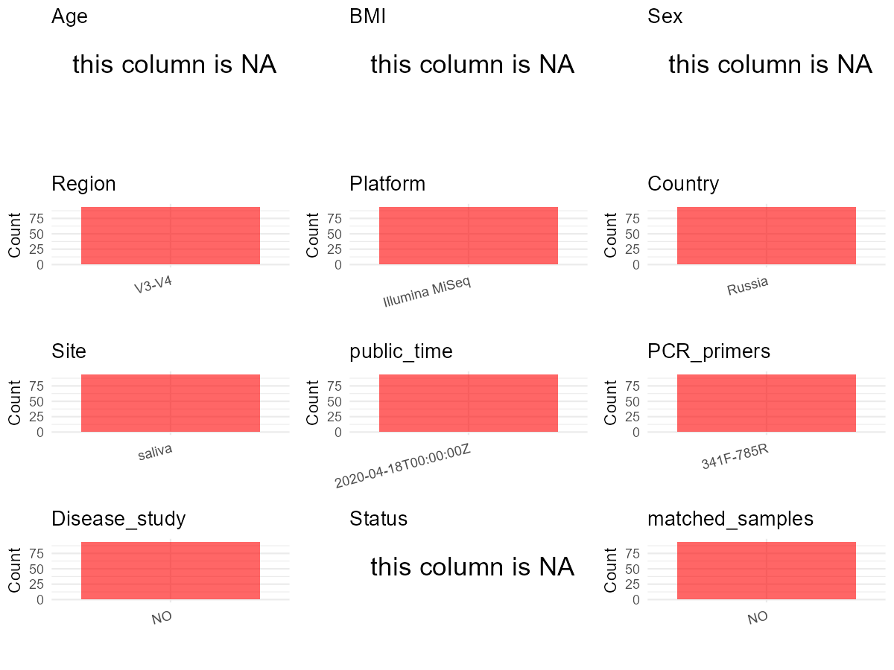

R Notebook: Metadata Processing Workflow
================

# Step 1: Obtain Initial Metadata from Each Project

To obtain the initial metadata: 1. Search for the BioProject ID (e.g.,
“PRJEBXXXX”) on the [NCBI SRA
website](https://www.ncbi.nlm.nih.gov/Traces/study/). 2. In the “Select”
table, click on “Metadata” and download the file. 3. The downloaded file
is typically named “SraRunTable.csv” and contains metadata for the
project.

``` r
# Load necessary libraries
library(dplyr)
library(ggplot2)
library(cowplot)

# Set working directory (update this path to your local directory)
setwd("D:/studylearning/董彪师兄项目/任务/修改20250922/PRJEB36081")

# Read the initial metadata files
initial_meta<-read.csv("SraRunTable.csv",header = T)

# Display the first few rows of the metadata
head(initial_meta)
```

    ##          Run Assay.Type AvgSpotLen    Bases BioProject    BioSample    Bytes
    ## 1 ERR4031018   AMPLICON        559 71491601 PRJEB36081 SAMEA6627350 45119210
    ## 2 ERR4031019   AMPLICON        559 48641287 PRJEB36081 SAMEA6627351 30725001
    ## 3 ERR4031020   AMPLICON        559 65332941 PRJEB36081 SAMEA6627352 41214483
    ## 4 ERR4031021   AMPLICON        559 74203622 PRJEB36081 SAMEA6627353 46603553
    ## 5 ERR4031022   AMPLICON        559 59621536 PRJEB36081 SAMEA6627354 37648281
    ## 6 ERR4031023   AMPLICON        559 67920377 PRJEB36081 SAMEA6627355 42996561
    ##              Center.Name Collection_Date Consent DATASTORE.filetype
    ## 1 UNIVERSITY OF FLORENCE      2010-06-03  public   fastq,run.zq,sra
    ## 2 UNIVERSITY OF FLORENCE      2010-06-03  public   fastq,run.zq,sra
    ## 3 UNIVERSITY OF FLORENCE      2010-06-03  public   fastq,run.zq,sra
    ## 4 UNIVERSITY OF FLORENCE      2010-06-03  public   fastq,run.zq,sra
    ## 5 UNIVERSITY OF FLORENCE      2010-06-03  public   fastq,run.zq,sra
    ## 6 UNIVERSITY OF FLORENCE      2010-06-03  public   fastq,run.zq,sra
    ##   DATASTORE.provider                     DATASTORE.region
    ## 1         gs,ncbi,s3 gs.us-east1,ncbi.public,s3.us-east-1
    ## 2         gs,ncbi,s3 gs.us-east1,ncbi.public,s3.us-east-1
    ## 3         gs,ncbi,s3 gs.us-east1,ncbi.public,s3.us-east-1
    ## 4         gs,ncbi,s3 gs.us-east1,ncbi.public,s3.us-east-1
    ## 5         gs,ncbi,s3 gs.us-east1,ncbi.public,s3.us-east-1
    ## 6         gs,ncbi,s3 gs.us-east1,ncbi.public,s3.us-east-1
    ##   ENA.FIRST.PUBLIC..run.     ena_first_public ENA.LAST.UPDATE..run.
    ## 1             2020-04-17 2020-04-17T17:04:53Z            2020-04-17
    ## 2             2020-04-17 2020-04-17T17:04:53Z            2020-04-17
    ## 3             2020-04-17 2020-04-17T17:04:53Z            2020-04-17
    ## 4             2020-04-17 2020-04-17T17:04:53Z            2020-04-17
    ## 5             2020-04-17 2020-04-17T17:04:53Z            2020-04-17
    ## 6             2020-04-17 2020-04-17T17:04:53Z            2020-04-17
    ##        ena_last_update environment_.biome. environment_.feature.
    ## 1 2020-03-18T11:11:16Z   mouth environment bodily fluid material
    ## 2 2020-03-18T11:11:16Z   mouth environment bodily fluid material
    ## 3 2020-03-18T11:11:16Z   mouth environment bodily fluid material
    ## 4 2020-03-18T11:11:16Z   mouth environment bodily fluid material
    ## 5 2020-03-18T11:11:16Z   mouth environment bodily fluid material
    ## 6 2020-03-18T11:11:16Z   mouth environment bodily fluid material
    ##   environment_.material. Experiment  external_id geo_loc_name_country
    ## 1        saliva material ERX4032318 SAMEA6627350               Russia
    ## 2        saliva material ERX4032319 SAMEA6627351               Russia
    ## 3        saliva material ERX4032320 SAMEA6627352               Russia
    ## 4        saliva material ERX4032321 SAMEA6627353               Russia
    ## 5        saliva material ERX4032322 SAMEA6627354               Russia
    ## 6        saliva material ERX4032323 SAMEA6627355               Russia
    ##   geo_loc_name_country_continent geographic_location_.country_and.or_sea.
    ## 1                         Europe                                   Russia
    ## 2                         Europe                                   Russia
    ## 3                         Europe                                   Russia
    ## 4                         Europe                                   Russia
    ## 5                         Europe                                   Russia
    ## 6                         Europe                                   Russia
    ##   geographic_location_.latitude. geographic_location_.longitude.
    ## 1                       55.77962                          37.524
    ## 2                       55.77962                          37.524
    ## 3                       55.77962                          37.524
    ## 4                       55.77962                          37.524
    ## 5                       55.77962                          37.524
    ## 6                       55.77962                          37.524
    ##   human_oral_environmental_package      INSDC_center_name   INSDC_first_public
    ## 1                       human-oral UNIVERSITY OF FLORENCE 2020-04-17T17:04:53Z
    ## 2                       human-oral UNIVERSITY OF FLORENCE 2020-04-17T17:04:53Z
    ## 3                       human-oral UNIVERSITY OF FLORENCE 2020-04-17T17:04:53Z
    ## 4                       human-oral UNIVERSITY OF FLORENCE 2020-04-17T17:04:53Z
    ## 5                       human-oral UNIVERSITY OF FLORENCE 2020-04-17T17:04:53Z
    ## 6                       human-oral UNIVERSITY OF FLORENCE 2020-04-17T17:04:53Z
    ##      INSDC_last_update INSDC_status     Instrument investigation_type
    ## 1 2020-03-18T11:11:16Z       public Illumina MiSeq         metagenome
    ## 2 2020-03-18T11:11:16Z       public Illumina MiSeq         metagenome
    ## 3 2020-03-18T11:11:16Z       public Illumina MiSeq         metagenome
    ## 4 2020-03-18T11:11:16Z       public Illumina MiSeq         metagenome
    ## 5 2020-03-18T11:11:16Z       public Illumina MiSeq         metagenome
    ## 6 2020-03-18T11:11:16Z       public Illumina MiSeq         metagenome
    ##   Library.Name LibraryLayout LibrarySelection LibrarySource
    ## 1  unspecified        PAIRED              PCR   METAGENOMIC
    ## 2  unspecified        PAIRED              PCR   METAGENOMIC
    ## 3  unspecified        PAIRED              PCR   METAGENOMIC
    ## 4  unspecified        PAIRED              PCR   METAGENOMIC
    ## 5  unspecified        PAIRED              PCR   METAGENOMIC
    ## 6  unspecified        PAIRED              PCR   METAGENOMIC
    ##                  Organism Platform
    ## 1 human saliva metagenome ILLUMINA
    ## 2 human saliva metagenome ILLUMINA
    ## 3 human saliva metagenome ILLUMINA
    ## 4 human saliva metagenome ILLUMINA
    ## 5 human saliva metagenome ILLUMINA
    ## 6 human saliva metagenome ILLUMINA
    ##                                                                                                                             project_name
    ## 1 Defining the resilience of the human salivary microbiota by a 520 days longitudinal study in confined environment: the Mars500 mission
    ## 2 Defining the resilience of the human salivary microbiota by a 520 days longitudinal study in confined environment: the Mars500 mission
    ## 3 Defining the resilience of the human salivary microbiota by a 520 days longitudinal study in confined environment: the Mars500 mission
    ## 4 Defining the resilience of the human salivary microbiota by a 520 days longitudinal study in confined environment: the Mars500 mission
    ## 5 Defining the resilience of the human salivary microbiota by a 520 days longitudinal study in confined environment: the Mars500 mission
    ## 6 Defining the resilience of the human salivary microbiota by a 520 days longitudinal study in confined environment: the Mars500 mission
    ##            ReleaseDate          create_date version  Sample.Name   Sample_name
    ## 1 2020-04-18T00:00:00Z 2020-04-22T18:30:00Z       2 SAMEA6627350 Mars500_79445
    ## 2 2020-04-18T00:00:00Z 2020-04-22T18:30:00Z       2 SAMEA6627351 Mars500_79446
    ## 3 2020-04-18T00:00:00Z 2020-04-22T18:31:00Z       2 SAMEA6627352 Mars500_79447
    ## 4 2020-04-18T00:00:00Z 2020-04-22T18:31:00Z       2 SAMEA6627353 Mars500_79448
    ## 5 2020-04-18T00:00:00Z 2020-04-22T18:31:00Z       2 SAMEA6627354 Mars500_79449
    ## 6 2020-04-18T00:00:00Z 2020-04-22T18:31:00Z       2 SAMEA6627355 Mars500_79450
    ##           Scientific_Name Sequencing_method SRA.Study  Submitter_Id
    ## 1 human saliva metagenome          Illumina ERP119217 Mars500_79445
    ## 2 human saliva metagenome          Illumina ERP119217 Mars500_79446
    ## 3 human saliva metagenome          Illumina ERP119217 Mars500_79447
    ## 4 human saliva metagenome          Illumina ERP119217 Mars500_79448
    ## 5 human saliva metagenome          Illumina ERP119217 Mars500_79449
    ## 6 human saliva metagenome          Illumina ERP119217 Mars500_79450

# Step 2: Create a Uniform Metadata Template

The uniform metadata should include the following columns:

1.  **BioProject**: Project ID (e.g., “PRJNA339212”)
2.  **Run**: Sample ID (e.g., “ERRXXXXXX” or “SRRXXXXXX”)
3.  **sample_name**: Original sample name submitted by the authors (not
    the database-assigned ID)
4.  **Age**: Age of the subject (if available)
5.  **BMI**: Body Mass Index (if available)
6.  **Sex**: Sex of the subject (“F” or “M”)
7.  **Region**: Targeted 16S rRNA region (e.g., “V3-V4”)
8.  **Platform**: Sequencing platform (e.g., “Illumina MiSeq”)
9.  **Country**: Country of sample origin (e.g., “China”)
10. **Site**: Sample site (e.g., “saliva”, “dental plaque”)
11. **public_time**: Data release date (format: “YYYY-MM-DD”)
12. **PCR_primers**: PCR primers used (e.g., “515F-806R”)
13. **title**: Title of the associated publication
14. **Disease_study**: Whether the study involves a disease (“YES” or
    “NO”)
15. **Status**: Disease status (e.g., “T2DM”, “HC”). Note: If the study
    includes both disease and healthy samples, this must be specified
    per sample.

``` r
# Create a uniform metadata dataframe
metadata <- data.frame(
  BioProject = initial_meta$BioProject,
  Run = initial_meta$Run,
  sample_name = initial_meta$Sample_name,
  Age = NA,
  BMI = NA,
  Sex=  NA,
  Region = "V3-V4",
  Platform = initial_meta$Instrument,
  Country = initial_meta$geo_loc_name_country,
  Site = initial_meta$environment_.material.,
  public_time = initial_meta$ReleaseDate,
  stringsAsFactors = FALSE
)
```

# Step 3: Manually Add Information from the Publication

Some information (e.g. PCR primers, study title, disease status) must be
manually extracted from the publication and added to the metadata.

``` r
# Add information obtained from the publication
metadata$PCR_primers <- "341F-785R"  # Update based on the publication
metadata$title <- "Defining the resilience of the human salivary microbiota by a 520-day longitudinal study in a confined environment: the Mars500 mission"
metadata$Disease_study <- "NO"
metadata$Status <- NA_character_
metadata <- metadata %>%
  mutate(Site = case_when(
    grepl("saliva material", Site) ~ "saliva"
  ))

# Check initial data distribution
cat("Initial sample distribution:\n")
```

    ## Initial sample distribution:

``` r
table(metadata$sample_name)
```

    ## 
    ## Mars500_79445 Mars500_79446 Mars500_79447 Mars500_79448 Mars500_79449 
    ##             1             1             1             1             1 
    ## Mars500_79450 Mars500_79451 Mars500_79452 Mars500_79453 Mars500_79454 
    ##             1             1             1             1             1 
    ## Mars500_79455 Mars500_79456 Mars500_79457 Mars500_79458 Mars500_79459 
    ##             1             1             1             1             1 
    ## Mars500_79460 Mars500_79461 Mars500_79462 Mars500_79463 Mars500_79464 
    ##             1             1             1             1             1 
    ## Mars500_79465 Mars500_79466 Mars500_79467 Mars500_79468 Mars500_79469 
    ##             1             1             1             1             1 
    ## Mars500_79470 Mars500_79471 Mars500_79472 Mars500_79473 Mars500_79474 
    ##             1             1             1             1             1 
    ## Mars500_79475 Mars500_79476 Mars500_79477 Mars500_79478 Mars500_79479 
    ##             1             1             1             1             1 
    ## Mars500_79480 Mars500_79481 Mars500_79482 Mars500_79483 Mars500_79484 
    ##             1             1             1             1             1 
    ## Mars500_79485 Mars500_79486 Mars500_79487 Mars500_79488 Mars500_79489 
    ##             1             1             1             1             1 
    ## Mars500_79490 Mars500_79491 Mars500_79492 Mars500_79493 Mars500_79494 
    ##             1             1             1             1             1 
    ## Mars500_79495 Mars500_79496 Mars500_79497 Mars500_79498 Mars500_79499 
    ##             1             1             1             1             1 
    ## Mars500_79500 Mars500_79501 Mars500_79502 Mars500_79503 Mars500_79504 
    ##             1             1             1             1             1 
    ## Mars500_79505 Mars500_79506 Mars500_79507 Mars500_79508 Mars500_79509 
    ##             1             1             1             1             1 
    ## Mars500_79510 Mars500_79511 Mars500_79512 Mars500_79513 Mars500_79514 
    ##             1             1             1             1             1 
    ## Mars500_79515 Mars500_79516 Mars500_79517 Mars500_79518 Mars500_79519 
    ##             1             1             1             1             1 
    ## Mars500_79520 Mars500_79521 Mars500_79522 Mars500_79523 Mars500_79524 
    ##             1             1             1             1             1 
    ## Mars500_79525 Mars500_79526 Mars500_79527 Mars500_79528 Mars500_79529 
    ##             1             1             1             1             1 
    ## Mars500_79530 Mars500_79531 Mars500_79532 Mars500_79533 Mars500_79534 
    ##             1             1             1             1             1 
    ## Mars500_79535 Mars500_79536 Mars500_79537 Mars500_79538 
    ##             1             1             1             1

``` r
table(metadata$Site)
```

    ## 
    ## saliva 
    ##     94

``` r
# Calculate sampling frequency per subject
sample_counts <- table(metadata$sample_name)
cat("\nNumber of samples per subject:\n")
```

    ## 
    ## Number of samples per subject:

``` r
print(sample_counts)
```

    ## 
    ## Mars500_79445 Mars500_79446 Mars500_79447 Mars500_79448 Mars500_79449 
    ##             1             1             1             1             1 
    ## Mars500_79450 Mars500_79451 Mars500_79452 Mars500_79453 Mars500_79454 
    ##             1             1             1             1             1 
    ## Mars500_79455 Mars500_79456 Mars500_79457 Mars500_79458 Mars500_79459 
    ##             1             1             1             1             1 
    ## Mars500_79460 Mars500_79461 Mars500_79462 Mars500_79463 Mars500_79464 
    ##             1             1             1             1             1 
    ## Mars500_79465 Mars500_79466 Mars500_79467 Mars500_79468 Mars500_79469 
    ##             1             1             1             1             1 
    ## Mars500_79470 Mars500_79471 Mars500_79472 Mars500_79473 Mars500_79474 
    ##             1             1             1             1             1 
    ## Mars500_79475 Mars500_79476 Mars500_79477 Mars500_79478 Mars500_79479 
    ##             1             1             1             1             1 
    ## Mars500_79480 Mars500_79481 Mars500_79482 Mars500_79483 Mars500_79484 
    ##             1             1             1             1             1 
    ## Mars500_79485 Mars500_79486 Mars500_79487 Mars500_79488 Mars500_79489 
    ##             1             1             1             1             1 
    ## Mars500_79490 Mars500_79491 Mars500_79492 Mars500_79493 Mars500_79494 
    ##             1             1             1             1             1 
    ## Mars500_79495 Mars500_79496 Mars500_79497 Mars500_79498 Mars500_79499 
    ##             1             1             1             1             1 
    ## Mars500_79500 Mars500_79501 Mars500_79502 Mars500_79503 Mars500_79504 
    ##             1             1             1             1             1 
    ## Mars500_79505 Mars500_79506 Mars500_79507 Mars500_79508 Mars500_79509 
    ##             1             1             1             1             1 
    ## Mars500_79510 Mars500_79511 Mars500_79512 Mars500_79513 Mars500_79514 
    ##             1             1             1             1             1 
    ## Mars500_79515 Mars500_79516 Mars500_79517 Mars500_79518 Mars500_79519 
    ##             1             1             1             1             1 
    ## Mars500_79520 Mars500_79521 Mars500_79522 Mars500_79523 Mars500_79524 
    ##             1             1             1             1             1 
    ## Mars500_79525 Mars500_79526 Mars500_79527 Mars500_79528 Mars500_79529 
    ##             1             1             1             1             1 
    ## Mars500_79530 Mars500_79531 Mars500_79532 Mars500_79533 Mars500_79534 
    ##             1             1             1             1             1 
    ## Mars500_79535 Mars500_79536 Mars500_79537 Mars500_79538 
    ##             1             1             1             1

``` r
# Create matched_samples column
metadata$matched_samples <- ifelse(metadata$sample_name %in% names(sample_counts[sample_counts >= 2]), "YES", "NO")

cat("\nMatched samples distribution:\n")
```

    ## 
    ## Matched samples distribution:

``` r
table(metadata$matched_samples)
```

    ## 
    ## NO 
    ## 94

``` r
# Identify samples for removal: single samples excluding saliva
single_samples <- names(sample_counts[sample_counts == 1])
samples_to_remove <- metadata$sample_name %in% single_samples & !(metadata$Site %in% c("saliva"))

cat("\nNumber of samples to be removed:", sum(samples_to_remove), "\n")
```

    ## 
    ## Number of samples to be removed: 0

``` r
# Remove identified samples
metadata_clean <- metadata[!samples_to_remove, ]

cat("\nFinal sample distribution after cleaning:\n")
```

    ## 
    ## Final sample distribution after cleaning:

``` r
table(metadata_clean$sample_name)
```

    ## 
    ## Mars500_79445 Mars500_79446 Mars500_79447 Mars500_79448 Mars500_79449 
    ##             1             1             1             1             1 
    ## Mars500_79450 Mars500_79451 Mars500_79452 Mars500_79453 Mars500_79454 
    ##             1             1             1             1             1 
    ## Mars500_79455 Mars500_79456 Mars500_79457 Mars500_79458 Mars500_79459 
    ##             1             1             1             1             1 
    ## Mars500_79460 Mars500_79461 Mars500_79462 Mars500_79463 Mars500_79464 
    ##             1             1             1             1             1 
    ## Mars500_79465 Mars500_79466 Mars500_79467 Mars500_79468 Mars500_79469 
    ##             1             1             1             1             1 
    ## Mars500_79470 Mars500_79471 Mars500_79472 Mars500_79473 Mars500_79474 
    ##             1             1             1             1             1 
    ## Mars500_79475 Mars500_79476 Mars500_79477 Mars500_79478 Mars500_79479 
    ##             1             1             1             1             1 
    ## Mars500_79480 Mars500_79481 Mars500_79482 Mars500_79483 Mars500_79484 
    ##             1             1             1             1             1 
    ## Mars500_79485 Mars500_79486 Mars500_79487 Mars500_79488 Mars500_79489 
    ##             1             1             1             1             1 
    ## Mars500_79490 Mars500_79491 Mars500_79492 Mars500_79493 Mars500_79494 
    ##             1             1             1             1             1 
    ## Mars500_79495 Mars500_79496 Mars500_79497 Mars500_79498 Mars500_79499 
    ##             1             1             1             1             1 
    ## Mars500_79500 Mars500_79501 Mars500_79502 Mars500_79503 Mars500_79504 
    ##             1             1             1             1             1 
    ## Mars500_79505 Mars500_79506 Mars500_79507 Mars500_79508 Mars500_79509 
    ##             1             1             1             1             1 
    ## Mars500_79510 Mars500_79511 Mars500_79512 Mars500_79513 Mars500_79514 
    ##             1             1             1             1             1 
    ## Mars500_79515 Mars500_79516 Mars500_79517 Mars500_79518 Mars500_79519 
    ##             1             1             1             1             1 
    ## Mars500_79520 Mars500_79521 Mars500_79522 Mars500_79523 Mars500_79524 
    ##             1             1             1             1             1 
    ## Mars500_79525 Mars500_79526 Mars500_79527 Mars500_79528 Mars500_79529 
    ##             1             1             1             1             1 
    ## Mars500_79530 Mars500_79531 Mars500_79532 Mars500_79533 Mars500_79534 
    ##             1             1             1             1             1 
    ## Mars500_79535 Mars500_79536 Mars500_79537 Mars500_79538 
    ##             1             1             1             1

``` r
table(metadata_clean$Site)
```

    ## 
    ## saliva 
    ##     94

``` r
table(metadata_clean$matched_samples)
```

    ## 
    ## NO 
    ## 94

``` r
# Use cleaned dataset for subsequent analysis
metadata <- metadata_clean
```

# Step 4: Summarize and Validate the Metadata

``` r
# Check the number of unique runs and sample names
print(paste("Number of unique runs:", length(unique(metadata$Run))))
```

    ## [1] "Number of unique runs: 94"

``` r
print(paste("Number of unique sample names:", length(unique(metadata$sample_name))))
```

    ## [1] "Number of unique sample names: 94"

# Step 5: Visualize the Metadata

``` r

```


# Step 6: Finalize and Export the Metadata

``` r
# Reorder columns to match the desired format
metadata <- metadata[, c(
  "BioProject", "Run", "sample_name", "Age", "BMI", "Sex", 
  "Region", "Platform", "Country", "Site", "public_time", 
  "PCR_primers", "title", "Disease_study", "Status","matched_samples"
)]

# Export the uniform metadata to a CSV file
write.csv(metadata, file = "metadata.csv", quote = FALSE)
head(metadata)
```

    ##   BioProject        Run   sample_name Age BMI Sex Region       Platform Country
    ## 1 PRJEB36081 ERR4031018 Mars500_79445  NA  NA  NA  V3-V4 Illumina MiSeq  Russia
    ## 2 PRJEB36081 ERR4031019 Mars500_79446  NA  NA  NA  V3-V4 Illumina MiSeq  Russia
    ## 3 PRJEB36081 ERR4031020 Mars500_79447  NA  NA  NA  V3-V4 Illumina MiSeq  Russia
    ## 4 PRJEB36081 ERR4031021 Mars500_79448  NA  NA  NA  V3-V4 Illumina MiSeq  Russia
    ## 5 PRJEB36081 ERR4031022 Mars500_79449  NA  NA  NA  V3-V4 Illumina MiSeq  Russia
    ## 6 PRJEB36081 ERR4031023 Mars500_79450  NA  NA  NA  V3-V4 Illumina MiSeq  Russia
    ##     Site          public_time PCR_primers
    ## 1 saliva 2020-04-18T00:00:00Z   341F-785R
    ## 2 saliva 2020-04-18T00:00:00Z   341F-785R
    ## 3 saliva 2020-04-18T00:00:00Z   341F-785R
    ## 4 saliva 2020-04-18T00:00:00Z   341F-785R
    ## 5 saliva 2020-04-18T00:00:00Z   341F-785R
    ## 6 saliva 2020-04-18T00:00:00Z   341F-785R
    ##                                                                                                                                     title
    ## 1 Defining the resilience of the human salivary microbiota by a 520-day longitudinal study in a confined environment: the Mars500 mission
    ## 2 Defining the resilience of the human salivary microbiota by a 520-day longitudinal study in a confined environment: the Mars500 mission
    ## 3 Defining the resilience of the human salivary microbiota by a 520-day longitudinal study in a confined environment: the Mars500 mission
    ## 4 Defining the resilience of the human salivary microbiota by a 520-day longitudinal study in a confined environment: the Mars500 mission
    ## 5 Defining the resilience of the human salivary microbiota by a 520-day longitudinal study in a confined environment: the Mars500 mission
    ## 6 Defining the resilience of the human salivary microbiota by a 520-day longitudinal study in a confined environment: the Mars500 mission
    ##   Disease_study Status matched_samples
    ## 1            NO   <NA>              NO
    ## 2            NO   <NA>              NO
    ## 3            NO   <NA>              NO
    ## 4            NO   <NA>              NO
    ## 5            NO   <NA>              NO
    ## 6            NO   <NA>              NO

## Notes for Students:

1.  **Metadata Accuracy**: Always cross-check the metadata with the
    original publication to ensure accuracy.
2.  **Manual Entries**: Columns like `PCR_primers`, and `Status` often
    require manual entry based on the publication.
3.  **Disease Status**: Be careful when assigning `Status`—some studies
    include both disease and healthy samples.
4.  **Visualization**: The plots help quickly identify the distribution
    of values in each column, which is useful for quality control.
5.  **Reproducibility**: Update the working directory and file paths to
    match your local environment.
