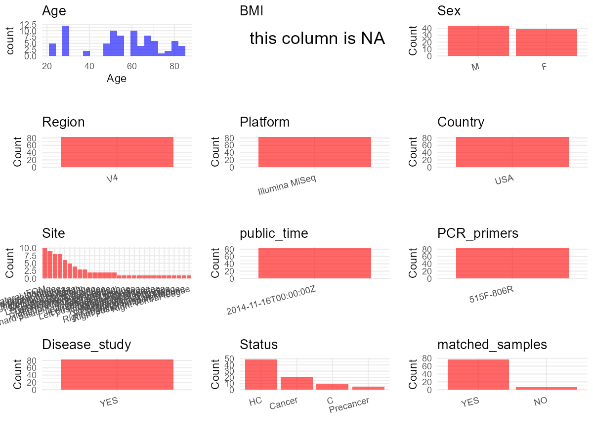

R Notebook: Metadata Processing Workflow
================

# Step 1: Obtain Initial Metadata from Each Project

To obtain the initial metadata: 1. Search for the BioProject ID (e.g.,
“PRJEBXXXX”) on the [NCBI SRA
website](https://www.ncbi.nlm.nih.gov/Traces/study/). 2. In the “Select”
table, click on “Metadata” and download the file. 3. The downloaded file
is typically named “SraRunTable.csv” and contains metadata for the
project.

``` r
# Load necessary libraries
library(dplyr)
library(ggplot2)
library(cowplot)

# Set working directory (update this path to your local directory)
setwd("D:/studylearning/董彪师兄项目/任务/修改20250922/PRJEB4953")

# Read the initial metadata files
initial_meta<-read.csv("SraRunTable.csv",header = T)
initial_meta <- subset(initial_meta,Assay.Type=="AMPLICON")
library(readxl)
pone010 <- read_excel("pone.0098741.s010.xlsx",skip = 1)
colnames(pone010)[1] <- "SG Number"
pone010 <- pone010[,c("SG Number","Sample name","Patient id","sample type","Age","Sex","Site")]
pone011 <- read_excel("pone.0098741.s011.xlsx",skip = 1)
pone011 <- pone011[,c("SG Number","Sample name","Patient id","sample type","Age","Sex","Site")]
pone012 <- read_excel("pone.0098741.s012.xlsx",skip = 1)
colnames(pone012)[colnames(pone012)=="Diagnosis"] <- "sample type"
pone012 <- pone012[,c("SG Number","Sample name","Patient id","sample type","Age","Sex","Site")]
pone013 <- read_excel("pone.0098741.s013.xlsx",skip = 1)
pone013 <- pone013[,c("SG Number","Sample name","Patient id","sample type","Age","Sex","Site")]
pone014 <- read_excel("pone.0098741.s014.xlsx",skip = 1)
pone014 <- pone014[,c("SG Number","Sample name","Patient id","sample type")]
pone014$Age <- NA_character_
pone014$Sex <- NA_character_
pone014$Site <- NA_character_
poneall <- rbind(pone010,pone011,pone012,pone013,pone014)
poneall <- poneall %>%
  group_by(`Patient id`) %>% # 根据Patient id分组
  mutate(
    Age = first(na.omit(Age)), # 取该组内第一个非NA的Age值
    Sex = first(na.omit(Sex))  # 取该组内第一个非NA的Sex值
  ) %>%
  ungroup()
poneall <- poneall %>%
  mutate(
    # 创建分组ID（只对第一个字符为p的样本）
    group_id = ifelse(substr(`Sample name`, 1, 1) == "p", 
                      substr(`Sample name`, 1, 5), 
                      NA)
  ) %>%
  group_by(group_id) %>%
  mutate(
    # 只对分组内的行（即第一个字符为p的行）统一Site值
    Site = ifelse(!is.na(group_id), first(na.omit(Site)), Site)
  ) %>%
  ungroup() %>%
  select(-group_id)
initial_meta_cbind <- initial_meta %>%
  left_join(
    poneall %>% mutate(`SG Number` = gsub("-", "_", `SG Number`)),
    by = c("Sequencing_method" = "SG Number")
  )
initial_meta_cbind <- subset(initial_meta_cbind,!is.na(Age))
head(initial_meta_cbind)
```

    ##         Run Assay.Type AvgSpotLen    Bases BioProject    BioSample    Bytes
    ## 1 ERR368845   AMPLICON        500 46024500  PRJEB4953 SAMEA2247951 27130637
    ## 2 ERR368846   AMPLICON        500 34092500  PRJEB4953 SAMEA2247952 20015260
    ## 3 ERR368847   AMPLICON        500 31246500  PRJEB4953 SAMEA2247953 18328384
    ## 4 ERR368848   AMPLICON        500 23074500  PRJEB4953 SAMEA2247954 13976623
    ## 5 ERR368849   AMPLICON        500 48828000  PRJEB4953 SAMEA2247955 28779580
    ## 6 ERR368850   AMPLICON        500 26033500  PRJEB4953 SAMEA2247956 15668772
    ##    Center.Name Collection_Date Consent DATASTORE.filetype DATASTORE.provider
    ## 1 SECONDGENOME      2012-03-01  public   fastq,run.zq,sra     ena,gs,ncbi,s3
    ## 2 SECONDGENOME      2012-03-01  public   fastq,run.zq,sra     ena,gs,ncbi,s3
    ## 3 SECONDGENOME      2012-03-01  public   fastq,run.zq,sra     ena,gs,ncbi,s3
    ## 4 SECONDGENOME      2012-03-01  public   fastq,run.zq,sra     ena,gs,ncbi,s3
    ## 5 SECONDGENOME      2012-03-01  public   fastq,run.zq,sra     ena,gs,ncbi,s3
    ## 6 SECONDGENOME      2012-03-01  public   fastq,run.zq,sra     ena,gs,ncbi,s3
    ##                           DATASTORE.region Experiment     Instrument
    ## 1 ena,gs.us-east1,ncbi.public,s3.us-east-1  ERX341554 Illumina MiSeq
    ## 2 ena,gs.us-east1,ncbi.public,s3.us-east-1  ERX341555 Illumina MiSeq
    ## 3 ena,gs.us-east1,ncbi.public,s3.us-east-1  ERX341556 Illumina MiSeq
    ## 4 ena,gs.us-east1,ncbi.public,s3.us-east-1  ERX341557 Illumina MiSeq
    ## 5 ena,gs.us-east1,ncbi.public,s3.us-east-1  ERX341558 Illumina MiSeq
    ## 6 ena,gs.us-east1,ncbi.public,s3.us-east-1  ERX341559 Illumina MiSeq
    ##   Library.Name LibraryLayout LibrarySelection LibrarySource
    ## 1  EPAN12-0117        PAIRED              PCR   METAGENOMIC
    ## 2  EPAN12-0117        PAIRED              PCR   METAGENOMIC
    ## 3  EPAN12-0117        PAIRED              PCR   METAGENOMIC
    ## 4  EPAN12-0117        PAIRED              PCR   METAGENOMIC
    ## 5  EPAN12-0117        PAIRED              PCR   METAGENOMIC
    ## 6  EPAN12-0117        PAIRED              PCR   METAGENOMIC
    ##                Organism Platform          ReleaseDate  Sample.Name SRA.Study
    ## 1 human oral metagenome ILLUMINA 2014-11-16T00:00:00Z SAMEA2247951 ERP004294
    ## 2 human oral metagenome ILLUMINA 2014-11-16T00:00:00Z SAMEA2247952 ERP004294
    ## 3 human oral metagenome ILLUMINA 2014-11-16T00:00:00Z SAMEA2247953 ERP004294
    ## 4 human oral metagenome ILLUMINA 2014-11-16T00:00:00Z SAMEA2247954 ERP004294
    ## 5 human oral metagenome ILLUMINA 2014-11-16T00:00:00Z SAMEA2247955 ERP004294
    ## 6 human oral metagenome ILLUMINA 2014-11-16T00:00:00Z SAMEA2247956 ERP004294
    ##            create_date version ENA.FIRST.PUBLIC..run. ENA_first_public
    ## 1 2014-11-16T01:10:00Z       1             2014-11-15       2014-11-15
    ## 2 2014-11-16T01:10:00Z       1             2014-11-15       2014-11-15
    ## 3 2014-11-16T01:10:00Z       1             2014-11-15       2014-11-15
    ## 4 2014-11-16T01:12:00Z       1             2014-11-15       2014-11-15
    ## 5 2014-11-16T01:14:00Z       1             2014-11-15       2014-11-15
    ## 6 2014-11-16T01:11:00Z       1             2014-11-15       2014-11-15
    ##   ENA.LAST.UPDATE..run. ena_last_update environment_.biome.
    ## 1            2018-11-16      2016-10-21               Human
    ## 2            2018-11-16      2016-10-21               Human
    ## 3            2018-11-16      2016-10-21               Human
    ## 4            2018-11-16      2016-10-21               Human
    ## 5            2018-11-16      2016-10-21               Human
    ## 6            2018-11-16      2016-10-21               Human
    ##   environment_.feature. environment_.material.  external_id
    ## 1       Oral Metagenome              Oral Swab SAMEA2247951
    ## 2       Oral Metagenome              Oral Swab SAMEA2247952
    ## 3       Oral Metagenome              Oral Swab SAMEA2247953
    ## 4       Oral Metagenome              Oral Swab SAMEA2247954
    ## 5       Oral Metagenome              Oral Swab SAMEA2247955
    ## 6       Oral Metagenome              Oral Swab SAMEA2247956
    ##   geographic_location_.countryand.orsea region. geographic_location_.latitude.
    ## 1                                   USA    37.8                          122.4
    ## 2                                   USA    37.8                          122.4
    ## 3                                   USA    37.8                          122.4
    ## 4                                   USA    37.8                          122.4
    ## 5                                   USA    37.8                          122.4
    ## 6                                   USA    37.8                          122.4
    ##   geographic_location_.longitude. humam_oral_environmental_package
    ## 1                      human-oral                     SECONDGENOME
    ## 2                      human-oral                     SECONDGENOME
    ## 3                      human-oral                     SECONDGENOME
    ## 4                      human-oral                     SECONDGENOME
    ## 5                      human-oral                     SECONDGENOME
    ## 6                      human-oral                     SECONDGENOME
    ##   INSDC_center_alias    INSDC_center_name   INSDC_first_public
    ## 1 Second Genome Inc. 2014-11-15T17:02:24Z 2016-10-21T09:43:44Z
    ## 2 Second Genome Inc. 2014-11-15T17:02:24Z 2016-10-21T09:43:44Z
    ## 3 Second Genome Inc. 2014-11-15T17:02:24Z 2016-10-21T09:43:43Z
    ## 4 Second Genome Inc. 2014-11-15T17:02:24Z 2016-10-21T09:43:44Z
    ## 5 Second Genome Inc. 2014-11-15T17:02:24Z 2016-10-21T09:43:44Z
    ## 6 Second Genome Inc. 2014-11-15T17:02:24Z 2016-10-21T09:43:43Z
    ##   INSDC_last_update INSDC_status     investigation_type project_name
    ## 1            public   metagenome Oral Cancer Microbiome    PT12_4257
    ## 2            public   metagenome Oral Cancer Microbiome    PT12_4258
    ## 3            public   metagenome Oral Cancer Microbiome    PT12_4259
    ## 4            public   metagenome Oral Cancer Microbiome    PT12_4260
    ## 5            public   metagenome Oral Cancer Microbiome    PT12_4261
    ## 6            public   metagenome Oral Cancer Microbiome    PT12_4262
    ##             Sample_name Sequencing_method Submitter_Id alcohol_use
    ## 1 Illumina MiSeq 16S V4         PT12_4257                         
    ## 2 Illumina MiSeq 16S V4         PT12_4258                         
    ## 3 Illumina MiSeq 16S V4         PT12_4259                         
    ## 4 Illumina MiSeq 16S V4         PT12_4260                         
    ## 5 Illumina MiSeq 16S V4         PT12_4261                         
    ## 6 Illumina MiSeq 16S V4         PT12_4262                         
    ##   BioSampleModel env_biome env_feature env_material ethnicity
    ## 1                                                            
    ## 2                                                            
    ## 3                                                            
    ## 4                                                            
    ## 5                                                            
    ## 6                                                            
    ##   geo_loc_name_country geo_loc_name_country_continent geo_loc_name Host_age
    ## 1                                                               NA         
    ## 2                                                               NA         
    ## 3                                                               NA         
    ## 4                                                               NA         
    ## 5                                                               NA         
    ## 6                                                               NA         
    ##   Host_disease HOST host_sex host_subject_id host_tissue_sampled lat_lon
    ## 1                         NA                                            
    ## 2                         NA                                            
    ## 3                         NA                                            
    ## 4                         NA                                            
    ## 5                         NA                                            
    ## 6                         NA                                            
    ##   medic_hist_perform ref_biomaterial samp_collect_device source_material_id
    ## 1                                                                          
    ## 2                                                                          
    ## 3                                                                          
    ## 4                                                                          
    ## 5                                                                          
    ## 6                                                                          
    ##   tobacco_use Sample name Patient id sample type Age Sex
    ## 1          NA       p108C        108      Cancer  39   F
    ## 2          NA       p108N        108      Normal  39   F
    ## 3          NA       p104C        104      Cancer  55   F
    ## 4          NA       p104N        104      Normal  55   F
    ## 5          NA      p113C1        113      Cancer  62   M
    ## 6          NA      p113N1        113      Normal  62   M
    ##                          Site
    ## 1 Right lateral tongue corner
    ## 2        Left lateral  tongue
    ## 3        Right lateral tongue
    ## 4         Left lateral tongue
    ## 5         Right buccal mucosa
    ## 6          Left buccal mucosa

# Step 2: Create a Uniform Metadata Template

The uniform metadata should include the following columns:

1.  **BioProject**: Project ID (e.g., “PRJNA339212”)
2.  **Run**: Sample ID (e.g., “ERRXXXXXX” or “SRRXXXXXX”)
3.  **sample_name**: Original sample name submitted by the authors (not
    the database-assigned ID)
4.  **Age**: Age of the subject (if available)
5.  **BMI**: Body Mass Index (if available)
6.  **Sex**: Sex of the subject (“F” or “M”)
7.  **Region**: Targeted 16S rRNA region (e.g., “V3-V4”)
8.  **Platform**: Sequencing platform (e.g., “Illumina MiSeq”)
9.  **Country**: Country of sample origin (e.g., “China”)
10. **Site**: Sample site (e.g., “saliva”, “dental plaque”)
11. **public_time**: Data release date (format: “YYYY-MM-DD”)
12. **PCR_primers**: PCR primers used (e.g., “515F-806R”)
13. **title**: Title of the associated publication
14. **Disease_study**: Whether the study involves a disease (“YES” or
    “NO”)
15. **Status**: Disease status (e.g., “T2DM”, “HC”). Note: If the study
    includes both disease and healthy samples, this must be specified
    per sample.

``` r
# Create a uniform metadata dataframe
metadata <- data.frame(
  BioProject = initial_meta_cbind$BioProject,
  Run = initial_meta_cbind$Run,
  sample_name = initial_meta_cbind$`Sample name`,
  Age = initial_meta_cbind$Age,
  BMI = NA,
  Sex= initial_meta_cbind$Sex,
  Region = "V4",
  Platform = initial_meta_cbind$Instrument,
  Country = "USA",
  Site = initial_meta_cbind$Site,
  public_time = initial_meta_cbind$ReleaseDate,
  stringsAsFactors = FALSE
)
```

# Step 3: Manually Add Information from the Publication

Some information (e.g. PCR primers, study title, disease status) must be
manually extracted from the publication and added to the metadata.

``` r
# Add information obtained from the publication
metadata$PCR_primers <- "515F-806R"
metadata$title <- "Changes in Abundance of Oral Microbiota Associated with Oral Cancer"
metadata$Disease_study <- "YES"
metadata$Status <- initial_meta_cbind$`sample type`
metadata[which(metadata$Status=="precancer"),]$Status <- "Precancer"
metadata[which(metadata$Status=="Healthy normal"),]$Status <- "HC"
metadata[which(metadata$Status=="Normal"),]$Status <- "HC"
metadata <- metadata %>%
  mutate(Status = case_when(
    Status %in% c("Cancer", "Precancer", "HC") ~ Status,
    TRUE ~ "C"
  ))
print(table(metadata$Status))
```

    ## 
    ##         C    Cancer        HC Precancer 
    ##         9        20        49         5

``` r
metadata$Age <- as.numeric(metadata$Age)
metadata[which(metadata$Site=="Left lateral  tongue"),]$Site <- "Left lateral tongue"
metadata[which(metadata$Site=="Right lateral tongue corner"),]$Site <- "Right lateral tongue"
#extract subject id by remove prefix of sample_name
metadata$sample_name <- gsub("[[:alpha:]]", "", metadata$sample_name)

# Check initial data distribution
cat("Initial sample distribution:\n")
```

    ## Initial sample distribution:

``` r
table(metadata$sample_name)
```

    ## 
    ##  104 1051 1052 1053 1054  107  108 1091 1092 1111 1112 1131 1132  114 1141 1142 
    ##    2    2    2    1    1    2    2    2    2    2    2    2    2    1    1    1 
    ##  115  116  117 1181 1281 1282  131  135  136  139  142 1431 1432  144  146  147 
    ##    2    2    2    2    2    2    1    2    2    2    2    2    2    2    2    2 
    ##  150  153  156  159  160  161  162  163  164 
    ##    2    2    2    4    3    4    2    2    4

``` r
table(metadata$Site)
```

    ## 
    ##                     floor of mouth                                FOM 
    ##                                  1                                 10 
    ## hard palate 1 cm lateral to lesion                     Lateral tongue 
    ##                                  1                                  9 
    ##                Left alveolar ridge                 Left buccal mucosa 
    ##                                  2                                  6 
    ##              Left dorsum of tongue                Left floor of mouth 
    ##                                  1                                  3 
    ##                 Left labial mucosa                Left lateral tongue 
    ##                                  1                                  8 
    ##            Left mandibular gingiva            Left post mandible ging 
    ##                                  1                                  2 
    ##      Left posterior lateral tongue            Left retromolar trigone 
    ##                                  1                                  2 
    ##                Left ventral tongue          Lower right labial mucosa 
    ##                                  1                                  4 
    ##                Midline hard palate               Right alveolar ridge 
    ##                                  1                                  2 
    ##                Right buccal mucosa             Right dorsum of tongue 
    ##                                  5                                  1 
    ##               Right floor of mouth                Right labial mucosa 
    ##                                  3                                  1 
    ##               Right lateral tongue           Right mandibular gingiva 
    ##                                  8                                  1 
    ##            Right post maxilla ging     Right posterior base of tongue 
    ##                                  1                                  1 
    ##     Right posterior lateral tongue           Right retromolar trigone 
    ##                                  1                                  2 
    ##          Right upper buccal mucosa               Right ventral tongue 
    ##                                  2                                  1

``` r
# Calculate sampling frequency per subject
sample_counts <- table(metadata$sample_name)
cat("\nNumber of samples per subject:\n")
```

    ## 
    ## Number of samples per subject:

``` r
print(sample_counts)
```

    ## 
    ##  104 1051 1052 1053 1054  107  108 1091 1092 1111 1112 1131 1132  114 1141 1142 
    ##    2    2    2    1    1    2    2    2    2    2    2    2    2    1    1    1 
    ##  115  116  117 1181 1281 1282  131  135  136  139  142 1431 1432  144  146  147 
    ##    2    2    2    2    2    2    1    2    2    2    2    2    2    2    2    2 
    ##  150  153  156  159  160  161  162  163  164 
    ##    2    2    2    4    3    4    2    2    4

``` r
# Create matched_samples column
metadata$matched_samples <- ifelse(metadata$sample_name %in% names(sample_counts[sample_counts >= 2]), "YES", "NO")

cat("\nMatched samples distribution:\n")
```

    ## 
    ## Matched samples distribution:

``` r
table(metadata$matched_samples)
```

    ## 
    ##  NO YES 
    ##   6  77

``` r
# Identify samples for removal: single samples excluding "Right post maxilla ging","Left post mandible ging","Left post mandible ging","Right posterior base of tongue","Lower right labial mucosa" and "Lower right labial mucosa"
single_samples <- names(sample_counts[sample_counts == 1])
samples_to_remove <- metadata$sample_name %in% single_samples & !(metadata$Site %in% c("Right post maxilla ging","Left post mandible ging","Left post mandible ging","Right posterior base of tongue","Lower right labial mucosa","Lower right labial mucosa"))

cat("\nNumber of samples to be removed:", sum(samples_to_remove), "\n")
```

    ## 
    ## Number of samples to be removed: 0

``` r
# Remove identified samples
metadata_clean <- metadata[!samples_to_remove, ]

cat("\nFinal sample distribution after cleaning:\n")
```

    ## 
    ## Final sample distribution after cleaning:

``` r
table(metadata_clean$sample_name)
```

    ## 
    ##  104 1051 1052 1053 1054  107  108 1091 1092 1111 1112 1131 1132  114 1141 1142 
    ##    2    2    2    1    1    2    2    2    2    2    2    2    2    1    1    1 
    ##  115  116  117 1181 1281 1282  131  135  136  139  142 1431 1432  144  146  147 
    ##    2    2    2    2    2    2    1    2    2    2    2    2    2    2    2    2 
    ##  150  153  156  159  160  161  162  163  164 
    ##    2    2    2    4    3    4    2    2    4

``` r
table(metadata_clean$Site)
```

    ## 
    ##                     floor of mouth                                FOM 
    ##                                  1                                 10 
    ## hard palate 1 cm lateral to lesion                     Lateral tongue 
    ##                                  1                                  9 
    ##                Left alveolar ridge                 Left buccal mucosa 
    ##                                  2                                  6 
    ##              Left dorsum of tongue                Left floor of mouth 
    ##                                  1                                  3 
    ##                 Left labial mucosa                Left lateral tongue 
    ##                                  1                                  8 
    ##            Left mandibular gingiva            Left post mandible ging 
    ##                                  1                                  2 
    ##      Left posterior lateral tongue            Left retromolar trigone 
    ##                                  1                                  2 
    ##                Left ventral tongue          Lower right labial mucosa 
    ##                                  1                                  4 
    ##                Midline hard palate               Right alveolar ridge 
    ##                                  1                                  2 
    ##                Right buccal mucosa             Right dorsum of tongue 
    ##                                  5                                  1 
    ##               Right floor of mouth                Right labial mucosa 
    ##                                  3                                  1 
    ##               Right lateral tongue           Right mandibular gingiva 
    ##                                  8                                  1 
    ##            Right post maxilla ging     Right posterior base of tongue 
    ##                                  1                                  1 
    ##     Right posterior lateral tongue           Right retromolar trigone 
    ##                                  1                                  2 
    ##          Right upper buccal mucosa               Right ventral tongue 
    ##                                  2                                  1

``` r
table(metadata_clean$matched_samples)
```

    ## 
    ##  NO YES 
    ##   6  77

``` r
# Use cleaned dataset for subsequent analysis
metadata <- metadata_clean
```

# Step 4: Summarize and Validate the Metadata

``` r
# Check the number of unique runs and sample names
print(paste("Number of unique runs:", length(unique(metadata$Run))))
```

    ## [1] "Number of unique runs: 83"

``` r
print(paste("Number of unique sample names:", length(unique(metadata$sample_name))))
```

    ## [1] "Number of unique sample names: 41"

# Step 5: Visualize the Metadata

``` r

```


# Step 6: Finalize and Export the Metadata

``` r
# Reorder columns to match the desired format
metadata <- metadata[, c(
  "BioProject", "Run", "sample_name", "Age", "BMI", "Sex", 
  "Region", "Platform", "Country", "Site", "public_time", 
  "PCR_primers", "title", "Disease_study", "Status","matched_samples"
)]

# Export the uniform metadata to a CSV file
write.csv(metadata, file = "metadata.csv", quote = FALSE)
head(metadata)
```

    ##   BioProject       Run sample_name Age BMI Sex Region       Platform Country
    ## 1  PRJEB4953 ERR368845         108  39  NA   F     V4 Illumina MiSeq     USA
    ## 2  PRJEB4953 ERR368846         108  39  NA   F     V4 Illumina MiSeq     USA
    ## 3  PRJEB4953 ERR368847         104  55  NA   F     V4 Illumina MiSeq     USA
    ## 4  PRJEB4953 ERR368848         104  55  NA   F     V4 Illumina MiSeq     USA
    ## 5  PRJEB4953 ERR368849        1131  62  NA   M     V4 Illumina MiSeq     USA
    ## 6  PRJEB4953 ERR368850        1131  62  NA   M     V4 Illumina MiSeq     USA
    ##                   Site          public_time PCR_primers
    ## 1 Right lateral tongue 2014-11-16T00:00:00Z   515F-806R
    ## 2  Left lateral tongue 2014-11-16T00:00:00Z   515F-806R
    ## 3 Right lateral tongue 2014-11-16T00:00:00Z   515F-806R
    ## 4  Left lateral tongue 2014-11-16T00:00:00Z   515F-806R
    ## 5  Right buccal mucosa 2014-11-16T00:00:00Z   515F-806R
    ## 6   Left buccal mucosa 2014-11-16T00:00:00Z   515F-806R
    ##                                                                 title
    ## 1 Changes in Abundance of Oral Microbiota Associated with Oral Cancer
    ## 2 Changes in Abundance of Oral Microbiota Associated with Oral Cancer
    ## 3 Changes in Abundance of Oral Microbiota Associated with Oral Cancer
    ## 4 Changes in Abundance of Oral Microbiota Associated with Oral Cancer
    ## 5 Changes in Abundance of Oral Microbiota Associated with Oral Cancer
    ## 6 Changes in Abundance of Oral Microbiota Associated with Oral Cancer
    ##   Disease_study Status matched_samples
    ## 1           YES Cancer             YES
    ## 2           YES     HC             YES
    ## 3           YES Cancer             YES
    ## 4           YES     HC             YES
    ## 5           YES Cancer             YES
    ## 6           YES     HC             YES

## Notes for Students:

1.  **Metadata Accuracy**: Always cross-check the metadata with the
    original publication to ensure accuracy.
2.  **Manual Entries**: Columns like `PCR_primers`, and `Status` often
    require manual entry based on the publication.
3.  **Disease Status**: Be careful when assigning `Status`—some studies
    include both disease and healthy samples.
4.  **Visualization**: The plots help quickly identify the distribution
    of values in each column, which is useful for quality control.
5.  **Reproducibility**: Update the working directory and file paths to
    match your local environment.
