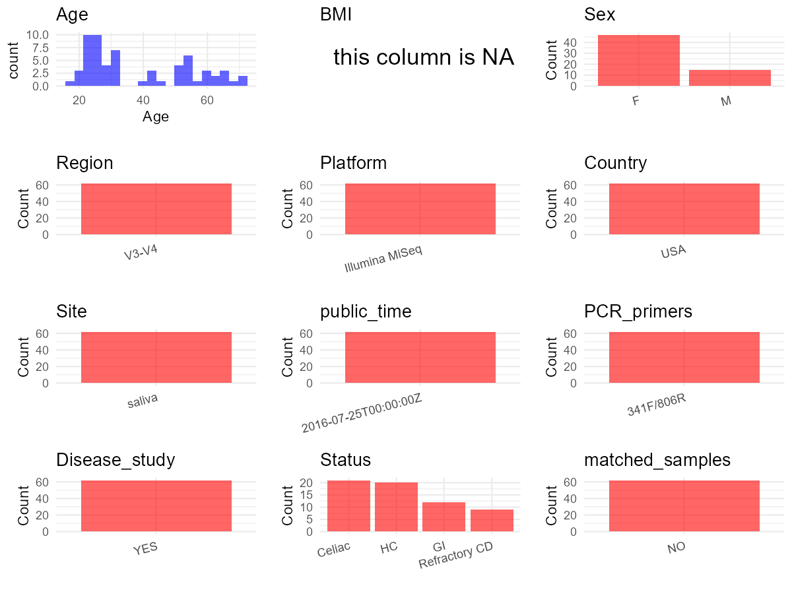

R Notebook: Metadata Processing Workflow
================

# Step 1: Obtain Initial Metadata from Each Project

To obtain the initial metadata: 1. Search for the BioProject ID (e.g.,
“PRJEBXXXX”) on the [NCBI SRA
website](https://www.ncbi.nlm.nih.gov/Traces/study/). 2. In the “Select”
table, click on “Metadata” and download the file. 3. The downloaded file
is typically named “SraRunTable.csv” and contains metadata for the
project.

``` r
# Load necessary libraries
library(dplyr)
library(ggplot2)
library(cowplot)

# Set working directory (update this path to your local directory)
setwd("D:/studylearning/董彪师兄项目/任务/修改20250922/PRJNA321349")

# Read the initial metadata files
initial_meta<-read.csv("SraRunTable.csv",header = T)

# Display the first few rows of the metadata
head(initial_meta)
```

    ##          Run AGE Assay.Type AvgSpotLen    Bases BIOMATERIAL_PROVIDER
    ## 1 SRR3932818  27   AMPLICON        419 47503929    Boston University
    ## 2 SRR3932819  31   AMPLICON        419 46590952    Boston University
    ## 3 SRR3932820  23   AMPLICON        421 23449634    Boston University
    ## 4 SRR3932821  58   AMPLICON        423 32691358    Boston University
    ## 5 SRR3932822  24   AMPLICON        421 24581703    Boston University
    ## 6 SRR3932823  23   AMPLICON        422 45831674    Boston University
    ##    BioProject    BioSample BioSampleModel    Bytes       Center.Name Consent
    ## 1 PRJNA321349 SAMN04992716          Human 23610421 BOSTON UNIVERSITY  public
    ## 2 PRJNA321349 SAMN04992717          Human 23199314 BOSTON UNIVERSITY  public
    ## 3 PRJNA321349 SAMN04992726          Human 11695664 BOSTON UNIVERSITY  public
    ## 4 PRJNA321349 SAMN04992727          Human 16357093 BOSTON UNIVERSITY  public
    ## 5 PRJNA321349 SAMN04992728          Human 12190812 BOSTON UNIVERSITY  public
    ## 6 PRJNA321349 SAMN04992729          Human 22905824 BOSTON UNIVERSITY  public
    ##   DATASTORE.filetype DATASTORE.provider                     DATASTORE.region
    ## 1   fastq,run.zq,sra         gs,ncbi,s3 gs.us-east1,ncbi.public,s3.us-east-1
    ## 2   fastq,run.zq,sra         gs,ncbi,s3 gs.us-east1,ncbi.public,s3.us-east-1
    ## 3   fastq,run.zq,sra         gs,ncbi,s3 gs.us-east1,ncbi.public,s3.us-east-1
    ## 4       fastq,run.zq         gs,ncbi,s3 gs.us-east1,ncbi.public,s3.us-east-1
    ## 5   fastq,run.zq,sra         gs,ncbi,s3 gs.us-east1,ncbi.public,s3.us-east-1
    ## 6   fastq,run.zq,sra         gs,ncbi,s3 gs.us-east1,ncbi.public,s3.us-east-1
    ##   Experiment     Instrument         isolate Library.Name LibraryLayout
    ## 1 SRX1962138 Illumina MiSeq  multiple isol1            1        PAIRED
    ## 2 SRX1962139 Illumina MiSeq  multiple isol2            2        PAIRED
    ## 3 SRX1962140 Illumina MiSeq multiple isol11           11        PAIRED
    ## 4 SRX1962141 Illumina MiSeq multiple isol12           12        PAIRED
    ## 5 SRX1962142 Illumina MiSeq multiple isol13           13        PAIRED
    ## 6 SRX1962143 Illumina MiSeq multiple isol14           14        PAIRED
    ##   LibrarySelection LibrarySource         Organism Platform          ReleaseDate
    ## 1              PCR   METAGENOMIC human metagenome ILLUMINA 2016-07-25T00:00:00Z
    ## 2              PCR   METAGENOMIC human metagenome ILLUMINA 2016-07-25T00:00:00Z
    ## 3              PCR   METAGENOMIC human metagenome ILLUMINA 2016-07-25T00:00:00Z
    ## 4              PCR   METAGENOMIC human metagenome ILLUMINA 2016-07-25T00:00:00Z
    ## 5              PCR   METAGENOMIC human metagenome ILLUMINA 2016-07-25T00:00:00Z
    ## 6              PCR   METAGENOMIC human metagenome ILLUMINA 2016-07-25T00:00:00Z
    ##   Sample.Name    sex SRA.Study tissue          create_date version
    ## 1       HC001   male SRP078999 saliva 2016-07-20T14:30:00Z       1
    ## 2       HC002 female SRP078999 saliva 2016-07-20T14:30:00Z       1
    ## 3       HC011 female SRP078999 saliva 2016-07-20T14:30:00Z       1
    ## 4       HC012 female SRP078999 saliva                           NA
    ## 5       HC013 female SRP078999 saliva 2016-07-20T14:30:00Z       1
    ## 6       HC014 female SRP078999 saliva 2016-07-20T14:30:00Z       1

# Step 2: Create a Uniform Metadata Template

The uniform metadata should include the following columns:

1.  **BioProject**: Project ID (e.g., “PRJNA339212”)
2.  **Run**: Sample ID (e.g., “ERRXXXXXX” or “SRRXXXXXX”)
3.  **sample_name**: Original sample name submitted by the authors (not
    the database-assigned ID)
4.  **Age**: Age of the subject (if available)
5.  **BMI**: Body Mass Index (if available)
6.  **Sex**: Sex of the subject (“F” or “M”)
7.  **Region**: Targeted 16S rRNA region (e.g., “V3-V4”)
8.  **Platform**: Sequencing platform (e.g., “Illumina MiSeq”)
9.  **Country**: Country of sample origin (e.g., “China”)
10. **Site**: Sample site (e.g., “saliva”, “dental plaque”)
11. **public_time**: Data release date (format: “YYYY-MM-DD”)
12. **PCR_primers**: PCR primers used (e.g., “515F-806R”)
13. **title**: Title of the associated publication
14. **Disease_study**: Whether the study involves a disease (“YES” or
    “NO”)
15. **Status**: Disease status (e.g., “T2DM”, “HC”). Note: If the study
    includes both disease and healthy samples, this must be specified
    per sample.

``` r
# Create a uniform metadata dataframe
metadata <- data.frame(
  BioProject = initial_meta$BioProject,
  Run = initial_meta$Run,
  sample_name = initial_meta$Sample.Name,
  Age = initial_meta$AGE,
  BMI = NA,
  Sex=initial_meta$sex,
  Region = "V3-V4",
  Platform = initial_meta$Instrument,
  Country = "USA",
  Site = initial_meta$tissue,
  public_time = initial_meta$ReleaseDate,
  stringsAsFactors = FALSE
)
```

# Step 3: Manually Add Information from the Publication

Some information (e.g. PCR primers, study title, disease status) must be
manually extracted from the publication and added to the metadata.

``` r
# Add information obtained from the publication
metadata$PCR_primers <- "341F/806R"  # Update based on the publication
metadata$title <- "Salivary Gluten Degradation and Oral Microbial Profiles in Healthy Individuals and Celiac Disease Patients"
metadata$Disease_study <- "YES"

# Assign disease status based on sample_name patterns
metadata <- metadata %>%
  mutate(Status = case_when(
    grepl("^HC", sample_name) ~ "HC",
    grepl("^GI", sample_name) ~ "GI",
    grepl("^CD", sample_name) ~ "Celiac",
    grepl("^RCD", sample_name) ~ "Refractory CD",
  ))
metadata <- metadata %>% 
  mutate(Sex = case_when(
    grepl("f",Sex)~"F",
    grepl("m",Sex)~"M"
  ))

# Check initial data distribution
cat("Initial sample distribution:\n")
```

    ## Initial sample distribution:

``` r
table(metadata$sample_name)
```

    ## 
    ##  CD001  CD002  CD003  CD004  CD005  CD006  CD007  CD008  CD009  CD010  CD011 
    ##      1      1      1      1      1      1      1      1      1      1      1 
    ##  CD012  CD013  CD014  CD015  CD016  CD017  CD018  CD019   CD20   CD21  GI001 
    ##      1      1      1      1      1      1      1      1      1      1      1 
    ##  GI002  GI003  GI004  GI005  GI006  GI007  GI008  GI009  GI010  GI011  GI012 
    ##      1      1      1      1      1      1      1      1      1      1      1 
    ##  HC001  HC002  HC003  HC004  HC005  HC006  HC007  HC008  HC009  HC010  HC011 
    ##      1      1      1      1      1      1      1      1      1      1      1 
    ##  HC012  HC013  HC014  HC015  HC016  HC017  HC018  HC019  HC020 RCD001 RCD002 
    ##      1      1      1      1      1      1      1      1      1      1      1 
    ## RCD003 RCD004 RCD005 RCD006 RCD007 RCD008 RCD009 
    ##      1      1      1      1      1      1      1

``` r
table(metadata$Site)
```

    ## 
    ## saliva 
    ##     62

``` r
# Calculate sampling frequency per subject
sample_counts <- table(metadata$sample_name)
cat("\nNumber of samples per subject:\n")
```

    ## 
    ## Number of samples per subject:

``` r
print(sample_counts)
```

    ## 
    ##  CD001  CD002  CD003  CD004  CD005  CD006  CD007  CD008  CD009  CD010  CD011 
    ##      1      1      1      1      1      1      1      1      1      1      1 
    ##  CD012  CD013  CD014  CD015  CD016  CD017  CD018  CD019   CD20   CD21  GI001 
    ##      1      1      1      1      1      1      1      1      1      1      1 
    ##  GI002  GI003  GI004  GI005  GI006  GI007  GI008  GI009  GI010  GI011  GI012 
    ##      1      1      1      1      1      1      1      1      1      1      1 
    ##  HC001  HC002  HC003  HC004  HC005  HC006  HC007  HC008  HC009  HC010  HC011 
    ##      1      1      1      1      1      1      1      1      1      1      1 
    ##  HC012  HC013  HC014  HC015  HC016  HC017  HC018  HC019  HC020 RCD001 RCD002 
    ##      1      1      1      1      1      1      1      1      1      1      1 
    ## RCD003 RCD004 RCD005 RCD006 RCD007 RCD008 RCD009 
    ##      1      1      1      1      1      1      1

``` r
# Create matched_samples column
metadata$matched_samples <- ifelse(metadata$sample_name %in% names(sample_counts[sample_counts >= 2]), "YES", "NO")

cat("\nMatched samples distribution:\n")
```

    ## 
    ## Matched samples distribution:

``` r
table(metadata$matched_samples)
```

    ## 
    ## NO 
    ## 62

``` r
# Identify samples for removal: single samples excluding saliva
single_samples <- names(sample_counts[sample_counts == 1])
samples_to_remove <- metadata$sample_name %in% single_samples & !(metadata$Site %in% c("saliva"))

cat("\nNumber of samples to be removed:", sum(samples_to_remove), "\n")
```

    ## 
    ## Number of samples to be removed: 0

``` r
# Remove identified samples
metadata_clean <- metadata[!samples_to_remove, ]

cat("\nFinal sample distribution after cleaning:\n")
```

    ## 
    ## Final sample distribution after cleaning:

``` r
table(metadata_clean$sample_name)
```

    ## 
    ##  CD001  CD002  CD003  CD004  CD005  CD006  CD007  CD008  CD009  CD010  CD011 
    ##      1      1      1      1      1      1      1      1      1      1      1 
    ##  CD012  CD013  CD014  CD015  CD016  CD017  CD018  CD019   CD20   CD21  GI001 
    ##      1      1      1      1      1      1      1      1      1      1      1 
    ##  GI002  GI003  GI004  GI005  GI006  GI007  GI008  GI009  GI010  GI011  GI012 
    ##      1      1      1      1      1      1      1      1      1      1      1 
    ##  HC001  HC002  HC003  HC004  HC005  HC006  HC007  HC008  HC009  HC010  HC011 
    ##      1      1      1      1      1      1      1      1      1      1      1 
    ##  HC012  HC013  HC014  HC015  HC016  HC017  HC018  HC019  HC020 RCD001 RCD002 
    ##      1      1      1      1      1      1      1      1      1      1      1 
    ## RCD003 RCD004 RCD005 RCD006 RCD007 RCD008 RCD009 
    ##      1      1      1      1      1      1      1

``` r
table(metadata_clean$Site)
```

    ## 
    ## saliva 
    ##     62

``` r
table(metadata_clean$matched_samples)
```

    ## 
    ## NO 
    ## 62

``` r
# Use cleaned dataset for subsequent analysis
metadata <- metadata_clean
```

# Step 4: Summarize and Validate the Metadata

``` r
# Check the number of unique runs and sample names
print(paste("Number of unique runs:", length(unique(metadata$Run))))
```

    ## [1] "Number of unique runs: 62"

``` r
print(paste("Number of unique sample names:", length(unique(metadata$sample_name))))
```

    ## [1] "Number of unique sample names: 62"

# Step 5: Visualize the Metadata

``` r

```


# Step 6: Finalize and Export the Metadata

``` r
# Reorder columns to match the desired format
metadata <- metadata[, c(
  "BioProject", "Run", "sample_name", "Age", "BMI", "Sex", 
  "Region", "Platform", "Country", "Site", "public_time", 
  "PCR_primers", "title", "Disease_study", "Status","matched_samples"
)]

# Export the uniform metadata to a CSV file
write.csv(metadata, file = "metadata.csv", quote = FALSE)
head(metadata)
```

    ##    BioProject        Run sample_name Age BMI Sex Region       Platform Country
    ## 1 PRJNA321349 SRR3932818       HC001  27  NA   M  V3-V4 Illumina MiSeq     USA
    ## 2 PRJNA321349 SRR3932819       HC002  31  NA   F  V3-V4 Illumina MiSeq     USA
    ## 3 PRJNA321349 SRR3932820       HC011  23  NA   F  V3-V4 Illumina MiSeq     USA
    ## 4 PRJNA321349 SRR3932821       HC012  58  NA   F  V3-V4 Illumina MiSeq     USA
    ## 5 PRJNA321349 SRR3932822       HC013  24  NA   F  V3-V4 Illumina MiSeq     USA
    ## 6 PRJNA321349 SRR3932823       HC014  23  NA   F  V3-V4 Illumina MiSeq     USA
    ##     Site          public_time PCR_primers
    ## 1 saliva 2016-07-25T00:00:00Z   341F/806R
    ## 2 saliva 2016-07-25T00:00:00Z   341F/806R
    ## 3 saliva 2016-07-25T00:00:00Z   341F/806R
    ## 4 saliva 2016-07-25T00:00:00Z   341F/806R
    ## 5 saliva 2016-07-25T00:00:00Z   341F/806R
    ## 6 saliva 2016-07-25T00:00:00Z   341F/806R
    ##                                                                                                        title
    ## 1 Salivary Gluten Degradation and Oral Microbial Profiles in Healthy Individuals and Celiac Disease Patients
    ## 2 Salivary Gluten Degradation and Oral Microbial Profiles in Healthy Individuals and Celiac Disease Patients
    ## 3 Salivary Gluten Degradation and Oral Microbial Profiles in Healthy Individuals and Celiac Disease Patients
    ## 4 Salivary Gluten Degradation and Oral Microbial Profiles in Healthy Individuals and Celiac Disease Patients
    ## 5 Salivary Gluten Degradation and Oral Microbial Profiles in Healthy Individuals and Celiac Disease Patients
    ## 6 Salivary Gluten Degradation and Oral Microbial Profiles in Healthy Individuals and Celiac Disease Patients
    ##   Disease_study Status matched_samples
    ## 1           YES     HC              NO
    ## 2           YES     HC              NO
    ## 3           YES     HC              NO
    ## 4           YES     HC              NO
    ## 5           YES     HC              NO
    ## 6           YES     HC              NO

## Notes for Students:

1.  **Metadata Accuracy**: Always cross-check the metadata with the
    original publication to ensure accuracy.
2.  **Manual Entries**: Columns like `PCR_primers`, and `Status` often
    require manual entry based on the publication.
3.  **Disease Status**: Be careful when assigning `Status`—some studies
    include both disease and healthy samples.
4.  **Visualization**: The plots help quickly identify the distribution
    of values in each column, which is useful for quality control.
5.  **Reproducibility**: Update the working directory and file paths to
    match your local environment.
