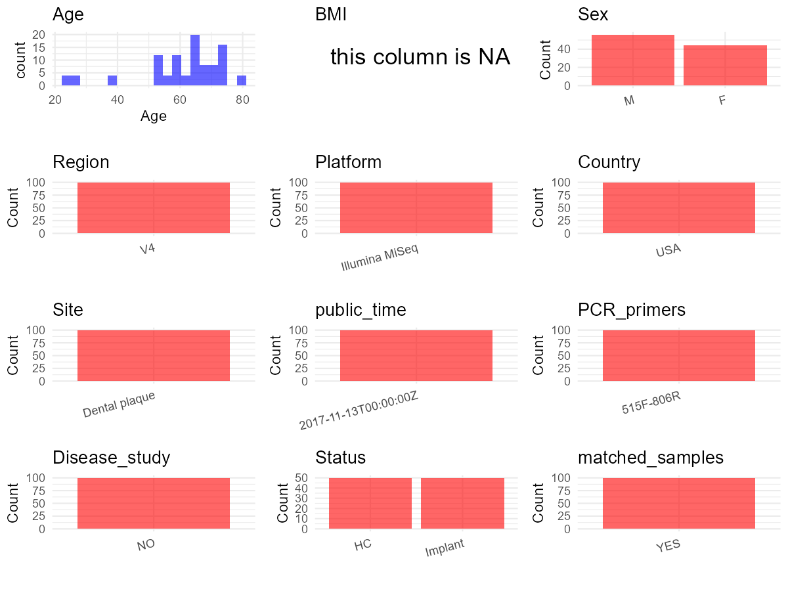

R Notebook: Metadata Processing Workflow
================

# Step 1: Obtain Initial Metadata from Each Project

To obtain the initial metadata: 1. Search for the BioProject ID (e.g.,
“PRJEBXXXX”) on the [NCBI SRA
website](https://www.ncbi.nlm.nih.gov/Traces/study/). 2. In the “Select”
table, click on “Metadata” and download the file. 3. The downloaded file
is typically named “SraRunTable.csv” and contains metadata for the
project.

``` r
# Load necessary libraries
library(dplyr)
library(ggplot2)
library(cowplot)

# Set working directory (update this path to your local directory)
setwd("D:/studylearning/董彪师兄项目/任务/修改20250922/PRJNA417321")

# Read the initial metadata files
initial_meta <- read.csv("SraRunTable.csv", header = TRUE)

# Display the first few rows of the metadata
head(initial_meta)
```

    ##          Run Assay.Type AvgSpotLen    Bases  BioProject    BioSample
    ## 1 SRR6284000   AMPLICON        502 23142702 PRJNA417321 SAMN07982747
    ## 2 SRR6284001   AMPLICON        502 35790090 PRJNA417321 SAMN07982746
    ## 3 SRR6284002   AMPLICON        502 32065250 PRJNA417321 SAMN07982743
    ## 4 SRR6284003   AMPLICON        502 35918602 PRJNA417321 SAMN07982742
    ## 5 SRR6284004   AMPLICON        502 26167252 PRJNA417321 SAMN07982745
    ## 6 SRR6284005   AMPLICON        502 37444180 PRJNA417321 SAMN07982744
    ##                                  BioSampleModel    Bytes
    ## 1 MIMARKS.specimen,MIGS/MIMS/MIMARKS.human-oral 14667780
    ## 2 MIMARKS.specimen,MIGS/MIMS/MIMARKS.human-oral 23150447
    ## 3 MIMARKS.specimen,MIGS/MIMS/MIMARKS.human-oral 20115387
    ## 4 MIMARKS.specimen,MIGS/MIMS/MIMARKS.human-oral 22720339
    ## 5 MIMARKS.specimen,MIGS/MIMS/MIMARKS.human-oral 16969201
    ## 6 MIMARKS.specimen,MIGS/MIMS/MIMARKS.human-oral 24204694
    ##                      Center.Name Collection_Date Consent      Cultivar
    ## 1 UNIVERSITY OF NEBRASKA-LINCOLN      2016-03-24  public Not appicable
    ## 2 UNIVERSITY OF NEBRASKA-LINCOLN      2016-03-24  public Not appicable
    ## 3 UNIVERSITY OF NEBRASKA-LINCOLN      2016-03-10  public Not appicable
    ## 4 UNIVERSITY OF NEBRASKA-LINCOLN      2016-03-10  public Not appicable
    ## 5 UNIVERSITY OF NEBRASKA-LINCOLN      2016-01-14  public Not appicable
    ## 6 UNIVERSITY OF NEBRASKA-LINCOLN      2016-01-14  public Not appicable
    ##   DATASTORE.filetype DATASTORE.provider                     DATASTORE.region
    ## 1   fastq,run.zq,sra         gs,ncbi,s3 gs.us-east1,ncbi.public,s3.us-east-1
    ## 2   fastq,run.zq,sra         gs,ncbi,s3 gs.us-east1,ncbi.public,s3.us-east-1
    ## 3   fastq,run.zq,sra         gs,ncbi,s3 gs.us-east1,ncbi.public,s3.us-east-1
    ## 4   fastq,run.zq,sra         gs,ncbi,s3 gs.us-east1,ncbi.public,s3.us-east-1
    ## 5   fastq,run.zq,sra         gs,ncbi,s3 gs.us-east1,ncbi.public,s3.us-east-1
    ## 6   fastq,run.zq,sra         gs,ncbi,s3 gs.us-east1,ncbi.public,s3.us-east-1
    ##          Ecotype env_biome env_feature  env_material              ethnicity
    ## 1 Not applicable      Oral     Natural Dental plaque Not Hispanic or Latino
    ## 2 Not applicable      Oral     Implant Dental plaque Not Hispanic or Latino
    ## 3 Not applicable      Oral     Natural Dental plaque Not Hispanic or Latino
    ## 4 Not applicable      Oral     Implant Dental plaque Not Hispanic or Latino
    ## 5 Not applicable      Oral     Natural Dental plaque Not Hispanic or Latino
    ## 6 Not applicable      Oral     Implant Dental plaque Not Hispanic or Latino
    ##   Experiment geo_loc_name_country geo_loc_name_country_continent   geo_loc_name
    ## 1 SRX3386213         uncalculated                   uncalculated Not applicable
    ## 2 SRX3386212         uncalculated                   uncalculated Not applicable
    ## 3 SRX3386211         uncalculated                   uncalculated Not applicable
    ## 4 SRX3386210         uncalculated                   uncalculated Not applicable
    ## 5 SRX3386209         uncalculated                   uncalculated Not applicable
    ## 6 SRX3386208         uncalculated                   uncalculated Not applicable
    ##   Host_age         HOST host_sex     Instrument isol_growth_condt isolate
    ## 1       69 Homo sapiens   female Illumina MiSeq    Not applicable      29
    ## 2       69 Homo sapiens   female Illumina MiSeq    Not applicable      29
    ## 3       23 Homo sapiens     male Illumina MiSeq    Not applicable      28
    ## 4       23 Homo sapiens     male Illumina MiSeq    Not applicable      28
    ## 5       69 Homo sapiens   female Illumina MiSeq    Not applicable      29
    ## 6       69 Homo sapiens   female Illumina MiSeq    Not applicable      29
    ##          lat_lon Library.Name LibraryLayout LibrarySelection LibrarySource
    ## 1 Not applicable        029BG        PAIRED              PCR   METAGENOMIC
    ## 2 Not applicable        029BS        PAIRED              PCR   METAGENOMIC
    ## 3 Not applicable        028BG        PAIRED              PCR   METAGENOMIC
    ## 4 Not applicable        028BS        PAIRED              PCR   METAGENOMIC
    ## 5 Not applicable        029AG        PAIRED              PCR   METAGENOMIC
    ## 6 Not applicable        029AS        PAIRED              PCR   METAGENOMIC
    ##                Organism Platform          ReleaseDate     samp_collect_device
    ## 1 human oral metagenome ILLUMINA 2017-11-13T00:00:00Z Endodontic paper points
    ## 2 human oral metagenome ILLUMINA 2017-11-13T00:00:00Z Endodontic paper points
    ## 3 human oral metagenome ILLUMINA 2017-11-13T00:00:00Z Endodontic paper points
    ## 4 human oral metagenome ILLUMINA 2017-11-13T00:00:00Z Endodontic paper points
    ## 5 human oral metagenome ILLUMINA 2017-11-13T00:00:00Z Endodontic paper points
    ## 6 human oral metagenome ILLUMINA 2017-11-13T00:00:00Z Endodontic paper points
    ##   Sample.Name SRA.Study         strain WEEK          create_date version
    ## 1       029BG SRP124857 Not applicable   12 2017-11-13T13:27:00Z       1
    ## 2       029BS SRP124857 Not applicable   12 2017-11-13T13:27:00Z       1
    ## 3       028BG SRP124857 Not applicable   12 2017-11-13T13:27:00Z       1
    ## 4       028BS SRP124857 Not applicable   12 2017-11-13T13:27:00Z       1
    ## 5       029AG SRP124857 Not applicable    4 2017-11-13T13:27:00Z       1
    ## 6       029AS SRP124857 Not applicable    4 2017-11-13T13:27:00Z       1

# Step 2: Create a Uniform Metadata Template

The uniform metadata should include the following columns:

1.  **BioProject**: Project ID (e.g., “PRJNA339212”)
2.  **Run**: Sample ID (e.g., “ERRXXXXXX” or “SRRXXXXXX”)
3.  **sample_name**: Original sample name submitted by the authors (not
    the database-assigned ID)
4.  **Age**: Age of the subject (if available)
5.  **BMI**: Body Mass Index (if available)
6.  **Sex**: Sex of the subject (“F” or “M”)
7.  **Region**: Targeted 16S rRNA region (e.g., “V3-V4”)
8.  **Platform**: Sequencing platform (e.g., “Illumina MiSeq”)
9.  **Country**: Country of sample origin (e.g., “China”)
10. **Site**: Sample site (e.g., “saliva”, “dental plaque”)
11. **public_time**: Data release date (format: “YYYY-MM-DD”)
12. **PCR_primers**: PCR primers used (e.g., “515F-806R”)
13. **title**: Title of the associated publication
14. **Disease_study**: Whether the study involves a disease (“YES” or
    “NO”)
15. **Status**: Disease status (e.g., “T2DM”, “HC”). Note: If the study
    includes both disease and healthy samples, this must be specified
    per sample.

``` r
# Create a uniform metadata dataframe
metadata <- data.frame(
  BioProject = initial_meta$BioProject,
  Run = initial_meta$Run,
  sample_name = initial_meta$Sample.Name,
  Age = initial_meta$Host_age,
  BMI = NA,
  Sex= initial_meta$host_sex,
  Region = "V4",
  Platform = initial_meta$Instrument,
  Country = "USA",
  Site = initial_meta$env_material,
  public_time = initial_meta$ReleaseDate,
  stringsAsFactors = FALSE
)
```

# Step 3: Manually Add Information from the Publication

Some information (e.g. PCR primers, study title, disease status) must be
manually extracted from the publication and added to the metadata.

``` r
# Add information obtained from the publication
metadata$PCR_primers <- "515F-806R"  # Update based on the publication
metadata$title <- "Subgingival Microbiome Colonization and Cytokine Production during Early Dental Implant Healing"
metadata$Disease_study <- "NO"
metadata <- metadata %>% 
  mutate(Status = case_when(
    grepl("G",sample_name)~"HC",
    grepl("S",sample_name)~"Implant"
  ))
metadata <- metadata %>%
  mutate(Sex = case_when(
    grepl("female", Sex) ~ "F",
    grepl("male", Sex) ~ "M"
  ))

#extract subject id by remove prefix of sample_name
metadata$sample_name <- gsub("BG|BS|AG|AS", "", metadata$sample_name)

# Check initial data distribution
cat("Initial sample distribution:\n")
```

    ## Initial sample distribution:

``` r
table(metadata$sample_name)
```

    ## 
    ## 001 004 008 010 013 016 020 022 028 029 032 034 035 036 039 048 055 057 058 062 
    ##   4   4   4   4   4   4   4   4   4   4   4   4   4   4   4   4   4   4   4   4 
    ## 063 064 066 067 071 
    ##   4   4   4   4   4

``` r
table(metadata$Site)
```

    ## 
    ## Dental plaque 
    ##           100

``` r
# Calculate sampling frequency per subject
sample_counts <- table(metadata$sample_name)
cat("\nNumber of samples per subject:\n")
```

    ## 
    ## Number of samples per subject:

``` r
print(sample_counts)
```

    ## 
    ## 001 004 008 010 013 016 020 022 028 029 032 034 035 036 039 048 055 057 058 062 
    ##   4   4   4   4   4   4   4   4   4   4   4   4   4   4   4   4   4   4   4   4 
    ## 063 064 066 067 071 
    ##   4   4   4   4   4

``` r
# Create matched_samples column
metadata$matched_samples <- ifelse(metadata$sample_name %in% names(sample_counts[sample_counts >= 2]), "YES", "NO")

cat("\nMatched samples distribution:\n")
```

    ## 
    ## Matched samples distribution:

``` r
table(metadata$matched_samples)
```

    ## 
    ## YES 
    ## 100

``` r
# Identify samples for removal: single samples excluding Dental plaque
single_samples <- names(sample_counts[sample_counts == 1])
samples_to_remove <- metadata$sample_name %in% single_samples & !(metadata$Site %in% c("Dental plaque"))

cat("\nNumber of samples to be removed:", sum(samples_to_remove), "\n")
```

    ## 
    ## Number of samples to be removed: 0

``` r
# Remove identified samples
metadata_clean <- metadata[!samples_to_remove, ]

cat("\nFinal sample distribution after cleaning:\n")
```

    ## 
    ## Final sample distribution after cleaning:

``` r
table(metadata_clean$sample_name)
```

    ## 
    ## 001 004 008 010 013 016 020 022 028 029 032 034 035 036 039 048 055 057 058 062 
    ##   4   4   4   4   4   4   4   4   4   4   4   4   4   4   4   4   4   4   4   4 
    ## 063 064 066 067 071 
    ##   4   4   4   4   4

``` r
table(metadata_clean$Site)
```

    ## 
    ## Dental plaque 
    ##           100

``` r
table(metadata_clean$matched_samples)
```

    ## 
    ## YES 
    ## 100

``` r
# Use cleaned dataset for subsequent analysis
metadata <- metadata_clean
```

# Step 4: Summarize and Validate the Metadata

``` r
# Check the number of unique runs and sample names
print(paste("Number of unique runs:", length(unique(metadata$Run))))
```

    ## [1] "Number of unique runs: 100"

``` r
print(paste("Number of unique sample names:", length(unique(metadata$sample_name))))
```

    ## [1] "Number of unique sample names: 25"

# Step 5: Visualize the Metadata

``` r

```


# Step 6: Finalize and Export the Metadata

``` r
# Reorder columns to match the desired format
metadata <- metadata[, c(
  "BioProject", "Run", "sample_name", "Age", "BMI", "Sex", 
  "Region", "Platform", "Country", "Site", "public_time", 
  "PCR_primers", "title", "Disease_study", "Status","matched_samples"
)]

# Export the uniform metadata to a CSV file
write.csv(metadata, file = "metadata.csv", quote = FALSE)
head(metadata)
```

    ##    BioProject        Run sample_name Age BMI Sex Region       Platform Country
    ## 1 PRJNA417321 SRR6284000         029  69  NA   F     V4 Illumina MiSeq     USA
    ## 2 PRJNA417321 SRR6284001         029  69  NA   F     V4 Illumina MiSeq     USA
    ## 3 PRJNA417321 SRR6284002         028  23  NA   M     V4 Illumina MiSeq     USA
    ## 4 PRJNA417321 SRR6284003         028  23  NA   M     V4 Illumina MiSeq     USA
    ## 5 PRJNA417321 SRR6284004         029  69  NA   F     V4 Illumina MiSeq     USA
    ## 6 PRJNA417321 SRR6284005         029  69  NA   F     V4 Illumina MiSeq     USA
    ##            Site          public_time PCR_primers
    ## 1 Dental plaque 2017-11-13T00:00:00Z   515F-806R
    ## 2 Dental plaque 2017-11-13T00:00:00Z   515F-806R
    ## 3 Dental plaque 2017-11-13T00:00:00Z   515F-806R
    ## 4 Dental plaque 2017-11-13T00:00:00Z   515F-806R
    ## 5 Dental plaque 2017-11-13T00:00:00Z   515F-806R
    ## 6 Dental plaque 2017-11-13T00:00:00Z   515F-806R
    ##                                                                                             title
    ## 1 Subgingival Microbiome Colonization and Cytokine Production during Early Dental Implant Healing
    ## 2 Subgingival Microbiome Colonization and Cytokine Production during Early Dental Implant Healing
    ## 3 Subgingival Microbiome Colonization and Cytokine Production during Early Dental Implant Healing
    ## 4 Subgingival Microbiome Colonization and Cytokine Production during Early Dental Implant Healing
    ## 5 Subgingival Microbiome Colonization and Cytokine Production during Early Dental Implant Healing
    ## 6 Subgingival Microbiome Colonization and Cytokine Production during Early Dental Implant Healing
    ##   Disease_study  Status matched_samples
    ## 1            NO      HC             YES
    ## 2            NO Implant             YES
    ## 3            NO      HC             YES
    ## 4            NO Implant             YES
    ## 5            NO      HC             YES
    ## 6            NO Implant             YES

## Notes for Students:

1.  **Metadata Accuracy**: Always cross-check the metadata with the
    original publication to ensure accuracy.
2.  **Manual Entries**: Columns like `PCR_primers`, and `Status` often
    require manual entry based on the publication.
3.  **Disease Status**: Be careful when assigning `Status`—some studies
    include both disease and healthy samples.
4.  **Visualization**: The plots help quickly identify the distribution
    of values in each column, which is useful for quality control.
5.  **Reproducibility**: Update the working directory and file paths to
    match your local environment.
