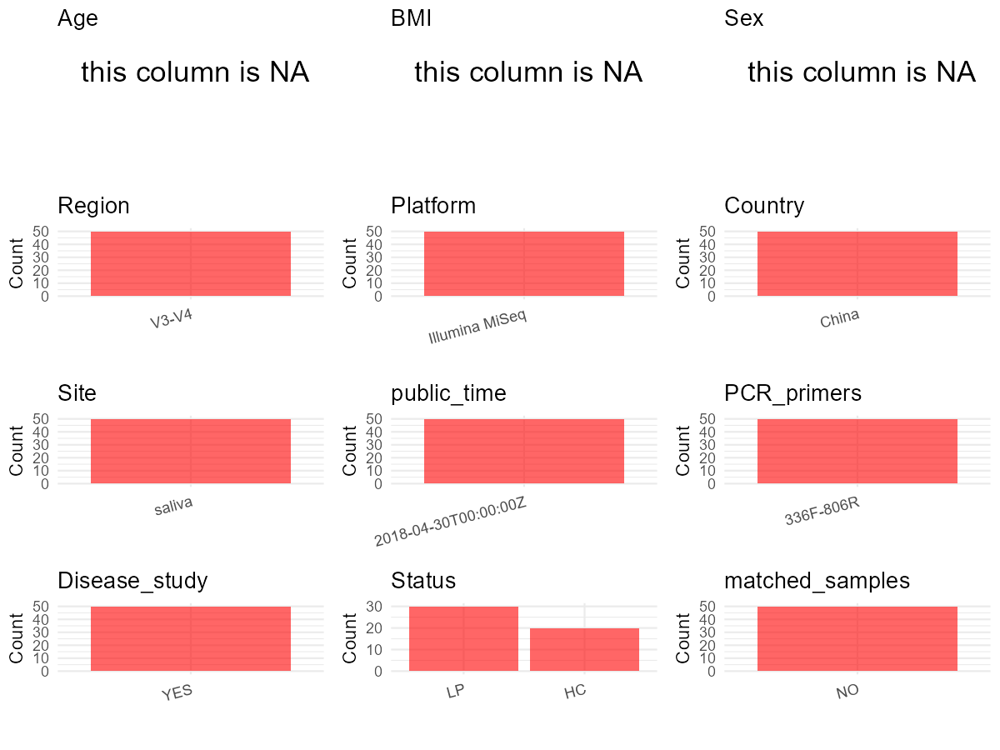

R Notebook: Metadata Processing Workflow
================

# Step 1: Obtain Initial Metadata from Each Project

To obtain the initial metadata: 1. Search for the BioProject ID (e.g.,
“PRJEBXXXX”) on the [NCBI SRA
website](https://www.ncbi.nlm.nih.gov/Traces/study/). 2. In the “Select”
table, click on “Metadata” and download the file. 3. The downloaded file
is typically named “SraRunTable.csv” and contains metadata for the
project.

``` r
# Load necessary libraries
library(dplyr)
library(ggplot2)
library(cowplot)

# Set working directory (update this path to your local directory)
setwd("D:/studylearning/董彪师兄项目/任务/修改20250922/PRJNA436183")

# Read the initial metadata files
initial_meta<-read.csv("SraRunTable.csv",header = T)

# Display the first few rows of the metadata
head(initial_meta)
```

    ##          Run Assay.Type AvgSpotLen    Bases  BioProject    BioSample
    ## 1 SRR6808443   AMPLICON        252 20992552 PRJNA436183 SAMN08619266
    ## 2 SRR6808444   AMPLICON        255 10685783 PRJNA436183 SAMN08619252
    ## 3 SRR6808445   AMPLICON        255  7698172 PRJNA436183 SAMN08619251
    ## 4 SRR6808446   AMPLICON        252 22745605 PRJNA436183 SAMN08619255
    ## 5 SRR6808447   AMPLICON        255 12799612 PRJNA436183 SAMN08619244
    ## 6 SRR6808448   AMPLICON        255 10634889 PRJNA436183 SAMN08619243
    ##                BioSampleModel   Bytes         Center.Name Collection_Date
    ## 1 Metagenome or environmental 9120076 SHANDONG UNIVERSITY      2017-01-22
    ## 2 Metagenome or environmental 5335657 SHANDONG UNIVERSITY      2017-03-29
    ## 3 Metagenome or environmental 3926781 SHANDONG UNIVERSITY      2017-03-29
    ## 4 Metagenome or environmental 9375216 SHANDONG UNIVERSITY      2017-01-06
    ## 5 Metagenome or environmental 6489114 SHANDONG UNIVERSITY      2017-03-02
    ## 6 Metagenome or environmental 5419495 SHANDONG UNIVERSITY      2017-02-23
    ##   Consent DATASTORE.filetype DATASTORE.provider
    ## 1  public   fastq,run.zq,sra         gs,ncbi,s3
    ## 2  public   fastq,run.zq,sra         gs,ncbi,s3
    ## 3  public   fastq,run.zq,sra         gs,ncbi,s3
    ## 4  public   fastq,run.zq,sra         gs,ncbi,s3
    ## 5  public   fastq,run.zq,sra         gs,ncbi,s3
    ## 6  public   fastq,run.zq,sra         gs,ncbi,s3
    ##                       DATASTORE.region Experiment geo_loc_name_country
    ## 1 gs.us-east1,ncbi.public,s3.us-east-1 SRX3766706                China
    ## 2 gs.us-east1,ncbi.public,s3.us-east-1 SRX3766705                China
    ## 3 gs.us-east1,ncbi.public,s3.us-east-1 SRX3766704                China
    ## 4 gs.us-east1,ncbi.public,s3.us-east-1 SRX3766703                China
    ## 5 gs.us-east1,ncbi.public,s3.us-east-1 SRX3766702                China
    ## 6 gs.us-east1,ncbi.public,s3.us-east-1 SRX3766701                China
    ##   geo_loc_name_country_continent geo_loc_name         Host     Instrument
    ## 1                           Asia  China:Jinan Homo sapiens Illumina MiSeq
    ## 2                           Asia  China:Jinan Homo sapiens Illumina MiSeq
    ## 3                           Asia  China:Jinan Homo sapiens Illumina MiSeq
    ## 4                           Asia  China:Jinan Homo sapiens Illumina MiSeq
    ## 5                           Asia  China:Jinan Homo sapiens Illumina MiSeq
    ## 6                           Asia  China:Jinan Homo sapiens Illumina MiSeq
    ##                    lat_lon Library.Name LibraryLayout LibrarySelection
    ## 1 36.654230 N 117.018721 E          O14        PAIRED              PCR
    ## 2 36.654230 N 117.018721 E         LP30        PAIRED              PCR
    ## 3 36.654230 N 117.018721 E         LP29        PAIRED              PCR
    ## 4 36.654230 N 117.018721 E           O3        PAIRED              PCR
    ## 5 36.654230 N 117.018721 E         LP22        PAIRED              PCR
    ## 6 36.654230 N 117.018721 E         LP21        PAIRED              PCR
    ##   LibrarySource              Organism Platform          ReleaseDate
    ## 1   METAGENOMIC human oral metagenome ILLUMINA 2018-04-30T00:00:00Z
    ## 2   METAGENOMIC human oral metagenome ILLUMINA 2018-04-30T00:00:00Z
    ## 3   METAGENOMIC human oral metagenome ILLUMINA 2018-04-30T00:00:00Z
    ## 4   METAGENOMIC human oral metagenome ILLUMINA 2018-04-30T00:00:00Z
    ## 5   METAGENOMIC human oral metagenome ILLUMINA 2018-04-30T00:00:00Z
    ## 6   METAGENOMIC human oral metagenome ILLUMINA 2018-04-30T00:00:00Z
    ##            create_date version Sample.Name SRA.Study temp
    ## 1 2018-03-06T03:56:00Z       1         O14 SRP133987   44
    ## 2 2018-03-06T03:56:00Z       1        LP30 SRP133987   30
    ## 3 2018-03-06T03:56:00Z       1        LP29 SRP133987   29
    ## 4 2018-03-06T03:56:00Z       1          O3 SRP133987   33
    ## 5 2018-03-06T03:56:00Z       1        LP22 SRP133987   22
    ## 6 2018-03-06T03:56:00Z       1        LP21 SRP133987   21

# Step 2: Create a Uniform Metadata Template

The uniform metadata should include the following columns:

1.  **BioProject**: Project ID (e.g., “PRJNA339212”)
2.  **Run**: Sample ID (e.g., “ERRXXXXXX” or “SRRXXXXXX”)
3.  **sample_name**: Original sample name submitted by the authors (not
    the database-assigned ID)
4.  **Age**: Age of the subject (if available)
5.  **BMI**: Body Mass Index (if available)
6.  **Sex**: Sex of the subject (“F” or “M”)
7.  **Region**: Targeted 16S rRNA region (e.g., “V3-V4”)
8.  **Platform**: Sequencing platform (e.g., “Illumina MiSeq”)
9.  **Country**: Country of sample origin (e.g., “China”)
10. **Site**: Sample site (e.g., “saliva”, “dental plaque”)
11. **public_time**: Data release date (format: “YYYY-MM-DD”)
12. **PCR_primers**: PCR primers used (e.g., “515F-806R”)
13. **title**: Title of the associated publication
14. **Disease_study**: Whether the study involves a disease (“YES” or
    “NO”)
15. **Status**: Disease status (e.g., “T2DM”, “HC”). Note: If the study
    includes both disease and healthy samples, this must be specified
    per sample.

``` r
# Create a uniform metadata dataframe
metadata <- data.frame(
  BioProject = initial_meta$BioProject,
  Run = initial_meta$Run,
  sample_name = initial_meta$Sample.Name,
  Age = NA_character_,
  BMI = NA_character_,
  Sex= NA_character_,
  Region = "V3-V4",
  Platform = initial_meta$Instrument,
  Country = initial_meta$geo_loc_name_country,
  Site = "saliva",
  public_time = initial_meta$ReleaseDate,
  stringsAsFactors = FALSE
)
```

# Step 3: Manually Add Information from the Publication

Some information (e.g. PCR primers, study title, disease status) must be
manually extracted from the publication and added to the metadata.

``` r
# Add information obtained from the publication
metadata$PCR_primers <- "336F-806R"
metadata$title <- "Helicobacter pylori infection is correlated with the incidence of erosive oral lichen planus and the alteration of the oral microbiome composition"
metadata$Disease_study <- "YES"
metadata <- metadata %>% mutate(Status=case_when(grepl("O",sample_name)~"HC",grepl("LP",sample_name)~"LP"))

#extract subject id by remove prefix of sample_name
#metadata$sample_name <- gsub("T|CR|CS|C|N|S", "", metadata$sample_name)

# Check initial data distribution
cat("Initial sample distribution:\n")
```

    ## Initial sample distribution:

``` r
table(metadata$sample_name)
```

    ## 
    ##  LP1 LP10 LP11 LP12 LP13 LP14 LP15 LP16 LP17 LP18 LP19  LP2 LP20 LP21 LP22 LP23 
    ##    1    1    1    1    1    1    1    1    1    1    1    1    1    1    1    1 
    ## LP24 LP25 LP26 LP27 LP28 LP29  LP3 LP30  LP4  LP5  LP6  LP7  LP8  LP9   O1  O10 
    ##    1    1    1    1    1    1    1    1    1    1    1    1    1    1    1    1 
    ##  O11  O12  O13  O14  O15  O16  O17  O18  O19   O2  O20   O3   O4   O5   O6   O7 
    ##    1    1    1    1    1    1    1    1    1    1    1    1    1    1    1    1 
    ##   O8   O9 
    ##    1    1

``` r
table(metadata$Site)
```

    ## 
    ## saliva 
    ##     50

``` r
# Calculate sampling frequency per subject
sample_counts <- table(metadata$sample_name)
cat("\nNumber of samples per subject:\n")
```

    ## 
    ## Number of samples per subject:

``` r
print(sample_counts)
```

    ## 
    ##  LP1 LP10 LP11 LP12 LP13 LP14 LP15 LP16 LP17 LP18 LP19  LP2 LP20 LP21 LP22 LP23 
    ##    1    1    1    1    1    1    1    1    1    1    1    1    1    1    1    1 
    ## LP24 LP25 LP26 LP27 LP28 LP29  LP3 LP30  LP4  LP5  LP6  LP7  LP8  LP9   O1  O10 
    ##    1    1    1    1    1    1    1    1    1    1    1    1    1    1    1    1 
    ##  O11  O12  O13  O14  O15  O16  O17  O18  O19   O2  O20   O3   O4   O5   O6   O7 
    ##    1    1    1    1    1    1    1    1    1    1    1    1    1    1    1    1 
    ##   O8   O9 
    ##    1    1

``` r
# Create matched_samples column
metadata$matched_samples <- ifelse(metadata$sample_name %in% names(sample_counts[sample_counts >= 2]), "YES", "NO")

cat("\nMatched samples distribution:\n")
```

    ## 
    ## Matched samples distribution:

``` r
table(metadata$matched_samples)
```

    ## 
    ## NO 
    ## 50

``` r
# Identify samples for removal: single samples excluding saliva
single_samples <- names(sample_counts[sample_counts == 1])
samples_to_remove <- metadata$sample_name %in% single_samples & !(metadata$Site %in% c("saliva"))

cat("\nNumber of samples to be removed:", sum(samples_to_remove), "\n")
```

    ## 
    ## Number of samples to be removed: 0

``` r
# Remove identified samples
metadata_clean <- metadata[!samples_to_remove, ]

cat("\nFinal sample distribution after cleaning:\n")
```

    ## 
    ## Final sample distribution after cleaning:

``` r
table(metadata_clean$sample_name)
```

    ## 
    ##  LP1 LP10 LP11 LP12 LP13 LP14 LP15 LP16 LP17 LP18 LP19  LP2 LP20 LP21 LP22 LP23 
    ##    1    1    1    1    1    1    1    1    1    1    1    1    1    1    1    1 
    ## LP24 LP25 LP26 LP27 LP28 LP29  LP3 LP30  LP4  LP5  LP6  LP7  LP8  LP9   O1  O10 
    ##    1    1    1    1    1    1    1    1    1    1    1    1    1    1    1    1 
    ##  O11  O12  O13  O14  O15  O16  O17  O18  O19   O2  O20   O3   O4   O5   O6   O7 
    ##    1    1    1    1    1    1    1    1    1    1    1    1    1    1    1    1 
    ##   O8   O9 
    ##    1    1

``` r
table(metadata_clean$Site)
```

    ## 
    ## saliva 
    ##     50

``` r
table(metadata_clean$matched_samples)
```

    ## 
    ## NO 
    ## 50

``` r
# Use cleaned dataset for subsequent analysis
metadata <- metadata_clean
```

# Step 4: Summarize and Validate the Metadata

``` r
# Check the number of unique runs and sample names
print(paste("Number of unique runs:", length(unique(metadata$Run))))
```

    ## [1] "Number of unique runs: 50"

``` r
print(paste("Number of unique sample names:", length(unique(metadata$sample_name))))
```

    ## [1] "Number of unique sample names: 50"

# Step 5: Visualize the Metadata

``` r

```


# Step 6: Finalize and Export the Metadata

``` r
# Reorder columns to match the desired format
metadata <- metadata[, c(
  "BioProject", "Run", "sample_name", "Age", "BMI", "Sex", 
  "Region", "Platform", "Country", "Site", "public_time", 
  "PCR_primers", "title", "Disease_study", "Status","matched_samples"
)]

# Export the uniform metadata to a CSV file
write.csv(metadata, file = "metadata.csv", quote = FALSE)
head(metadata)
```

    ##    BioProject        Run sample_name  Age  BMI  Sex Region       Platform
    ## 1 PRJNA436183 SRR6808443         O14 <NA> <NA> <NA>  V3-V4 Illumina MiSeq
    ## 2 PRJNA436183 SRR6808444        LP30 <NA> <NA> <NA>  V3-V4 Illumina MiSeq
    ## 3 PRJNA436183 SRR6808445        LP29 <NA> <NA> <NA>  V3-V4 Illumina MiSeq
    ## 4 PRJNA436183 SRR6808446          O3 <NA> <NA> <NA>  V3-V4 Illumina MiSeq
    ## 5 PRJNA436183 SRR6808447        LP22 <NA> <NA> <NA>  V3-V4 Illumina MiSeq
    ## 6 PRJNA436183 SRR6808448        LP21 <NA> <NA> <NA>  V3-V4 Illumina MiSeq
    ##   Country   Site          public_time PCR_primers
    ## 1   China saliva 2018-04-30T00:00:00Z   336F-806R
    ## 2   China saliva 2018-04-30T00:00:00Z   336F-806R
    ## 3   China saliva 2018-04-30T00:00:00Z   336F-806R
    ## 4   China saliva 2018-04-30T00:00:00Z   336F-806R
    ## 5   China saliva 2018-04-30T00:00:00Z   336F-806R
    ## 6   China saliva 2018-04-30T00:00:00Z   336F-806R
    ##                                                                                                                                                title
    ## 1 Helicobacter pylori infection is correlated with the incidence of erosive oral lichen planus and the alteration of the oral microbiome composition
    ## 2 Helicobacter pylori infection is correlated with the incidence of erosive oral lichen planus and the alteration of the oral microbiome composition
    ## 3 Helicobacter pylori infection is correlated with the incidence of erosive oral lichen planus and the alteration of the oral microbiome composition
    ## 4 Helicobacter pylori infection is correlated with the incidence of erosive oral lichen planus and the alteration of the oral microbiome composition
    ## 5 Helicobacter pylori infection is correlated with the incidence of erosive oral lichen planus and the alteration of the oral microbiome composition
    ## 6 Helicobacter pylori infection is correlated with the incidence of erosive oral lichen planus and the alteration of the oral microbiome composition
    ##   Disease_study Status matched_samples
    ## 1           YES     HC              NO
    ## 2           YES     LP              NO
    ## 3           YES     LP              NO
    ## 4           YES     HC              NO
    ## 5           YES     LP              NO
    ## 6           YES     LP              NO

## Notes for Students:

1.  **Metadata Accuracy**: Always cross-check the metadata with the
    original publication to ensure accuracy.
2.  **Manual Entries**: Columns like `PCR_primers`, and `Status` often
    require manual entry based on the publication.
3.  **Disease Status**: Be careful when assigning `Status`—some studies
    include both disease and healthy samples.
4.  **Visualization**: The plots help quickly identify the distribution
    of values in each column, which is useful for quality control.
5.  **Reproducibility**: Update the working directory and file paths to
    match your local environment.
