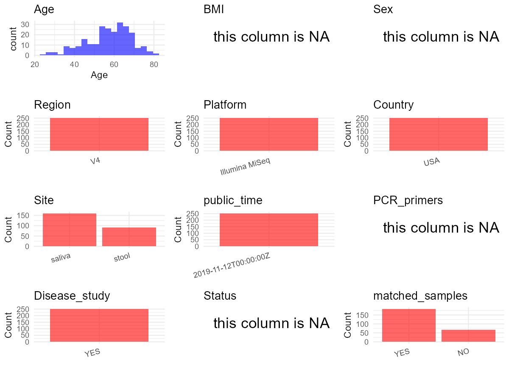

R Notebook: Metadata Processing Workflow
================

# Step 1: Obtain Initial Metadata from Each Project

To obtain the initial metadata: 1. Search for the BioProject ID (e.g.,
“PRJEBXXXX”) on the [NCBI SRA
website](https://www.ncbi.nlm.nih.gov/Traces/study/). 2. In the “Select”
table, click on “Metadata” and download the file. 3. The downloaded file
is typically named “SraRunTable.csv” and contains metadata for the
project.

``` r
# Load necessary libraries
library(dplyr)
library(ggplot2)
library(cowplot)

# Set working directory (update this path to your local directory)
setwd("D:/studylearning/董彪师兄项目/任务/修改20250922/PRJNA535518")

# Read the initial metadata files
initial_meta<-read.csv("SraRunTable.csv",header = T)

# Display the first few rows of the metadata
head(initial_meta)
```

    ##          Run AGE_067 Assay.Type AvgSpotLen    Bases  BioProject    BioSample
    ## 1 SRR8986398      67   AMPLICON        500 54304125 PRJNA535518 SAMN11507646
    ## 2 SRR8986399      54   AMPLICON        500 12423399 PRJNA535518 SAMN11507647
    ## 3 SRR8986400      74   AMPLICON        500 17370536 PRJNA535518 SAMN11507514
    ## 4 SRR8986401      55   AMPLICON        500 29415409 PRJNA535518 SAMN11507641
    ## 5 SRR8986402      55   AMPLICON        500 23883467 PRJNA535518 SAMN11507643
    ## 6 SRR8986403      63   AMPLICON        500 15057184 PRJNA535518 SAMN11507644
    ##                         BioSampleModel    Bytes              Center.Name Cohort
    ## 1 MIMS.me,MIGS/MIMS/MIMARKS.human-oral 32221003 UNIVERSITY OF PITTSBURGH      1
    ## 2 MIMS.me,MIGS/MIMS/MIMARKS.human-oral  7890408 UNIVERSITY OF PITTSBURGH      3
    ## 3 MIMS.me,MIGS/MIMS/MIMARKS.human-oral 10858006 UNIVERSITY OF PITTSBURGH      1
    ## 4 MIMS.me,MIGS/MIMS/MIMARKS.human-oral 17252952 UNIVERSITY OF PITTSBURGH      3
    ## 5 MIMS.me,MIGS/MIMS/MIMARKS.human-oral 14896926 UNIVERSITY OF PITTSBURGH      1
    ## 6 MIMS.me,MIGS/MIMS/MIMARKS.human-oral  9512285 UNIVERSITY OF PITTSBURGH      1
    ##   Collection_Date Consent DATASTORE.filetype DATASTORE.provider
    ## 1            2017  public   fastq,run.zq,sra         gs,ncbi,s3
    ## 2      2017-07-09  public   fastq,run.zq,sra         gs,ncbi,s3
    ## 3      2017-07-05  public   fastq,run.zq,sra         gs,ncbi,s3
    ## 4      2017-06-16  public   fastq,run.zq,sra         gs,ncbi,s3
    ## 5      2017-07-21  public   fastq,run.zq,sra         gs,ncbi,s3
    ## 6      2017-07-15  public   fastq,run.zq,sra         gs,ncbi,s3
    ##                       DATASTORE.region env_broad_scale   env_local_scale
    ## 1 gs.us-east1,ncbi.public,s3.us-east-1       human_gut outpatient_clinic
    ## 2 gs.us-east1,ncbi.public,s3.us-east-1       human_gut outpatient_clinic
    ## 3 gs.us-east1,ncbi.public,s3.us-east-1     human_mouth outpatient_clinic
    ## 4 gs.us-east1,ncbi.public,s3.us-east-1       human_gut outpatient_clinic
    ## 5 gs.us-east1,ncbi.public,s3.us-east-1       human_gut outpatient_clinic
    ## 6 gs.us-east1,ncbi.public,s3.us-east-1       human_gut outpatient_clinic
    ##   env_medium Experiment Freezer_Section geo_loc_name_country
    ## 1      stool SRX5765869   Morris 80C #3                  USA
    ## 2      stool SRX5765868   Morris 80C #3                  USA
    ## 3     saliva SRX5765867   Morris 80C #3                  USA
    ## 4      stool SRX5765866   Morris 80C #3                  USA
    ## 5      stool SRX5765865   Morris 80C #2                  USA
    ## 6      stool SRX5765864   Morris 80C #2                  USA
    ##   geo_loc_name_country_continent   geo_loc_name height         HOST IL6_zscore
    ## 1                  North America USA:Pittsburgh  1.812 Homo_sapiens -0.4920462
    ## 2                  North America USA:Pittsburgh  1.811 Homo_sapiens -0.3581251
    ## 3                  North America USA:Pittsburgh  1.764 Homo_sapiens -0.1104432
    ## 4                  North America USA:Pittsburgh  1.817 Homo_sapiens -0.1104432
    ## 5                  North America USA:Pittsburgh  1.799 Homo_sapiens -0.8016486
    ## 6                  North America USA:Pittsburgh  1.822 Homo_sapiens -0.7138079
    ##   IL8_zscore     Instrument             lat_lon Library.Name LibraryLayout
    ## 1 -0.9347947 Illumina MiSeq 40.4406 N 79.9959 W     80109_st        PAIRED
    ## 2  0.2878265 Illumina MiSeq 40.4406 N 79.9959 W     80110_st        PAIRED
    ## 3 -0.1804387 Illumina MiSeq 40.4406 N 79.9959 W    80112_sal        PAIRED
    ## 4 -0.1804387 Illumina MiSeq 40.4406 N 79.9959 W     80098_st        PAIRED
    ## 5  0.1723639 Illumina MiSeq 40.4406 N 79.9959 W     80101_st        PAIRED
    ## 6 -0.9347947 Illumina MiSeq 40.4406 N 79.9959 W     80102_st        PAIRED
    ##   LibrarySelection LibrarySource      M_DateProcessed       M_DateReceived
    ## 1              PCR   METAGENOMIC 2017-06-26T00:00:00Z 2017-06-26T00:00:00Z
    ## 2              PCR   METAGENOMIC 2017-07-13T00:00:00Z 2017-07-12T00:00:00Z
    ## 3              PCR   METAGENOMIC 2017-07-11T00:00:00Z 2017-07-07T00:00:00Z
    ## 4              PCR   METAGENOMIC 2017-06-22T00:00:00Z 2017-06-22T00:00:00Z
    ## 5              PCR   METAGENOMIC 2017-07-26T00:00:00Z 2017-07-26T00:00:00Z
    ## 6              PCR   METAGENOMIC 2017-07-18T00:00:00Z 2017-07-18T00:00:00Z
    ##                  M_Key              Organism Platform          ReleaseDate
    ## 1 MACS_GI-80109-1-PITT  human gut metagenome ILLUMINA 2019-11-12T00:00:00Z
    ## 2 MACS_GI-80110-1-PITT  human gut metagenome ILLUMINA 2019-11-12T00:00:00Z
    ## 3 MACS_GI-80112-1-PITT human oral metagenome ILLUMINA 2019-11-12T00:00:00Z
    ## 4 MACS_GI-80098-1-PITT  human gut metagenome ILLUMINA 2019-11-12T00:00:00Z
    ## 5 MACS_GI-80101-1-PITT  human gut metagenome ILLUMINA 2019-11-12T00:00:00Z
    ## 6 MACS_GI-80102-1-PITT  human gut metagenome ILLUMINA 2019-11-12T00:00:00Z
    ##            create_date version                          Sample_ID Sample.Name
    ## 1 2019-04-29T14:33:00Z       1  0150.80109.V1.ST.paired.for.fasta    80109_st
    ## 2 2019-04-29T14:33:00Z       1  0150.80110.V1.ST.paired.for.fasta    80110_st
    ## 3 2019-04-29T14:33:00Z       1 0150.80112.V1.SAL.paired.for.fasta   80112_sal
    ## 4 2019-04-29T14:33:00Z       1  0150.80098.V1.ST.paired.for.fasta    80098_st
    ## 5 2019-04-29T14:33:00Z       1  0150.80101.V1.ST.paired.for.fasta    80101_st
    ## 6 2019-04-29T14:33:00Z       1  0150.80102.V1.ST.paired.for.fasta    80102_st
    ##   Sample_Number SRA.Study subject_id
    ## 1           220 SRP194168      80109
    ## 2           221 SRP194168      80110
    ## 3            88 SRP194168      80112
    ## 4           215 SRP194168      80098
    ## 5           217 SRP194168      80101
    ## 6           218 SRP194168      80102

# Step 2: Create a Uniform Metadata Template

The uniform metadata should include the following columns:

1.  **BioProject**: Project ID (e.g., “PRJNA339212”)
2.  **Run**: Sample ID (e.g., “ERRXXXXXX” or “SRRXXXXXX”)
3.  **sample_name**: Original sample name submitted by the authors (not
    the database-assigned ID)
4.  **Age**: Age of the subject (if available)
5.  **BMI**: Body Mass Index (if available)
6.  **Sex**: Sex of the subject (“F” or “M”)
7.  **Region**: Targeted 16S rRNA region (e.g., “V3-V4”)
8.  **Platform**: Sequencing platform (e.g., “Illumina MiSeq”)
9.  **Country**: Country of sample origin (e.g., “China”)
10. **Site**: Sample site (e.g., “saliva”, “dental plaque”)
11. **public_time**: Data release date (format: “YYYY-MM-DD”)
12. **PCR_primers**: PCR primers used (e.g., “515F-806R”)
13. **title**: Title of the associated publication
14. **Disease_study**: Whether the study involves a disease (“YES” or
    “NO”)
15. **Status**: Disease status (e.g., “T2DM”, “HC”). Note: If the study
    includes both disease and healthy samples, this must be specified
    per sample.

``` r
# Create a uniform metadata dataframe
metadata <- data.frame(
  BioProject = initial_meta$BioProject,
  Run = initial_meta$Run,
  sample_name = initial_meta$Sample.Name,
  Age = initial_meta$AGE_067,
  BMI = NA,
  Sex= NA,
  Region = "V4",
  Platform = initial_meta$Instrument,
  Country = initial_meta$geo_loc_name_country,
  Site = initial_meta$env_medium,
  public_time = initial_meta$ReleaseDate,
  stringsAsFactors = FALSE
)
```

# Step 3: Manually Add Information from the Publication

Some information (e.g. PCR primers, study title, disease status) must be
manually extracted from the publication and added to the metadata.

``` r
# Add information obtained from the publication
metadata$PCR_primers <- NA_character_  # Update based on the publication
metadata$title <- "Alterations in Oral Microbiota in HIV Are Related to Decreased Pulmonary Function"
metadata$Disease_study <- "YES"
metadata$Status <- NA_character_

#extract subject id by remove prefix of sample_name
metadata$sample_name <- gsub("_st|_sal", "", metadata$sample_name)

# Check initial data distribution
cat("Initial sample distribution:\n")
```

    ## Initial sample distribution:

``` r
table(metadata$sample_name)
```

    ## 
    ## 80000 80001 80002 80003 80004 80006 80007 80008 80010 80011 80012 80013 80015 
    ##     2     2     1     1     1     1     1     1     2     1     1     2     1 
    ## 80016 80018 80019 80022 80023 80024 80025 80026 80027 80028 80029 80030 80031 
    ##     2     1     1     2     2     1     2     2     2     1     1     2     1 
    ## 80032 80033 80034 80036 80037 80040 80041 80042 80043 80044 80045 80046 80047 
    ##     1     1     1     1     2     2     2     1     2     2     2     2     2 
    ## 80048 80049 80051 80052 80053 80054 80055 80057 80059 80060 80061 80062 80063 
    ##     2     2     2     2     2     2     2     1     1     2     2     1     2 
    ## 80064 80065 80066 80067 80068 80069 80070 80072 80073 80074 80076 80077 80078 
    ##     2     2     1     2     2     1     2     2     1     1     1     1     2 
    ## 80079 80080 80081 80082 80083 80084 80086 80087 80088 80089 80090 80091 80092 
    ##     2     2     1     1     1     2     2     2     2     1     2     2     1 
    ## 80093 80094 80095 80096 80097 80098 80099 80100 80101 80102 80104 80105 80106 
    ##     2     1     1     2     1     2     1     2     2     2     1     1     1 
    ## 80107 80109 80110 80111 80112 80114 80115 80116 80118 80119 80120 80121 80123 
    ##     2     2     2     2     1     2     2     2     1     2     1     2     1 
    ## 80124 80125 80126 80127 80128 80129 80130 80133 80135 80136 80137 80138 80139 
    ##     2     2     2     1     2     2     1     2     1     2     1     1     2 
    ## 80140 80141 80142 80143 80146 80147 80148 80149 80150 80151 80153 80154 80155 
    ##     2     1     1     1     2     1     1     1     2     1     1     1     1 
    ## 80157 80158 80159 80160 80161 80162 80163 80164 80165 80166 80168 80169 80170 
    ##     1     2     2     1     2     1     2     2     1     2     1     2     2 
    ## 80171 80172 80173 80174 80175 80176 80177 80178 80179 80181 80182 80183 80184 
    ##     2     2     1     2     2     1     1     2     1     1     2     2     1 
    ## 80196 80197 80198 80201 80204 80206 80211 80214 80218 80220 80225 80228 
    ##     2     2     2     2     1     2     2     1     1     1     1     2

``` r
table(metadata$Site)
```

    ## 
    ## saliva  stool 
    ##    160    100

``` r
# Calculate sampling frequency per subject
sample_counts <- table(metadata$sample_name)
cat("\nNumber of samples per subject:\n")
```

    ## 
    ## Number of samples per subject:

``` r
print(sample_counts)
```

    ## 
    ## 80000 80001 80002 80003 80004 80006 80007 80008 80010 80011 80012 80013 80015 
    ##     2     2     1     1     1     1     1     1     2     1     1     2     1 
    ## 80016 80018 80019 80022 80023 80024 80025 80026 80027 80028 80029 80030 80031 
    ##     2     1     1     2     2     1     2     2     2     1     1     2     1 
    ## 80032 80033 80034 80036 80037 80040 80041 80042 80043 80044 80045 80046 80047 
    ##     1     1     1     1     2     2     2     1     2     2     2     2     2 
    ## 80048 80049 80051 80052 80053 80054 80055 80057 80059 80060 80061 80062 80063 
    ##     2     2     2     2     2     2     2     1     1     2     2     1     2 
    ## 80064 80065 80066 80067 80068 80069 80070 80072 80073 80074 80076 80077 80078 
    ##     2     2     1     2     2     1     2     2     1     1     1     1     2 
    ## 80079 80080 80081 80082 80083 80084 80086 80087 80088 80089 80090 80091 80092 
    ##     2     2     1     1     1     2     2     2     2     1     2     2     1 
    ## 80093 80094 80095 80096 80097 80098 80099 80100 80101 80102 80104 80105 80106 
    ##     2     1     1     2     1     2     1     2     2     2     1     1     1 
    ## 80107 80109 80110 80111 80112 80114 80115 80116 80118 80119 80120 80121 80123 
    ##     2     2     2     2     1     2     2     2     1     2     1     2     1 
    ## 80124 80125 80126 80127 80128 80129 80130 80133 80135 80136 80137 80138 80139 
    ##     2     2     2     1     2     2     1     2     1     2     1     1     2 
    ## 80140 80141 80142 80143 80146 80147 80148 80149 80150 80151 80153 80154 80155 
    ##     2     1     1     1     2     1     1     1     2     1     1     1     1 
    ## 80157 80158 80159 80160 80161 80162 80163 80164 80165 80166 80168 80169 80170 
    ##     1     2     2     1     2     1     2     2     1     2     1     2     2 
    ## 80171 80172 80173 80174 80175 80176 80177 80178 80179 80181 80182 80183 80184 
    ##     2     2     1     2     2     1     1     2     1     1     2     2     1 
    ## 80196 80197 80198 80201 80204 80206 80211 80214 80218 80220 80225 80228 
    ##     2     2     2     2     1     2     2     1     1     1     1     2

``` r
# Create matched_samples column
metadata$matched_samples <- ifelse(metadata$sample_name %in% names(sample_counts[sample_counts >= 2]), "YES", "NO")

cat("\nMatched samples distribution:\n")
```

    ## 
    ## Matched samples distribution:

``` r
table(metadata$matched_samples)
```

    ## 
    ##  NO YES 
    ##  76 184

``` r
# Identify samples for removal: single samples excluding saliva 
single_samples <- names(sample_counts[sample_counts == 1])
samples_to_remove <- metadata$sample_name %in% single_samples & !(metadata$Site %in% c("saliva"))

cat("\nNumber of samples to be removed:", sum(samples_to_remove), "\n")
```

    ## 
    ## Number of samples to be removed: 8

``` r
# Remove identified samples
metadata_clean <- metadata[!samples_to_remove, ]

cat("\nFinal sample distribution after cleaning:\n")
```

    ## 
    ## Final sample distribution after cleaning:

``` r
table(metadata_clean$sample_name)
```

    ## 
    ## 80000 80001 80002 80003 80004 80006 80007 80010 80013 80016 80019 80022 80023 
    ##     2     2     1     1     1     1     1     2     2     2     1     2     2 
    ## 80024 80025 80026 80027 80029 80030 80032 80033 80034 80036 80037 80040 80041 
    ##     1     2     2     2     1     2     1     1     1     1     2     2     2 
    ## 80042 80043 80044 80045 80046 80047 80048 80049 80051 80052 80053 80054 80055 
    ##     1     2     2     2     2     2     2     2     2     2     2     2     2 
    ## 80057 80060 80061 80062 80063 80064 80065 80066 80067 80068 80069 80070 80072 
    ##     1     2     2     1     2     2     2     1     2     2     1     2     2 
    ## 80073 80074 80076 80077 80078 80079 80080 80081 80082 80083 80084 80086 80087 
    ##     1     1     1     1     2     2     2     1     1     1     2     2     2 
    ## 80088 80089 80090 80091 80092 80093 80094 80095 80096 80097 80098 80099 80100 
    ##     2     1     2     2     1     2     1     1     2     1     2     1     2 
    ## 80101 80102 80104 80105 80106 80107 80109 80110 80111 80112 80114 80115 80116 
    ##     2     2     1     1     1     2     2     2     2     1     2     2     2 
    ## 80118 80119 80120 80121 80123 80124 80125 80126 80127 80128 80129 80130 80133 
    ##     1     2     1     2     1     2     2     2     1     2     2     1     2 
    ## 80135 80136 80137 80138 80139 80140 80141 80142 80143 80146 80147 80148 80149 
    ##     1     2     1     1     2     2     1     1     1     2     1     1     1 
    ## 80150 80151 80153 80154 80155 80157 80158 80159 80160 80161 80162 80163 80164 
    ##     2     1     1     1     1     1     2     2     1     2     1     2     2 
    ## 80165 80166 80168 80169 80170 80171 80172 80173 80174 80175 80176 80177 80178 
    ##     1     2     1     2     2     2     2     1     2     2     1     1     2 
    ## 80179 80181 80182 80183 80184 80196 80197 80198 80201 80204 80206 80211 80214 
    ##     1     1     2     2     1     2     2     2     2     1     2     2     1 
    ## 80218 80220 80225 80228 
    ##     1     1     1     2

``` r
table(metadata_clean$Site)
```

    ## 
    ## saliva  stool 
    ##    160     92

``` r
table(metadata_clean$matched_samples)
```

    ## 
    ##  NO YES 
    ##  68 184

``` r
# Use cleaned dataset for subsequent analysis
metadata <- metadata_clean
```

# Step 4: Summarize and Validate the Metadata

``` r
# Check the number of unique runs and sample names
print(paste("Number of unique runs:", length(unique(metadata$Run))))
```

    ## [1] "Number of unique runs: 252"

``` r
print(paste("Number of unique sample names:", length(unique(metadata$sample_name))))
```

    ## [1] "Number of unique sample names: 160"

# Step 5: Visualize the Metadata

``` r

```


# Step 6: Finalize and Export the Metadata

``` r
# Reorder columns to match the desired format
metadata <- metadata[, c(
  "BioProject", "Run", "sample_name", "Age", "BMI", "Sex", 
  "Region", "Platform", "Country", "Site", "public_time", 
  "PCR_primers", "title", "Disease_study", "Status","matched_samples"
)]

# Export the uniform metadata to a CSV file
write.csv(metadata, file = "metadata.csv", quote = FALSE)
head(metadata)
```

    ##    BioProject        Run sample_name Age BMI Sex Region       Platform Country
    ## 1 PRJNA535518 SRR8986398       80109  67  NA  NA     V4 Illumina MiSeq     USA
    ## 2 PRJNA535518 SRR8986399       80110  54  NA  NA     V4 Illumina MiSeq     USA
    ## 3 PRJNA535518 SRR8986400       80112  74  NA  NA     V4 Illumina MiSeq     USA
    ## 4 PRJNA535518 SRR8986401       80098  55  NA  NA     V4 Illumina MiSeq     USA
    ## 5 PRJNA535518 SRR8986402       80101  55  NA  NA     V4 Illumina MiSeq     USA
    ## 6 PRJNA535518 SRR8986403       80102  63  NA  NA     V4 Illumina MiSeq     USA
    ##     Site          public_time PCR_primers
    ## 1  stool 2019-11-12T00:00:00Z        <NA>
    ## 2  stool 2019-11-12T00:00:00Z        <NA>
    ## 3 saliva 2019-11-12T00:00:00Z        <NA>
    ## 4  stool 2019-11-12T00:00:00Z        <NA>
    ## 5  stool 2019-11-12T00:00:00Z        <NA>
    ## 6  stool 2019-11-12T00:00:00Z        <NA>
    ##                                                                               title
    ## 1 Alterations in Oral Microbiota in HIV Are Related to Decreased Pulmonary Function
    ## 2 Alterations in Oral Microbiota in HIV Are Related to Decreased Pulmonary Function
    ## 3 Alterations in Oral Microbiota in HIV Are Related to Decreased Pulmonary Function
    ## 4 Alterations in Oral Microbiota in HIV Are Related to Decreased Pulmonary Function
    ## 5 Alterations in Oral Microbiota in HIV Are Related to Decreased Pulmonary Function
    ## 6 Alterations in Oral Microbiota in HIV Are Related to Decreased Pulmonary Function
    ##   Disease_study Status matched_samples
    ## 1           YES   <NA>             YES
    ## 2           YES   <NA>             YES
    ## 3           YES   <NA>              NO
    ## 4           YES   <NA>             YES
    ## 5           YES   <NA>             YES
    ## 6           YES   <NA>             YES

## Notes for Students:

1.  **Metadata Accuracy**: Always cross-check the metadata with the
    original publication to ensure accuracy.
2.  **Manual Entries**: Columns like `PCR_primers`, and `Status` often
    require manual entry based on the publication.
3.  **Disease Status**: Be careful when assigning `Status`—some studies
    include both disease and healthy samples.
4.  **Visualization**: The plots help quickly identify the distribution
    of values in each column, which is useful for quality control.
5.  **Reproducibility**: Update the working directory and file paths to
    match your local environment.
