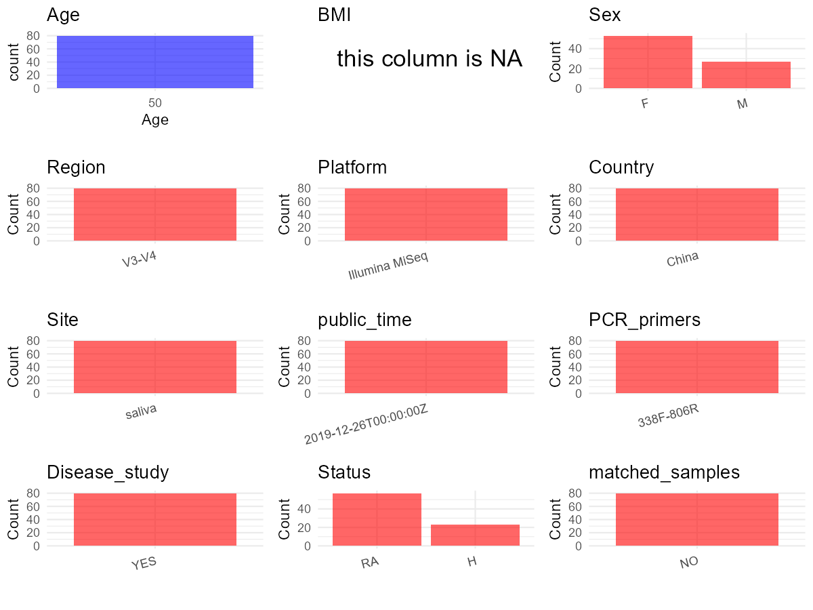

R Notebook: Metadata Processing Workflow
================

# Step 1: Obtain Initial Metadata from Each Project

To obtain the initial metadata: 1. Search for the BioProject ID (e.g.,
“PRJEBXXXX”) on the [NCBI SRA
website](https://www.ncbi.nlm.nih.gov/Traces/study/). 2. In the “Select”
table, click on “Metadata” and download the file. 3. The downloaded file
is typically named “SraRunTable.csv” and contains metadata for the
project.

``` r
# Load necessary libraries
library(dplyr)
library(ggplot2)
library(cowplot)

# Set working directory (update this path to your local directory)
setwd("D:/studylearning/董彪师兄项目/任务/修改20250922/PRJNA578951")

# Read the initial metadata files
initial_meta<-read.csv("SraRunTable.csv",header = T)

# Display the first few rows of the metadata
head(initial_meta)
```

    ##           Run Assay.Type AvgSpotLen    Bases BIOMATERIAL_PROVIDER  BioProject
    ## 1 SRR10339192   AMPLICON        425 14836574             luoyubin PRJNA578951
    ## 2 SRR10339193   AMPLICON        422 25444702             luoyubin PRJNA578951
    ## 3 SRR10339194   AMPLICON        422 22470067             luoyubin PRJNA578951
    ## 4 SRR10339195   AMPLICON        424 14152608             luoyubin PRJNA578951
    ## 5 SRR10339196   AMPLICON        426 31507051             luoyubin PRJNA578951
    ## 6 SRR10339197   AMPLICON        424 15178398             luoyubin PRJNA578951
    ##      BioSample              BioSampleModel    Bytes
    ## 1 SAMN13086622 Metagenome or environmental  6631582
    ## 2 SAMN13086621 Metagenome or environmental 11866146
    ## 3 SAMN13086692 Metagenome or environmental 12778420
    ## 4 SAMN13086691 Metagenome or environmental  6409727
    ## 5 SAMN13086690 Metagenome or environmental 13198460
    ## 6 SAMN13086689 Metagenome or environmental  6900472
    ##                               Center.Name Collection_Date Consent
    ## 1 WEST CHINA HOSPITAL, SICHUAN UNIVERSITY         missing  public
    ## 2 WEST CHINA HOSPITAL, SICHUAN UNIVERSITY         missing  public
    ## 3 WEST CHINA HOSPITAL, SICHUAN UNIVERSITY         missing  public
    ## 4 WEST CHINA HOSPITAL, SICHUAN UNIVERSITY         missing  public
    ## 5 WEST CHINA HOSPITAL, SICHUAN UNIVERSITY         missing  public
    ## 6 WEST CHINA HOSPITAL, SICHUAN UNIVERSITY         missing  public
    ##   DATASTORE.filetype DATASTORE.provider                     DATASTORE.region
    ## 1   fastq,run.zq,sra         gs,ncbi,s3 gs.us-east1,ncbi.public,s3.us-east-1
    ## 2   fastq,run.zq,sra         gs,ncbi,s3 gs.us-east1,ncbi.public,s3.us-east-1
    ## 3   fastq,run.zq,sra         gs,ncbi,s3 gs.us-east1,ncbi.public,s3.us-east-1
    ## 4   fastq,run.zq,sra         gs,ncbi,s3 gs.us-east1,ncbi.public,s3.us-east-1
    ## 5   fastq,run.zq,sra         gs,ncbi,s3 gs.us-east1,ncbi.public,s3.us-east-1
    ## 6   fastq,run.zq,sra         gs,ncbi,s3 gs.us-east1,ncbi.public,s3.us-east-1
    ##   Experiment geo_loc_name_country geo_loc_name_country_continent geo_loc_name
    ## 1 SRX7049339         uncalculated                   uncalculated      missing
    ## 2 SRX7049338         uncalculated                   uncalculated      missing
    ## 3 SRX7049337         uncalculated                   uncalculated      missing
    ## 4 SRX7049336         uncalculated                   uncalculated      missing
    ## 5 SRX7049335         uncalculated                   uncalculated      missing
    ## 6 SRX7049334         uncalculated                   uncalculated      missing
    ##   Host_age         Host host_sex     Instrument        isolate isolation_source
    ## 1       50 Homo sapiens     male Illumina MiSeq human saliva10           saliva
    ## 2       50 Homo sapiens     male Illumina MiSeq  human saliva9           saliva
    ## 3       50 Homo sapiens   female Illumina MiSeq human saliva80           saliva
    ## 4       50 Homo sapiens   female Illumina MiSeq human saliva79           saliva
    ## 5       50 Homo sapiens   female Illumina MiSeq human saliva78           saliva
    ## 6       50 Homo sapiens   female Illumina MiSeq human saliva77           saliva
    ##   lat_lon    Library.Name LibraryLayout LibrarySelection LibrarySource
    ## 1 missing    trim.sH20.fq        SINGLE              PCR   METAGENOMIC
    ## 2 missing    trim.sH31.fq        SINGLE              PCR   METAGENOMIC
    ## 3 missing trim.spre027.fq        SINGLE              PCR   METAGENOMIC
    ## 4 missing    trim.sH16.fq        SINGLE              PCR   METAGENOMIC
    ## 5 missing   trim.spre5.fq        SINGLE              PCR   METAGENOMIC
    ## 6 missing    trim.sH22.fq        SINGLE              PCR   METAGENOMIC
    ##                Organism Platform          ReleaseDate          create_date
    ## 1 human oral metagenome ILLUMINA 2019-12-26T00:00:00Z 2019-10-24T06:46:00Z
    ## 2 human oral metagenome ILLUMINA 2019-12-26T00:00:00Z 2019-10-24T06:46:00Z
    ## 3 human oral metagenome ILLUMINA 2019-12-26T00:00:00Z 2019-10-24T06:46:00Z
    ## 4 human oral metagenome ILLUMINA 2019-12-26T00:00:00Z 2019-10-24T06:46:00Z
    ## 5 human oral metagenome ILLUMINA 2019-12-26T00:00:00Z 2019-10-24T06:46:00Z
    ## 6 human oral metagenome ILLUMINA 2019-12-26T00:00:00Z 2019-10-24T06:46:00Z
    ##   version     Sample.Name SRA.Study
    ## 1       1    trim.sH20.fq SRP226795
    ## 2       1    trim.sH31.fq SRP226795
    ## 3       1 trim.spre027.fq SRP226795
    ## 4       1    trim.sH16.fq SRP226795
    ## 5       1   trim.spre5.fq SRP226795
    ## 6       1    trim.sH22.fq SRP226795

# Step 2: Create a Uniform Metadata Template

The uniform metadata should include the following columns:

1.  **BioProject**: Project ID (e.g., “PRJNA339212”)
2.  **Run**: Sample ID (e.g., “ERRXXXXXX” or “SRRXXXXXX”)
3.  **sample_name**: Original sample name submitted by the authors (not
    the database-assigned ID)
4.  **Age**: Age of the subject (if available)
5.  **BMI**: Body Mass Index (if available)
6.  **Sex**: Sex of the subject (“F” or “M”)
7.  **Region**: Targeted 16S rRNA region (e.g., “V3-V4”)
8.  **Platform**: Sequencing platform (e.g., “Illumina MiSeq”)
9.  **Country**: Country of sample origin (e.g., “China”)
10. **Site**: Sample site (e.g., “saliva”, “dental plaque”)
11. **public_time**: Data release date (format: “YYYY-MM-DD”)
12. **PCR_primers**: PCR primers used (e.g., “515F-806R”)
13. **title**: Title of the associated publication
14. **Disease_study**: Whether the study involves a disease (“YES” or
    “NO”)
15. **Status**: Disease status (e.g., “T2DM”, “HC”). Note: If the study
    includes both disease and healthy samples, this must be specified
    per sample.

``` r
# Create a uniform metadata dataframe
metadata <- data.frame(
  BioProject = initial_meta$BioProject,
  Run = initial_meta$Run,
  sample_name = initial_meta$Sample.Name,
  Age = initial_meta$Host_age,
  BMI = NA_character_,
  Sex=initial_meta$host_sex,
  Region = "V3-V4",
  Platform = initial_meta$Instrument,
  Country = "China",
  Site = initial_meta$isolation_source,
  public_time = initial_meta$ReleaseDate,
  stringsAsFactors = FALSE
)
```

# Step 3: Manually Add Information from the Publication

Some information (e.g. PCR primers, study title, disease status) must be
manually extracted from the publication and added to the metadata.

``` r
# Add information obtained from the publication
metadata$PCR_primers <- "338F-806R"  # Update based on the publication
metadata$title <- "Oral Microbiota Perturbations Are Linked to High Risk for Rheumatoid Arthritis"
metadata$Disease_study <- "YES"
metadata <- metadata %>% mutate(Status=case_when(grepl("trim.sH",sample_name)~"H",grepl("trim.sp",sample_name)~"RA",grepl("trim.sR",sample_name)~"RA"))
metadata <- metadata %>% 
  mutate(Sex = case_when(
    grepl("f",Sex)~"F",
    grepl("m",Sex)~"M"
  ))

#extract subject id by remove prefix of sample_name
#metadata$sample_name <- gsub("T|CR|CS|C|N|S", "", metadata$sample_name)

# Check initial data distribution
cat("Initial sample distribution:\n")
```

    ## Initial sample distribution:

``` r
table(metadata$sample_name)
```

    ## 
    ##    trim.sH16.fq    trim.sH17.fq    trim.sH18.fq    trim.sH19.fq    trim.sH20.fq 
    ##               1               1               1               1               1 
    ##    trim.sH21.fq    trim.sH22.fq    trim.sH24.fq    trim.sH25.fq    trim.sH26.fq 
    ##               1               1               1               1               1 
    ##    trim.sH27.fq    trim.sH28.fq    trim.sH29.fq    trim.sH30.fq    trim.sH31.fq 
    ##               1               1               1               1               1 
    ##    trim.sH33.fq    trim.sH34.fq    trim.sH35.fq    trim.sH39.fq  trim.sHC004.fq 
    ##               1               1               1               1               1 
    ##  trim.sHC005.fq  trim.sHC006.fq  trim.sHC007.fq trim.spre023.fq trim.spre024.fq 
    ##               1               1               1               1               1 
    ## trim.spre025.fq trim.spre026.fq trim.spre027.fq trim.spre028.fq trim.spre032.fq 
    ##               1               1               1               1               1 
    ## trim.spre033.fq trim.spre034.fq   trim.spre1.fq  trim.spre10.fq  trim.spre11.fq 
    ##               1               1               1               1               1 
    ##  trim.spre12.fq  trim.spre13.fq  trim.spre14.fq  trim.spre15.fq  trim.spre16.fq 
    ##               1               1               1               1               1 
    ##  trim.spre17.fq  trim.spre18.fq  trim.spre20.fq  trim.spre21.fq  trim.spre22.fq 
    ##               1               1               1               1               1 
    ##   trim.spre3.fq   trim.spre4.fq   trim.spre5.fq   trim.spre6.fq   trim.spre7.fq 
    ##               1               1               1               1               1 
    ##   trim.spre8.fq   trim.spre9.fq    trim.sR25.fq    trim.sR26.fq    trim.sR30.fq 
    ##               1               1               1               1               1 
    ##    trim.sR33.fq    trim.sR42.fq    trim.sR45.fq    trim.sR54.fq    trim.sRA1.fq 
    ##               1               1               1               1               1 
    ##   trim.sRA11.fq   trim.sRA12.fq   trim.sRA20.fq   trim.sRA22.fq   trim.sRA23.fq 
    ##               1               1               1               1               1 
    ##   trim.sRA24.fq   trim.sRA27.fq   trim.sRA32.fq   trim.sRA34.fq   trim.sRA35.fq 
    ##               1               1               1               1               1 
    ##   trim.sRA37.fq   trim.sRA40.fq   trim.sRA41.fq   trim.sRA44.fq   trim.sRA46.fq 
    ##               1               1               1               1               1 
    ##   trim.sRA49.fq   trim.sRA55.fq    trim.sRA6.fq    trim.sRA8.fq    trim.sRA9.fq 
    ##               1               1               1               1               1

``` r
table(metadata$Site)
```

    ## 
    ## saliva 
    ##     80

``` r
# Calculate sampling frequency per subject
sample_counts <- table(metadata$sample_name)
cat("\nNumber of samples per subject:\n")
```

    ## 
    ## Number of samples per subject:

``` r
print(sample_counts)
```

    ## 
    ##    trim.sH16.fq    trim.sH17.fq    trim.sH18.fq    trim.sH19.fq    trim.sH20.fq 
    ##               1               1               1               1               1 
    ##    trim.sH21.fq    trim.sH22.fq    trim.sH24.fq    trim.sH25.fq    trim.sH26.fq 
    ##               1               1               1               1               1 
    ##    trim.sH27.fq    trim.sH28.fq    trim.sH29.fq    trim.sH30.fq    trim.sH31.fq 
    ##               1               1               1               1               1 
    ##    trim.sH33.fq    trim.sH34.fq    trim.sH35.fq    trim.sH39.fq  trim.sHC004.fq 
    ##               1               1               1               1               1 
    ##  trim.sHC005.fq  trim.sHC006.fq  trim.sHC007.fq trim.spre023.fq trim.spre024.fq 
    ##               1               1               1               1               1 
    ## trim.spre025.fq trim.spre026.fq trim.spre027.fq trim.spre028.fq trim.spre032.fq 
    ##               1               1               1               1               1 
    ## trim.spre033.fq trim.spre034.fq   trim.spre1.fq  trim.spre10.fq  trim.spre11.fq 
    ##               1               1               1               1               1 
    ##  trim.spre12.fq  trim.spre13.fq  trim.spre14.fq  trim.spre15.fq  trim.spre16.fq 
    ##               1               1               1               1               1 
    ##  trim.spre17.fq  trim.spre18.fq  trim.spre20.fq  trim.spre21.fq  trim.spre22.fq 
    ##               1               1               1               1               1 
    ##   trim.spre3.fq   trim.spre4.fq   trim.spre5.fq   trim.spre6.fq   trim.spre7.fq 
    ##               1               1               1               1               1 
    ##   trim.spre8.fq   trim.spre9.fq    trim.sR25.fq    trim.sR26.fq    trim.sR30.fq 
    ##               1               1               1               1               1 
    ##    trim.sR33.fq    trim.sR42.fq    trim.sR45.fq    trim.sR54.fq    trim.sRA1.fq 
    ##               1               1               1               1               1 
    ##   trim.sRA11.fq   trim.sRA12.fq   trim.sRA20.fq   trim.sRA22.fq   trim.sRA23.fq 
    ##               1               1               1               1               1 
    ##   trim.sRA24.fq   trim.sRA27.fq   trim.sRA32.fq   trim.sRA34.fq   trim.sRA35.fq 
    ##               1               1               1               1               1 
    ##   trim.sRA37.fq   trim.sRA40.fq   trim.sRA41.fq   trim.sRA44.fq   trim.sRA46.fq 
    ##               1               1               1               1               1 
    ##   trim.sRA49.fq   trim.sRA55.fq    trim.sRA6.fq    trim.sRA8.fq    trim.sRA9.fq 
    ##               1               1               1               1               1

``` r
# Create matched_samples column
metadata$matched_samples <- ifelse(metadata$sample_name %in% names(sample_counts[sample_counts >= 2]), "YES", "NO")

cat("\nMatched samples distribution:\n")
```

    ## 
    ## Matched samples distribution:

``` r
table(metadata$matched_samples)
```

    ## 
    ## NO 
    ## 80

``` r
# Identify samples for removal: single samples excluding saliva
single_samples <- names(sample_counts[sample_counts == 1])
samples_to_remove <- metadata$sample_name %in% single_samples & !(metadata$Site %in% c("saliva"))

cat("\nNumber of samples to be removed:", sum(samples_to_remove), "\n")
```

    ## 
    ## Number of samples to be removed: 0

``` r
# Remove identified samples
metadata_clean <- metadata[!samples_to_remove, ]

cat("\nFinal sample distribution after cleaning:\n")
```

    ## 
    ## Final sample distribution after cleaning:

``` r
table(metadata_clean$sample_name)
```

    ## 
    ##    trim.sH16.fq    trim.sH17.fq    trim.sH18.fq    trim.sH19.fq    trim.sH20.fq 
    ##               1               1               1               1               1 
    ##    trim.sH21.fq    trim.sH22.fq    trim.sH24.fq    trim.sH25.fq    trim.sH26.fq 
    ##               1               1               1               1               1 
    ##    trim.sH27.fq    trim.sH28.fq    trim.sH29.fq    trim.sH30.fq    trim.sH31.fq 
    ##               1               1               1               1               1 
    ##    trim.sH33.fq    trim.sH34.fq    trim.sH35.fq    trim.sH39.fq  trim.sHC004.fq 
    ##               1               1               1               1               1 
    ##  trim.sHC005.fq  trim.sHC006.fq  trim.sHC007.fq trim.spre023.fq trim.spre024.fq 
    ##               1               1               1               1               1 
    ## trim.spre025.fq trim.spre026.fq trim.spre027.fq trim.spre028.fq trim.spre032.fq 
    ##               1               1               1               1               1 
    ## trim.spre033.fq trim.spre034.fq   trim.spre1.fq  trim.spre10.fq  trim.spre11.fq 
    ##               1               1               1               1               1 
    ##  trim.spre12.fq  trim.spre13.fq  trim.spre14.fq  trim.spre15.fq  trim.spre16.fq 
    ##               1               1               1               1               1 
    ##  trim.spre17.fq  trim.spre18.fq  trim.spre20.fq  trim.spre21.fq  trim.spre22.fq 
    ##               1               1               1               1               1 
    ##   trim.spre3.fq   trim.spre4.fq   trim.spre5.fq   trim.spre6.fq   trim.spre7.fq 
    ##               1               1               1               1               1 
    ##   trim.spre8.fq   trim.spre9.fq    trim.sR25.fq    trim.sR26.fq    trim.sR30.fq 
    ##               1               1               1               1               1 
    ##    trim.sR33.fq    trim.sR42.fq    trim.sR45.fq    trim.sR54.fq    trim.sRA1.fq 
    ##               1               1               1               1               1 
    ##   trim.sRA11.fq   trim.sRA12.fq   trim.sRA20.fq   trim.sRA22.fq   trim.sRA23.fq 
    ##               1               1               1               1               1 
    ##   trim.sRA24.fq   trim.sRA27.fq   trim.sRA32.fq   trim.sRA34.fq   trim.sRA35.fq 
    ##               1               1               1               1               1 
    ##   trim.sRA37.fq   trim.sRA40.fq   trim.sRA41.fq   trim.sRA44.fq   trim.sRA46.fq 
    ##               1               1               1               1               1 
    ##   trim.sRA49.fq   trim.sRA55.fq    trim.sRA6.fq    trim.sRA8.fq    trim.sRA9.fq 
    ##               1               1               1               1               1

``` r
table(metadata_clean$Site)
```

    ## 
    ## saliva 
    ##     80

``` r
table(metadata_clean$matched_samples)
```

    ## 
    ## NO 
    ## 80

``` r
# Use cleaned dataset for subsequent analysis
metadata <- metadata_clean
```

# Step 4: Summarize and Validate the Metadata

``` r
# Check the number of unique runs and sample names
print(paste("Number of unique runs:", length(unique(metadata$Run))))
```

    ## [1] "Number of unique runs: 80"

``` r
print(paste("Number of unique sample names:", length(unique(metadata$sample_name))))
```

    ## [1] "Number of unique sample names: 80"

# Step 5: Visualize the Metadata

``` r

```


# Step 6: Finalize and Export the Metadata

``` r
# Reorder columns to match the desired format
metadata <- metadata[, c(
  "BioProject", "Run", "sample_name", "Age", "BMI", "Sex", 
  "Region", "Platform", "Country", "Site", "public_time", 
  "PCR_primers", "title", "Disease_study", "Status","matched_samples"
)]

# Export the uniform metadata to a CSV file
write.csv(metadata, file = "metadata.csv", quote = FALSE)
head(metadata)
```

    ##    BioProject         Run     sample_name Age  BMI Sex Region       Platform
    ## 1 PRJNA578951 SRR10339192    trim.sH20.fq  50 <NA>   M  V3-V4 Illumina MiSeq
    ## 2 PRJNA578951 SRR10339193    trim.sH31.fq  50 <NA>   M  V3-V4 Illumina MiSeq
    ## 3 PRJNA578951 SRR10339194 trim.spre027.fq  50 <NA>   F  V3-V4 Illumina MiSeq
    ## 4 PRJNA578951 SRR10339195    trim.sH16.fq  50 <NA>   F  V3-V4 Illumina MiSeq
    ## 5 PRJNA578951 SRR10339196   trim.spre5.fq  50 <NA>   F  V3-V4 Illumina MiSeq
    ## 6 PRJNA578951 SRR10339197    trim.sH22.fq  50 <NA>   F  V3-V4 Illumina MiSeq
    ##   Country   Site          public_time PCR_primers
    ## 1   China saliva 2019-12-26T00:00:00Z   338F-806R
    ## 2   China saliva 2019-12-26T00:00:00Z   338F-806R
    ## 3   China saliva 2019-12-26T00:00:00Z   338F-806R
    ## 4   China saliva 2019-12-26T00:00:00Z   338F-806R
    ## 5   China saliva 2019-12-26T00:00:00Z   338F-806R
    ## 6   China saliva 2019-12-26T00:00:00Z   338F-806R
    ##                                                                            title
    ## 1 Oral Microbiota Perturbations Are Linked to High Risk for Rheumatoid Arthritis
    ## 2 Oral Microbiota Perturbations Are Linked to High Risk for Rheumatoid Arthritis
    ## 3 Oral Microbiota Perturbations Are Linked to High Risk for Rheumatoid Arthritis
    ## 4 Oral Microbiota Perturbations Are Linked to High Risk for Rheumatoid Arthritis
    ## 5 Oral Microbiota Perturbations Are Linked to High Risk for Rheumatoid Arthritis
    ## 6 Oral Microbiota Perturbations Are Linked to High Risk for Rheumatoid Arthritis
    ##   Disease_study Status matched_samples
    ## 1           YES      H              NO
    ## 2           YES      H              NO
    ## 3           YES     RA              NO
    ## 4           YES      H              NO
    ## 5           YES     RA              NO
    ## 6           YES      H              NO

## Notes for Students:

1.  **Metadata Accuracy**: Always cross-check the metadata with the
    original publication to ensure accuracy.
2.  **Manual Entries**: Columns like `PCR_primers`, and `Status` often
    require manual entry based on the publication.
3.  **Disease Status**: Be careful when assigning `Status`—some studies
    include both disease and healthy samples.
4.  **Visualization**: The plots help quickly identify the distribution
    of values in each column, which is useful for quality control.
5.  **Reproducibility**: Update the working directory and file paths to
    match your local environment.
