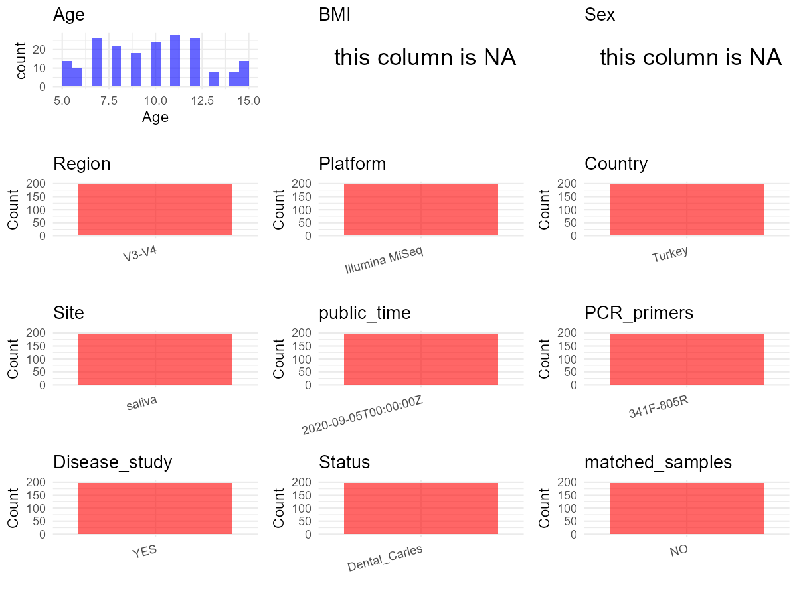

R Notebook: Metadata Processing Workflow
================

# Step 1: Obtain Initial Metadata from Each Project

To obtain the initial metadata: 1. Search for the BioProject ID (e.g.,
“PRJEBXXXX”) on the [NCBI SRA
website](https://www.ncbi.nlm.nih.gov/Traces/study/). 2. In the “Select”
table, click on “Metadata” and download the file. 3. The downloaded file
is typically named “SraRunTable.csv” and contains metadata for the
project.

``` r
# Load necessary libraries
library(dplyr)
library(ggplot2)
library(cowplot)

# Set working directory (update this path to your local directory)
setwd("D:/studylearning/董彪师兄项目/任务/修改20250922/PRJNA613586")

# Read the initial metadata files
initial_meta<-read.csv("SraRunTable.csv",header = T)

# Display the first few rows of the metadata
head(initial_meta)
```

    ##           Run Assay.Type AvgSpotLen    Bases  BioProject    BioSample
    ## 1 SRR11355925   AMPLICON        601 37228216 PRJNA613586 SAMN14410005
    ## 2 SRR11355926   AMPLICON        601 38456474 PRJNA613586 SAMN14410004
    ## 3 SRR11355927   AMPLICON        601 42026525 PRJNA613586 SAMN14410003
    ## 4 SRR11355928   AMPLICON        601 26038457 PRJNA613586 SAMN14410002
    ## 5 SRR11355929   AMPLICON        600 20839275 PRJNA613586 SAMN14410001
    ## 6 SRR11355930   AMPLICON        600 21782134 PRJNA613586 SAMN14410000
    ##                         BioSampleModel    Bytes         Center.Name
    ## 1 MIMS.me,MIGS/MIMS/MIMARKS.human-oral 20849203 ISTANBUL UNIVERSITY
    ## 2 MIMS.me,MIGS/MIMS/MIMARKS.human-oral 21424152 ISTANBUL UNIVERSITY
    ## 3 MIMS.me,MIGS/MIMS/MIMARKS.human-oral 23639305 ISTANBUL UNIVERSITY
    ## 4 MIMS.me,MIGS/MIMS/MIMARKS.human-oral 14931337 ISTANBUL UNIVERSITY
    ## 5 MIMS.me,MIGS/MIMS/MIMARKS.human-oral 12532937 ISTANBUL UNIVERSITY
    ## 6 MIMS.me,MIGS/MIMS/MIMARKS.human-oral 12476038 ISTANBUL UNIVERSITY
    ##   Collection_Date Consent DATASTORE.filetype DATASTORE.provider
    ## 1            2016  public   fastq,run.zq,sra         gs,ncbi,s3
    ## 2            2016  public   fastq,run.zq,sra         gs,ncbi,s3
    ## 3            2016  public   fastq,run.zq,sra         gs,ncbi,s3
    ## 4            2016  public   fastq,run.zq,sra         gs,ncbi,s3
    ## 5            2016  public   fastq,run.zq,sra         gs,ncbi,s3
    ## 6            2016  public   fastq,run.zq,sra         gs,ncbi,s3
    ##                       DATASTORE.region env_broad_scale env_local_scale
    ## 1 gs.us-east1,ncbi.public,s3.us-east-1   ENVO:02000019   ENVO:02000036
    ## 2 gs.us-east1,ncbi.public,s3.us-east-1   ENVO:02000019   ENVO:02000036
    ## 3 gs.us-east1,ncbi.public,s3.us-east-1   ENVO:02000019   ENVO:02000036
    ## 4 gs.us-east1,ncbi.public,s3.us-east-1   ENVO:02000019   ENVO:02000036
    ## 5 gs.us-east1,ncbi.public,s3.us-east-1   ENVO:02000019   ENVO:02000036
    ## 6 gs.us-east1,ncbi.public,s3.us-east-1   ENVO:02000019   ENVO:02000036
    ##      env_medium Experiment geo_loc_name_country geo_loc_name_country_continent
    ## 1 ENVO:02000036 SRX7957973               Turkey                           Asia
    ## 2 ENVO:02000036 SRX7957972               Turkey                           Asia
    ## 3 ENVO:02000036 SRX7957971               Turkey                           Asia
    ## 4 ENVO:02000036 SRX7957970               Turkey                           Asia
    ## 5 ENVO:02000036 SRX7957969               Turkey                           Asia
    ## 6 ENVO:02000036 SRX7957968               Turkey                           Asia
    ##       geo_loc_name Host_age host_body_product         Host     Instrument
    ## 1 Turkey: Istanbul       10            saliva Homo sapiens Illumina MiSeq
    ## 2 Turkey: Istanbul       10            saliva Homo sapiens Illumina MiSeq
    ## 3 Turkey: Istanbul        7            saliva Homo sapiens Illumina MiSeq
    ## 4 Turkey: Istanbul        7            saliva Homo sapiens Illumina MiSeq
    ## 5 Turkey: Istanbul       15            saliva Homo sapiens Illumina MiSeq
    ## 6 Turkey: Istanbul       15            saliva Homo sapiens Illumina MiSeq
    ##   isolate         lat_lon Library.Name LibraryLayout LibrarySelection
    ## 1 186-T49 41.01 N 28.98 E          186        PAIRED              PCR
    ## 2 185-T49 41.01 N 28.98 E          185        PAIRED              PCR
    ## 3 184-T48 41.01 N 28.98 E          184        PAIRED              PCR
    ## 4 183-T48 41.01 N 28.98 E          183        PAIRED              PCR
    ## 5 180-T47 41.01 N 28.98 E          180        PAIRED              PCR
    ## 6 179-T47 41.01 N 28.98 E          179        PAIRED              PCR
    ##   LibrarySource                Organism Platform          ReleaseDate
    ## 1   METAGENOMIC human saliva metagenome ILLUMINA 2020-09-05T00:00:00Z
    ## 2   METAGENOMIC human saliva metagenome ILLUMINA 2020-09-05T00:00:00Z
    ## 3   METAGENOMIC human saliva metagenome ILLUMINA 2020-09-05T00:00:00Z
    ## 4   METAGENOMIC human saliva metagenome ILLUMINA 2020-09-05T00:00:00Z
    ## 5   METAGENOMIC human saliva metagenome ILLUMINA 2020-09-05T00:00:00Z
    ## 6   METAGENOMIC human saliva metagenome ILLUMINA 2020-09-05T00:00:00Z
    ##            create_date version Sample.Name SRA.Study twin_id
    ## 1 2020-03-20T09:03:00Z       1         186 SRP253432     T49
    ## 2 2020-03-20T09:04:00Z       1         185 SRP253432     T49
    ## 3 2020-03-20T09:03:00Z       1         184 SRP253432     T48
    ## 4 2020-03-20T09:03:00Z       1         183 SRP253432     T48
    ## 5 2020-03-20T09:04:00Z       1         180 SRP253432     T47
    ## 6 2020-03-20T09:03:00Z       1         179 SRP253432     T47

# Step 2: Create a Uniform Metadata Template

The uniform metadata should include the following columns:

1.  **BioProject**: Project ID (e.g., “PRJNA339212”)
2.  **Run**: Sample ID (e.g., “ERRXXXXXX” or “SRRXXXXXX”)
3.  **sample_name**: Original sample name submitted by the authors (not
    the database-assigned ID)
4.  **Age**: Age of the subject (if available)
5.  **BMI**: Body Mass Index (if available)
6.  **Sex**: Sex of the subject (“F” or “M”)
7.  **Region**: Targeted 16S rRNA region (e.g., “V3-V4”)
8.  **Platform**: Sequencing platform (e.g., “Illumina MiSeq”)
9.  **Country**: Country of sample origin (e.g., “China”)
10. **Site**: Sample site (e.g., “saliva”, “dental plaque”)
11. **public_time**: Data release date (format: “YYYY-MM-DD”)
12. **PCR_primers**: PCR primers used (e.g., “515F-806R”)
13. **title**: Title of the associated publication
14. **Disease_study**: Whether the study involves a disease (“YES” or
    “NO”)
15. **Status**: Disease status (e.g., “T2DM”, “HC”). Note: If the study
    includes both disease and healthy samples, this must be specified
    per sample.

``` r
# Create a uniform metadata dataframe
metadata <- data.frame(
  BioProject = initial_meta$BioProject,
  Run = initial_meta$Run,
  sample_name = initial_meta$Sample.Name,
  Age = initial_meta$Host_age,
  BMI = NA_character_,
  Sex= NA_character_,
  Region = "V3-V4",
  Platform = initial_meta$Instrument,
  Country = initial_meta$geo_loc_name_country,
  Site = initial_meta$host_body_product,
  public_time = initial_meta$ReleaseDate,
  stringsAsFactors = FALSE
)
```

# Step 3: Manually Add Information from the Publication

Some information (e.g. PCR primers, study title, disease status) must be
manually extracted from the publication and added to the metadata.

``` r
# Add information obtained from the publication
metadata$PCR_primers <- "341F-805R"
metadata$title <- "Oral microbiota and dental caries data from monozygotic and dizygotic twin children"
metadata$Disease_study <- "YES"
metadata$Status <- "Dental_Caries"

#extract subject id by remove prefix of sample_name
#metadata$sample_name <- gsub("T|CR|CS|C|N|S", "", metadata$sample_name)

# Check initial data distribution
cat("Initial sample distribution:\n")
```

    ## Initial sample distribution:

``` r
table(metadata$sample_name)
```

    ## 
    ##   3   4   9  10  11  12  15  16  19  20  23  24  27  28  29  30  35  36  43  44 
    ##   1   1   1   1   1   1   1   1   1   1   1   1   1   1   1   1   1   1   1   1 
    ##  55  56  57  58  63  64  69  70  71  72  73  74  75  76  77  78  79  80  81  82 
    ##   1   1   1   1   1   1   1   1   1   1   1   1   1   1   1   1   1   1   1   1 
    ##  83  84  85  86  97  98  99 100 101 102 103 104 107 108 109 110 113 114 115 116 
    ##   1   1   1   1   1   1   1   1   1   1   1   1   1   1   1   1   1   1   1   1 
    ## 117 118 119 120 127 128 129 130 133 134 137 138 139 140 143 144 145 146 157 158 
    ##   1   1   1   1   1   1   1   1   1   1   1   1   1   1   1   1   1   1   1   1 
    ## 159 160 161 162 163 164 165 166 167 168 177 178 179 180 183 184 185 186 189 190 
    ##   1   1   1   1   1   1   1   1   1   1   1   1   1   1   1   1   1   1   1   1 
    ## 191 192 193 194 197 198 199 200 201 202 203 204 205 206 211 212 213 214 219 220 
    ##   1   1   1   1   1   1   1   1   1   1   1   1   1   1   1   1   1   1   1   1 
    ## 221 222 225 226 227 228 231 232 233 234 235 236 239 240 243 244 249 250 253 254 
    ##   1   1   1   1   1   1   1   1   1   1   1   1   1   1   1   1   1   1   1   1 
    ## 257 258 259 260 267 268 273 274 275 276 279 280 283 284 285 286 287 288 291 292 
    ##   1   1   1   1   1   1   1   1   1   1   1   1   1   1   1   1   1   1   1   1 
    ## 293 294 297 298 303 304 307 308 309 310 311 312 317 318 339 340 343 344 349 350 
    ##   1   1   1   1   1   1   1   1   1   1   1   1   1   1   1   1   1   1   1   1 
    ## 351 352 353 354 361 362 363 364 365 366 381 382 385 386 387 388 391 392 
    ##   1   1   1   1   1   1   1   1   1   1   1   1   1   1   1   1   1   1

``` r
table(metadata$Site)
```

    ## 
    ## saliva 
    ##    198

``` r
# Calculate sampling frequency per subject
sample_counts <- table(metadata$sample_name)
cat("\nNumber of samples per subject:\n")
```

    ## 
    ## Number of samples per subject:

``` r
print(sample_counts)
```

    ## 
    ##   3   4   9  10  11  12  15  16  19  20  23  24  27  28  29  30  35  36  43  44 
    ##   1   1   1   1   1   1   1   1   1   1   1   1   1   1   1   1   1   1   1   1 
    ##  55  56  57  58  63  64  69  70  71  72  73  74  75  76  77  78  79  80  81  82 
    ##   1   1   1   1   1   1   1   1   1   1   1   1   1   1   1   1   1   1   1   1 
    ##  83  84  85  86  97  98  99 100 101 102 103 104 107 108 109 110 113 114 115 116 
    ##   1   1   1   1   1   1   1   1   1   1   1   1   1   1   1   1   1   1   1   1 
    ## 117 118 119 120 127 128 129 130 133 134 137 138 139 140 143 144 145 146 157 158 
    ##   1   1   1   1   1   1   1   1   1   1   1   1   1   1   1   1   1   1   1   1 
    ## 159 160 161 162 163 164 165 166 167 168 177 178 179 180 183 184 185 186 189 190 
    ##   1   1   1   1   1   1   1   1   1   1   1   1   1   1   1   1   1   1   1   1 
    ## 191 192 193 194 197 198 199 200 201 202 203 204 205 206 211 212 213 214 219 220 
    ##   1   1   1   1   1   1   1   1   1   1   1   1   1   1   1   1   1   1   1   1 
    ## 221 222 225 226 227 228 231 232 233 234 235 236 239 240 243 244 249 250 253 254 
    ##   1   1   1   1   1   1   1   1   1   1   1   1   1   1   1   1   1   1   1   1 
    ## 257 258 259 260 267 268 273 274 275 276 279 280 283 284 285 286 287 288 291 292 
    ##   1   1   1   1   1   1   1   1   1   1   1   1   1   1   1   1   1   1   1   1 
    ## 293 294 297 298 303 304 307 308 309 310 311 312 317 318 339 340 343 344 349 350 
    ##   1   1   1   1   1   1   1   1   1   1   1   1   1   1   1   1   1   1   1   1 
    ## 351 352 353 354 361 362 363 364 365 366 381 382 385 386 387 388 391 392 
    ##   1   1   1   1   1   1   1   1   1   1   1   1   1   1   1   1   1   1

``` r
# Create matched_samples column
metadata$matched_samples <- ifelse(metadata$sample_name %in% names(sample_counts[sample_counts >= 2]), "YES", "NO")

cat("\nMatched samples distribution:\n")
```

    ## 
    ## Matched samples distribution:

``` r
table(metadata$matched_samples)
```

    ## 
    ##  NO 
    ## 198

``` r
# Identify samples for removal: single samples excluding saliva
single_samples <- names(sample_counts[sample_counts == 1])
samples_to_remove <- metadata$sample_name %in% single_samples & !(metadata$Site %in% c("saliva"))

cat("\nNumber of samples to be removed:", sum(samples_to_remove), "\n")
```

    ## 
    ## Number of samples to be removed: 0

``` r
# Remove identified samples
metadata_clean <- metadata[!samples_to_remove, ]

cat("\nFinal sample distribution after cleaning:\n")
```

    ## 
    ## Final sample distribution after cleaning:

``` r
table(metadata_clean$sample_name)
```

    ## 
    ##   3   4   9  10  11  12  15  16  19  20  23  24  27  28  29  30  35  36  43  44 
    ##   1   1   1   1   1   1   1   1   1   1   1   1   1   1   1   1   1   1   1   1 
    ##  55  56  57  58  63  64  69  70  71  72  73  74  75  76  77  78  79  80  81  82 
    ##   1   1   1   1   1   1   1   1   1   1   1   1   1   1   1   1   1   1   1   1 
    ##  83  84  85  86  97  98  99 100 101 102 103 104 107 108 109 110 113 114 115 116 
    ##   1   1   1   1   1   1   1   1   1   1   1   1   1   1   1   1   1   1   1   1 
    ## 117 118 119 120 127 128 129 130 133 134 137 138 139 140 143 144 145 146 157 158 
    ##   1   1   1   1   1   1   1   1   1   1   1   1   1   1   1   1   1   1   1   1 
    ## 159 160 161 162 163 164 165 166 167 168 177 178 179 180 183 184 185 186 189 190 
    ##   1   1   1   1   1   1   1   1   1   1   1   1   1   1   1   1   1   1   1   1 
    ## 191 192 193 194 197 198 199 200 201 202 203 204 205 206 211 212 213 214 219 220 
    ##   1   1   1   1   1   1   1   1   1   1   1   1   1   1   1   1   1   1   1   1 
    ## 221 222 225 226 227 228 231 232 233 234 235 236 239 240 243 244 249 250 253 254 
    ##   1   1   1   1   1   1   1   1   1   1   1   1   1   1   1   1   1   1   1   1 
    ## 257 258 259 260 267 268 273 274 275 276 279 280 283 284 285 286 287 288 291 292 
    ##   1   1   1   1   1   1   1   1   1   1   1   1   1   1   1   1   1   1   1   1 
    ## 293 294 297 298 303 304 307 308 309 310 311 312 317 318 339 340 343 344 349 350 
    ##   1   1   1   1   1   1   1   1   1   1   1   1   1   1   1   1   1   1   1   1 
    ## 351 352 353 354 361 362 363 364 365 366 381 382 385 386 387 388 391 392 
    ##   1   1   1   1   1   1   1   1   1   1   1   1   1   1   1   1   1   1

``` r
table(metadata_clean$Site)
```

    ## 
    ## saliva 
    ##    198

``` r
table(metadata_clean$matched_samples)
```

    ## 
    ##  NO 
    ## 198

``` r
# Use cleaned dataset for subsequent analysis
metadata <- metadata_clean
```

# Step 4: Summarize and Validate the Metadata

``` r
# Check the number of unique runs and sample names
print(paste("Number of unique runs:", length(unique(metadata$Run))))
```

    ## [1] "Number of unique runs: 198"

``` r
print(paste("Number of unique sample names:", length(unique(metadata$sample_name))))
```

    ## [1] "Number of unique sample names: 198"

# Step 5: Visualize the Metadata

``` r

```


# Step 6: Finalize and Export the Metadata

``` r
# Reorder columns to match the desired format
metadata <- metadata[, c(
  "BioProject", "Run", "sample_name", "Age", "BMI", "Sex", 
  "Region", "Platform", "Country", "Site", "public_time", 
  "PCR_primers", "title", "Disease_study", "Status","matched_samples"
)]

# Export the uniform metadata to a CSV file
write.csv(metadata, file = "metadata.csv", quote = FALSE)
head(metadata)
```

    ##    BioProject         Run sample_name Age  BMI  Sex Region       Platform
    ## 1 PRJNA613586 SRR11355925         186  10 <NA> <NA>  V3-V4 Illumina MiSeq
    ## 2 PRJNA613586 SRR11355926         185  10 <NA> <NA>  V3-V4 Illumina MiSeq
    ## 3 PRJNA613586 SRR11355927         184   7 <NA> <NA>  V3-V4 Illumina MiSeq
    ## 4 PRJNA613586 SRR11355928         183   7 <NA> <NA>  V3-V4 Illumina MiSeq
    ## 5 PRJNA613586 SRR11355929         180  15 <NA> <NA>  V3-V4 Illumina MiSeq
    ## 6 PRJNA613586 SRR11355930         179  15 <NA> <NA>  V3-V4 Illumina MiSeq
    ##   Country   Site          public_time PCR_primers
    ## 1  Turkey saliva 2020-09-05T00:00:00Z   341F-805R
    ## 2  Turkey saliva 2020-09-05T00:00:00Z   341F-805R
    ## 3  Turkey saliva 2020-09-05T00:00:00Z   341F-805R
    ## 4  Turkey saliva 2020-09-05T00:00:00Z   341F-805R
    ## 5  Turkey saliva 2020-09-05T00:00:00Z   341F-805R
    ## 6  Turkey saliva 2020-09-05T00:00:00Z   341F-805R
    ##                                                                                 title
    ## 1 Oral microbiota and dental caries data from monozygotic and dizygotic twin children
    ## 2 Oral microbiota and dental caries data from monozygotic and dizygotic twin children
    ## 3 Oral microbiota and dental caries data from monozygotic and dizygotic twin children
    ## 4 Oral microbiota and dental caries data from monozygotic and dizygotic twin children
    ## 5 Oral microbiota and dental caries data from monozygotic and dizygotic twin children
    ## 6 Oral microbiota and dental caries data from monozygotic and dizygotic twin children
    ##   Disease_study        Status matched_samples
    ## 1           YES Dental_Caries              NO
    ## 2           YES Dental_Caries              NO
    ## 3           YES Dental_Caries              NO
    ## 4           YES Dental_Caries              NO
    ## 5           YES Dental_Caries              NO
    ## 6           YES Dental_Caries              NO

## Notes for Students:

1.  **Metadata Accuracy**: Always cross-check the metadata with the
    original publication to ensure accuracy.
2.  **Manual Entries**: Columns like `PCR_primers`, and `Status` often
    require manual entry based on the publication.
3.  **Disease Status**: Be careful when assigning `Status`—some studies
    include both disease and healthy samples.
4.  **Visualization**: The plots help quickly identify the distribution
    of values in each column, which is useful for quality control.
5.  **Reproducibility**: Update the working directory and file paths to
    match your local environment.
