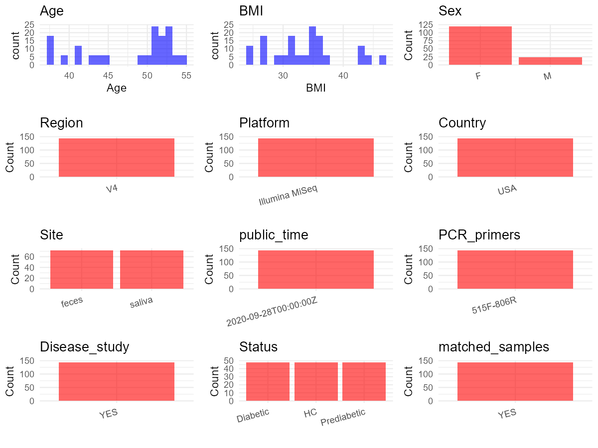

R Notebook: Metadata Processing Workflow
================

# Step 1: Obtain Initial Metadata from Each Project

To obtain the initial metadata: 1. Search for the BioProject ID (e.g.,
“PRJEBXXXX”) on the [NCBI SRA
website](https://www.ncbi.nlm.nih.gov/Traces/study/). 2. In the “Select”
table, click on “Metadata” and download the file. 3. The downloaded file
is typically named “SraRunTable.csv” and contains metadata for the
project.

``` r
# Load necessary libraries
library(dplyr)
library(ggplot2)
library(cowplot)

# Set working directory (update this path to your local directory)
setwd("D:/studylearning/董彪师兄项目/任务/修改20250922/PRJNA662100")

# Read the initial metadata files
initial_meta<-read.csv("SraRunTable.csv",header = T)
initial_meta <- subset(initial_meta,env_medium != "Flow cytometry sheath fluid")
initial_meta <- initial_meta %>% 
  mutate(env_medium=case_when(
    grepl("S",env_medium)~"saliva",
    grepl("F",env_medium)~"feces"
  ))
# Display the first few rows of the metadata
head(initial_meta)
```

    ##           Run Assay.Type AvgSpotLen    Bases  BioProject    BioSample
    ## 1 SRR12604924   AMPLICON        500  3587500 PRJNA662100 SAMN16076690
    ## 2 SRR12604925   AMPLICON        500 23238500 PRJNA662100 SAMN16076689
    ## 3 SRR12604926   AMPLICON        500  2396000 PRJNA662100 SAMN16076688
    ## 4 SRR12604927   AMPLICON        500  3487500 PRJNA662100 SAMN16076687
    ## 5 SRR12604928   AMPLICON        500 20659000 PRJNA662100 SAMN16076686
    ## 6 SRR12604929   AMPLICON        500  8919000 PRJNA662100 SAMN16076685
    ##                                      BioSampleModel    Bytes
    ## 1 MIMARKS.survey,MIGS/MIMS/MIMARKS.human-associated  2208634
    ## 2 MIMARKS.survey,MIGS/MIMS/MIMARKS.human-associated 13361016
    ## 3 MIMARKS.survey,MIGS/MIMS/MIMARKS.human-associated  1431442
    ## 4 MIMARKS.survey,MIGS/MIMS/MIMARKS.human-associated  2111227
    ## 5 MIMARKS.survey,MIGS/MIMS/MIMARKS.human-associated 12491638
    ## 6 MIMARKS.survey,MIGS/MIMS/MIMARKS.human-associated  5368918
    ##                  Center.Name Collection_Date Consent DATASTORE.filetype
    ## 1 BAYLOR COLLEGE OF MEDICINE      2018-04-05  public   fastq,run.zq,sra
    ## 2 BAYLOR COLLEGE OF MEDICINE      2018-04-05  public   fastq,run.zq,sra
    ## 3 BAYLOR COLLEGE OF MEDICINE      2018-04-05  public   fastq,run.zq,sra
    ## 4 BAYLOR COLLEGE OF MEDICINE      2018-04-05  public   fastq,run.zq,sra
    ## 5 BAYLOR COLLEGE OF MEDICINE      2018-05-14  public   fastq,run.zq,sra
    ## 6 BAYLOR COLLEGE OF MEDICINE      2018-05-14  public   fastq,run.zq,sra
    ##   DATASTORE.provider                     DATASTORE.region diabetes_status
    ## 1         gs,ncbi,s3 gs.us-east1,ncbi.public,s3.us-east-1     Prediabetic
    ## 2         gs,ncbi,s3 gs.us-east1,ncbi.public,s3.us-east-1     Prediabetic
    ## 3         gs,ncbi,s3 gs.us-east1,ncbi.public,s3.us-east-1     Prediabetic
    ## 4         gs,ncbi,s3 gs.us-east1,ncbi.public,s3.us-east-1     Prediabetic
    ## 5         gs,ncbi,s3 gs.us-east1,ncbi.public,s3.us-east-1   Normoglycemic
    ## 6         gs,ncbi,s3 gs.us-east1,ncbi.public,s3.us-east-1   Normoglycemic
    ##   env_broad_scale          env_local_scale env_medium Experiment
    ## 1     urban biome human associated habitat     saliva SRX9088747
    ## 2     urban biome human associated habitat      feces SRX9088746
    ## 3     urban biome human associated habitat      feces SRX9088745
    ## 4     urban biome human associated habitat      feces SRX9088744
    ## 5     urban biome human associated habitat     saliva SRX9088743
    ## 6     urban biome human associated habitat     saliva SRX9088742
    ##   geo_loc_name_country geo_loc_name_country_continent geo_loc_name         HOST
    ## 1                  USA                  North America      USA: TX Homo sapiens
    ## 2                  USA                  North America      USA: TX Homo sapiens
    ## 3                  USA                  North America      USA: TX Homo sapiens
    ## 4                  USA                  North America      USA: TX Homo sapiens
    ## 5                  USA                  North America      USA: TX Homo sapiens
    ## 6                  USA                  North America      USA: TX Homo sapiens
    ##   iga_sort     Instrument             lat_lon          Library.Name
    ## 1     A-M- Illumina MiSeq 26.3798 N 98.8203 W PD11_sal_AminusMminus
    ## 2  Presort Illumina MiSeq 26.3798 N 98.8203 W      PD11_fec_Presort
    ## 3     A+M- Illumina MiSeq 26.3798 N 98.8203 W  PD11_fec_AplusMminus
    ## 4     A-M- Illumina MiSeq 26.3798 N 98.8203 W PD11_fec_AminusMminus
    ## 5  Presort Illumina MiSeq 26.3798 N 98.8203 W       N73_sal_Presort
    ## 6     A+M- Illumina MiSeq 26.3798 N 98.8203 W   N73_sal_AplusMminus
    ##   LibraryLayout LibrarySelection LibrarySource                Organism Platform
    ## 1        PAIRED              PCR   METAGENOMIC human saliva metagenome ILLUMINA
    ## 2        PAIRED              PCR   METAGENOMIC    human gut metagenome ILLUMINA
    ## 3        PAIRED              PCR   METAGENOMIC    human gut metagenome ILLUMINA
    ## 4        PAIRED              PCR   METAGENOMIC    human gut metagenome ILLUMINA
    ## 5        PAIRED              PCR   METAGENOMIC human saliva metagenome ILLUMINA
    ## 6        PAIRED              PCR   METAGENOMIC human saliva metagenome ILLUMINA
    ##            ReleaseDate          create_date version           Sample.Name
    ## 1 2020-09-28T00:00:00Z 2020-09-07T17:16:00Z       1 PD11_sal_AminusMminus
    ## 2 2020-09-28T00:00:00Z 2020-09-07T17:16:00Z       1      PD11_fec_Presort
    ## 3 2020-09-28T00:00:00Z 2020-09-07T17:16:00Z       1  PD11_fec_AplusMminus
    ## 4 2020-09-28T00:00:00Z 2020-09-07T17:16:00Z       1 PD11_fec_AminusMminus
    ## 5 2020-09-28T00:00:00Z 2020-09-07T17:16:00Z       1       N73_sal_Presort
    ## 6 2020-09-28T00:00:00Z 2020-09-07T17:16:00Z       1   N73_sal_AplusMminus
    ##   SRA.Study study_subject
    ## 1 SRP280519          PD11
    ## 2 SRP280519          PD11
    ## 3 SRP280519          PD11
    ## 4 SRP280519          PD11
    ## 5 SRP280519           N73
    ## 6 SRP280519           N73

# Step 2: Create a Uniform Metadata Template

The uniform metadata should include the following columns:

1.  **BioProject**: Project ID (e.g., “PRJNA339212”)
2.  **Run**: Sample ID (e.g., “ERRXXXXXX” or “SRRXXXXXX”)
3.  **sample_name**: Original sample name submitted by the authors (not
    the database-assigned ID)
4.  **Age**: Age of the subject (if available)
5.  **BMI**: Body Mass Index (if available)
6.  **Sex**: Sex of the subject (“F” or “M”)
7.  **Region**: Targeted 16S rRNA region (e.g., “V3-V4”)
8.  **Platform**: Sequencing platform (e.g., “Illumina MiSeq”)
9.  **Country**: Country of sample origin (e.g., “China”)
10. **Site**: Sample site (e.g., “saliva”, “dental plaque”)
11. **public_time**: Data release date (format: “YYYY-MM-DD”)
12. **PCR_primers**: PCR primers used (e.g., “515F-806R”)
13. **title**: Title of the associated publication
14. **Disease_study**: Whether the study involves a disease (“YES” or
    “NO”)
15. **Status**: Disease status (e.g., “T2DM”, “HC”). Note: If the study
    includes both disease and healthy samples, this must be specified
    per sample.

``` r
# Create a uniform metadata dataframe
metadata <- data.frame(
  BioProject = initial_meta$BioProject,
  Run = initial_meta$Run,
  sample_name = initial_meta$Sample.Name,
  Age = NA,
  BMI = NA,
  Sex= NA,
  Region = "V4",
  Platform = initial_meta$Instrument,
  Country = initial_meta$geo_loc_name_country,
  Site = initial_meta$env_medium,
  public_time = initial_meta$ReleaseDate,
  Status = initial_meta$diabetes_status,
  study_subject = initial_meta$study_subject,
  stringsAsFactors = FALSE
)
```

# Step 3: Manually Add Information from the Publication

Some information (e.g. PCR primers, study title, disease status) must be
manually extracted from the publication and added to the metadata.

``` r
# Add information obtained from the publication
metadata$PCR_primers <- "515F-806R"
metadata$title <- "Impact of Diabetes on the Gut and Salivary IgA Microbiomes"
metadata$Disease_study <- "YES"
metadata[which(metadata$Status=="Normoglycemic"),]$Status <- "HC"
update_dataframe <- function(df, id_col, condition_value, update_cols, update_values) {
  condition_rows <- df[[id_col]] == condition_value
  
  # 更新指定列的值
  for (i in seq_along(update_cols)) {
    df[condition_rows, update_cols[i]] <- update_values[i]
  }
  
  return(df)
}
metadata <- update_dataframe(metadata,id_col="study_subject",condition_value="N04",update_cols = c("Age", "BMI", "Sex"),update_values = c(49, 36.5, "female"))
metadata <- update_dataframe(metadata,id_col="study_subject",condition_value="N28",update_cols = c("Age", "BMI", "Sex"),update_values = c(53, 26.5, "female"))
metadata <- update_dataframe(metadata,id_col="study_subject",condition_value="N30",update_cols = c("Age", "BMI", "Sex"),update_values = c(52, 34.9, "female"))
metadata <- update_dataframe(metadata,id_col="study_subject",condition_value="N33",update_cols = c("Age", "BMI", "Sex"),update_values = c(38, 24.3, "female"))
metadata <- update_dataframe(metadata,id_col="study_subject",condition_value="N52",update_cols = c("Age", "BMI", "Sex"),update_values = c(52, 33.6, "female"))
metadata <- update_dataframe(metadata,id_col="study_subject",condition_value="N54",update_cols = c("Age", "BMI", "Sex"),update_values = c(51, 27, "female"))
metadata <- update_dataframe(metadata,id_col="study_subject",condition_value="N62",update_cols = c("Age", "BMI", "Sex"),update_values = c(38, 34.7, "female"))
metadata <- update_dataframe(metadata,id_col="study_subject",condition_value="N73",update_cols = c("Age", "BMI", "Sex"),update_values = c(44, 26.9, "female"))
metadata <- update_dataframe(metadata,id_col="study_subject",condition_value="PD11",update_cols = c("Age", "BMI", "Sex"),update_values = c(43, 35.3, "female"))
metadata <- update_dataframe(metadata,id_col="study_subject",condition_value="PD17",update_cols = c("Age", "BMI", "Sex"),update_values = c(51, 33.1, "female"))
metadata <- update_dataframe(metadata,id_col="study_subject",condition_value="PD22",update_cols = c("Age", "BMI", "Sex"),update_values = c(38, 31.4, "female"))
metadata <- update_dataframe(metadata,id_col="study_subject",condition_value="PD27",update_cols = c("Age", "BMI", "Sex"),update_values = c(55, 28.7, "male"))
metadata <- update_dataframe(metadata,id_col="study_subject",condition_value="PD40",update_cols = c("Age", "BMI", "Sex"),update_values = c(53, 31, "female"))
metadata <- update_dataframe(metadata,id_col="study_subject",condition_value="PD41",update_cols = c("Age", "BMI", "Sex"),update_values = c(52, 36.6, "female"))
metadata <- update_dataframe(metadata,id_col="study_subject",condition_value="PD44",update_cols = c("Age", "BMI", "Sex"),update_values = c(45, 36.8, "male"))
metadata <- update_dataframe(metadata,id_col="study_subject",condition_value="PD56",update_cols = c("Age", "BMI", "Sex"),update_values = c(50, 31, "male"))
metadata <- update_dataframe(metadata,id_col="study_subject",condition_value="D01",update_cols = c("Age", "BMI", "Sex"),update_values = c(54, 24.4, "female"))
metadata <- update_dataframe(metadata,id_col="study_subject",condition_value="D13",update_cols = c("Age", "BMI", "Sex"),update_values = c(51, 43.8, "female"))
metadata <- update_dataframe(metadata,id_col="study_subject",condition_value="D19",update_cols = c("Age", "BMI", "Sex"),update_values = c(41, 46.4, "female"))
metadata <- update_dataframe(metadata,id_col="study_subject",condition_value="D43",update_cols = c("Age", "BMI", "Sex"),update_values = c(53, 42.5, "female"))
metadata <- update_dataframe(metadata,id_col="study_subject",condition_value="D79",update_cols = c("Age", "BMI", "Sex"),update_values = c(41, 36.6, "male"))
metadata <- update_dataframe(metadata,id_col="study_subject",condition_value="D82",update_cols = c("Age", "BMI", "Sex"),update_values = c(53, 42.5, "female"))
metadata <- update_dataframe(metadata,id_col="study_subject",condition_value="D89",update_cols = c("Age", "BMI", "Sex"),update_values = c(51, 29.9, "female"))
metadata <- update_dataframe(metadata,id_col="study_subject",condition_value="D106",update_cols = c("Age", "BMI", "Sex"),update_values = c(39, 35.2, "female"))
metadata$Region <- "V4"
metadata <- metadata %>%
  mutate(Sex = case_when(
    grepl("female", Sex) ~ "F",
    grepl("male", Sex) ~ "M"
  ))
metadata$Age <- as.numeric(metadata$Age)
metadata$BMI <- as.numeric(metadata$BMI)

#extract subject id by remove prefix of sample_name
metadata$sample_name <- sub("_.*", "", metadata$sample_name)

# Check initial data distribution
cat("Initial sample distribution:\n")
```

    ## Initial sample distribution:

``` r
table(metadata$sample_name)
```

    ## 
    ##  D01 D106  D13  D19  D43  D79  D82  D89  N04  N28  N30  N33  N52  N54  N62  N73 
    ##    6    6    6    6    6    6    6    6    6    6    6    6    6    6    6    6 
    ## PD11 PD17 PD22 PD27 PD40 PD41 PD44 PD56 
    ##    6    6    6    6    6    6    6    6

``` r
table(metadata$Site)
```

    ## 
    ##  feces saliva 
    ##     72     72

``` r
# Calculate sampling frequency per subject
sample_counts <- table(metadata$sample_name)
cat("\nNumber of samples per subject:\n")
```

    ## 
    ## Number of samples per subject:

``` r
print(sample_counts)
```

    ## 
    ##  D01 D106  D13  D19  D43  D79  D82  D89  N04  N28  N30  N33  N52  N54  N62  N73 
    ##    6    6    6    6    6    6    6    6    6    6    6    6    6    6    6    6 
    ## PD11 PD17 PD22 PD27 PD40 PD41 PD44 PD56 
    ##    6    6    6    6    6    6    6    6

``` r
# Create matched_samples column
metadata$matched_samples <- ifelse(metadata$sample_name %in% names(sample_counts[sample_counts >= 2]), "YES", "NO")

cat("\nMatched samples distribution:\n")
```

    ## 
    ## Matched samples distribution:

``` r
table(metadata$matched_samples)
```

    ## 
    ## YES 
    ## 144

``` r
# Identify samples for removal: single samples excluding saliva 
single_samples <- names(sample_counts[sample_counts == 1])
samples_to_remove <- metadata$sample_name %in% single_samples & !(metadata$Site %in% c("saliva"))

cat("\nNumber of samples to be removed:", sum(samples_to_remove), "\n")
```

    ## 
    ## Number of samples to be removed: 0

``` r
# Remove identified samples
metadata_clean <- metadata[!samples_to_remove, ]

cat("\nFinal sample distribution after cleaning:\n")
```

    ## 
    ## Final sample distribution after cleaning:

``` r
table(metadata_clean$sample_name)
```

    ## 
    ##  D01 D106  D13  D19  D43  D79  D82  D89  N04  N28  N30  N33  N52  N54  N62  N73 
    ##    6    6    6    6    6    6    6    6    6    6    6    6    6    6    6    6 
    ## PD11 PD17 PD22 PD27 PD40 PD41 PD44 PD56 
    ##    6    6    6    6    6    6    6    6

``` r
table(metadata_clean$Site)
```

    ## 
    ##  feces saliva 
    ##     72     72

``` r
table(metadata_clean$matched_samples)
```

    ## 
    ## YES 
    ## 144

``` r
# Use cleaned dataset for subsequent analysis
metadata <- metadata_clean
```

# Step 4: Summarize and Validate the Metadata

``` r
# Check the number of unique runs and sample names
print(paste("Number of unique runs:", length(unique(metadata$Run))))
```

    ## [1] "Number of unique runs: 144"

``` r
print(paste("Number of unique sample names:", length(unique(metadata$sample_name))))
```

    ## [1] "Number of unique sample names: 24"

# Step 5: Visualize the Metadata

``` r

```


# Step 6: Finalize and Export the Metadata

``` r
# Reorder columns to match the desired format
metadata <- metadata[, c(
  "BioProject", "Run", "sample_name", "Age", "BMI", "Sex", 
  "Region", "Platform", "Country", "Site", "public_time", 
  "PCR_primers", "title", "Disease_study", "Status","matched_samples"
)]

# Export the uniform metadata to a CSV file
write.csv(metadata, file = "metadata.csv", quote = FALSE)
head(metadata)
```

    ##    BioProject         Run sample_name Age  BMI Sex Region       Platform
    ## 1 PRJNA662100 SRR12604924        PD11  43 35.3   F     V4 Illumina MiSeq
    ## 2 PRJNA662100 SRR12604925        PD11  43 35.3   F     V4 Illumina MiSeq
    ## 3 PRJNA662100 SRR12604926        PD11  43 35.3   F     V4 Illumina MiSeq
    ## 4 PRJNA662100 SRR12604927        PD11  43 35.3   F     V4 Illumina MiSeq
    ## 5 PRJNA662100 SRR12604928         N73  44 26.9   F     V4 Illumina MiSeq
    ## 6 PRJNA662100 SRR12604929         N73  44 26.9   F     V4 Illumina MiSeq
    ##   Country   Site          public_time PCR_primers
    ## 1     USA saliva 2020-09-28T00:00:00Z   515F-806R
    ## 2     USA  feces 2020-09-28T00:00:00Z   515F-806R
    ## 3     USA  feces 2020-09-28T00:00:00Z   515F-806R
    ## 4     USA  feces 2020-09-28T00:00:00Z   515F-806R
    ## 5     USA saliva 2020-09-28T00:00:00Z   515F-806R
    ## 6     USA saliva 2020-09-28T00:00:00Z   515F-806R
    ##                                                        title Disease_study
    ## 1 Impact of Diabetes on the Gut and Salivary IgA Microbiomes           YES
    ## 2 Impact of Diabetes on the Gut and Salivary IgA Microbiomes           YES
    ## 3 Impact of Diabetes on the Gut and Salivary IgA Microbiomes           YES
    ## 4 Impact of Diabetes on the Gut and Salivary IgA Microbiomes           YES
    ## 5 Impact of Diabetes on the Gut and Salivary IgA Microbiomes           YES
    ## 6 Impact of Diabetes on the Gut and Salivary IgA Microbiomes           YES
    ##        Status matched_samples
    ## 1 Prediabetic             YES
    ## 2 Prediabetic             YES
    ## 3 Prediabetic             YES
    ## 4 Prediabetic             YES
    ## 5          HC             YES
    ## 6          HC             YES

## Notes for Students:

1.  **Metadata Accuracy**: Always cross-check the metadata with the
    original publication to ensure accuracy.
2.  **Manual Entries**: Columns like `PCR_primers`, and `Status` often
    require manual entry based on the publication.
3.  **Disease Status**: Be careful when assigning `Status`—some studies
    include both disease and healthy samples.
4.  **Visualization**: The plots help quickly identify the distribution
    of values in each column, which is useful for quality control.
5.  **Reproducibility**: Update the working directory and file paths to
    match your local environment.
