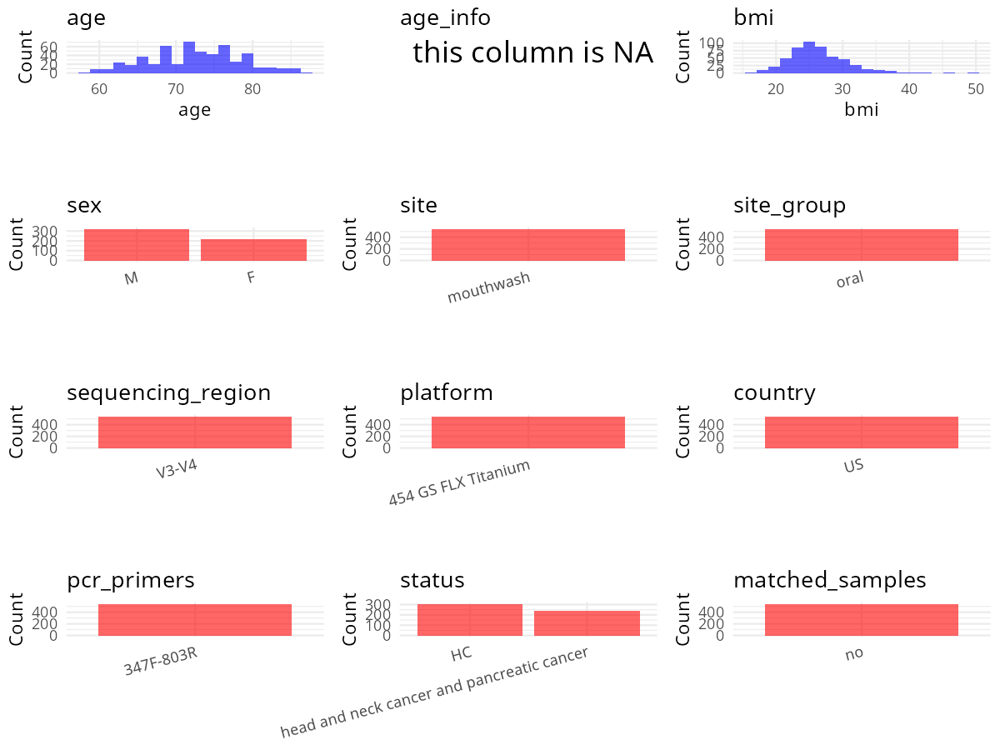

R Notebook: Metadata Processing Workflow
================

# Step 1: Obtain Initial Metadata from Each Project

To obtain the initial metadata: 1. Search for the BioProject ID (e.g.,
“PRJEBXXXX”) on the [NCBI SRA
website](https://www.ncbi.nlm.nih.gov/Traces/study/). 2. In the “Select”
table, click on “Metadata” and download the file. 3. The downloaded file
is typically named “SraRunTable.csv” and contains metadata for the
project.

``` r
# Load necessary libraries
library(dplyr)
library(ggplot2)
library(cowplot)

# Set working directory (update this path to your local directory)
setwd("D:/oral_project/PRJNA434300")

# Read the initial metadata files
initial_meta<-read.csv("SraRunTable.csv",header = T)

# Combine the two metadata files
#meta <- rbind(initial_meta, initial_meta1)

#Remove entries where Organism is "gut metagenome" (non-oral samples)
#initial_meta <- subset(initial_meta,isolation_source!= "feces")

# Check the number of samples containing "HT" in Sample.Name (e.g., healthy controls)
#nrow(subset(meta, grepl("HT", Sample.Name)))

# Display the first few rows of the metadata
head(initial_meta)
```

    ##          Run Assay.Type AvgSpotLen    Bases  BioProject    BioSample
    ## 1 SRR6751132   AMPLICON        384 12777550 PRJNA434300 SAMN08552086
    ## 2 SRR6751133   AMPLICON        377 10357769 PRJNA434300 SAMN08552085
    ## 3 SRR6751134   AMPLICON        392  6509545 PRJNA434300 SAMN08552350
    ## 4 SRR6751135   AMPLICON        399  5349647 PRJNA434300 SAMN08552082
    ## 5 SRR6751136   AMPLICON        396  5575230 PRJNA434300 SAMN08552081
    ## 6 SRR6751137   AMPLICON        372  8798481 PRJNA434300 SAMN08552084
    ##                BioSampleModel   Bytes                            Center.Name
    ## 1 Metagenome or environmental 7763243 NEW YORK UNIVERSITY SCHOOL OF MEDICINE
    ## 2 Metagenome or environmental 6162147 NEW YORK UNIVERSITY SCHOOL OF MEDICINE
    ## 3 Metagenome or environmental 3748969 NEW YORK UNIVERSITY SCHOOL OF MEDICINE
    ## 4 Metagenome or environmental 2956824 NEW YORK UNIVERSITY SCHOOL OF MEDICINE
    ## 5 Metagenome or environmental 3010481 NEW YORK UNIVERSITY SCHOOL OF MEDICINE
    ## 6 Metagenome or environmental 5340517 NEW YORK UNIVERSITY SCHOOL OF MEDICINE
    ##   Collection_Date Consent DATASTORE.filetype DATASTORE.provider
    ## 1  not applicable  public     bam,run.zq,sra         gs,ncbi,s3
    ## 2  not applicable  public     bam,run.zq,sra         gs,ncbi,s3
    ## 3  not applicable  public     bam,run.zq,sra         gs,ncbi,s3
    ## 4  not applicable  public     bam,run.zq,sra         gs,ncbi,s3
    ## 5  not applicable  public     bam,run.zq,sra         gs,ncbi,s3
    ## 6  not applicable  public     bam,run.zq,sra         gs,ncbi,s3
    ##                       DATASTORE.region disease_status Experiment
    ## 1 gs.us-east1,ncbi.public,s3.us-east-1           Case SRX3724150
    ## 2 gs.us-east1,ncbi.public,s3.us-east-1        Control SRX3724149
    ## 3 gs.us-east1,ncbi.public,s3.us-east-1           Case SRX3724148
    ## 4 gs.us-east1,ncbi.public,s3.us-east-1           Case SRX3724147
    ## 5 gs.us-east1,ncbi.public,s3.us-east-1        Control SRX3724146
    ## 6 gs.us-east1,ncbi.public,s3.us-east-1        Control SRX3724145
    ##   geo_loc_name_country geo_loc_name_country_continent   geo_loc_name Host_Age
    ## 1         uncalculated                   uncalculated not applicable       66
    ## 2         uncalculated                   uncalculated not applicable       65
    ## 3         uncalculated                   uncalculated not applicable       74
    ## 4         uncalculated                   uncalculated not applicable       75
    ## 5         uncalculated                   uncalculated not applicable       78
    ## 6         uncalculated                   uncalculated not applicable       75
    ##   host_BMI host_ETHA_GRAMS_PER_DAY host_race         HOST host_smoke
    ## 1    23.24                    1.20     White Homo sapiens     Former
    ## 2    23.63                   10.25     White Homo sapiens    Current
    ## 3    33.90                    2.24     White Homo sapiens      Never
    ## 4    24.41                   17.14     White Homo sapiens     Former
    ## 5    21.97                      NA     White Homo sapiens      Never
    ## 6    23.06                    0.00     White Homo sapiens      Never
    ##   host_type_beer host_type_liquor host_type_wine hostgender          Instrument
    ## 1              2                2              2       male 454 GS FLX Titanium
    ## 2              1                2              2       male 454 GS FLX Titanium
    ## 3              2                2              2     female 454 GS FLX Titanium
    ## 4              2                2              2       male 454 GS FLX Titanium
    ## 5             NA               NA             NA       male 454 GS FLX Titanium
    ## 6              0                0              0       male 454 GS FLX Titanium
    ##          isolate isolation_source lat_lon Library.Name LibraryLayout
    ## 1 not applicable   not applicable missing          100        SINGLE
    ## 2 not applicable   not applicable missing           99        SINGLE
    ## 3 not applicable   not applicable missing          364        SINGLE
    ## 4 not applicable   not applicable missing           96        SINGLE
    ## 5 not applicable   not applicable missing           95        SINGLE
    ## 6 not applicable   not applicable missing           98        SINGLE
    ##   LibrarySelection LibrarySource              Organism Platform
    ## 1              PCR       GENOMIC human oral metagenome    LS454
    ## 2              PCR       GENOMIC human oral metagenome    LS454
    ## 3              PCR       GENOMIC human oral metagenome    LS454
    ## 4              PCR       GENOMIC human oral metagenome    LS454
    ## 5              PCR       GENOMIC human oral metagenome    LS454
    ## 6              PCR       GENOMIC human oral metagenome    LS454
    ##            ReleaseDate          create_date version Sample.Name sample_type
    ## 1 2018-02-21T00:00:00Z 2018-05-10T10:01:00Z       2     ACS_100   Mouthwash
    ## 2 2018-02-21T00:00:00Z 2018-05-10T10:01:00Z       2     ACS_099   Mouthwash
    ## 3 2018-02-21T00:00:00Z 2018-05-10T10:01:00Z       2     ACS_364   Mouthwash
    ## 4 2018-02-21T00:00:00Z 2018-05-10T10:01:00Z       2     ACS_096   Mouthwash
    ## 5 2018-02-21T00:00:00Z 2018-05-10T10:01:00Z       2     ACS_095   Mouthwash
    ## 6 2018-02-21T00:00:00Z 2018-05-10T10:01:00Z       2     ACS_098   Mouthwash
    ##   SRA.Study         strain study type
    ## 1 SRP133146 not applicable   ACS  HNC
    ## 2 SRP133146 not applicable   ACS  HNC
    ## 3 SRP133146 not applicable   ACS   PC
    ## 4 SRP133146 not applicable   ACS  HNC
    ## 5 SRP133146 not applicable   ACS  HNC
    ## 6 SRP133146 not applicable   ACS  HNC

# Step 2: Create a Uniform Metadata Template

The uniform metadata should include the following columns:

1.  **BioProject**: Project ID (e.g., “PRJNA339212”)
2.  **Run**: Sample ID (e.g., “ERRXXXXXX” or “SRRXXXXXX”)
3.  **sample_name**: Original sample name submitted by the authors (not
    the database-assigned ID)
4.  **Age**: Age of the subject (if available)
5.  **BMI**: Body Mass Index (if available)
6.  **Sex**: Sex of the subject (“F” or “M”)
7.  **Region**: Targeted 16S rRNA region (e.g., “V3-V4”)
8.  **Platform**: Sequencing platform (e.g., “Illumina MiSeq”)
9.  **Country**: Country of sample origin (e.g., “China”)
10. **Site**: Sample site (e.g., “saliva”, “dental plaque”)
11. **public_time**: Data release date (format: “YYYY-MM-DD”)
12. **PCR_primers**: PCR primers used (e.g., “515F-806R”)
13. **title**: Title of the associated publication
14. **Disease_study**: Whether the study involves a disease (“YES” or
    “NO”)
15. **Status**: Disease status (e.g., “T2DM”, “HC”). Note: If the study
    includes both disease and healthy samples, this must be specified
    per sample.

``` r
# Create a uniform metadata dataframe
metadata <- data.frame(
  BioProject = initial_meta$BioProject,
  Run = initial_meta$Run,
  sample_name = initial_meta$Library.Name,
  Age = initial_meta$Host_Age,
  BMI = initial_meta$host_BMI,
  Sex=initial_meta$hostgender,
  Region = "V3-V4",
  Platform = initial_meta$Instrument,
  Country = initial_meta$geo_loc_name_country,
  Site =initial_meta$sample_type,
  public_time = initial_meta$ReleaseDate,
  Status=initial_meta$disease_status,
  stringsAsFactors = FALSE
)
```

# Step 3: Manually Add Information from the Publication

Some information (e.g. PCR primers, study title, disease status) must be
manually extracted from the publication and added to the metadata.

``` r
# Add information obtained from the publication
metadata$PCR_primers <- "347F-803R"
metadata$title <- "Elevated Dietary Carbohydrate and Glycemic Intake Associate with an Altered Oral Microbial Ecosystem in Two Large U.S. Cohorts"
#metadata<-subset(uniform_meta,Site!="feces")
metadata$Disease_study <- "YES"
# Assign disease status based on sample_name patterns
metadata <- metadata %>%
  mutate(Status = ifelse(grepl("Case",Status), 
                        "head and neck cancer and pancreatic cancer;", 
                        ifelse(grepl("Control", Status), "Healthy control", NA)))
#metadata<-metadata%>%
#  mutate(Site=ifelse(grepl("gut",Site),"Feces" ,ifelse(grepl("oral",Site),"Saliva",NA)))

#extract subject id by remove prefix of sample_name
#metadata$sample_name <- gsub("[FSP].*", "", metadata$sample_name)
#get subjects id with Saliva available
#keep_subjects<-subset(metadata,Site %in% c("Saliva"))
#remove subjects without Saliva samples
#metadata<-subset(metadata,sample_name %in% keep_subjects$sample_name)
#get subjects sampling counts
#sample_counts <- table(metadata$sample_name)
# Create matched_samples column, any subjects have >=2 samples will be label "YES", otherwise "NO"
#metadata$matched_samples <- ifelse(metadata$sample_name %in% names(sample_counts[sample_counts >= 2]), "YES", "NO")
#metadata$BMI<-gsub("not provided",NA,metadata$BMI)
#metadata$BMI<-as.numeric(metadata$BMI)
metadata$matched_samples<-"NO"
```

# Step 4: Summarize and Validate the Metadata

``` r
# Check the number of unique runs and sample names
print(paste("Number of unique runs:", length(unique(metadata$Run))))
```

    ## [1] "Number of unique runs: 543"

``` r
print(paste("Number of unique sample names:", length(unique(metadata$sample_name))))
```

    ## [1] "Number of unique sample names: 543"

# Step 5: Visualize the Metadata

``` r

```


# Step 6: Finalize and Export the Metadata

``` r
# Reorder columns to match the desired format
metadata <- metadata[, c(
  "BioProject", "Run", "sample_name", "Age", "BMI", "Sex", 
  "Region", "Platform", "Country", "Site", "public_time", 
  "PCR_primers", "title", "Disease_study", "Status","matched_samples"
)]

# Export the uniform metadata to a CSV file
write.csv(metadata, file = "metadata.csv", quote = FALSE)
head(metadata)
```

    ##    BioProject        Run sample_name Age   BMI    Sex Region
    ## 1 PRJNA434300 SRR6751132         100  66 23.24   male  V3-V4
    ## 2 PRJNA434300 SRR6751133          99  65 23.63   male  V3-V4
    ## 3 PRJNA434300 SRR6751134         364  74 33.90 female  V3-V4
    ## 4 PRJNA434300 SRR6751135          96  75 24.41   male  V3-V4
    ## 5 PRJNA434300 SRR6751136          95  78 21.97   male  V3-V4
    ## 6 PRJNA434300 SRR6751137          98  75 23.06   male  V3-V4
    ##              Platform      Country      Site          public_time PCR_primers
    ## 1 454 GS FLX Titanium uncalculated Mouthwash 2018-02-21T00:00:00Z   347F-803R
    ## 2 454 GS FLX Titanium uncalculated Mouthwash 2018-02-21T00:00:00Z   347F-803R
    ## 3 454 GS FLX Titanium uncalculated Mouthwash 2018-02-21T00:00:00Z   347F-803R
    ## 4 454 GS FLX Titanium uncalculated Mouthwash 2018-02-21T00:00:00Z   347F-803R
    ## 5 454 GS FLX Titanium uncalculated Mouthwash 2018-02-21T00:00:00Z   347F-803R
    ## 6 454 GS FLX Titanium uncalculated Mouthwash 2018-02-21T00:00:00Z   347F-803R
    ##                                                                                                                            title
    ## 1 Elevated Dietary Carbohydrate and Glycemic Intake Associate with an Altered Oral Microbial Ecosystem in Two Large U.S. Cohorts
    ## 2 Elevated Dietary Carbohydrate and Glycemic Intake Associate with an Altered Oral Microbial Ecosystem in Two Large U.S. Cohorts
    ## 3 Elevated Dietary Carbohydrate and Glycemic Intake Associate with an Altered Oral Microbial Ecosystem in Two Large U.S. Cohorts
    ## 4 Elevated Dietary Carbohydrate and Glycemic Intake Associate with an Altered Oral Microbial Ecosystem in Two Large U.S. Cohorts
    ## 5 Elevated Dietary Carbohydrate and Glycemic Intake Associate with an Altered Oral Microbial Ecosystem in Two Large U.S. Cohorts
    ## 6 Elevated Dietary Carbohydrate and Glycemic Intake Associate with an Altered Oral Microbial Ecosystem in Two Large U.S. Cohorts
    ##   Disease_study                                      Status matched_samples
    ## 1           YES head and neck cancer and pancreatic cancer;              NO
    ## 2           YES                             Healthy control              NO
    ## 3           YES head and neck cancer and pancreatic cancer;              NO
    ## 4           YES head and neck cancer and pancreatic cancer;              NO
    ## 5           YES                             Healthy control              NO
    ## 6           YES                             Healthy control              NO

## Notes for Students:

1.  **Metadata Accuracy**: Always cross-check the metadata with the
    original publication to ensure accuracy.
2.  **Manual Entries**: Columns like `PCR_primers`, and `Status` often
    require manual entry based on the publication.
3.  **Disease Status**: Be careful when assigning `Status`—some studies
    include both disease and healthy samples.
4.  **Visualization**: The plots help quickly identify the distribution
    of values in each column, which is useful for quality control.
5.  **Reproducibility**: Update the working directory and file paths to
    match your local environment.
