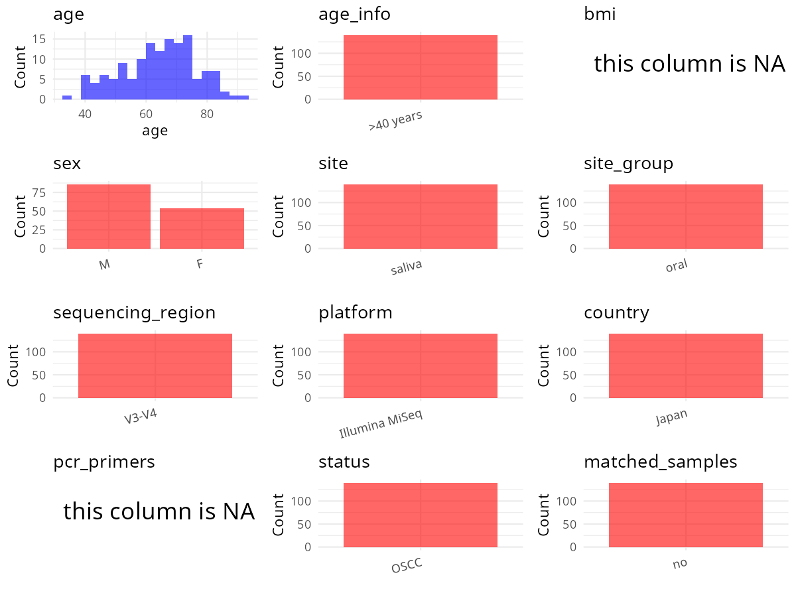

R Notebook: Metadata Processing Workflow
================

# Step 1: Obtain Initial Metadata from Each Project

To obtain the initial metadata: 1. Search for the BioProject ID (e.g.,
“PRJEBXXXX”) on the [NCBI SRA
website](https://www.ncbi.nlm.nih.gov/Traces/study/). 2. In the “Select”
table, click on “Metadata” and download the file. 3. The downloaded file
is typically named “SraRunTable.csv” and contains metadata for the
project.

``` r
# Load necessary libraries
library(dplyr)
library(ggplot2)
library(cowplot)

# Set working directory (update this path to your local directory)
setwd("D:/oral_project/PRJNA525734")

# Read the initial metadata files
initial_meta<-read.csv("SraRunTable.csv",header = T)

# Combine the two metadata files
#meta <- rbind(initial_meta, initial_meta1)

#Remove entries where Organism is "gut metagenome" (non-oral samples)
#initial_meta <- subset(initial_meta,isolation_source!= "feces")

# Check the number of samples containing "HT" in Sample.Name (e.g., healthy controls)
#nrow(subset(meta, grepl("HT", Sample.Name)))
initial_meta<-subset(initial_meta,Assay.Type=="AMPLICON")
# Display the first few rows of the metadata
head(initial_meta)
```

    ##          Run AGE Assay.Type AvgSpotLen    Bases  BioProject    BioSample
    ## 1 SRR8675978  74   AMPLICON        600 61129682 PRJNA525734 SAMN11066338
    ## 2 SRR8675979  56   AMPLICON        600 58035758 PRJNA525734 SAMN11066337
    ## 3 SRR8675980  63   AMPLICON        600 66754443 PRJNA525734 SAMN11066336
    ## 4 SRR8675981  62   AMPLICON        600 60616131 PRJNA525734 SAMN11066335
    ## 5 SRR8675982  81   AMPLICON        601 59409038 PRJNA525734 SAMN11066342
    ## 6 SRR8675983  60   AMPLICON        600 36703463 PRJNA525734 SAMN11066341
    ##                BioSampleModel    Bytes
    ## 1 Metagenome or environmental 40895270
    ## 2 Metagenome or environmental 38529471
    ## 3 Metagenome or environmental 44705977
    ## 4 Metagenome or environmental 40361658
    ## 5 Metagenome or environmental 39420462
    ## 6 Metagenome or environmental 24367785
    ##                                                          Center.Name
    ## 1 NATIONAL INSTITUTES OF BIOMEDICAL INNOVATION, HEALTH AND NUTRITION
    ## 2 NATIONAL INSTITUTES OF BIOMEDICAL INNOVATION, HEALTH AND NUTRITION
    ## 3 NATIONAL INSTITUTES OF BIOMEDICAL INNOVATION, HEALTH AND NUTRITION
    ## 4 NATIONAL INSTITUTES OF BIOMEDICAL INNOVATION, HEALTH AND NUTRITION
    ## 5 NATIONAL INSTITUTES OF BIOMEDICAL INNOVATION, HEALTH AND NUTRITION
    ## 6 NATIONAL INSTITUTES OF BIOMEDICAL INNOVATION, HEALTH AND NUTRITION
    ##   Collection_Date Consent DATASTORE.filetype DATASTORE.provider
    ## 1         2016-11  public   fastq,run.zq,sra         gs,ncbi,s3
    ## 2         2016-11  public   fastq,run.zq,sra         gs,ncbi,s3
    ## 3         2016-11  public   fastq,run.zq,sra         gs,ncbi,s3
    ## 4         2016-11  public   fastq,run.zq,sra         gs,ncbi,s3
    ## 5         2016-11  public   fastq,run.zq,sra         gs,ncbi,s3
    ## 6         2016-11  public   fastq,run.zq,sra         gs,ncbi,s3
    ##                       DATASTORE.region Experiment geo_loc_name_country
    ## 1 gs.us-east1,ncbi.public,s3.us-east-1 SRX5472037                Japan
    ## 2 gs.us-east1,ncbi.public,s3.us-east-1 SRX5472036                Japan
    ## 3 gs.us-east1,ncbi.public,s3.us-east-1 SRX5472035                Japan
    ## 4 gs.us-east1,ncbi.public,s3.us-east-1 SRX5472034                Japan
    ## 5 gs.us-east1,ncbi.public,s3.us-east-1 SRX5472033                Japan
    ## 6 gs.us-east1,ncbi.public,s3.us-east-1 SRX5472032                Japan
    ##   geo_loc_name_country_continent geo_loc_name         HOST     Instrument
    ## 1                           Asia        Japan Homo sapiens Illumina MiSeq
    ## 2                           Asia        Japan Homo sapiens Illumina MiSeq
    ## 3                           Asia        Japan Homo sapiens Illumina MiSeq
    ## 4                           Asia        Japan Homo sapiens Illumina MiSeq
    ## 5                           Asia        Japan Homo sapiens Illumina MiSeq
    ## 6                           Asia        Japan Homo sapiens Illumina MiSeq
    ##   isolation_source lat_lon Library.Name LibraryLayout LibrarySelection
    ## 1             Oral    none        MT-44        PAIRED              PCR
    ## 2             Oral    none        MT-43        PAIRED              PCR
    ## 3             Oral    none        MT-42        PAIRED              PCR
    ## 4             Oral    none        MT-41        PAIRED              PCR
    ## 5             Oral    none        MT-48        PAIRED              PCR
    ## 6             Oral    none        MT-47        PAIRED              PCR
    ##   LibrarySource   Organism Platform          ReleaseDate          create_date
    ## 1       GENOMIC metagenome ILLUMINA 2019-05-29T00:00:00Z 2019-03-05T22:54:00Z
    ## 2       GENOMIC metagenome ILLUMINA 2019-05-29T00:00:00Z 2019-03-05T22:54:00Z
    ## 3       GENOMIC metagenome ILLUMINA 2019-05-29T00:00:00Z 2019-03-05T22:54:00Z
    ## 4       GENOMIC metagenome ILLUMINA 2019-05-29T00:00:00Z 2019-03-05T22:54:00Z
    ## 5       GENOMIC metagenome ILLUMINA 2019-05-29T00:00:00Z 2019-03-05T22:55:00Z
    ## 6       GENOMIC metagenome ILLUMINA 2019-05-29T00:00:00Z 2019-03-05T22:54:00Z
    ##   version  Sample.Name SampleID    sex SRA.Study
    ## 1       1 tsurumiMT-44    MT-44 female SRP187636
    ## 2       1 tsurumiMT-43    MT-43   male SRP187636
    ## 3       1 tsurumiMT-42    MT-42   male SRP187636
    ## 4       1 tsurumiMT-41    MT-41 female SRP187636
    ## 5       1 tsurumiMT-48    MT-48   male SRP187636
    ## 6       1 tsurumiMT-47    MT-47   male SRP187636

# Step 2: Create a Uniform Metadata Template

The uniform metadata should include the following columns:

1.  **BioProject**: Project ID (e.g., “PRJNA339212”)
2.  **Run**: Sample ID (e.g., “ERRXXXXXX” or “SRRXXXXXX”)
3.  **sample_name**: Original sample name submitted by the authors (not
    the database-assigned ID)
4.  **Age**: Age of the subject (if available)
5.  **BMI**: Body Mass Index (if available)
6.  **Sex**: Sex of the subject (“F” or “M”)
7.  **Region**: Targeted 16S rRNA region (e.g., “V3-V4”)
8.  **Platform**: Sequencing platform (e.g., “Illumina MiSeq”)
9.  **Country**: Country of sample origin (e.g., “China”)
10. **Site**: Sample site (e.g., “saliva”, “dental plaque”)
11. **public_time**: Data release date (format: “YYYY-MM-DD”)
12. **PCR_primers**: PCR primers used (e.g., “515F-806R”)
13. **title**: Title of the associated publication
14. **Disease_study**: Whether the study involves a disease (“YES” or
    “NO”)
15. **Status**: Disease status (e.g., “T2DM”, “HC”). Note: If the study
    includes both disease and healthy samples, this must be specified
    per sample.

``` r
# Create a uniform metadata dataframe
metadata <- data.frame(
  BioProject = initial_meta$BioProject,
  Run = initial_meta$Run,
  sample_name = initial_meta$SampleID,
  Age = initial_meta$AGE,
  BMI = NA,
  Sex=initial_meta$sex,
  Region = "V3-V4",
  Platform = initial_meta$Instrument,
  Country = initial_meta$geo_loc_name_country,
  Site = "Saliva",
  public_time = initial_meta$ReleaseDate,
  stringsAsFactors = FALSE
)
```

# Step 3: Manually Add Information from the Publication

Some information (e.g. PCR primers, study title, disease status) must be
manually extracted from the publication and added to the metadata.

``` r
# Add information obtained from the publication
metadata$PCR_primers <- NA
metadata$title <- "Analysis of oral microbiota in Japanese oral cancer patients using 16S rRNA sequencing"
#metadata<-subset(uniform_meta,Site!="feces")
metadata$Disease_study <- "YES"
# Assign disease status based on sample_name patterns
metadata$Status<-NA
#metadata<- metadata%>%
#  mutate(Status=case_when(grepl("C_",sample_name)~"Control",grepl("SDP_",sample_name)~"chronic periodontitis and T2DM",grepl("P_",sample_name)~"chronic periodontitis"))
#extract subject id by remove prefix of sample_name
#metadata$sample_name <- gsub("S-Saliva-.*|F", "", metadata$sample_name)
#get subjects id with Saliva available
#keep_subjects<-subset(metadata,Site %in% c("Saliva"))
#remove subjects without Saliva samples
#metadata<-subset(metadata,sample_name %in% keep_subjects$sample_name)
#get subjects sampling counts
#sample_counts <- table(metadata$sample_name)
# Create matched_samples column, any subjects have >=2 samples will be label "YES", otherwise "NO"
#metadata$matched_samples <- ifelse(metadata$sample_name %in% names(sample_counts[sample_counts >= 2]), "YES", "NO")
metadata$matched_samples<-"NO"
```

# Step 4: Summarize and Validate the Metadata

``` r
# Check the number of unique runs and sample names
print(paste("Number of unique runs:", length(unique(metadata$Run))))
```

    ## [1] "Number of unique runs: 140"

``` r
print(paste("Number of unique sample names:", length(unique(metadata$sample_name))))
```

    ## [1] "Number of unique sample names: 140"

# Step 5: Visualize the Metadata

``` r

```


# Step 6: Finalize and Export the Metadata

``` r
# Reorder columns to match the desired format
metadata <- metadata[, c(
  "BioProject", "Run", "sample_name", "Age", "BMI", "Sex", 
  "Region", "Platform", "Country", "Site", "public_time", 
  "PCR_primers", "title", "Disease_study", "Status","matched_samples"
)]

# Export the uniform metadata to a CSV file
write.csv(metadata, file = "metadata.csv", quote = FALSE)
head(metadata)
```

    ##    BioProject        Run sample_name Age BMI    Sex Region       Platform
    ## 1 PRJNA525734 SRR8675978       MT-44  74  NA female  V3-V4 Illumina MiSeq
    ## 2 PRJNA525734 SRR8675979       MT-43  56  NA   male  V3-V4 Illumina MiSeq
    ## 3 PRJNA525734 SRR8675980       MT-42  63  NA   male  V3-V4 Illumina MiSeq
    ## 4 PRJNA525734 SRR8675981       MT-41  62  NA female  V3-V4 Illumina MiSeq
    ## 5 PRJNA525734 SRR8675982       MT-48  81  NA   male  V3-V4 Illumina MiSeq
    ## 6 PRJNA525734 SRR8675983       MT-47  60  NA   male  V3-V4 Illumina MiSeq
    ##   Country   Site          public_time PCR_primers
    ## 1   Japan Saliva 2019-05-29T00:00:00Z          NA
    ## 2   Japan Saliva 2019-05-29T00:00:00Z          NA
    ## 3   Japan Saliva 2019-05-29T00:00:00Z          NA
    ## 4   Japan Saliva 2019-05-29T00:00:00Z          NA
    ## 5   Japan Saliva 2019-05-29T00:00:00Z          NA
    ## 6   Japan Saliva 2019-05-29T00:00:00Z          NA
    ##                                                                                    title
    ## 1 Analysis of oral microbiota in Japanese oral cancer patients using 16S rRNA sequencing
    ## 2 Analysis of oral microbiota in Japanese oral cancer patients using 16S rRNA sequencing
    ## 3 Analysis of oral microbiota in Japanese oral cancer patients using 16S rRNA sequencing
    ## 4 Analysis of oral microbiota in Japanese oral cancer patients using 16S rRNA sequencing
    ## 5 Analysis of oral microbiota in Japanese oral cancer patients using 16S rRNA sequencing
    ## 6 Analysis of oral microbiota in Japanese oral cancer patients using 16S rRNA sequencing
    ##   Disease_study Status matched_samples
    ## 1           YES     NA              NO
    ## 2           YES     NA              NO
    ## 3           YES     NA              NO
    ## 4           YES     NA              NO
    ## 5           YES     NA              NO
    ## 6           YES     NA              NO

## Notes for Students:

1.  **Metadata Accuracy**: Always cross-check the metadata with the
    original publication to ensure accuracy.
2.  **Manual Entries**: Columns like `PCR_primers`, and `Status` often
    require manual entry based on the publication.
3.  **Disease Status**: Be careful when assigning `Status`—some studies
    include both disease and healthy samples.
4.  **Visualization**: The plots help quickly identify the distribution
    of values in each column, which is useful for quality control.
5.  **Reproducibility**: Update the working directory and file paths to
    match your local environment.
