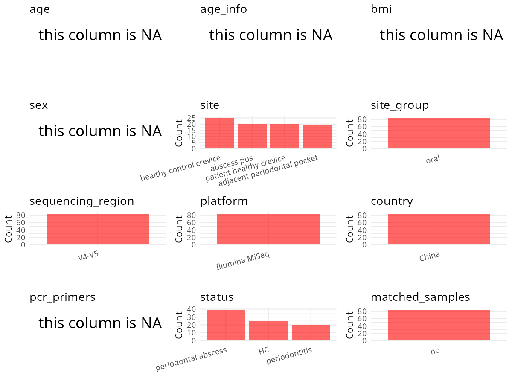

R Notebook: Metadata Processing Workflow
================

# Step 1: Obtain Initial Metadata from Each Project

To obtain the initial metadata: 1. Search for the BioProject ID (e.g.,
“PRJEBXXXX”) on the [NCBI SRA
website](https://www.ncbi.nlm.nih.gov/Traces/study/). 2. In the “Select”
table, click on “Metadata” and download the file. 3. The downloaded file
is typically named “SraRunTable.csv” and contains metadata for the
project.

``` r
# Load necessary libraries
library(dplyr)
library(ggplot2)
library(cowplot)

# Set working directory (update this path to your local directory)
setwd("D:/oral_project/PRJNA547446")

# Read the initial metadata files
initial_meta<-read.csv("SraRunTable.csv",header = T)

# Combine the two metadata files
#meta <- rbind(initial_meta, initial_meta1)

#Remove entries where Organism is "gut metagenome" (non-oral samples)
#initial_meta <- subset(initial_meta,host_body_product=="oral cavity")

# Check the number of samples containing "HT" in Sample.Name (e.g., healthy controls)
#nrow(subset(meta, grepl("HT", Sample.Name)))

# Display the first few rows of the metadata
head(initial_meta)
```

    ##          Run Assay.Type AvgSpotLen     Bases  BioProject    BioSample
    ## 1 SRR9214805   AMPLICON        550 105647534 PRJNA547446 SAMN11963818
    ## 2 SRR9214806   AMPLICON        550  92738444 PRJNA547446 SAMN11963817
    ## 3 SRR9214807   AMPLICON        525 100753058 PRJNA547446 SAMN11963820
    ## 4 SRR9214808   AMPLICON        526 108584697 PRJNA547446 SAMN11963819
    ## 5 SRR9214809   AMPLICON        551  66755922 PRJNA547446 SAMN11963822
    ## 6 SRR9214810   AMPLICON        551 115066794 PRJNA547446 SAMN11963821
    ##                BioSampleModel    Bytes                          Center.Name
    ## 1 Metagenome or environmental 60447267 ZHONGSHAN HOSPITAL, FUDAN UNIVERSITY
    ## 2 Metagenome or environmental 53121693 ZHONGSHAN HOSPITAL, FUDAN UNIVERSITY
    ## 3 Metagenome or environmental 65716351 ZHONGSHAN HOSPITAL, FUDAN UNIVERSITY
    ## 4 Metagenome or environmental 70665224 ZHONGSHAN HOSPITAL, FUDAN UNIVERSITY
    ## 5 Metagenome or environmental 37126036 ZHONGSHAN HOSPITAL, FUDAN UNIVERSITY
    ## 6 Metagenome or environmental 64040802 ZHONGSHAN HOSPITAL, FUDAN UNIVERSITY
    ##   Collection_Date Consent DATASTORE.filetype DATASTORE.provider
    ## 1            2015  public   fastq,run.zq,sra         gs,ncbi,s3
    ## 2            2015  public   fastq,run.zq,sra         gs,ncbi,s3
    ## 3            2015  public   fastq,run.zq,sra         gs,ncbi,s3
    ## 4            2015  public   fastq,run.zq,sra         gs,ncbi,s3
    ## 5            2015  public   fastq,run.zq,sra         gs,ncbi,s3
    ## 6            2015  public   fastq,run.zq,sra         gs,ncbi,s3
    ##                       DATASTORE.region Experiment geo_loc_name_country
    ## 1 gs.us-east1,ncbi.public,s3.us-east-1 SRX5985583                China
    ## 2 gs.us-east1,ncbi.public,s3.us-east-1 SRX5985582                China
    ## 3 gs.us-east1,ncbi.public,s3.us-east-1 SRX5985581                China
    ## 4 gs.us-east1,ncbi.public,s3.us-east-1 SRX5985580                China
    ## 5 gs.us-east1,ncbi.public,s3.us-east-1 SRX5985579                China
    ## 6 gs.us-east1,ncbi.public,s3.us-east-1 SRX5985578                China
    ##   geo_loc_name_country_continent geo_loc_name         HOST     Instrument
    ## 1                           Asia        China Homo sapiens Illumina MiSeq
    ## 2                           Asia        China Homo sapiens Illumina MiSeq
    ## 3                           Asia        China Homo sapiens Illumina MiSeq
    ## 4                           Asia        China Homo sapiens Illumina MiSeq
    ## 5                           Asia        China Homo sapiens Illumina MiSeq
    ## 6                           Asia        China Homo sapiens Illumina MiSeq
    ##              isolate isolation_source lat_lon   Library.Name LibraryLayout
    ## 1 periodontal pocket           052004 missing 052004A_Pocket        PAIRED
    ## 2 periodontal pocket           052003 missing 052003A_Pocket        PAIRED
    ## 3 periodontal pocket           070101 missing 070101C_Pocket        PAIRED
    ## 4 periodontal pocket           062403 missing 062403B_Pocket        PAIRED
    ## 5 periodontal pocket           081102 missing 081102A_Pocket        PAIRED
    ## 6 periodontal pocket           072801 missing 072801A_Pocket        PAIRED
    ##   LibrarySelection LibrarySource              Organism Platform
    ## 1              PCR   METAGENOMIC human oral metagenome ILLUMINA
    ## 2              PCR   METAGENOMIC human oral metagenome ILLUMINA
    ## 3              PCR   METAGENOMIC human oral metagenome ILLUMINA
    ## 4              PCR   METAGENOMIC human oral metagenome ILLUMINA
    ## 5              PCR   METAGENOMIC human oral metagenome ILLUMINA
    ## 6              PCR   METAGENOMIC human oral metagenome ILLUMINA
    ##            ReleaseDate          create_date version    Sample.Name
    ## 1 2020-07-01T00:00:00Z 2019-06-07T14:17:00Z       1 052004A_Pocket
    ## 2 2020-07-01T00:00:00Z 2019-06-07T14:18:00Z       1 052003A_Pocket
    ## 3 2020-07-01T00:00:00Z 2019-06-07T14:18:00Z       1 070101C_Pocket
    ## 4 2020-07-01T00:00:00Z 2019-06-07T14:18:00Z       1 062403B_Pocket
    ## 5 2020-07-01T00:00:00Z 2019-06-07T14:18:00Z       1 081102A_Pocket
    ## 6 2020-07-01T00:00:00Z 2019-06-07T14:18:00Z       1 072801A_Pocket
    ##            sample_type SRA.Study
    ## 1 metagenomic assembly SRP200763
    ## 2 metagenomic assembly SRP200763
    ## 3 metagenomic assembly SRP200763
    ## 4 metagenomic assembly SRP200763
    ## 5 metagenomic assembly SRP200763
    ## 6 metagenomic assembly SRP200763

# Step 2: Create a Uniform Metadata Template

The uniform metadata should include the following columns:

1.  **BioProject**: Project ID (e.g., “PRJNA339212”)
2.  **Run**: Sample ID (e.g., “ERRXXXXXX” or “SRRXXXXXX”)
3.  **sample_name**: Original sample name (if subject id is available,
    use subject id) submitted by the authors (not the database-assigned
    ID)
4.  **Age**: Age of the subject (if available)
5.  **BMI**: Body Mass Index (if available)
6.  **Sex**: Sex of the subject (“F” or “M”)
7.  **Region**: Targeted 16S rRNA region (e.g., “V3-V4”)
8.  **Platform**: Sequencing platform (e.g., “Illumina MiSeq”)
9.  **Country**: Country of sample origin (e.g., “China”)
10. **Site**: Sample site (e.g., “saliva”, “dental plaque”)
11. **public_time**: Data release date (format: “YYYY-MM-DD”)
12. **PCR_primers**: PCR primers used (e.g., “515F-806R”)
13. **title**: Title of the associated publication
14. **Disease_study**: Whether the study involves a disease (“YES” or
    “NO”)
15. **Status**: Disease status (e.g., “T2DM”, “HC”). Note: If the study
    includes both disease and healthy samples, this must be specified
    per sample.
16. **matched_samples**: whether the study have matched samples from
    oral and other sites (“YES”,“NO”)

``` r
# Create a uniform metadata dataframe
metadata <- data.frame(
  BioProject = initial_meta$BioProject,
  Run = initial_meta$Run,
  sample_name = initial_meta$Sample.Name,
  Age = NA,
  BMI = NA,
  Sex=NA,
  Region = "V4–V5",
  Platform = initial_meta$Instrument,
  Country = initial_meta$geo_loc_name_country,
  Site = initial_meta$isolate,
  public_time = initial_meta$ReleaseDate,
  Status=initial_meta$isolate,
  stringsAsFactors = FALSE
)
```

# Step 3: Manually Add Information from the Publication

Some information (e.g. PCR primers, study title, disease status) must be
manually extracted from the publication and added to the metadata.

``` r
# Add information obtained from the publication
metadata$PCR_primers <- NA

metadata$title <- "Microbiota in Human Periodontal Abscess Revealed by 16S rDNA Sequencing"
metadata$Disease_study <- "YES"
#get 
# Assign disease status based on sample_name patterns
metadata <- metadata %>%
  mutate(Site = case_when(
    Site == "periodontal abscess" ~ "Abscess Pus",
    Site == "periodontal pocket" ~ "Adjacent Periodontal Pocket", 
    Site == "periodontal patient control" ~ "Patient Healthy Crevice",
    Site == "periodontal health control" ~ "Healthy Control Crevice"
  ))
metadata$matched_samples="NO"
```

# Step 4: Summarize and Validate the Metadata

``` r
# Check the number of unique runs and sample names
print(paste("Number of unique runs:", length(unique(metadata$Run))))
```

    ## [1] "Number of unique runs: 84"

``` r
print(paste("Number of unique sample names:", length(unique(metadata$sample_name))))
```

    ## [1] "Number of unique sample names: 84"

# Step 5: Visualize the Metadata

``` r

```


# Step 6: Finalize and Export the Metadata

``` r
# Reorder columns to match the desired format
metadata <- metadata[, c(
  "BioProject", "Run", "sample_name", "Age", "BMI", "Sex", 
  "Region", "Platform", "Country", "Site", "public_time", 
  "PCR_primers", "title", "Disease_study", "Status","matched_samples"
)]

# Export the uniform metadata to a CSV file
write.csv(metadata, file = "metadata.csv", quote = FALSE)
head(metadata)
```

    ##    BioProject        Run    sample_name Age BMI Sex Region       Platform
    ## 1 PRJNA547446 SRR9214805 052004A_Pocket  NA  NA  NA  V4–V5 Illumina MiSeq
    ## 2 PRJNA547446 SRR9214806 052003A_Pocket  NA  NA  NA  V4–V5 Illumina MiSeq
    ## 3 PRJNA547446 SRR9214807 070101C_Pocket  NA  NA  NA  V4–V5 Illumina MiSeq
    ## 4 PRJNA547446 SRR9214808 062403B_Pocket  NA  NA  NA  V4–V5 Illumina MiSeq
    ## 5 PRJNA547446 SRR9214809 081102A_Pocket  NA  NA  NA  V4–V5 Illumina MiSeq
    ## 6 PRJNA547446 SRR9214810 072801A_Pocket  NA  NA  NA  V4–V5 Illumina MiSeq
    ##   Country                        Site          public_time PCR_primers
    ## 1   China Adjacent Periodontal Pocket 2020-07-01T00:00:00Z          NA
    ## 2   China Adjacent Periodontal Pocket 2020-07-01T00:00:00Z          NA
    ## 3   China Adjacent Periodontal Pocket 2020-07-01T00:00:00Z          NA
    ## 4   China Adjacent Periodontal Pocket 2020-07-01T00:00:00Z          NA
    ## 5   China Adjacent Periodontal Pocket 2020-07-01T00:00:00Z          NA
    ## 6   China Adjacent Periodontal Pocket 2020-07-01T00:00:00Z          NA
    ##                                                                     title
    ## 1 Microbiota in Human Periodontal Abscess Revealed by 16S rDNA Sequencing
    ## 2 Microbiota in Human Periodontal Abscess Revealed by 16S rDNA Sequencing
    ## 3 Microbiota in Human Periodontal Abscess Revealed by 16S rDNA Sequencing
    ## 4 Microbiota in Human Periodontal Abscess Revealed by 16S rDNA Sequencing
    ## 5 Microbiota in Human Periodontal Abscess Revealed by 16S rDNA Sequencing
    ## 6 Microbiota in Human Periodontal Abscess Revealed by 16S rDNA Sequencing
    ##   Disease_study             Status matched_samples
    ## 1           YES periodontal pocket              NO
    ## 2           YES periodontal pocket              NO
    ## 3           YES periodontal pocket              NO
    ## 4           YES periodontal pocket              NO
    ## 5           YES periodontal pocket              NO
    ## 6           YES periodontal pocket              NO

## Notes for Students:

1.  **Metadata Accuracy**: Always cross-check the metadata with the
    original publication to ensure accuracy.
2.  **Manual Entries**: Columns like `PCR_primers`, and `Status` often
    require manual entry based on the publication.
3.  **Disease Status**: Be careful when assigning `Status`—some studies
    include both disease and healthy samples.
4.  **Visualization**: The plots help quickly identify the distribution
    of values in each column, which is useful for quality control.
5.  **Reproducibility**: Update the working directory and file paths to
    match your local environment.
