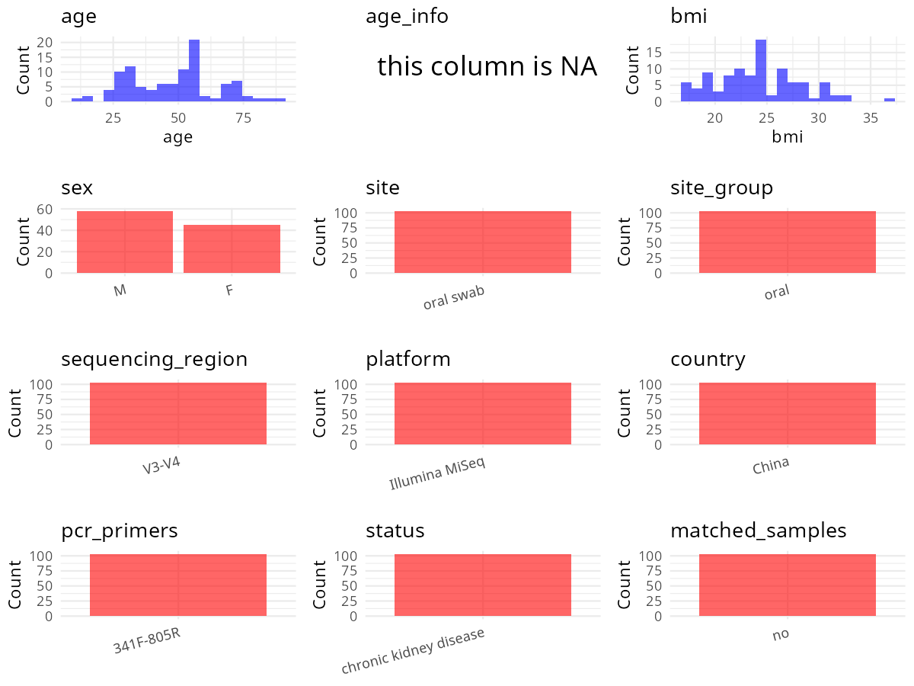

R Notebook: Metadata Processing Workflow
================

# Step 1: Obtain Initial Metadata from Each Project

To obtain the initial metadata: 1. Search for the BioProject ID (e.g.,
“PRJEBXXXX”) on the [NCBI SRA
website](https://www.ncbi.nlm.nih.gov/Traces/study/). 2. In the “Select”
table, click on “Metadata” and download the file. 3. The downloaded file
is typically named “SraRunTable.csv” and contains metadata for the
project.

``` r
# Load necessary libraries
library(dplyr)
library(ggplot2)
library(cowplot)

# Set working directory (update this path to your local directory)
setwd("D:/oral_project/PRJNA649074")

# Read the initial metadata files
initial_meta<-read.csv("SraRunTable.csv",header = T)

# Combine the two metadata files
#meta <- rbind(initial_meta, initial_meta1)

#Remove entries where Organism is "gut metagenome" (non-oral samples)
#initial_meta <- subset(initial_meta,isolation_source!= "feces")

# Check the number of samples containing "HT" in Sample.Name (e.g., healthy controls)
#nrow(subset(meta, grepl("HT", Sample.Name)))

# Display the first few rows of the metadata
head(initial_meta)
```

    ##           Run Assay.Type AvgSpotLen    Bases  BioProject    BioSample
    ## 1 SRR12338054   AMPLICON        600 27115958 PRJNA649074 SAMN15658722
    ## 2 SRR12338055   AMPLICON        600 33103254 PRJNA649074 SAMN15658721
    ## 3 SRR12338056   AMPLICON        600 39807800 PRJNA649074 SAMN15658720
    ## 4 SRR12338057   AMPLICON        600 29832463 PRJNA649074 SAMN15658719
    ## 5 SRR12338058   AMPLICON        599 25393197 PRJNA649074 SAMN15658718
    ## 6 SRR12338059   AMPLICON        599 37009131 PRJNA649074 SAMN15658717
    ##                BioSampleModel    Bytes
    ## 1 Metagenome or environmental 15357669
    ## 2 Metagenome or environmental 19294088
    ## 3 Metagenome or environmental 22138847
    ## 4 Metagenome or environmental 16724869
    ## 5 Metagenome or environmental 14338630
    ## 6 Metagenome or environmental 20973367
    ##                                             Center.Name Collection_Date Consent
    ## 1 THE FIRST AFFILIATED HOSPITAL OF ZHENGZHOU UNIVERSITY      2019-12-16  public
    ## 2 THE FIRST AFFILIATED HOSPITAL OF ZHENGZHOU UNIVERSITY      2019-12-13  public
    ## 3 THE FIRST AFFILIATED HOSPITAL OF ZHENGZHOU UNIVERSITY      2019-12-12  public
    ## 4 THE FIRST AFFILIATED HOSPITAL OF ZHENGZHOU UNIVERSITY      2019-12-11  public
    ## 5 THE FIRST AFFILIATED HOSPITAL OF ZHENGZHOU UNIVERSITY      2019-12-11  public
    ## 6 THE FIRST AFFILIATED HOSPITAL OF ZHENGZHOU UNIVERSITY      2019-12-03  public
    ##   DATASTORE.filetype DATASTORE.provider                     DATASTORE.region
    ## 1   fastq,run.zq,sra         gs,ncbi,s3 gs.us-east1,ncbi.public,s3.us-east-1
    ## 2   fastq,run.zq,sra         gs,ncbi,s3 gs.us-east1,ncbi.public,s3.us-east-1
    ## 3   fastq,run.zq,sra         gs,ncbi,s3 gs.us-east1,ncbi.public,s3.us-east-1
    ## 4   fastq,run.zq,sra         gs,ncbi,s3 gs.us-east1,ncbi.public,s3.us-east-1
    ## 5   fastq,run.zq,sra         gs,ncbi,s3 gs.us-east1,ncbi.public,s3.us-east-1
    ## 6   fastq,run.zq,sra         gs,ncbi,s3 gs.us-east1,ncbi.public,s3.us-east-1
    ##   Experiment geo_loc_name_country geo_loc_name_country_continent
    ## 1 SRX8838072                China                           Asia
    ## 2 SRX8838071                China                           Asia
    ## 3 SRX8838070                China                           Asia
    ## 4 SRX8838069                China                           Asia
    ## 5 SRX8838068                China                           Asia
    ## 6 SRX8838067                China                           Asia
    ##      geo_loc_name      HOST     Instrument isolation_source          lat_lon
    ## 1 China:Hang'zhou hzCKD0056 Illumina MiSeq             oral 30.26 N 120.19 E
    ## 2 China:Hang'zhou hzCKD0055 Illumina MiSeq             oral 30.26 N 120.19 E
    ## 3 China:Hang'zhou hzCKD0054 Illumina MiSeq             oral 30.26 N 120.19 E
    ## 4 China:Hang'zhou hzCKD0053 Illumina MiSeq             oral 30.26 N 120.19 E
    ## 5 China:Hang'zhou hzCKD0052 Illumina MiSeq             oral 30.26 N 120.19 E
    ## 6 China:Hang'zhou hzCKD0051 Illumina MiSeq             oral 30.26 N 120.19 E
    ##   Library.Name LibraryLayout LibrarySelection LibrarySource
    ## 1    OhzCKD_56        PAIRED              PCR         OTHER
    ## 2    OhzCKD_55        PAIRED              PCR         OTHER
    ## 3    OhzCKD_54        PAIRED              PCR         OTHER
    ## 4    OhzCKD_53        PAIRED              PCR         OTHER
    ## 5    OhzCKD_52        PAIRED              PCR         OTHER
    ## 6    OhzCKD_51        PAIRED              PCR         OTHER
    ##                Organism Platform          ReleaseDate          create_date
    ## 1 human oral metagenome ILLUMINA 2020-07-28T00:00:00Z 2020-07-28T10:06:00Z
    ## 2 human oral metagenome ILLUMINA 2020-07-28T00:00:00Z 2020-07-28T10:06:00Z
    ## 3 human oral metagenome ILLUMINA 2020-07-28T00:00:00Z 2020-07-28T10:06:00Z
    ## 4 human oral metagenome ILLUMINA 2020-07-28T00:00:00Z 2020-07-28T10:06:00Z
    ## 5 human oral metagenome ILLUMINA 2020-07-28T00:00:00Z 2020-07-28T10:06:00Z
    ## 6 human oral metagenome ILLUMINA 2020-07-28T00:00:00Z 2020-07-28T10:06:00Z
    ##   version Sample.Name SRA.Study
    ## 1       1   OhzCKD_56 SRP273916
    ## 2       1   OhzCKD_55 SRP273916
    ## 3       1   OhzCKD_54 SRP273916
    ## 4       1   OhzCKD_53 SRP273916
    ## 5       1   OhzCKD_52 SRP273916
    ## 6       1   OhzCKD_51 SRP273916

# Step 2: Create a Uniform Metadata Template

The uniform metadata should include the following columns:

1.  **BioProject**: Project ID (e.g., “PRJNA339212”)
2.  **Run**: Sample ID (e.g., “ERRXXXXXX” or “SRRXXXXXX”)
3.  **sample_name**: Original sample name submitted by the authors (not
    the database-assigned ID)
4.  **Age**: Age of the subject (if available)
5.  **BMI**: Body Mass Index (if available)
6.  **Sex**: Sex of the subject (“F” or “M”)
7.  **Region**: Targeted 16S rRNA region (e.g., “V3-V4”)
8.  **Platform**: Sequencing platform (e.g., “Illumina MiSeq”)
9.  **Country**: Country of sample origin (e.g., “China”)
10. **Site**: Sample site (e.g., “saliva”, “dental plaque”)
11. **public_time**: Data release date (format: “YYYY-MM-DD”)
12. **PCR_primers**: PCR primers used (e.g., “515F-806R”)
13. **title**: Title of the associated publication
14. **Disease_study**: Whether the study involves a disease (“YES” or
    “NO”)
15. **Status**: Disease status (e.g., “T2DM”, “HC”). Note: If the study
    includes both disease and healthy samples, this must be specified
    per sample.

``` r
# Create a uniform metadata dataframe
metadata <- data.frame(
  BioProject = initial_meta$BioProject,
  Run = initial_meta$Run,
  sample_name = initial_meta$Library.Name,
  Age = NA,
  BMI = NA,
  Sex=NA,
  Region = "V3-V4",
  Platform = initial_meta$Instrument,
  Country = initial_meta$geo_loc_name_country,
  Site =initial_meta$isolation_source,
  public_time = initial_meta$ReleaseDate,
  Status="chronic kidney disease",
  stringsAsFactors = FALSE
)
```

# Step 3: Manually Add Information from the Publication

Some information (e.g. PCR primers, study title, disease status) must be
manually extracted from the publication and added to the metadata.

``` r
# Add information obtained from the publication
metadata$PCR_primers <- "341F-805R"
metadata$title <- "Elevated Dietary Carbohydrate and Glycemic Intake Associate with an Altered Oral Microbial Ecosystem in Two Large U.S. Cohorts"
#metadata<-subset(uniform_meta,Site!="feces")
metadata$Disease_study <- "YES"
# Assign disease status based on sample_name patterns
#extract subject id by remove prefix of sample_name
#metadata$sample_name <- gsub("[FSP].*", "", metadata$sample_name)
#get subjects id with Saliva available
#keep_subjects<-subset(metadata,Site %in% c("Saliva"))
#remove subjects without Saliva samples
#metadata<-subset(metadata,sample_name %in% keep_subjects$sample_name)
#get subjects sampling counts
#sample_counts <- table(metadata$sample_name)
# Create matched_samples column, any subjects have >=2 samples will be label "YES", otherwise "NO"
#metadata$matched_samples <- ifelse(metadata$sample_name %in% names(sample_counts[sample_counts >= 2]), "YES", "NO")
#metadata$BMI<-gsub("not provided",NA,metadata$BMI)
#metadata$BMI<-as.numeric(metadata$BMI)
metadata$matched_samples<-"NO"
```

# Step 4: Summarize and Validate the Metadata

``` r
# Check the number of unique runs and sample names
print(paste("Number of unique runs:", length(unique(metadata$Run))))
```

    ## [1] "Number of unique runs: 103"

``` r
print(paste("Number of unique sample names:", length(unique(metadata$sample_name))))
```

    ## [1] "Number of unique sample names: 103"

# Step 5: Visualize the Metadata

``` r

```


# Step 6: Finalize and Export the Metadata

``` r
# Reorder columns to match the desired format
metadata <- metadata[, c(
  "BioProject", "Run", "sample_name", "Age", "BMI", "Sex", 
  "Region", "Platform", "Country", "Site", "public_time", 
  "PCR_primers", "title", "Disease_study", "Status","matched_samples"
)]

# Export the uniform metadata to a CSV file
write.csv(metadata, file = "metadata.csv", quote = FALSE)
head(metadata)
```

    ##    BioProject         Run sample_name Age BMI Sex Region       Platform Country
    ## 1 PRJNA649074 SRR12338054   OhzCKD_56  NA  NA  NA  V3-V4 Illumina MiSeq   China
    ## 2 PRJNA649074 SRR12338055   OhzCKD_55  NA  NA  NA  V3-V4 Illumina MiSeq   China
    ## 3 PRJNA649074 SRR12338056   OhzCKD_54  NA  NA  NA  V3-V4 Illumina MiSeq   China
    ## 4 PRJNA649074 SRR12338057   OhzCKD_53  NA  NA  NA  V3-V4 Illumina MiSeq   China
    ## 5 PRJNA649074 SRR12338058   OhzCKD_52  NA  NA  NA  V3-V4 Illumina MiSeq   China
    ## 6 PRJNA649074 SRR12338059   OhzCKD_51  NA  NA  NA  V3-V4 Illumina MiSeq   China
    ##   Site          public_time PCR_primers
    ## 1 oral 2020-07-28T00:00:00Z   341F-805R
    ## 2 oral 2020-07-28T00:00:00Z   341F-805R
    ## 3 oral 2020-07-28T00:00:00Z   341F-805R
    ## 4 oral 2020-07-28T00:00:00Z   341F-805R
    ## 5 oral 2020-07-28T00:00:00Z   341F-805R
    ## 6 oral 2020-07-28T00:00:00Z   341F-805R
    ##                                                                                                                            title
    ## 1 Elevated Dietary Carbohydrate and Glycemic Intake Associate with an Altered Oral Microbial Ecosystem in Two Large U.S. Cohorts
    ## 2 Elevated Dietary Carbohydrate and Glycemic Intake Associate with an Altered Oral Microbial Ecosystem in Two Large U.S. Cohorts
    ## 3 Elevated Dietary Carbohydrate and Glycemic Intake Associate with an Altered Oral Microbial Ecosystem in Two Large U.S. Cohorts
    ## 4 Elevated Dietary Carbohydrate and Glycemic Intake Associate with an Altered Oral Microbial Ecosystem in Two Large U.S. Cohorts
    ## 5 Elevated Dietary Carbohydrate and Glycemic Intake Associate with an Altered Oral Microbial Ecosystem in Two Large U.S. Cohorts
    ## 6 Elevated Dietary Carbohydrate and Glycemic Intake Associate with an Altered Oral Microbial Ecosystem in Two Large U.S. Cohorts
    ##   Disease_study                 Status matched_samples
    ## 1           YES chronic kidney disease              NO
    ## 2           YES chronic kidney disease              NO
    ## 3           YES chronic kidney disease              NO
    ## 4           YES chronic kidney disease              NO
    ## 5           YES chronic kidney disease              NO
    ## 6           YES chronic kidney disease              NO

## Notes for Students:

1.  **Metadata Accuracy**: Always cross-check the metadata with the
    original publication to ensure accuracy.
2.  **Manual Entries**: Columns like `PCR_primers`, and `Status` often
    require manual entry based on the publication.
3.  **Disease Status**: Be careful when assigning `Status`—some studies
    include both disease and healthy samples.
4.  **Visualization**: The plots help quickly identify the distribution
    of values in each column, which is useful for quality control.
5.  **Reproducibility**: Update the working directory and file paths to
    match your local environment.
