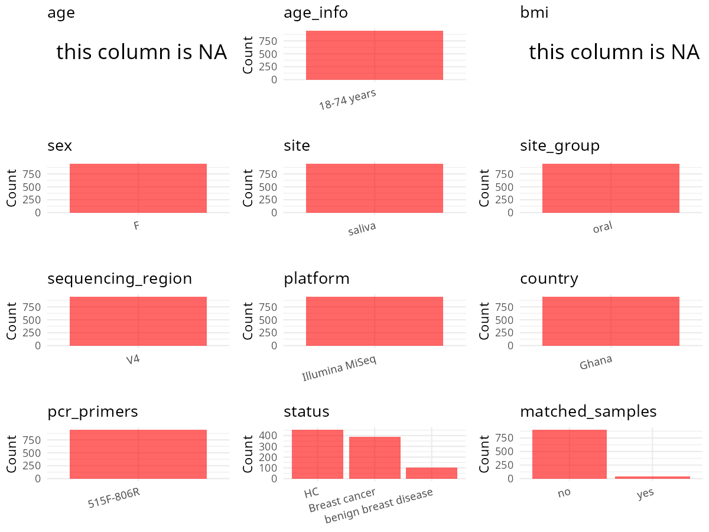

R Notebook: Metadata Processing Workflow
================

# Step 1: Obtain Initial Metadata from Each Project

To obtain the initial metadata: 1. Search for the BioProject ID (e.g.,
“PRJEBXXXX”) on the [NCBI SRA
website](https://www.ncbi.nlm.nih.gov/Traces/study/). 2. In the “Select”
table, click on “Metadata” and download the file. 3. The downloaded file
is typically named “SraRunTable.csv” and contains metadata for the
project.

``` r
# Load necessary libraries
library(dplyr)
library(ggplot2)
library(cowplot)

# Set working directory (update this path to your local directory)
setwd("D:/oral_project/PRJNA767189")

# Read the initial metadata files
initial_meta<-read.csv("SraRunTable.csv",header = T)

# Combine the two metadata files
#meta <- rbind(initial_meta, initial_meta1)

#Remove entries where Organism is "gut metagenome" (non-oral samples)
#initial_meta <- subset(initial_meta,isolation_source!= "feces")

# Check the number of samples containing "HT" in Sample.Name (e.g., healthy controls)
#nrow(subset(meta, grepl("HT", Sample.Name)))

# Display the first few rows of the metadata
head(initial_meta)
```

    ##           Run       Assay.Type AvgSpotLen    Bases  BioProject    BioSample
    ## 1 SRR16107365 Targeted-Capture        500 25018368 PRJNA767189 SAMN21892326
    ## 2 SRR16107366 Targeted-Capture        500 19201268 PRJNA767189 SAMN21892941
    ## 3 SRR16107367 Targeted-Capture        501 25540887 PRJNA767189 SAMN21892325
    ## 4 SRR16107368 Targeted-Capture        501 24943649 PRJNA767189 SAMN21892324
    ## 5 SRR16107369 Targeted-Capture        500 24208732 PRJNA767189 SAMN21892189
    ## 6 SRR16107370 Targeted-Capture        500 20122220 PRJNA767189 SAMN21892323
    ##                BioSampleModel    Bytes case_control Center.Name Collection_Date
    ## 1 Metagenome or environmental 14035832      Control         NCI              NA
    ## 2 Metagenome or environmental 10276724         Case         NCI              NA
    ## 3 Metagenome or environmental 14414969         Case         NCI              NA
    ## 4 Metagenome or environmental 13894777         Case         NCI              NA
    ## 5 Metagenome or environmental 13711242         Case         NCI              NA
    ## 6 Metagenome or environmental 11198327         Case         NCI              NA
    ##   Consent DATASTORE.filetype DATASTORE.provider
    ## 1  public   fastq,run.zq,sra         gs,ncbi,s3
    ## 2  public   fastq,run.zq,sra         gs,ncbi,s3
    ## 3  public   fastq,run.zq,sra         gs,ncbi,s3
    ## 4  public   fastq,run.zq,sra         gs,ncbi,s3
    ## 5  public   fastq,run.zq,sra         gs,ncbi,s3
    ## 6  public   fastq,run.zq,sra         gs,ncbi,s3
    ##                       DATASTORE.region  Experiment geo_loc_name_country
    ## 1 gs.us-east1,ncbi.public,s3.us-east-1 SRX12393312         uncalculated
    ## 2 gs.us-east1,ncbi.public,s3.us-east-1 SRX12393886         uncalculated
    ## 3 gs.us-east1,ncbi.public,s3.us-east-1 SRX12393311         uncalculated
    ## 4 gs.us-east1,ncbi.public,s3.us-east-1 SRX12393310         uncalculated
    ## 5 gs.us-east1,ncbi.public,s3.us-east-1 SRX12393309         uncalculated
    ## 6 gs.us-east1,ncbi.public,s3.us-east-1 SRX12393308         uncalculated
    ##   geo_loc_name_country_continent geo_loc_name         HOST     Instrument
    ## 1                   uncalculated           NA Homo sapiens Illumina MiSeq
    ## 2                   uncalculated           NA Homo sapiens Illumina MiSeq
    ## 3                   uncalculated           NA Homo sapiens Illumina MiSeq
    ## 4                   uncalculated           NA Homo sapiens Illumina MiSeq
    ## 5                   uncalculated           NA Homo sapiens Illumina MiSeq
    ## 6                   uncalculated           NA Homo sapiens Illumina MiSeq
    ##   lat_lon lib_const_method Library.Name LibraryLayout LibrarySelection
    ## 1      NA       paired-end    GBHS15271        PAIRED              PCR
    ## 2      NA       paired-end    GBHS57749        PAIRED              PCR
    ## 3      NA       paired-end    GBHS79343        PAIRED              PCR
    ## 4      NA       paired-end    GBHS96121        PAIRED              PCR
    ## 5      NA       paired-end    GBHS64114        PAIRED              PCR
    ## 6      NA       paired-end    GBHS26790        PAIRED              PCR
    ##   LibrarySource material   Organism Platform          ReleaseDate
    ## 1       GENOMIC   Saliva metagenome ILLUMINA 2021-12-01T00:00:00Z
    ## 2       GENOMIC   Saliva metagenome ILLUMINA 2021-12-01T00:00:00Z
    ## 3       GENOMIC   Saliva metagenome ILLUMINA 2021-12-01T00:00:00Z
    ## 4       GENOMIC   Saliva metagenome ILLUMINA 2021-12-01T00:00:00Z
    ## 5       GENOMIC   Saliva metagenome ILLUMINA 2021-12-01T00:00:00Z
    ## 6       GENOMIC   Saliva metagenome ILLUMINA 2021-12-01T00:00:00Z
    ##            create_date version Sample.Name sample_type SampleID2    seq_methods
    ## 1 2021-09-29T01:48:00Z       1    SC070332     Control GBHS15271 Illumina MiSeq
    ## 2 2021-09-29T01:48:00Z       1    SC097882      Cancer GBHS57749 Illumina MiSeq
    ## 3 2021-09-29T01:48:00Z       1    SC073825      Cancer GBHS79343 Illumina MiSeq
    ## 4 2021-09-29T01:48:00Z       1    SC103740      Cancer GBHS96121 Illumina MiSeq
    ## 5 2021-09-29T01:48:00Z       1    SC072309      Cancer GBHS64114 Illumina MiSeq
    ## 6 2021-09-29T01:49:00Z       1    SC073422      Cancer GBHS26790 Illumina MiSeq
    ##   SRA.Study target_gene target_subfragment CONSENSUS_DIAG
    ## 1 SRP339204    16S rRNA                 V4               
    ## 2 SRP339204    16S rRNA                 V4     1)Invasive
    ## 3 SRP339204    16S rRNA                 V4     1)Invasive
    ## 4 SRP339204    16S rRNA                 V4     1)Invasive
    ## 5 SRP339204    16S rRNA                 V4     1)Invasive
    ## 6 SRP339204    16S rRNA                 V4     1)Invasive

# Step 2: Create a Uniform Metadata Template

The uniform metadata should include the following columns:

1.  **BioProject**: Project ID (e.g., “PRJNA339212”)
2.  **Run**: Sample ID (e.g., “ERRXXXXXX” or “SRRXXXXXX”)
3.  **sample_name**: Original sample name submitted by the authors (not
    the database-assigned ID)
4.  **Age**: Age of the subject (if available)
5.  **BMI**: Body Mass Index (if available)
6.  **Sex**: Sex of the subject (“F” or “M”)
7.  **Region**: Targeted 16S rRNA region (e.g., “V3-V4”)
8.  **Platform**: Sequencing platform (e.g., “Illumina MiSeq”)
9.  **Country**: Country of sample origin (e.g., “China”)
10. **Site**: Sample site (e.g., “saliva”, “dental plaque”)
11. **public_time**: Data release date (format: “YYYY-MM-DD”)
12. **PCR_primers**: PCR primers used (e.g., “515F-806R”)
13. **title**: Title of the associated publication
14. **Disease_study**: Whether the study involves a disease (“YES” or
    “NO”)
15. **Status**: Disease status (e.g., “T2DM”, “HC”). Note: If the study
    includes both disease and healthy samples, this must be specified
    per sample.

``` r
# Create a uniform metadata dataframe
metadata <- data.frame(
  BioProject = initial_meta$BioProject,
  Run = initial_meta$Run,
  sample_name = initial_meta$Sample.Name,
  Age = NA,
  BMI = NA,
  Sex="F",
  Region = "V4",
  Platform = initial_meta$Instrument,
  Country = initial_meta$geo_loc_name_country,
  Site =initial_meta$material,
  public_time = initial_meta$ReleaseDate,
  stringsAsFactors = FALSE
)
```

# Step 3: Manually Add Information from the Publication

Some information (e.g. PCR primers, study title, disease status) must be
manually extracted from the publication and added to the metadata.

``` r
# Add information obtained from the publication
metadata$PCR_primers <- "515F-806R"
metadata$title <- "The oral microbiome and breast cancer and nonmalignant breast disease and its relationship with the fecal microbiome in the Ghana Breast Health Study"
#metadata<-subset(uniform_meta,Site!="feces")
metadata$Disease_study <- "YES"
# Assign disease status based on sample_name patterns
metadata$Status <- initial_meta$sample_type
metadata$Status<-gsub("Cancer","Breast cancer",metadata$Status)
#extract subject id by remove prefix of sample_name
#metadata$sample_name <- gsub("[FSP].*", "", metadata$sample_name)
#get subjects id with Saliva available
#keep_subjects<-subset(metadata,Site %in% c("saliva"))
#remove subjects without Saliva samples
#metadata<-subset(metadata,sample_name %in% keep_subjects$sample_name)
#get subjects sampling counts
#sample_counts <- table(metadata$sample_name)
# Create matched_samples column, any subjects have >=2 samples will be label "YES", otherwise "NO"
#metadata$matched_samples <- ifelse(metadata$sample_name %in% names(sample_counts[sample_counts >= 2]), "YES", "NO")
#metadata$BMI<-gsub("not provided",NA,metadata$BMI)
#metadata$BMI<-as.numeric(metadata$BMI)
metadata$matched_samples<-"NO"
```

# Step 4: Summarize and Validate the Metadata

``` r
# Check the number of unique runs and sample names
print(paste("Number of unique runs:", length(unique(metadata$Run))))
```

    ## [1] "Number of unique runs: 947"

``` r
print(paste("Number of unique sample names:", length(unique(metadata$sample_name))))
```

    ## [1] "Number of unique sample names: 947"

# Step 5: Visualize the Metadata

``` r

```


# Step 6: Finalize and Export the Metadata

``` r
# Reorder columns to match the desired format
metadata <- metadata[, c(
  "BioProject", "Run", "sample_name", "Age", "BMI", "Sex", 
  "Region", "Platform", "Country", "Site", "public_time", 
  "PCR_primers", "title", "Disease_study", "Status","matched_samples"
)]

# Export the uniform metadata to a CSV file
write.csv(metadata, file = "metadata.csv", quote = T)
head(metadata)
```

    ##    BioProject         Run sample_name Age BMI Sex Region       Platform
    ## 1 PRJNA767189 SRR16107365    SC070332  NA  NA   F     V4 Illumina MiSeq
    ## 2 PRJNA767189 SRR16107366    SC097882  NA  NA   F     V4 Illumina MiSeq
    ## 3 PRJNA767189 SRR16107367    SC073825  NA  NA   F     V4 Illumina MiSeq
    ## 4 PRJNA767189 SRR16107368    SC103740  NA  NA   F     V4 Illumina MiSeq
    ## 5 PRJNA767189 SRR16107369    SC072309  NA  NA   F     V4 Illumina MiSeq
    ## 6 PRJNA767189 SRR16107370    SC073422  NA  NA   F     V4 Illumina MiSeq
    ##        Country   Site          public_time PCR_primers
    ## 1 uncalculated Saliva 2021-12-01T00:00:00Z   515F-806R
    ## 2 uncalculated Saliva 2021-12-01T00:00:00Z   515F-806R
    ## 3 uncalculated Saliva 2021-12-01T00:00:00Z   515F-806R
    ## 4 uncalculated Saliva 2021-12-01T00:00:00Z   515F-806R
    ## 5 uncalculated Saliva 2021-12-01T00:00:00Z   515F-806R
    ## 6 uncalculated Saliva 2021-12-01T00:00:00Z   515F-806R
    ##                                                                                                                                                   title
    ## 1 The oral microbiome and breast cancer and nonmalignant breast disease and its relationship with the fecal microbiome in the Ghana Breast Health Study
    ## 2 The oral microbiome and breast cancer and nonmalignant breast disease and its relationship with the fecal microbiome in the Ghana Breast Health Study
    ## 3 The oral microbiome and breast cancer and nonmalignant breast disease and its relationship with the fecal microbiome in the Ghana Breast Health Study
    ## 4 The oral microbiome and breast cancer and nonmalignant breast disease and its relationship with the fecal microbiome in the Ghana Breast Health Study
    ## 5 The oral microbiome and breast cancer and nonmalignant breast disease and its relationship with the fecal microbiome in the Ghana Breast Health Study
    ## 6 The oral microbiome and breast cancer and nonmalignant breast disease and its relationship with the fecal microbiome in the Ghana Breast Health Study
    ##   Disease_study        Status matched_samples
    ## 1           YES       Control              NO
    ## 2           YES Breast cancer              NO
    ## 3           YES Breast cancer              NO
    ## 4           YES Breast cancer              NO
    ## 5           YES Breast cancer              NO
    ## 6           YES Breast cancer              NO

## Notes for Students:

1.  **Metadata Accuracy**: Always cross-check the metadata with the
    original publication to ensure accuracy.
2.  **Manual Entries**: Columns like `PCR_primers`, and `Status` often
    require manual entry based on the publication.
3.  **Disease Status**: Be careful when assigning `Status`—some studies
    include both disease and healthy samples.
4.  **Visualization**: The plots help quickly identify the distribution
    of values in each column, which is useful for quality control.
5.  **Reproducibility**: Update the working directory and file paths to
    match your local environment.
