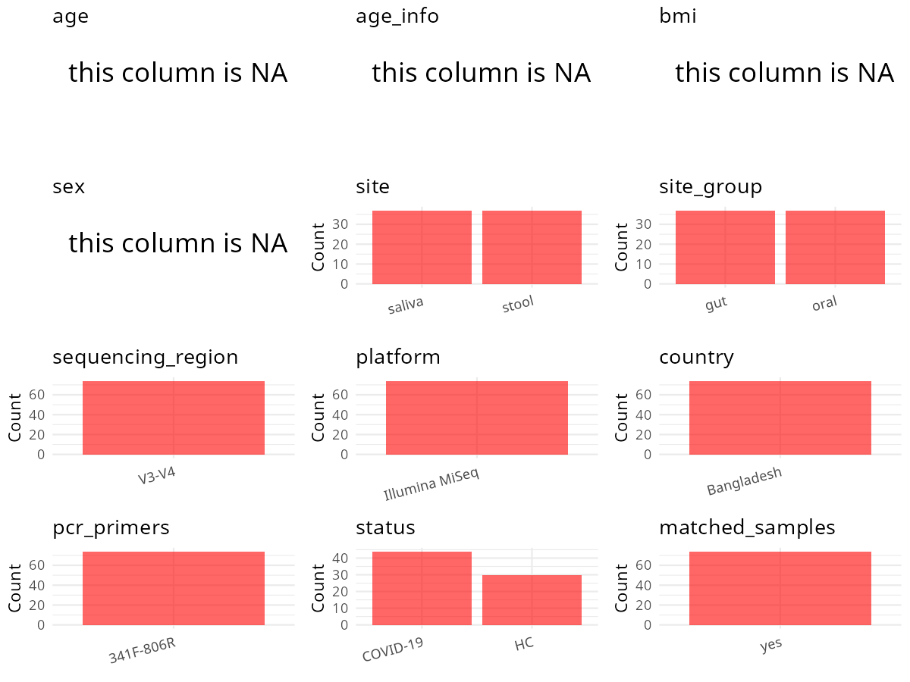

R Notebook: Metadata Processing Workflow
================

# Step 1: Obtain Initial Metadata from Each Project

To obtain the initial metadata: 1. Search for the BioProject ID (e.g.,
“PRJEBXXXX”) on the [NCBI SRA
website](https://www.ncbi.nlm.nih.gov/Traces/study/). 2. In the “Select”
table, click on “Metadata” and download the file. 3. The downloaded file
is typically named “SraRunTable.csv” and contains metadata for the
project.

``` r
# Load necessary libraries
library(dplyr)
library(ggplot2)
library(cowplot)

# Set working directory (update this path to your local directory)
setwd("D:/oral_project/PRJNA767939")

# Read the initial metadata files
initial_meta<-read.csv("SraRunTable.csv",header = T)

# Combine the two metadata files
#meta <- rbind(initial_meta, initial_meta1)

#Remove entries where Organism is "gut metagenome" (non-oral samples)
#initial_meta <- subset(initial_meta,isolation_source!= "feces")

# Check the number of samples containing "HT" in Sample.Name (e.g., healthy controls)
#nrow(subset(meta, grepl("HT", Sample.Name)))

# Display the first few rows of the metadata
head(initial_meta)
```

    ##           Run Assay.Type AvgSpotLen    Bases  BioProject    BioSample
    ## 1 SRR17066268   AMPLICON        580 24380172 PRJNA767939 SAMN21987271
    ## 2 SRR17066269   AMPLICON        599 28447196 PRJNA767939 SAMN21987270
    ## 3 SRR17066270   AMPLICON        555 18036856 PRJNA767939 SAMN21987335
    ## 4 SRR17066271   AMPLICON        568 24074033 PRJNA767939 SAMN21987334
    ## 5 SRR17066272   AMPLICON        560 21892925 PRJNA767939 SAMN21987333
    ## 6 SRR17066273   AMPLICON        594 27163494 PRJNA767939 SAMN21987332
    ##                BioSampleModel    Bytes
    ## 1 Metagenome or environmental 13737669
    ## 2 Metagenome or environmental 16185500
    ## 3 Metagenome or environmental 10178453
    ## 4 Metagenome or environmental 13654857
    ## 5 Metagenome or environmental 12365053
    ## 6 Metagenome or environmental 15735887
    ##                                      Center.Name Collection_Date Consent
    ## 1 SHAHJALAL UNIVERSITY OF SCIENCE AND TECHNOLOGY      2020-07-01  public
    ## 2 SHAHJALAL UNIVERSITY OF SCIENCE AND TECHNOLOGY      2020-06-30  public
    ## 3 SHAHJALAL UNIVERSITY OF SCIENCE AND TECHNOLOGY      2020-09-30  public
    ## 4 SHAHJALAL UNIVERSITY OF SCIENCE AND TECHNOLOGY      2020-09-29  public
    ## 5 SHAHJALAL UNIVERSITY OF SCIENCE AND TECHNOLOGY      2020-09-27  public
    ## 6 SHAHJALAL UNIVERSITY OF SCIENCE AND TECHNOLOGY      2020-09-24  public
    ##   DATASTORE.filetype DATASTORE.provider                     DATASTORE.region
    ## 1   fastq,run.zq,sra         gs,ncbi,s3 gs.us-east1,ncbi.public,s3.us-east-1
    ## 2   fastq,run.zq,sra         gs,ncbi,s3 gs.us-east1,ncbi.public,s3.us-east-1
    ## 3   fastq,run.zq,sra         gs,ncbi,s3 gs.us-east1,ncbi.public,s3.us-east-1
    ## 4   fastq,run.zq,sra         gs,ncbi,s3 gs.us-east1,ncbi.public,s3.us-east-1
    ## 5   fastq,run.zq,sra         gs,ncbi,s3 gs.us-east1,ncbi.public,s3.us-east-1
    ## 6   fastq,run.zq,sra         gs,ncbi,s3 gs.us-east1,ncbi.public,s3.us-east-1
    ##    Experiment geo_loc_name_country geo_loc_name_country_continent
    ## 1 SRX13254971           Bangladesh                           Asia
    ## 2 SRX13254970           Bangladesh                           Asia
    ## 3 SRX13254969           Bangladesh                           Asia
    ## 4 SRX13254968           Bangladesh                           Asia
    ## 5 SRX13254967           Bangladesh                           Asia
    ## 6 SRX13254966           Bangladesh                           Asia
    ##             geo_loc_name         HOST     Instrument         isolation_source
    ## 1 Bangladesh: Chattogram Homo sapiens Illumina MiSeq Homo sapiens_healthy gut
    ## 2 Bangladesh: Chattogram Homo sapiens Illumina MiSeq Homo sapiens_healthy gut
    ## 3 Bangladesh: Chattogram Homo sapiens Illumina MiSeq  Homo sapiens_COVID oral
    ## 4 Bangladesh: Chattogram Homo sapiens Illumina MiSeq  Homo sapiens_COVID oral
    ## 5 Bangladesh: Chattogram Homo sapiens Illumina MiSeq  Homo sapiens_COVID oral
    ## 6 Bangladesh: Chattogram Homo sapiens Illumina MiSeq  Homo sapiens_COVID oral
    ##               lat_lon           Library.Name LibraryLayout LibrarySelection
    ## 1 22.3407 N 91.8377 E Healthy control gut_10        PAIRED              PCR
    ## 2 22.3407 N 91.8377 E  Healthy control gut_9        PAIRED              PCR
    ## 3 22.3407 N 91.8377 E          COVID oral_22        PAIRED              PCR
    ## 4 22.3407 N 91.8377 E          COVID oral_21        PAIRED              PCR
    ## 5 22.3407 N 91.8377 E          COVID oral_20        PAIRED              PCR
    ## 6 22.3407 N 91.8377 E          COVID oral_19        PAIRED              PCR
    ##   LibrarySource        Organism Platform          ReleaseDate
    ## 1   METAGENOMIC  gut metagenome ILLUMINA 2021-11-29T00:00:00Z
    ## 2   METAGENOMIC  gut metagenome ILLUMINA 2021-11-29T00:00:00Z
    ## 3   METAGENOMIC oral metagenome ILLUMINA 2021-11-29T00:00:00Z
    ## 4   METAGENOMIC oral metagenome ILLUMINA 2021-11-29T00:00:00Z
    ## 5   METAGENOMIC oral metagenome ILLUMINA 2021-11-29T00:00:00Z
    ## 6   METAGENOMIC oral metagenome ILLUMINA 2021-11-29T00:00:00Z
    ##            create_date version Sample.Name SRA.Study
    ## 1 2021-11-29T13:49:00Z       1       CTG10 SRP348427
    ## 2 2021-11-29T13:50:00Z       1        CTG9 SRP348427
    ## 3 2021-11-29T13:49:00Z       1     COVO143 SRP348427
    ## 4 2021-11-29T13:49:00Z       1     COVO142 SRP348427
    ## 5 2021-11-29T13:49:00Z       1     COVO141 SRP348427
    ## 6 2021-11-29T13:49:00Z       1     COVO140 SRP348427

# Step 2: Create a Uniform Metadata Template

The uniform metadata should include the following columns:

1.  **BioProject**: Project ID (e.g., “PRJNA339212”)
2.  **Run**: Sample ID (e.g., “ERRXXXXXX” or “SRRXXXXXX”)
3.  **sample_name**: Original sample name submitted by the authors (not
    the database-assigned ID)
4.  **Age**: Age of the subject (if available)
5.  **BMI**: Body Mass Index (if available)
6.  **Sex**: Sex of the subject (“F” or “M”)
7.  **Region**: Targeted 16S rRNA region (e.g., “V3-V4”)
8.  **Platform**: Sequencing platform (e.g., “Illumina MiSeq”)
9.  **Country**: Country of sample origin (e.g., “China”)
10. **Site**: Sample site (e.g., “saliva”, “dental plaque”)
11. **public_time**: Data release date (format: “YYYY-MM-DD”)
12. **PCR_primers**: PCR primers used (e.g., “515F-806R”)
13. **title**: Title of the associated publication
14. **Disease_study**: Whether the study involves a disease (“YES” or
    “NO”)
15. **Status**: Disease status (e.g., “T2DM”, “HC”). Note: If the study
    includes both disease and healthy samples, this must be specified
    per sample.

``` r
# Create a uniform metadata dataframe
metadata <- data.frame(
  BioProject = initial_meta$BioProject,
  Run = initial_meta$Run,
  sample_name = initial_meta$Library.Name,
  Age = NA,
  BMI = NA,
  Sex=NA,
  Region = "V3-V4",
  Platform = initial_meta$Instrument,
  Country = initial_meta$geo_loc_name_country,
  Site =initial_meta$isolation_source,
  public_time = initial_meta$ReleaseDate,
  stringsAsFactors = FALSE
)
```

# Step 3: Manually Add Information from the Publication

Some information (e.g. PCR primers, study title, disease status) must be
manually extracted from the publication and added to the metadata.

``` r
# Add information obtained from the publication
metadata$PCR_primers <- "341F-806R"
metadata$title <- "Dysbiosis of Oral and Gut Microbiomes in SARS-CoV-2 Infected
Patients in Bangladesh: Elucidating the Role of Opportunistic Gut Microbes"
#metadata<-subset(uniform_meta,Site!="feces")
metadata$Disease_study <- "YES"
# Assign disease status based on sample_name patterns
metadata <- metadata %>%
  mutate(Status = ifelse(grepl("Healthy control", sample_name), 
                        "Healthy control", 
                        ifelse(grepl("COVID", sample_name), "COVID", NA)))
metadata<-metadata%>%
  mutate(Site=ifelse(grepl("gut",Site),"Feces" ,ifelse(grepl("oral",Site),"Saliva",NA)))

#extract subject id by remove prefix of sample_name
#metadata$sample_name <- gsub("[FSP].*", "", metadata$sample_name)
#get subjects id with Saliva available
keep_subjects<-subset(metadata,Site %in% c("Saliva"))
#remove subjects without Saliva samples
metadata<-subset(metadata,sample_name %in% keep_subjects$sample_name)
#get subjects sampling counts
sample_counts <- table(metadata$sample_name)
# Create matched_samples column, any subjects have >=2 samples will be label "YES", otherwise "NO"
metadata$matched_samples <- ifelse(metadata$sample_name %in% names(sample_counts[sample_counts >= 2]), "YES", "NO")
#metadata$BMI<-gsub("not provided",NA,metadata$BMI)
#metadata$BMI<-as.numeric(metadata$BMI)
#metadata$matched_samples<-"NO"
```

# Step 4: Summarize and Validate the Metadata

``` r
# Check the number of unique runs and sample names
print(paste("Number of unique runs:", length(unique(metadata$Run))))
```

    ## [1] "Number of unique runs: 37"

``` r
print(paste("Number of unique sample names:", length(unique(metadata$sample_name))))
```

    ## [1] "Number of unique sample names: 37"

# Step 5: Visualize the Metadata

``` r

```


# Step 6: Finalize and Export the Metadata

``` r
# Reorder columns to match the desired format
metadata <- metadata[, c(
  "BioProject", "Run", "sample_name", "Age", "BMI", "Sex", 
  "Region", "Platform", "Country", "Site", "public_time", 
  "PCR_primers", "title", "Disease_study", "Status","matched_samples"
)]

# Export the uniform metadata to a CSV file
write.csv(metadata, file = "metadata.csv", quote = FALSE)
head(metadata)
```

    ##    BioProject         Run   sample_name Age BMI Sex Region       Platform
    ## 3 PRJNA767939 SRR17066270 COVID oral_22  NA  NA  NA  V3-V4 Illumina MiSeq
    ## 4 PRJNA767939 SRR17066271 COVID oral_21  NA  NA  NA  V3-V4 Illumina MiSeq
    ## 5 PRJNA767939 SRR17066272 COVID oral_20  NA  NA  NA  V3-V4 Illumina MiSeq
    ## 6 PRJNA767939 SRR17066273 COVID oral_19  NA  NA  NA  V3-V4 Illumina MiSeq
    ## 8 PRJNA767939 SRR17066275 COVID oral_18  NA  NA  NA  V3-V4 Illumina MiSeq
    ## 9 PRJNA767939 SRR17066276 COVID oral_17  NA  NA  NA  V3-V4 Illumina MiSeq
    ##      Country   Site          public_time PCR_primers
    ## 3 Bangladesh Saliva 2021-11-29T00:00:00Z   341F-806R
    ## 4 Bangladesh Saliva 2021-11-29T00:00:00Z   341F-806R
    ## 5 Bangladesh Saliva 2021-11-29T00:00:00Z   341F-806R
    ## 6 Bangladesh Saliva 2021-11-29T00:00:00Z   341F-806R
    ## 8 Bangladesh Saliva 2021-11-29T00:00:00Z   341F-806R
    ## 9 Bangladesh Saliva 2021-11-29T00:00:00Z   341F-806R
    ##                                                                                                                                      title
    ## 3 Dysbiosis of Oral and Gut Microbiomes in SARS-CoV-2 Infected\nPatients in Bangladesh: Elucidating the Role of Opportunistic Gut Microbes
    ## 4 Dysbiosis of Oral and Gut Microbiomes in SARS-CoV-2 Infected\nPatients in Bangladesh: Elucidating the Role of Opportunistic Gut Microbes
    ## 5 Dysbiosis of Oral and Gut Microbiomes in SARS-CoV-2 Infected\nPatients in Bangladesh: Elucidating the Role of Opportunistic Gut Microbes
    ## 6 Dysbiosis of Oral and Gut Microbiomes in SARS-CoV-2 Infected\nPatients in Bangladesh: Elucidating the Role of Opportunistic Gut Microbes
    ## 8 Dysbiosis of Oral and Gut Microbiomes in SARS-CoV-2 Infected\nPatients in Bangladesh: Elucidating the Role of Opportunistic Gut Microbes
    ## 9 Dysbiosis of Oral and Gut Microbiomes in SARS-CoV-2 Infected\nPatients in Bangladesh: Elucidating the Role of Opportunistic Gut Microbes
    ##   Disease_study Status matched_samples
    ## 3           YES  COVID              NO
    ## 4           YES  COVID              NO
    ## 5           YES  COVID              NO
    ## 6           YES  COVID              NO
    ## 8           YES  COVID              NO
    ## 9           YES  COVID              NO

## Notes for Students:

1.  **Metadata Accuracy**: Always cross-check the metadata with the
    original publication to ensure accuracy.
2.  **Manual Entries**: Columns like `PCR_primers`, and `Status` often
    require manual entry based on the publication.
3.  **Disease Status**: Be careful when assigning `Status`—some studies
    include both disease and healthy samples.
4.  **Visualization**: The plots help quickly identify the distribution
    of values in each column, which is useful for quality control.
5.  **Reproducibility**: Update the working directory and file paths to
    match your local environment.
