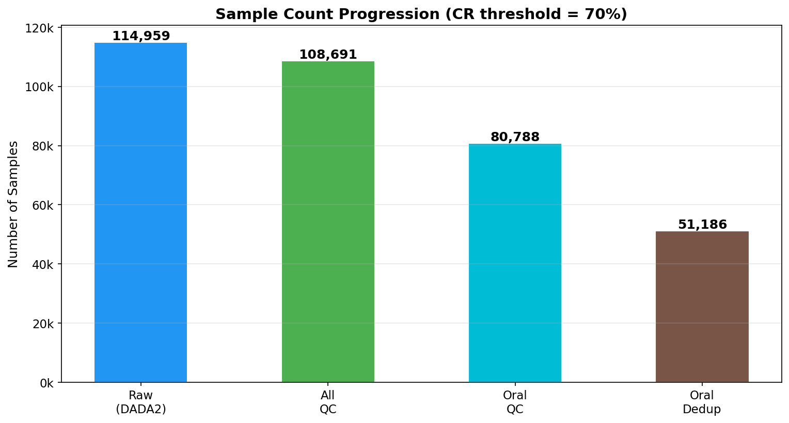
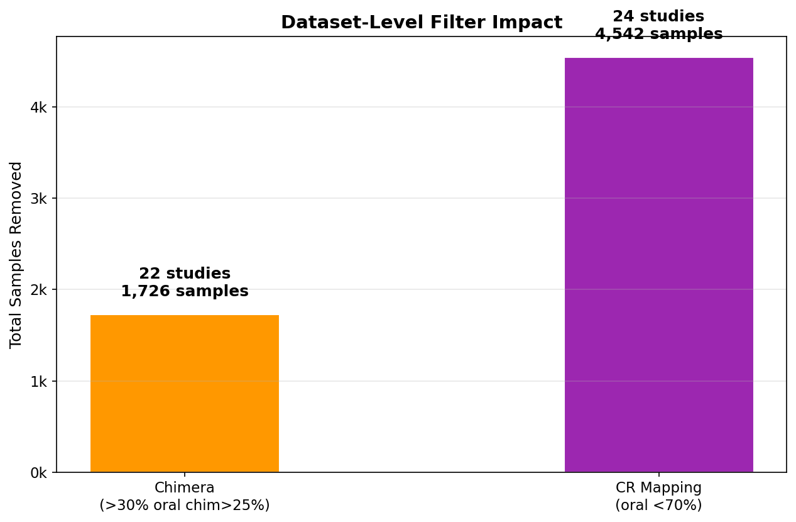
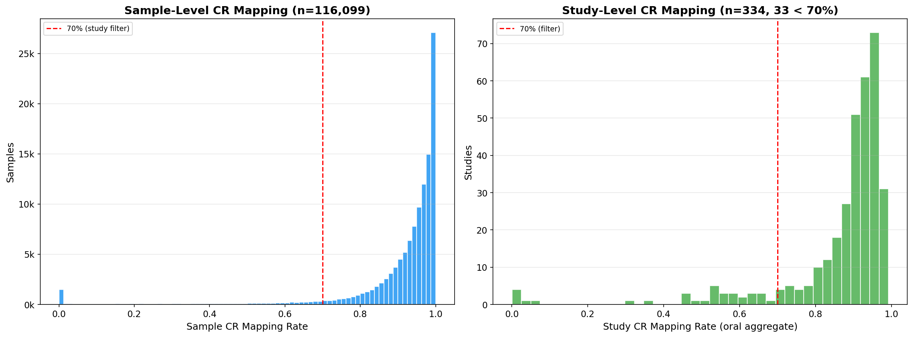
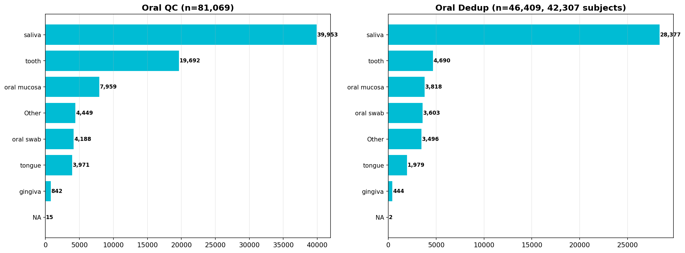

# Global Oral Microbiome — Metadata QC Pipeline v4

**Date:** 2026-07-22
**Directory:** `data/metadata-and-biom-v2-qc/`
**Scripts:** `merge_all_for_qc_raw.py` → `generate_metadata_tables.py` → `generate_qza.py`

---

## 1. Key Statistics

| Metric | Value |
|--------|------:|
| Raw samples (DADA2-processed) | 114,959 |
| Raw studies | 334 |
| **QC-passed samples** | **108,691** |
| QC-passed studies | 288 |
| Studies removed | 46 |
| Oral QC samples | 80,788 |
| Oral dedup samples | 51,186 |
| Subjects (dedup, per-study) | 48,752 |
| Oral samples in raw | 85,268 |

## 2. Filter Pipeline

Filtering is **dataset-level only**. All thresholds computed on **oral samples** (`site_group='oral'`). CR=0 samples are removed upstream to ensure metadata matches the closed-reference BIOM.

| Step | Criterion | Datasets Removed | Samples Removed | Remaining Samples |
|------|-----------|:---:|:---:|---:|
| 0 — Raw merge | DADA2-processed + CR mapping rate > 0 (`sample_cr_mapping_rate > 0`) | — | — | 114,959 |
| 1 — Chimera filter | >30% oral samples with chimera >25% | 22 | 1,726 | 113,233 |
| 2 — **CR mapping filter** | **Oral aggregate GG2 CR mapping < 70%** | 24 | 4,542 | **108,691** |
| 3 — Oral subset | `site_group='oral'` | — | — | 80,788 |
| 4 — Dedup | 1 sample per (subject_id × site_cleaned) | — | — | **51,186** |

> **v4 Changes:** Dataset-level only. ASV filter removed. CR threshold = 70%. CR=0 samples removed to match closed-reference BIOM.

## 3. Sample Flow

## 4. Filter Impact

## 5. CR Mapping Rate Distributions

*Left: sample-level CR mapping rates. Right: study-level oral aggregate CR mapping rates. Red dashed line = 70% filter threshold.*

## 6. Oral Site Distribution

## 7. Removed Studies Detail

| Step | Study | Total Samples | Oral Samples | CR Rate |
|------|-------|:---:|:---:|---:|
| 🟠 Dataset chimera filter | PRJDB9395 | 46 | 46 | 0.692232 |
| 🟠 Dataset chimera filter | PRJEB12953 | 110 | 110 | 0.013079 |
| 🟠 Dataset chimera filter | PRJNA418378 | 100 | 100 | 0.578256 |
| 🟠 Dataset chimera filter | PRJNA419259 | 48 | 48 | 0.881522 |
| 🟠 Dataset chimera filter | PRJNA438728 | 52 | 52 | 0.714315 |
| 🟠 Dataset chimera filter | PRJNA454811 | 31 | 31 | 0.943890 |
| 🟠 Dataset chimera filter | PRJNA489752 | 50 | 30 | 0.928620 |
| 🟠 Dataset chimera filter | PRJNA509532 | 144 | 144 | 0.534321 |
| 🟠 Dataset chimera filter | PRJNA511568 | 28 | 28 | 0.957299 |
| 🟠 Dataset chimera filter | PRJNA512456 | 143 | 143 | 0.901868 |
| 🟠 Dataset chimera filter | PRJNA580506 | 48 | 35 | 0.793404 |
| 🟠 Dataset chimera filter | PRJNA609630 | 55 | 55 | 0.547501 |
| 🟠 Dataset chimera filter | PRJNA610499 | 35 | 35 | 0.733581 |
| 🟠 Dataset chimera filter | PRJNA643969 | 96 | 96 | 0.790312 |
| 🟠 Dataset chimera filter | PRJNA648473 | 39 | 39 | 0.562356 |
| 🟠 Dataset chimera filter | PRJNA679485 | 49 | 49 | 0.847715 |
| 🟠 Dataset chimera filter | PRJNA731066 | 20 | 20 | 0.943802 |
| 🟠 Dataset chimera filter | PRJNA747639 | 149 | 149 | 0.348012 |
| 🟠 Dataset chimera filter | PRJNA750937 | 59 | 59 | 0.498945 |
| 🟠 Dataset chimera filter | PRJNA778221 | 39 | 39 | 0.904170 |
| 🟠 Dataset chimera filter | PRJNA837028 | 40 | 40 | 0.522161 |
| 🟠 Dataset chimera filter | PRJNA910326 | 345 | 217 | 0.851774 |
| 🟣 Dataset close-reference filter | PRJDB3211 | 25 | 2 | 0.003995 |
| 🟣 Dataset close-reference filter | PRJDB5944 | 35 | 35 | 0.084809 |
| 🟣 Dataset close-reference filter | PRJEB24929 | 230 | 110 | 0.643997 |
| 🟣 Dataset close-reference filter | PRJEB5069 | 13 | 9 | 0.460292 |
| 🟣 Dataset close-reference filter | PRJEB7825 | 66 | 27 | 0.652069 |
| 🟣 Dataset close-reference filter | PRJNA1149521 | 528 | 528 | 0.583759 |
| 🟣 Dataset close-reference filter | PRJNA1228548 | 148 | 148 | 0.486058 |
| 🟣 Dataset close-reference filter | PRJNA227796 | 14 | 14 | 0.540895 |
| 🟣 Dataset close-reference filter | PRJNA232543 | 25 | 25 | 0.589109 |
| 🟣 Dataset close-reference filter | PRJNA255332 | 24 | 24 | 0.061217 |
| 🟣 Dataset close-reference filter | PRJNA362687 | 109 | 109 | 0.540274 |
| 🟣 Dataset close-reference filter | PRJNA391982 | 232 | 232 | 0.669966 |
| 🟣 Dataset close-reference filter | PRJNA412445 | 102 | 102 | 0.632346 |
| 🟣 Dataset close-reference filter | PRJNA414355 | 88 | 88 | 0.623307 |
| 🟣 Dataset close-reference filter | PRJNA495719 | 87 | 87 | 0.564381 |
| 🟣 Dataset close-reference filter | PRJNA530161 | 415 | 415 | 0.610207 |
| 🟣 Dataset close-reference filter | PRJNA542018 | 40 | 40 | 0.463568 |
| 🟣 Dataset close-reference filter | PRJNA613363 | 115 | 115 | 0.612778 |
| 🟣 Dataset close-reference filter | PRJNA706727 | 1833 | 451 | 0.667148 |
| 🟣 Dataset close-reference filter | PRJNA712952 | 94 | 94 | 0.022164 |
| 🟣 Dataset close-reference filter | PRJNA714139 | 80 | 80 | 0.310555 |
| 🟣 Dataset close-reference filter | PRJNA722880 | 138 | 79 | 0.625751 |
| 🟣 Dataset close-reference filter | PRJNA763000 | 49 | 49 | 0.538380 |
| 🟣 Dataset close-reference filter | PRJNA807496 | 52 | 52 | 0.017451 |

## 8. Output Files

| File | Samples | Features | Studies | Subjects | Size |
|------|:---:|:---:|:---:|:---:|:---:|
| `metadata_all_for_qc_raw.tsv` | 114,959 | — | 334 | — | 47 MB |
| `metadata_all_qc.tsv` | 108,691 | — | 288 | — | 45 MB |
| `metadata_oral_qc.tsv` | 80,788 | — | 288 | — | 33 MB |
| `metadata_oral_qc_dedup.tsv` | 51,186 | — | 288 | 48,752 | 21 MB |
| `biom_all_qc.biom` | 108,691 | 61,235 | — | — | 72 MB |
| `biom_oral_qc.biom` | 80,788 | 61,235 | — | — | 53 MB |
| `biom_oral_qc_dedup.biom` | 51,186 | 61,235 | — | — | 38 MB |
| `biom_all_qc.qza` | — | — | — | — | 62 MB |
| `genus_table_all_qc.qza` | — | — | — | — | 31 MB |
| `genus_table_relabund_all_qc.qza` | — | — | — | — | 78 MB |

### Auxiliary Files

| File | Description |
|------|-------------|
| `QC/filter_funnel_summary.tsv` | Per-step sample/study counts |
| `QC/removed_studies_by_step.tsv` | Studies removed at each step |
| `figures/` | Report figures (PNG) |
| `merge_all_for_qc_raw.py` | Merge metadata sources → compute QC flags |
| `generate_metadata_tables.py` | Dataset filters → metadata + BIOM tables |
| `generate_qc_report.py` | This report |
| `generate_qza.py` | BIOM → QZA + genus collapse (requires qiime2-2022.2) |
| `README.md` | Directory documentation |

---

*Generated 2026-07-22 by `generate_qc_report.py` | Filter: CR>0 + dataset-only (Chimera >25% in >30% oral, CR <70% oral aggregate)*
