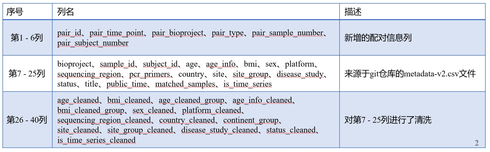
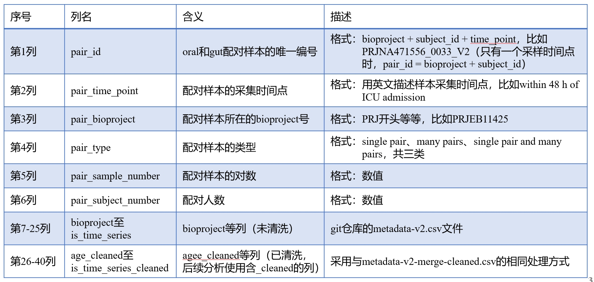
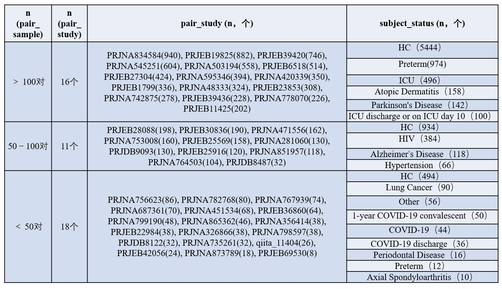
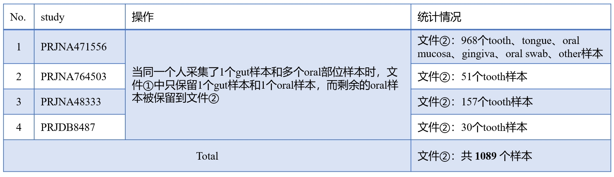
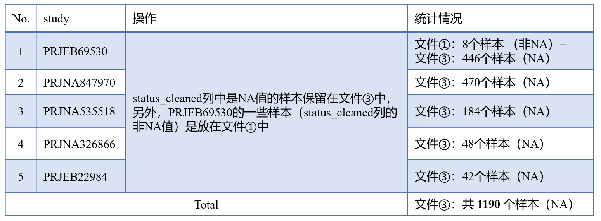
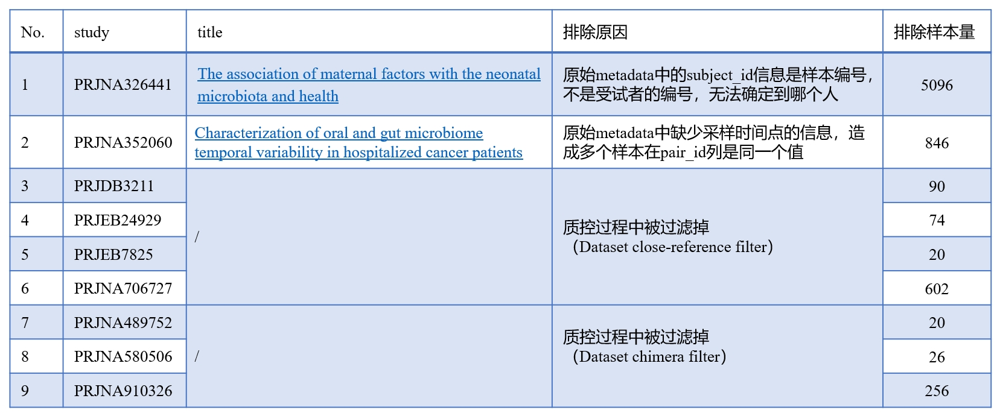

# Oral-Gut Pair Metadata and BIOM Feature Table Collection (V2 QC Release)

## Introduction

This directory contains the V2 quality-controlled (QC) metadata files and the corresponding feature table for the oral-gut paired samples. The files are stored in **CSV**, **TXT**, and **BIOM (Biological Observation Matrix)** formats.

These datasets organize the paired microbiome samples into primary pairs, additional oral sites, and samples with unknown status. A unified BIOM feature table is also provided, encompassing all samples across the distinct metadata subsets.

## File Descriptions

Below is a detailed list of the files in this directory, summarizing their contents, associated BioProjects, and sample dimensions.

### Metadata Files

* `metadata_oral_gut_pair_v2_merge_qc.csv`
* **Dimensions**: 45 BioProjects, 9,644 Samples (4,822 oral-gut pairs)
* **Description**: The primary metadata table containing the finalized, QC-filtered oral-gut paired samples. Each row represents one sample (oral or gut); each pair consists of two rows linked by the same `pair_id`. The first 40 columns contain the core metadata fields (see [Figure 1](#figure-1-metadata-column-overview) for the column overview).

* `metadata_pair_v2_additional_oral_site_merge_qc.csv`
* **Dimensions**: 2 BioProjects, 89 Samples
* **Description**: Metadata for additional oral site samples associated with the paired cohorts. These samples provide extra oral-site annotations (e.g., tooth) beyond the primary oral-gut pairing. See [Figure 4](#figure-4-additional-oral-site-samples) for a breakdown by site and status.

* `metadata_pair_v2_status_unknown_merge_qc.csv`
* **Dimensions**: 3 BioProjects, 1,004 Samples
* **Description**: Metadata for samples where the specific pair mapping or disease status is currently unknown. This includes longitudinal cohorts with time-series data where disease labels are ambiguous. NA values indicate that the disease status at the sample level cannot be determined. See [Figure 5](#figure-5-status-unknown-samples) for a breakdown.

### BIOM Feature Table

* `biom_oral_gut_pair_v2_qc.biom`
* **Description**: The unified feature table. This single BIOM file contains the abundance data for **all** samples listed across the three metadata CSV files above (`metadata_oral_gut_pair_v2_merge_qc.csv`, `metadata_pair_v2_additional_oral_site_merge_qc.csv`, and `metadata_pair_v2_status_unknown_merge_qc.csv`). Sample IDs in the BIOM file use the format `{bioproject_id}|{sample_id}` (e.g., `PRJNA362643|SRR6415184`). Total samples: 9,644 + 89 + 1,004 = **10,737 samples**.

### Project Lists

* `project_oral_gut_pair_list_qc.txt`
* **Description**: A plain text list containing the names of the 45 BioProjects that make up the primary `metadata_oral_gut_pair_v2_merge_qc.csv` dataset.

---

## Detailed Study Breakdowns and Figures

The following sections provide visual summaries and detailed breakdowns of the QC-filtered oral-gut pair dataset. All figures are located in `scripts/figure/`.

### Figure 1: Metadata Column Overview

The first 40 columns of `metadata_oral_gut_pair_v2_merge_qc.csv` contain the core metadata fields including sample identifiers, BioProject accession, body site, disease status, time point, demographic information, and sequencing metadata.

### Figure 2: Oral-Gut Pair Study Landscape

An overview of the 45 oral-gut pair studies in the primary metadata table. The figure summarizes key study-level characteristics including sample counts, disease types, and study designs.

### Figure 3: Paired Sample Counts and Time-Series Studies

Key statistics for the primary paired dataset:

* **Paired sample counts:**
  * 11 studies with **≥ 100 pairs**
  * 22 studies with **≥ 50 pairs**
* **Time-series studies:** 11 studies have **≥ 3 collection time points** (value `"yes"` in the `is_time_series_cleaned` column).
* **Studies with 2 time points (7 studies):**
  * PRJNA471556
  * PRJEB25569
  * PRJEB11425
  * PRJNA756623
  * PRJNA799190
  * PRJDB8122
  * PRJNA798597

> **Note:** NA values are not displayed in the summary tables.

### Figure 4: Additional Oral Site Samples

Breakdown of the 89 additional oral site samples (`metadata_pair_v2_additional_oral_site_merge_qc.csv`) by site and disease status.

> **Disease abbreviations used in the figures:**
> * **Atopic Dermatitis** — a chronic inflammatory skin condition
> * **Axial Spondyloarthritis** — a chronic inflammatory disease primarily affecting the spine and sacroiliac joints

> **Note on the `status_cleaned` column:** If a value appears as `"Other"` in `status_cleaned`, the sample belongs to a disease that had too few samples to form its own category and was grouped into "other disease." The specific disease name can be found in the corresponding `pair_time_point` column for both file ① (`metadata_oral_gut_pair_v2_merge_qc.csv`) and file ② (`metadata_pair_v2_additional_oral_site_merge_qc.csv`).

### Figure 5: Status-Unknown Samples

Breakdown of the 1,004 status-unknown samples (`metadata_pair_v2_status_unknown_merge_qc.csv`). These samples come from 3 BioProjects and include longitudinal cohorts where disease labels could not be reliably assigned.

> **Note:** `NA` values indicate that the disease status at the **sample level** cannot be clearly determined. These samples are included in the unified BIOM table but are excluded from disease-specific analyses.

### Figure 6: Excluded Studies

Summary of the **9 studies** that were excluded during the quality control process. These studies were removed due to insufficient metadata quality, ambiguous sample annotations, or other QC criteria.

---

## File Summary Table

| # | File | BioProjects | Samples | Description |
|---|------|-------------|---------|-------------|
| ① | `metadata_oral_gut_pair_v2_merge_qc.csv` | 45 | 9,644 (4,822 pairs) | Primary oral-gut paired metadata |
| ② | `metadata_pair_v2_additional_oral_site_merge_qc.csv` | 2 | 89 | Additional oral site samples |
| ③ | `metadata_pair_v2_status_unknown_merge_qc.csv` | 3 | 1,004 | Status-unknown / time-series samples |
| ④ | `project_oral_gut_pair_list_qc.txt` | — | — | List of 45 BioProject accessions (from file ①) |
| ⑤ | `biom_oral_gut_pair_v2_qc.biom` | — | 10,737 | Unified feature table containing all samples from files ①②③ |
