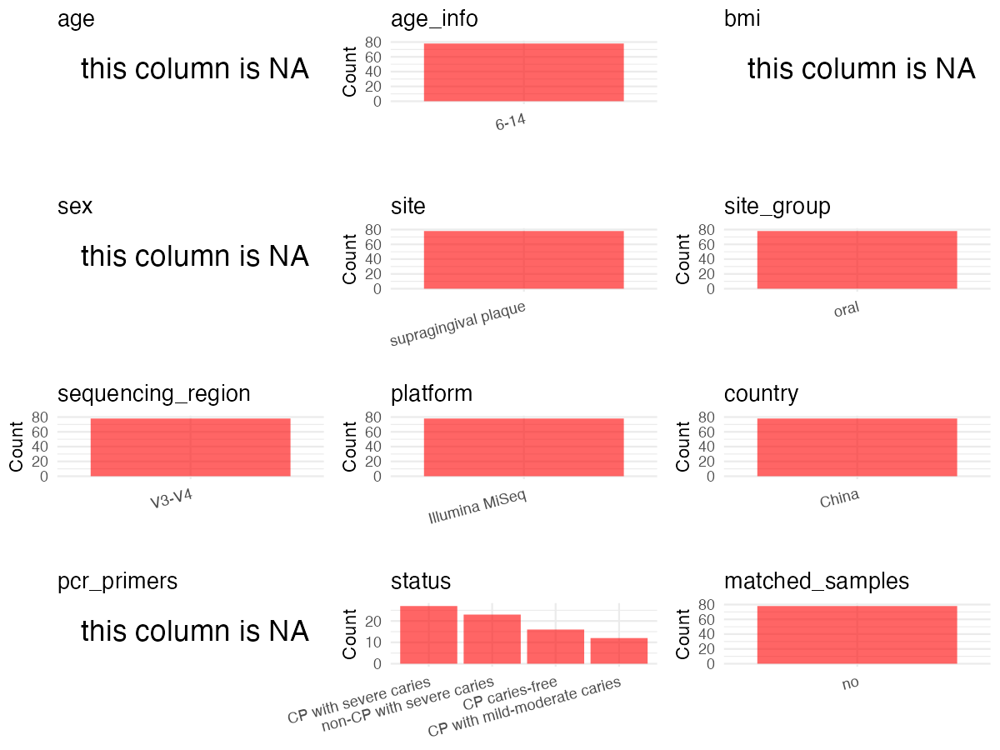

R Notebook: Metadata Processing Workflow
================

# Step 1: Obtain Initial Metadata from Each Project

To obtain the initial metadata: 1. Search for the BioProject ID (e.g.,
“PRJEBXXXX”) on the [NCBI SRA
website](https://www.ncbi.nlm.nih.gov/Traces/study/). 2. In the “Select”
table, click on “Metadata” and download the file. 3. The downloaded file
is typically named “SraRunTable.csv” and contains metadata for the
project.

``` r
# Load necessary libraries
library(dplyr)
library(ggplot2)
library(cowplot)
library(readxl)

# Set working directory (update this path to your local directory)
setwd("/home/dongbiao/word_embedding_microbiome/all_data/oral/global-oral-microbiome/data/projects/CNP0002325")

# Read the initial metadata files
initial_meta<-read.csv("metadata_CNP0002325_experiment.tsv", sep = "\t")

head(initial_meta)
```

    ##   project_accession sample_accession sample_name experiment_accession
    ## 1        CNP0002325       CNS0466274          B1           CNX0381254
    ## 2        CNP0002325       CNS0466275          B3           CNX0381255
    ## 3        CNP0002325       CNS0466276          B4           CNX0381256
    ## 4        CNP0002325       CNS0466277          B5           CNX0381257
    ## 5        CNP0002325       CNS0466278          B6           CNX0381258
    ## 6        CNP0002325       CNS0466279          B7           CNX0381259
    ##   run_accession                    experiment_title     library_name
    ## 1    CNR0462543 16S  of Microbiota: Oral Microbiota FPCR202390116-1A
    ## 2    CNR0462544 16S  of Microbiota: Oral Microbiota FPCR202390117-1A
    ## 3    CNR0462545 16S  of Microbiota: Oral Microbiota FPCR202390118-1A
    ## 4    CNR0462546 16S  of Microbiota: Oral Microbiota FPCR202390119-1A
    ## 5    CNR0462547 16S  of Microbiota: Oral Microbiota FPCR202390120-1A
    ## 6    CNR0462548 16S  of Microbiota: Oral Microbiota FPCR202390121-1A
    ##   library_strategy library_source library_selection library_layout platform
    ## 1         AMPLICON    METAGENOMIC               PCR         paired ILLUMINA
    ## 2         AMPLICON    METAGENOMIC               PCR         paired ILLUMINA
    ## 3         AMPLICON    METAGENOMIC               PCR         paired ILLUMINA
    ## 4         AMPLICON    METAGENOMIC               PCR         paired ILLUMINA
    ## 5         AMPLICON    METAGENOMIC               PCR         paired ILLUMINA
    ## 6         AMPLICON    METAGENOMIC               PCR         paired ILLUMINA
    ##      instrument_model design_description file_type  file_name
    ## 1 Illumina HiSeq 2500         16S  V3-V4     fastq B1_1.fq.gz
    ## 2 Illumina HiSeq 2500         16S  V3-V4     fastq B3_1.fq.gz
    ## 3 Illumina HiSeq 2500         16S  V3-V4     fastq B4_1.fq.gz
    ## 4 Illumina HiSeq 2500         16S  V3-V4     fastq B5_1.fq.gz
    ## 5 Illumina HiSeq 2500         16S  V3-V4     fastq B6_1.fq.gz
    ## 6 Illumina HiSeq 2500         16S  V3-V4     fastq B7_1.fq.gz
    ##                           file_md5 file2_name                        file2_md5
    ## 1 03bb5942b4ae3018251e880a59d7aa7e B1_2.fq.gz 54074819ac5018f6d853cea9ef5fed94
    ## 2 0f2975022fc3011cfed8b79c6da98aa0 B3_2.fq.gz d345a4749b403c4e508c9b9ca3457d7c
    ## 3 c8d3df388f0c77e760c8bbd704bf39f0 B4_2.fq.gz 3cc722aa5276bc6bbb54116736f64945
    ## 4 1e05303edf130b89a3090f9c043dc427 B5_2.fq.gz a0fd3cbb66f903918e57b92ce7c256cd
    ## 5 2c1d483e9d4e90b975cc53f1ec1971cc B6_2.fq.gz e955b984df4ff80e0df2aa22acee1a8c
    ## 6 ac11f0552e1b05a74d99f3fd5db71470 B7_2.fq.gz 6d70d13d5e2ae1ce5abaf4dcd6065bfa
    ##   file3_name file3_md5
    ## 1         NA        NA
    ## 2         NA        NA
    ## 3         NA        NA
    ## 4         NA        NA
    ## 5         NA        NA
    ## 6         NA        NA

# Step 2: Create a Uniform Metadata Template

The uniform metadata should include the following columns:

1.  **BioProject**: Project ID (e.g., “PRJNA339212”)
2.  **Run**: Sample ID (e.g., “ERRXXXXXX” or “SRRXXXXXX”)
3.  **sample_name**: Original sample name submitted by the authors (not
    the database-assigned ID)
4.  **Age**: Age of the subject (if available)
5.  **BMI**: Body Mass Index (if available)
6.  **Sex**: Sex of the subject (“F” or “M”)
7.  **Region**: Targeted 16S rRNA region (e.g., “V3-V4”)
8.  **Platform**: Sequencing platform (e.g., “Illumina MiSeq”)
9.  **Country**: Country of sample origin (e.g., “China”)
10. **Site**: Sample site (e.g., “saliva”, “dental plaque”)
11. **public_time**: Data release date (format: “YYYY-MM-DD”)
12. **PCR_primers**: PCR primers used (e.g., “515F-806R”)
13. **title**: Title of the associated publication
14. **Disease_study**: Whether the study involves a disease (“YES” or
    “NO”)
15. **Status**: Disease status (e.g., “T2DM”, “HC”). Note: If the study
    includes both disease and healthy samples, this must be specified
    per sample.

``` r
# Create a uniform metadata dataframe
metadata <- data.frame(
  BioProject = initial_meta$project_accession,
  Run = gsub("(.*)\\.fq\\.gz", "\\1", initial_meta$file_name),
  sample_name = initial_meta$sample_name,
  Age = NA,
  BMI = NA,
  Sex=NA,
  Region = "V3-V4",
  Platform = initial_meta$instrument_model,
  Country = "China",
  Site = "supragingival plaque",
  public_time = NA,
  stringsAsFactors = FALSE
)
metadata<-unique(metadata)
```

# Step 3: Manually Add Information from the Publication

Some information (e.g. PCR primers, study title, disease status) must be
manually extracted from the publication and added to the metadata.

``` r
# Add information obtained from the publication
metadata$PCR_primers <- NA
metadata$title <- "From Mouth to Brain: Distinct Supragingival Plaque Microbiota Composition in Cerebral Palsy Children With Caries"
metadata$Disease_study <- "YES"

# Assign disease status based on sample_name patterns
metadata$Status <- NA
metadata$matched_samples <- "NO"
```

# Step 4: Summarize and Validate the Metadata

``` r
# Check the number of unique runs and sample names
print(paste("Number of unique runs:", length(unique(metadata$Run))))
```

    ## [1] "Number of unique runs: 78"

``` r
print(paste("Number of unique sample names:", length(unique(metadata$sample_name))))
```

    ## [1] "Number of unique sample names: 78"

# Step 5: Visualize the Metadata

``` r

```


# Step 6: Finalize and Export the Metadata

``` r
# Reorder columns to match the desired format
metadata <- metadata[, c(
  "BioProject", "Run", "sample_name", "Age", "BMI", "Sex", 
  "Region", "Platform", "Country", "Site", "public_time", 
  "PCR_primers", "title", "Disease_study", "Status","matched_samples"
)]

# Export the uniform metadata to a CSV file
metadata<-unique(metadata)
write.csv(metadata, file = "metadata.csv", quote = TRUE)
head(metadata)
```

    ##   BioProject  Run sample_name Age BMI Sex Region            Platform Country
    ## 1 CNP0002325 B1_1          B1  NA  NA  NA  V3-V4 Illumina HiSeq 2500   China
    ## 2 CNP0002325 B3_1          B3  NA  NA  NA  V3-V4 Illumina HiSeq 2500   China
    ## 3 CNP0002325 B4_1          B4  NA  NA  NA  V3-V4 Illumina HiSeq 2500   China
    ## 4 CNP0002325 B5_1          B5  NA  NA  NA  V3-V4 Illumina HiSeq 2500   China
    ## 5 CNP0002325 B6_1          B6  NA  NA  NA  V3-V4 Illumina HiSeq 2500   China
    ## 6 CNP0002325 B7_1          B7  NA  NA  NA  V3-V4 Illumina HiSeq 2500   China
    ##                   Site public_time PCR_primers
    ## 1 supragingival plaque          NA          NA
    ## 2 supragingival plaque          NA          NA
    ## 3 supragingival plaque          NA          NA
    ## 4 supragingival plaque          NA          NA
    ## 5 supragingival plaque          NA          NA
    ## 6 supragingival plaque          NA          NA
    ##                                                                                                              title
    ## 1 From Mouth to Brain: Distinct Supragingival Plaque Microbiota Composition in Cerebral Palsy Children With Caries
    ## 2 From Mouth to Brain: Distinct Supragingival Plaque Microbiota Composition in Cerebral Palsy Children With Caries
    ## 3 From Mouth to Brain: Distinct Supragingival Plaque Microbiota Composition in Cerebral Palsy Children With Caries
    ## 4 From Mouth to Brain: Distinct Supragingival Plaque Microbiota Composition in Cerebral Palsy Children With Caries
    ## 5 From Mouth to Brain: Distinct Supragingival Plaque Microbiota Composition in Cerebral Palsy Children With Caries
    ## 6 From Mouth to Brain: Distinct Supragingival Plaque Microbiota Composition in Cerebral Palsy Children With Caries
    ##   Disease_study Status matched_samples
    ## 1           YES     NA              NO
    ## 2           YES     NA              NO
    ## 3           YES     NA              NO
    ## 4           YES     NA              NO
    ## 5           YES     NA              NO
    ## 6           YES     NA              NO

## Notes for Students:

1.  **Metadata Accuracy**: Always cross-check the metadata with the
    original publication to ensure accuracy.
2.  **Manual Entries**: Columns like `PCR_primers`, and `Status` often
    require manual entry based on the publication.
3.  **Disease Status**: Be careful when assigning `Status`—some studies
    include both disease and healthy samples.
4.  **Visualization**: The plots help quickly identify the distribution
    of values in each column, which is useful for quality control.
5.  **Reproducibility**: Update the working directory and file paths to
    match your local environment.
