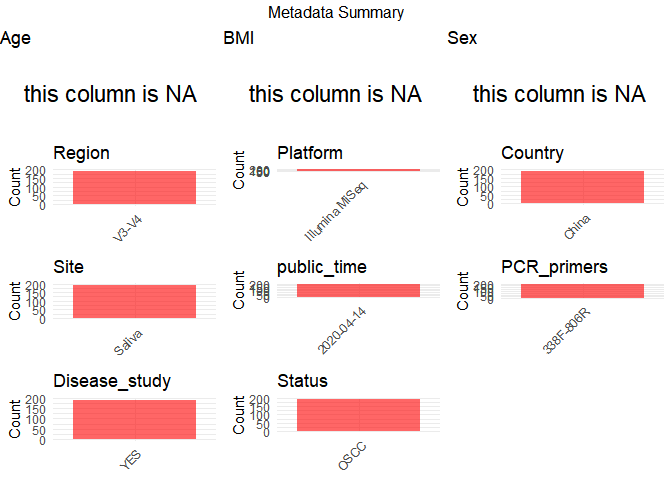

R Notebook: Metadata Processing Workflow
================

# Step 1: Obtain Initial Metadata from Each Project

To obtain the initial metadata: 1. Search for the BioProject ID (e.g.,
“PRJEBXXXX”) on the [NCBI SRA
website](https://www.ncbi.nlm.nih.gov/Traces/study/). 2. In the “Select”
table, click on “Metadata” and download the file. 3. The downloaded file
is typically named “SraRunTable.csv” and contains metadata for the
project.

``` r
# Load necessary libraries
library(dplyr)
library(ggplot2)
library(gridExtra)
library(readxl)

# Set working directory (update this path to your local directory)
setwd("D:/oral_project/OEP000837")

# Read the initial metadata files
initial_meta<-read_xlsx("OEP00000837_Data_1758007425482.xlsx",sheet = "sheet1")

# Combine the two metadata files
#meta <- rbind(initial_meta, initial_meta1)

# Remove entries where Organism is "gut metagenome" (non-oral samples)
#meta <- subset(meta, Organism != "gut metagenome")

# Check the number of samples containing "HT" in Sample.Name (e.g., healthy controls)
#nrow(subset(meta, grepl("HT", Sample.Name)))

# Display the first few rows of the metadata
head(initial_meta)
```

    ## # A tibble: 6 × 14
    ##   experiment_id experiment_name            experiment_type sample_id sample_name
    ##   <chr>         <chr>                      <chr>           <chr>     <chr>      
    ## 1 OEX00003132   the characteristics of or… Metagenomic     OES00028… S001-T     
    ## 2 OEX00003132   the characteristics of or… Metagenomic     OES00028… S001-C     
    ## 3 OEX00003132   the characteristics of or… Metagenomic     OES00028… S002-TY    
    ## 4 OEX00003132   the characteristics of or… Metagenomic     OES00028… S001-T     
    ## 5 OEX00003132   the characteristics of or… Metagenomic     OES00028… S001-C     
    ## 6 OEX00003132   the characteristics of or… Metagenomic     OES00028… S002-TY    
    ## # ℹ 9 more variables: sample_type <chr>, run_id <chr>, run_name <chr>,
    ## #   data_id <chr>, data_name <chr>, data_type <chr>, security <chr>, md5 <chr>,
    ## #   data_size <chr>

# Step 2: Create a Uniform Metadata Template

The uniform metadata should include the following columns:

1.  **BioProject**: Project ID (e.g., “PRJNA339212”)
2.  **Run**: Sample ID (e.g., “ERRXXXXXX” or “SRRXXXXXX”)
3.  **sample_name**: Original sample name submitted by the authors (not
    the database-assigned ID)
4.  **Age**: Age of the subject (if available)
5.  **BMI**: Body Mass Index (if available)
6.  **Sex**: Sex of the subject (“F” or “M”)
7.  **Region**: Targeted 16S rRNA region (e.g., “V3-V4”)
8.  **Platform**: Sequencing platform (e.g., “Illumina MiSeq”)
9.  **Country**: Country of sample origin (e.g., “China”)
10. **Site**: Sample site (e.g., “saliva”, “dental plaque”)
11. **public_time**: Data release date (format: “YYYY-MM-DD”)
12. **PCR_primers**: PCR primers used (e.g., “515F-806R”)
13. **title**: Title of the associated publication
14. **Disease_study**: Whether the study involves a disease (“YES” or
    “NO”)
15. **Status**: Disease status (e.g., “T2DM”, “HC”). Note: If the study
    includes both disease and healthy samples, this must be specified
    per sample.

``` r
# Create a uniform metadata dataframe
metadata <- data.frame(
  BioProject = "OEP000837",
  Run = initial_meta$run_id,
  sample_name = initial_meta$sample_name,
  Age = NA,
  BMI = NA,
  Sex=NA,
  Region = "V3-V4",
  Platform = "Illumina MiSeq",
  Country = "China",
  Site = "Saliva",
  public_time = "2020-04-14",
  stringsAsFactors = FALSE
)
```

# Step 3: Manually Add Information from the Publication

Some information (e.g. PCR primers, study title, disease status) must be
manually extracted from the publication and added to the metadata.

``` r
# Add information obtained from the publication
metadata$PCR_primers <- "338F-806R"
metadata$title <- "Oral Microbiota Analysis of Tissue Pairs and Saliva Samples From Patients With Oral Squamous Cell Carcinoma A Pilot Study"
metadata$Disease_study <- "YES"

# Assign disease status based on sample_name patterns
metadata$Status <- "OSCC"
```

# Step 4: Summarize and Validate the Metadata

``` r
# Check the number of unique runs and sample names
print(paste("Number of unique runs:", length(unique(metadata$Run))))
```

    ## [1] "Number of unique runs: 96"

``` r
print(paste("Number of unique sample names:", length(unique(metadata$sample_name))))
```

    ## [1] "Number of unique sample names: 96"

# Step 5: Visualize the Metadata

``` r
# Select columns for visualization
plot_data <- metadata %>%
  select(-BioProject, -Run, -sample_name, -title)

# Function to create simple plots for each column
create_simple_plots <- function(data) {
  plots <- list()
  
  for (col in colnames(data)) {
    # Check if the column is all NA
    if (all(is.na(data[[col]]))) {
      # Create an empty plot with text indicating all NA
      p <- ggplot() +
        annotate("text", x = 0.5, y = 0.5, label = "this column is NA", size = 6) +
        labs(title = col) +
        theme_void()
    } else if (is.numeric(data[[col]])) {
      # Numeric variable: histogram
      p <- ggplot(data, aes(x = .data[[col]])) +
        geom_histogram(fill = "blue", alpha = 0.6, bins = 20, na.rm = TRUE) +
        labs(title = col) +
        theme_minimal()
    } else {
      # Categorical variable: bar plot (remove NA values)
      count_data <- as.data.frame(table(data[[col]], useNA = "ifany"))
      p <- ggplot(count_data, aes(x = reorder(Var1, -Freq), y = Freq)) +
        geom_col(fill = "red", alpha = 0.6) +
        labs(title = col, x = NULL, y = "Count") +
        theme_minimal() +
        theme(axis.text.x = element_text(angle = 45, hjust = 1))
    }
    plots[[col]] <- p
  }
  
  return(plots)
}

# Generate and arrange plots
plots <- create_simple_plots(plot_data)
grid.arrange(grobs = plots, ncol = 3, top = "Metadata Summary")
```

<!-- -->

# Step 6: Finalize and Export the Metadata

``` r
# Reorder columns to match the desired format
metadata <- metadata[, c(
  "BioProject", "Run", "sample_name", "Age", "BMI", "Sex", 
  "Region", "Platform", "Country", "Site", "public_time", 
  "PCR_primers", "title", "Disease_study", "Status"
)]

# Export the uniform metadata to a CSV file
metadata<-unique(metadata)
write.csv(metadata, file = "metadata.csv", quote = FALSE)
```

## Notes for Students:

1.  **Metadata Accuracy**: Always cross-check the metadata with the
    original publication to ensure accuracy.
2.  **Manual Entries**: Columns like `PCR_primers`, and `Status` often
    require manual entry based on the publication.
3.  **Disease Status**: Be careful when assigning `Status`—some studies
    include both disease and healthy samples.
4.  **Visualization**: The plots help quickly identify the distribution
    of values in each column, which is useful for quality control.
5.  **Reproducibility**: Update the working directory and file paths to
    match your local environment.
