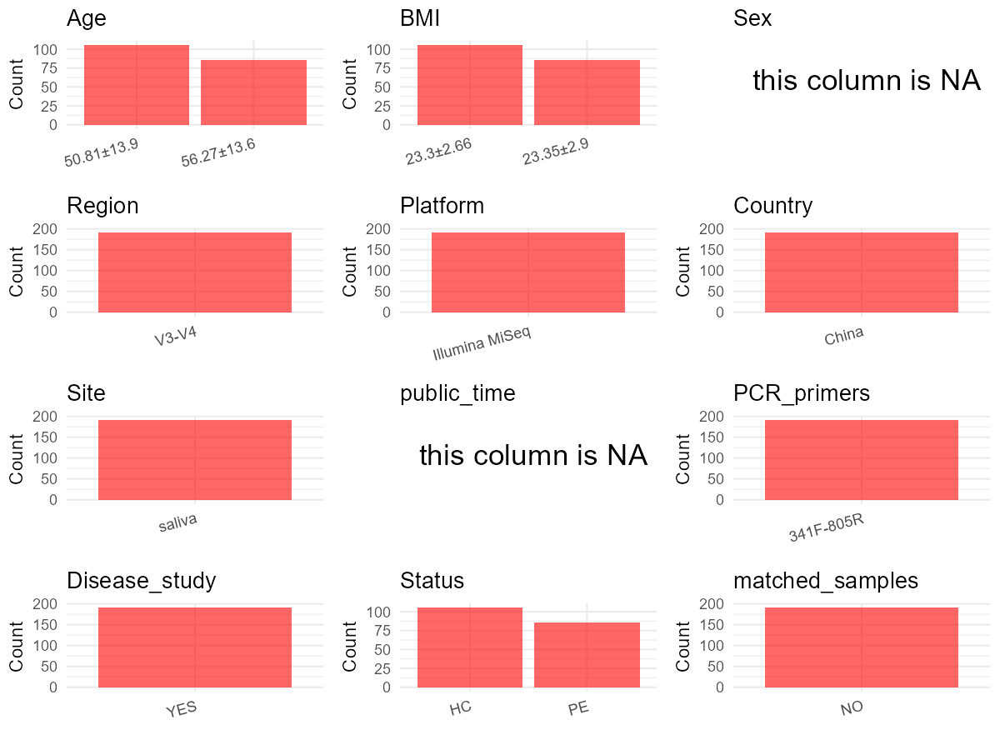

R Notebook: Metadata Processing Workflow
================

# Step 1: Obtain Initial Metadata from Each Project

To obtain the initial metadata: 1. Search for the BioProject ID (e.g.,
“PRJEBXXXX”) on the [NCBI SRA
website](https://www.ncbi.nlm.nih.gov/Traces/study/). 2. In the “Select”
table, click on “Metadata” and download the file. 3. The downloaded file
is typically named “SraRunTable.csv” and contains metadata for the
project.

``` r
# Load necessary libraries
library(dplyr)
library(ggplot2)
library(cowplot)

# Set working directory (update this path to your local directory)
setwd("D:/oral_project/PRJCA005537")

# Read the initial metadata files
initial_meta<-read.csv("SraRunTable.csv",header = T)

# Combine the two metadata files
#meta <- rbind(initial_meta, initial_meta1)

#Remove entries non-oral samples
#initial_meta <- subset(initial_meta,isolate %in% c("saliva","tongue coat"))

# Check the number of samples containing "HT" in Sample.Name (e.g., healthy controls)
#nrow(subset(meta, grepl("HT", Sample.Name)))

# Display the first few rows of the metadata
head(initial_meta)
```

    ##   ID Sample.name  Accession    Public.description Project.accession
    ## 1  1       B-135 SAMC393871 Oral flora in healthy       PRJCA005537
    ## 2  2       B-230 SAMC393872 Oral flora in healthy       PRJCA005537
    ## 3  3       B-127 SAMC393873 Oral flora in healthy       PRJCA005537
    ## 4  4       B-323 SAMC393874 Oral flora in healthy       PRJCA005537
    ## 5  5       B-113 SAMC393875 Oral flora in healthy       PRJCA005537
    ## 6  6       A-078 SAMC393876 Oral flora in healthy       PRJCA005537
    ##      Sample.title Organism         Host Isolation.source Collection.date
    ## 1 Oral microbiota Bacteria Homo sapiens          missing      2017-12-01
    ## 2 Oral microbiota Bacteria Homo sapiens          missing      2017-12-01
    ## 3 Oral microbiota Bacteria Homo sapiens          missing      2017-12-01
    ## 4 Oral microbiota Bacteria Homo sapiens          missing      2017-12-01
    ## 5 Oral microbiota Bacteria Homo sapiens          missing      2017-12-01
    ## 6 Oral microbiota Bacteria Homo sapiens          missing      2017-12-01
    ##   Geographic.location Latitude.longitude Reference.biomaterial
    ## 1     China: Xianyang    34.33 N 108.70E                    NA
    ## 2     China: Xianyang    34.33 N 108.70E                    NA
    ## 3     China: Xianyang    34.33 N 108.70E                    NA
    ## 4     China: Xianyang    34.33 N 108.70E                    NA
    ## 5     China: Xianyang    34.33 N 108.70E                    NA
    ## 6     China: Xianyang    34.33 N 108.70E                    NA
    ##   Relationship.to.oxygen Sample.collection.device Sample.material.processing
    ## 1                     NA                       NA                         NA
    ## 2                     NA                       NA                         NA
    ## 3                     NA                       NA                         NA
    ## 4                     NA                       NA                         NA
    ## 5                     NA                       NA                         NA
    ## 6                     NA                       NA                         NA
    ##   Sample.size Source.material.identifiers Description
    ## 1          NA                          NA          NA
    ## 2          NA                          NA          NA
    ## 3          NA                          NA          NA
    ## 4          NA                          NA          NA
    ## 5          NA                          NA          NA
    ## 6          NA                          NA          NA

# Step 2: Create a Uniform Metadata Template

The uniform metadata should include the following columns:

1.  **BioProject**: Project ID (e.g., “PRJNA339212”)
2.  **Run**: Sample ID (e.g., “ERRXXXXXX” or “SRRXXXXXX”)
3.  **sample_name**: Original sample name submitted by the authors (not
    the database-assigned ID)
4.  **Age**: Age of the subject (if available)
5.  **BMI**: Body Mass Index (if available)
6.  **Sex**: Sex of the subject (“F” or “M”)
7.  **Region**: Targeted 16S rRNA region (e.g., “V3-V4”)
8.  **Platform**: Sequencing platform (e.g., “Illumina MiSeq”)
9.  **Country**: Country of sample origin (e.g., “China”)
10. **Site**: Sample site (e.g., “saliva”, “dental plaque”)
11. **public_time**: Data release date (format: “YYYY-MM-DD”)
12. **PCR_primers**: PCR primers used (e.g., “515F-806R”)
13. **title**: Title of the associated publication
14. **Disease_study**: Whether the study involves a disease (“YES” or
    “NO”)
15. **Status**: Disease status (e.g., “T2DM”, “HC”). Note: If the study
    includes both disease and healthy samples, this must be specified
    per sample.
16. **matched_samples**: matched samples (“YES” or “NO”)

``` r
# Create a uniform metadata dataframe
metadata <- data.frame(
  BioProject = "PRJCA005537",
  Run = NA,
  sample_name = initial_meta$Sample.name,
  #Age = NA,
  #BMI = NA,
  Sex = NA,
  Region = "V3-V4",
  Platform = "Illumina MiSeq",
  Country = "China",
  Site = replace(initial_meta$Sample.title, initial_meta$Sample.title == "Oral microbiota", "saliva"),
  public_time = NA,
  Public.description = initial_meta$Public.description,
  stringsAsFactors = FALSE
)
```

``` r
metadata <- metadata %>%
  mutate(
    Age = case_when(
      grepl("Oral flora in healthy", Public.description) ~ "50.81±13.9",  
      grepl("Oral flora in esophagitis patients", Public.description) ~ "56.27±13.6",  
    )
  )
metadata <- metadata %>%
  mutate(
    BMI = case_when(
      grepl("Oral flora in healthy", Public.description) ~ "23.3±2.66",  
      grepl("Oral flora in esophagitis patients", Public.description) ~ "23.35±2.9",  
    )
  )
```

# Step 3: Manually Add Information from the Publication

Some information (e.g. PCR primers, study title, disease status) must be
manually extracted from the publication and added to the metadata.

``` r
# Add information obtained from the publication
metadata$PCR_primers <- "341F-805R"
metadata$title <- "Effects of Helicobacter pylori Infection on the Oral Microbiota of Reflux Esophagitis Patients"
metadata$Disease_study <- "YES"
# Assign disease status based on sample_name patterns
metadata <- metadata %>%
  mutate(Status = case_when(
    grepl("Oral flora in esophagitis patients", Public.description) ~ "PE",
    grepl("Oral flora in healthy", Public.description) ~ "HC",
    TRUE ~ NA_character_  # 处理其他情况
  )) %>%
  select(-Public.description)  # 删除Public.description列
#get subjects id according to sample id
metadata$sample_name<-gsub("","",metadata$sample_name)
#get subjects id with Saliva available
keep_subjects<-subset(metadata,Site %in% "saliva")
#remove subjects without Saliva samples
metadata<-subset(metadata,sample_name %in% keep_subjects$sample_name)
#get subjects sampling counts
sample_counts <- table(metadata$sample_name)
# Create matched_samples column, any subjects have >=2 samples will be label "YES", otherwise "NO"
metadata$matched_samples <- ifelse(metadata$sample_name %in% names(sample_counts[sample_counts >= 2]), "YES", "NO")
```

# Step 4: Summarize and Validate the Metadata

``` r
# Check the number of unique runs and sample names
print(paste("Number of unique runs:", length(unique(metadata$Run))))
```

    ## [1] "Number of unique runs: 1"

``` r
print(paste("Number of unique sample names:", length(unique(metadata$sample_name))))
```

    ## [1] "Number of unique sample names: 192"

# Step 5: Visualize the Metadata

``` r

```


# Step 6: Finalize and Export the Metadata

``` r
# Reorder columns to match the desired format
metadata <- metadata[, c(
  "BioProject", "Run", "sample_name", "Age", "BMI", "Sex", 
  "Region", "Platform", "Country", "Site", "public_time", 
  "PCR_primers", "title", "Disease_study", "Status","matched_samples"
)]

# Export the uniform metadata to a CSV file
write.csv(metadata, file = "metadata.csv", quote = TRUE)
head(metadata)
```

    ##    BioProject Run sample_name        Age       BMI Sex Region       Platform
    ## 1 PRJCA005537  NA       B-135 50.81±13.9 23.3±2.66  NA  V3-V4 Illumina MiSeq
    ## 2 PRJCA005537  NA       B-230 50.81±13.9 23.3±2.66  NA  V3-V4 Illumina MiSeq
    ## 3 PRJCA005537  NA       B-127 50.81±13.9 23.3±2.66  NA  V3-V4 Illumina MiSeq
    ## 4 PRJCA005537  NA       B-323 50.81±13.9 23.3±2.66  NA  V3-V4 Illumina MiSeq
    ## 5 PRJCA005537  NA       B-113 50.81±13.9 23.3±2.66  NA  V3-V4 Illumina MiSeq
    ## 6 PRJCA005537  NA       A-078 50.81±13.9 23.3±2.66  NA  V3-V4 Illumina MiSeq
    ##   Country   Site public_time PCR_primers
    ## 1   China saliva          NA   341F-805R
    ## 2   China saliva          NA   341F-805R
    ## 3   China saliva          NA   341F-805R
    ## 4   China saliva          NA   341F-805R
    ## 5   China saliva          NA   341F-805R
    ## 6   China saliva          NA   341F-805R
    ##                                                                                            title
    ## 1 Effects of Helicobacter pylori Infection on the Oral Microbiota of Reflux Esophagitis Patients
    ## 2 Effects of Helicobacter pylori Infection on the Oral Microbiota of Reflux Esophagitis Patients
    ## 3 Effects of Helicobacter pylori Infection on the Oral Microbiota of Reflux Esophagitis Patients
    ## 4 Effects of Helicobacter pylori Infection on the Oral Microbiota of Reflux Esophagitis Patients
    ## 5 Effects of Helicobacter pylori Infection on the Oral Microbiota of Reflux Esophagitis Patients
    ## 6 Effects of Helicobacter pylori Infection on the Oral Microbiota of Reflux Esophagitis Patients
    ##   Disease_study Status matched_samples
    ## 1           YES     HC              NO
    ## 2           YES     HC              NO
    ## 3           YES     HC              NO
    ## 4           YES     HC              NO
    ## 5           YES     HC              NO
    ## 6           YES     HC              NO

## Notes for Students:

1.  **Metadata Accuracy**: Always cross-check the metadata with the
    original publication to ensure accuracy.
2.  **Manual Entries**: Columns like `PCR_primers`, and `Status` often
    require manual entry based on the publication.
3.  **Disease Status**: Be careful when assigning `Status`—some studies
    include both disease and healthy samples.
4.  **Visualization**: The plots help quickly identify the distribution
    of values in each column, which is useful for quality control.
5.  **Reproducibility**: Update the working directory and file paths to
    match your local environment.
