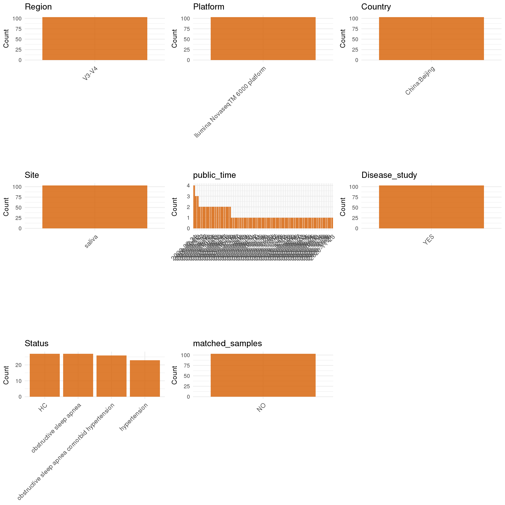

# Step 1: Obtain Initial Metadata from Each Project

This step sets the project directory, loads the raw CRA metadata, and standardizes the key accession columns.

```{r message=FALSE, warning=FALSE}
# Load libraries
library(dplyr)
library(ggplot2)
library(cowplot)

# (1) Setting working directory
project_id <- "PRJCA006963"

base_dir <- "E:/工作区/VSCode/RNAproject/collect_metadata_respon/project"
setwd(file.path(base_dir, project_id))

# (2) Loading raw metadata file
sra_file <- "CRA006039.csv"
initial_meta <- read.csv(sra_file, header = TRUE, stringsAsFactors = FALSE)

# CRA metadata stores project and sample accession under these columns.
initial_meta$BioProject <- initial_meta$Project.accession
initial_meta$Run <- initial_meta$Accession
```

# Step 2: Data Overview

First, you need to get an overview of the data, which includes two steps: reading the article and reading the initial metadata. This step is very IMPORTANT!

```{r message=FALSE, warning=FALSE}
# (1) Read the article in the following order: abstract, the beginning of the results section, and the methods.
# Paper summary used for this project:
# - Title: Altered Salivary Microbiota in Patients with Obstructive Sleep Apnea Comorbid Hypertension
# - Study design: cross-sectional
# - Sample size: 103 subjects
# - Group sizes from paper/Table 1: control 27, OSA 27, HTN 23, OSA+HTN 26
# - Site from Methods: unstimulated saliva
# - Sequencing from Methods: V3-V4, Illumina NovaSeq 6000, primers 338F/806R
# - Participants from Methods: male adults older than 18 years

# (2) IMPORTANT: MUST go through each column of initial_meta
head(initial_meta, 10)
colnames(initial_meta)
table(initial_meta$Host)
table(initial_meta$Geographic.location)
table(substr(initial_meta$Sample.name, 1, 2))
# The sample-name prefixes A0/A1/A2/A3 occur 27/27/23/26 times,
# matching control/OSA/HTN/OSA+HTN group sizes reported in the paper.
```

# Step 3: Removing Control and Non-human Samples

First, we need to remove control samples(including both negative controls and positive controls) and non-human samples.

```{r}
# (1) Parameter setup
control_column <- ""
control_keywords <- c()

species_column <- "Host"
unique(initial_meta[[species_column]])
non_human_keywords <- c()

# (2) Remove controls and non-human samples. DO NOT need to modify code in this part, just run it.
n_samples <- nrow(initial_meta)
# Control evaluation
if (length(control_keywords) > 0) {
  if (is.null(control_column) || control_column == "") {
    stop("Error: control_keywords provided but control_column is missing.")
  }

  if (!(control_column %in% colnames(initial_meta))) {
    stop(sprintf("Error: Column '%s' not found in initial_meta.", control_column))
  }

  control_pattern <- paste(control_keywords, collapse = "|")
  control_text <- initial_meta[[control_column]]
  is_control <- grepl(control_pattern, control_text)

} else {
  is_control <- rep(FALSE, n_samples)
}

# Non-human evaluation
if (length(non_human_keywords) > 0) {
  if (is.null(species_column) || species_column == "") {
    stop("Error: non_human_keywords provided but species_column is missing.")
  }

  if (!(species_column %in% colnames(initial_meta))) {
    stop(sprintf("Error: Column '%s' not found in initial_meta.", species_column))
  }

  non_human_pattern <- paste(non_human_keywords, collapse = "|")
  species_text <- initial_meta[[species_column]]
  is_non_human <- grepl(non_human_pattern, species_text)
} else {
  is_non_human <- rep(FALSE, n_samples)
}

# Execute removal
samples_to_remove <- is_control | is_non_human
initial_meta <- initial_meta[!samples_to_remove, ]

cat("Initial samples counts:", n_samples, "\n")
cat("Removed control samples:", sum(is_control), "\n")
cat("Removed non-human samples:", sum(is_non_human), "\n")
cat("Total samples removed ", sum(samples_to_remove), "\n")
cat("Remaining samples after Step 2:", nrow(initial_meta), "\n")
```

# Step 4: Creating a Uniform Metadata Template

This step converts the raw table into the standard metadata format used in our meta-analysis.

```{r}
metadata <- data.frame(
  bioproject = initial_meta$BioProject,
  sample_id = initial_meta$Run,
  subject_id = initial_meta$Sample.name,
  age = NA_real_,
  age_info = "control 30.50±5.74; OSA 40.11±11.25; HTN 36.22±10.20; OSA+HTN 42.17±9.52; male adults >18 years",
  bmi = NA_real_,
  sex = "M",
  sequencing_region = "V3-V4",
  platform = "Illumina NovaSeq 6000",
  raw_country = initial_meta$Geographic.location,
  country = "pending",
  site = "unstimulated saliva",
  site_group = "pending",
  public_time = NA_character_,
  pcr_primers = "F-ACTCCTACGGGAGGCAGCA,R-GGACTACHVGGGTWTCTAAT",
  title = "Altered Salivary Microbiota in Patients with Obstructive Sleep Apnea Comorbid Hypertension",
  disease_study = "yes",
  raw_status = initial_meta$Sample.name,
  status = "pending",
  matched_samples = "pending",
  is_time_series = "no",
  stringsAsFactors = FALSE
)

# Source notes for non-obvious fields:
# - subject_id uses Sample.name because the paper reports 103 subjects and the CRA table has 103 unique sample names.
# - age_info combines Table 1 group mean ± SD ages with the Methods inclusion criteria that all participants were male and older than 18 years.
# - sequencing_region, platform, pcr_primers, site, title, disease_study, and is_time_series come from the paper.
# - public_time is NA because CRA006039.csv provides Collection.date but no release date; collection date should not be used as public_time.
metadata$public_time <- as.Date(metadata$public_time)
```

# Step 5: Manually solving pending issues

This step involves two parts: (1) handle the columns with the `raw_` prefix, and next (2) handle the `site_group` and `matched_samples` columns.

```{r}
# (1) Handle the columns with the `raw_` prefix.
metadata <- metadata %>%
  mutate(
    country = sub(":.*$", "", raw_country),
    status = case_when(
      grepl("^A0", raw_status) ~ "HC",
      grepl("^A1", raw_status) ~ "obstructive sleep apnea",
      grepl("^A2", raw_status) ~ "hypertension",
      grepl("^A3", raw_status) ~ "obstructive sleep apnea comorbid hypertension",
      TRUE ~ NA_character_
    )
  )
# The status mapping is based on the sample-name prefixes in CRA006039.csv.
# Prefix counts A0/A1/A2/A3 are 27/27/23/26, matching control/OSA/HTN/OSA+HTN in the paper Results and Table 1.
```

```{r}
# (2) Filling the 'site_group' and 'matched_samples' columns
unique(metadata$site)
Oral_site = c("unstimulated saliva")
Gut_site = c("feces")

metadata <- metadata %>%
  mutate(site_group = case_when(
    site %in% Oral_site ~ "oral",
    site %in% Gut_site ~ "gut",
    TRUE ~ "other"
  ))

metadata$matched_samples <- ifelse(
  ave(metadata$subject_id, metadata$subject_id, FUN = length) > 1,
  "yes",
  "no"
)
# The paper describes one saliva sample per subject in a cross-sectional design, so matched_samples resolves to "no".
```

```{r}
# (3) check if there is pending value in metadata. If there is pending value, go on modify the metadata.
has_pending <- function(col) {
  if (is.character(col) || is.factor(col)) {
    any(col == "pending", na.rm = TRUE)
  } else {
    FALSE
  }
}

any_pending_value <- any(sapply(metadata, has_pending))

if (!any_pending_value) {
  message("Good! No cell contains the value 'pending'.")
} else {
  pending_cols <- names(metadata)[sapply(metadata, has_pending)]
  message("Columns containing 'pending': ", paste(pending_cols, collapse = ", "))
  message("Please continue to resolve these pending columns!")
}
```

# Step 6: Visualize the Metadata

This step makes a quick set of plots for checking the distribution of key metadata fields.

```{r}
plot_data <- metadata %>%
  select(-bioproject, -sample_id, -subject_id, -title)

create_simple_plots <- function(data) {
  plots <- list()
  continuous_vars <- c("age", "bmi")

  for (col in colnames(data)) {
    if (all(is.na(data[[col]]))) {
      p <- ggplot() +
        annotate("text", x = 0.5, y = 0.5, label = "this column is NA", size = 6) +
        labs(title = col) +
        theme_void()
    } else if (col %in% continuous_vars && is.numeric(data[[col]])) {
      p <- ggplot(data, aes(x = .data[[col]])) +
        geom_histogram(fill = "blue", alpha = 0.6, bins = 20, na.rm = TRUE) +
        labs(title = col, x = col, y = "Count") +
        theme_minimal()
    } else {
      count_data <- as.data.frame(table(data[[col]], useNA = "ifany"))
      p <- ggplot(count_data, aes(x = reorder(Var1, -Freq), y = Freq)) +
        geom_col(fill = "red", alpha = 0.6) +
        labs(title = col, x = NULL, y = "Count") +
        theme_minimal() +
        theme(axis.text.x = element_text(angle = 15, hjust = 1))
    }
    plots[[col]] <- p
  }

  return(plots)
}

plots <- create_simple_plots(plot_data)
p <- plot_grid(plots$age,
               plots$bmi,
               plots$sex,
               plots$site,
               plots$site_group,
               plots$sequencing_region,
               plots$platform,
               plots$country,
               plots$status,
               plots$matched_samples,
               ncol = 3, align = "hv", axis = "lb")
ggsave("Metadata_Summary.png", plot = p, width = 8, height = 6, dpi = 150)
```

```{r}

```

# Step 7: Sort and export the metadata

This step saves the cleaned metadata table as the final `metadata_v2.csv` file.

```{r}
fixed_cols <- c("bioproject", "sample_id", "subject_id", "age", "age_info",
                "bmi", "sex", "platform", "sequencing_region", "pcr_primers",
                "country", "site", "site_group", "disease_study", "status",
                "title", "public_time", "matched_samples", "is_time_series")
metadata <- metadata %>%
  select(all_of(fixed_cols), starts_with("raw_"))

write.csv(metadata, file = "metadata_v2.csv", quote = TRUE, row.names = FALSE)
```