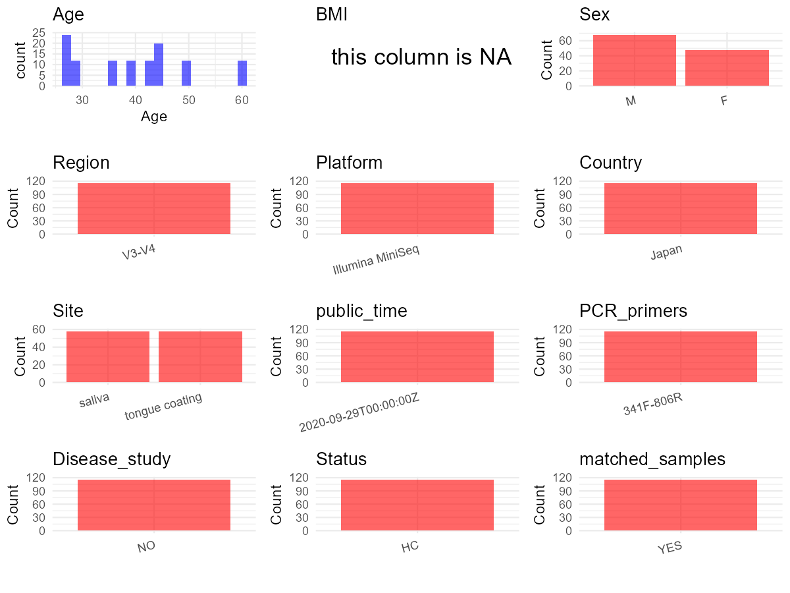

R Notebook: Metadata Processing Workflow
================

# Step 1: Obtain Initial Metadata from Each Project

To obtain the initial metadata: 1. Search for the BioProject ID (e.g.,
“PRJEBXXXX”) on the [NCBI SRA
website](https://www.ncbi.nlm.nih.gov/Traces/study/). 2. In the “Select”
table, click on “Metadata” and download the file. 3. The downloaded file
is typically named “SraRunTable.csv” and contains metadata for the
project.

``` r
# Load necessary libraries
library(dplyr)
library(ggplot2)
library(cowplot)

# Set working directory (update this path to your local directory)
setwd("E:/bioproject_YSD/PRJDB10589")

# Read the initial metadata files
initial_meta <- read.csv("SraRunTable.csv", header = T)

# Display the first few rows of the metadata
head(initial_meta)
```

    ##         Run Assay.Type AvgSpotLen    Bases BioProject    BioSample
    ## 1 DRR248464   AMPLICON        501 39425399 PRJDB10589 SAMD00248628
    ## 2 DRR248465   AMPLICON        511 65131463 PRJDB10589 SAMD00248629
    ## 3 DRR248466   AMPLICON        501 50317527 PRJDB10589 SAMD00248630
    ## 4 DRR248467   AMPLICON        511 57656038 PRJDB10589 SAMD00248631
    ## 5 DRR248468   AMPLICON        501 41162494 PRJDB10589 SAMD00248632
    ## 6 DRR248469   AMPLICON        511 60113080 PRJDB10589 SAMD00248633
    ##       BioSampleModel    Bytes  Center.Name Collection_Date Consent
    ## 1 MIMS.me.human-oral 24817119 OSAKA_DENTAL       2017/2018  public
    ## 2 MIMS.me.human-oral 41009732 OSAKA_DENTAL       2017/2018  public
    ## 3 MIMS.me.human-oral 32278247 OSAKA_DENTAL       2017/2018  public
    ## 4 MIMS.me.human-oral 37958012 OSAKA_DENTAL       2017/2018  public
    ## 5 MIMS.me.human-oral 26265951 OSAKA_DENTAL       2017/2018  public
    ## 6 MIMS.me.human-oral 37047239 OSAKA_DENTAL       2017/2018  public
    ##   DATASTORE.filetype DATASTORE.provider                     DATASTORE.region
    ## 1         run.zq,sra         gs,ncbi,s3 gs.us-east1,ncbi.public,s3.us-east-1
    ## 2         run.zq,sra         gs,ncbi,s3 gs.us-east1,ncbi.public,s3.us-east-1
    ## 3         run.zq,sra         gs,ncbi,s3 gs.us-east1,ncbi.public,s3.us-east-1
    ## 4         run.zq,sra         gs,ncbi,s3 gs.us-east1,ncbi.public,s3.us-east-1
    ## 5         run.zq,sra         gs,ncbi,s3 gs.us-east1,ncbi.public,s3.us-east-1
    ## 6         run.zq,sra         gs,ncbi,s3 gs.us-east1,ncbi.public,s3.us-east-1
    ##   Day env_broad_scale env_local_scale env_medium Experiment
    ## 1  D1  not applicable  not applicable     saliva  DRX238257
    ## 2  D2  not applicable  not applicable     saliva  DRX238258
    ## 3  D1  not applicable  not applicable     saliva  DRX238259
    ## 4  D2  not applicable  not applicable     saliva  DRX238260
    ## 5  D1  not applicable  not applicable     saliva  DRX238261
    ## 6  D2  not applicable  not applicable     saliva  DRX238262
    ##        experiment_type geo_loc_name_country geo_loc_name_country_continent
    ## 1 no intervention (E2)                Japan                           Asia
    ## 2 no intervention (E2)                Japan                           Asia
    ## 3 no intervention (E2)                Japan                           Asia
    ## 4 no intervention (E2)                Japan                           Asia
    ## 5 no intervention (E2)                Japan                           Asia
    ## 6 no intervention (E2)                Japan                           Asia
    ##   geo_loc_name         HOST host_subject_id       Instrument lat_lon
    ## 1  Japan:Osaka Homo sapiens   participant A Illumina MiniSeq missing
    ## 2  Japan:Osaka Homo sapiens   participant A Illumina MiniSeq missing
    ## 3  Japan:Osaka Homo sapiens   participant B Illumina MiniSeq missing
    ## 4  Japan:Osaka Homo sapiens   participant B Illumina MiniSeq missing
    ## 5  Japan:Osaka Homo sapiens   participant C Illumina MiniSeq missing
    ## 6  Japan:Osaka Homo sapiens   participant C Illumina MiniSeq missing
    ##   Library.Name LibraryLayout LibrarySelection LibrarySource miseq_run
    ## 1           NA        PAIRED              PCR       GENOMIC         6
    ## 2           NA        PAIRED              PCR       GENOMIC         7
    ## 3           NA        PAIRED              PCR       GENOMIC         6
    ## 4           NA        PAIRED              PCR       GENOMIC         7
    ## 5           NA        PAIRED              PCR       GENOMIC         6
    ## 6           NA        PAIRED              PCR       GENOMIC         7
    ##                Organism Platform
    ## 1 human oral metagenome ILLUMINA
    ## 2 human oral metagenome ILLUMINA
    ## 3 human oral metagenome ILLUMINA
    ## 4 human oral metagenome ILLUMINA
    ## 5 human oral metagenome ILLUMINA
    ## 6 human oral metagenome ILLUMINA
    ##                                                    project_name
    ## 1 Effect of oral care tablets on salivary and tongue microbiome
    ## 2 Effect of oral care tablets on salivary and tongue microbiome
    ## 3 Effect of oral care tablets on salivary and tongue microbiome
    ## 4 Effect of oral care tablets on salivary and tongue microbiome
    ## 5 Effect of oral care tablets on salivary and tongue microbiome
    ## 6 Effect of oral care tablets on salivary and tongue microbiome
    ##            ReleaseDate          create_date version  Sample.Name
    ## 1 2020-09-29T00:00:00Z 2020-09-29T17:57:00Z       1 SAMD00248628
    ## 2 2020-09-29T00:00:00Z 2020-09-29T17:57:00Z       1 SAMD00248629
    ## 3 2020-09-29T00:00:00Z 2020-09-29T17:57:00Z       1 SAMD00248630
    ## 4 2020-09-29T00:00:00Z 2020-09-29T17:57:00Z       1 SAMD00248631
    ## 5 2020-09-29T00:00:00Z 2020-09-29T17:56:00Z       1 SAMD00248632
    ## 6 2020-09-29T00:00:00Z 2020-09-29T17:57:00Z       1 SAMD00248633
    ##                          sample_name sampleid SRA.Study
    ## 1 207_saliva_E2_D1_participantA_run6      207 DRP006566
    ## 2 221_saliva_E2_D2_participantA_run7      221 DRP006566
    ## 3 208_saliva_E2_D1_participantB_run6      208 DRP006566
    ## 4 222_saliva_E2_D2_participantB_run7      222 DRP006566
    ## 5 209_saliva_E2_D1_participantC_run6      209 DRP006566
    ## 6 223_saliva_E2_D2_participantC_run7      223 DRP006566

# Step 2: Create a Uniform Metadata Template

The uniform metadata should include the following columns:

1.  **BioProject**: Project ID (e.g., “PRJNA339212”)
2.  **Run**: Sample ID (e.g., “ERRXXXXXX” or “SRRXXXXXX”)
3.  **sample_name**: Original sample name submitted by the authors (not
    the database-assigned ID)
4.  **Age**: Age of the subject (if available)
5.  **BMI**: Body Mass Index (if available)
6.  **Sex**: Sex of the subject (“F” or “M”)
7.  **Region**: Targeted 16S rRNA region (e.g., “V3-V4”)
8.  **Platform**: Sequencing platform (e.g., “Illumina MiSeq”)
9.  **Country**: Country of sample origin (e.g., “China”)
10. **Site**: Sample site (e.g., “saliva”, “dental plaque”)
11. **public_time**: Data release date (format: “YYYY-MM-DD”)
12. **PCR_primers**: PCR primers used (e.g., “515F-806R”)
13. **title**: Title of the associated publication
14. **Disease_study**: Whether the study involves a disease (“YES” or
    “NO”)
15. **Status**: Disease status (e.g., “T2DM”, “HC”). Note: If the study
    includes both disease and healthy samples, this must be specified
    per sample.
16. **matched_samples**: matched samples (“YES” or “NO”)

``` r
# Create a uniform metadata dataframe
metadata <- data.frame(
  BioProject = initial_meta$BioProject,
  Run = initial_meta$Run,
  sample_name = initial_meta$host_subject_id,
  BMI = NA,  
  Region = "V3-V4",
  Platform = initial_meta$Instrument,
  Country = initial_meta$geo_loc_name_country,
  Site = initial_meta$env_medium,
  public_time = initial_meta$ReleaseDate,
  stringsAsFactors = FALSE
)

# Add the suffix coating to all tongue values in the site column
metadata <- metadata %>%
  mutate(Site = case_when(
      Site == "tongue" ~ paste(Site, "coating"),
      TRUE ~ Site))

# Set the corresponding Age value for each sample_name value
age_map <- c(
  "participant A" = 50, "participant B" = 45, "participant C" = 42, "participant D" = 35, "participant E" = 60, "participant F" = 28, "participant G" = 27, "participant O" = 27, "participant Q" = 39, "participant R" = 45
)
metadata$Age <- age_map[metadata$sample_name]

# Set the corresponding Sex value for each sample_name value
sex_map <- c(
  "participant A" = "F", "participant B" = "M", "participant C" = "M", "participant D" = "F", "participant E" = "F", "participant F" = "M", "participant G" = "M", "participant O" = "F", "participant Q" = "M", "participant R" = "M"
)
metadata$Sex <- sex_map[metadata$sample_name]
```

# Step 3: Manually Add Information from the Publication

Some information (e.g. PCR primers, study title, disease status) must be
manually extracted from the publication and added to the metadata.

``` r
# Add information obtained from the publication
metadata$PCR_primers <- "341F-806R"
metadata$title <- "Inter-site and interpersonal diversity of salivary and tongue microbiomes and the effect of oral care tablets"
metadata$Disease_study <- "NO"
# Assign disease status based on sample_name patterns
metadata$Status <- "HC"

# Check initial data distribution
cat("Initial sample distribution:\n")
```

    ## Initial sample distribution:

``` r
table(metadata$sample_name)
```

    ## 
    ## participant A participant B participant C participant D participant E 
    ##            12            12            12            12            12 
    ## participant F participant G participant O participant Q participant R 
    ##            12            12            12            12             8

``` r
table(metadata$Site)
```

    ## 
    ##         saliva tongue coating 
    ##             58             58

``` r
# Calculate sampling frequency per subject
sample_counts <- table(metadata$sample_name)
cat("\nNumber of samples per subject:\n")
```

    ## 
    ## Number of samples per subject:

``` r
print(sample_counts)
```

    ## 
    ## participant A participant B participant C participant D participant E 
    ##            12            12            12            12            12 
    ## participant F participant G participant O participant Q participant R 
    ##            12            12            12            12             8

``` r
# Create matched_samples column
metadata$matched_samples <- ifelse(metadata$sample_name %in% names(sample_counts[sample_counts >= 2]), "YES", "NO")

cat("\nMatched samples distribution:\n")
```

    ## 
    ## Matched samples distribution:

``` r
table(metadata$matched_samples)
```

    ## 
    ## YES 
    ## 116

``` r
# Identify samples for removal: single samples excluding saliva and tongue coating
single_samples <- names(sample_counts[sample_counts == 1])
samples_to_remove <- metadata$sample_name %in% single_samples & 
                     !(metadata$Site %in% c("saliva", "tongue coating"))

cat("\nNumber of samples to be removed:", sum(samples_to_remove), "\n")
```

    ## 
    ## Number of samples to be removed: 0

``` r
# Remove identified samples
metadata_clean <- metadata[!samples_to_remove, ]

cat("\nFinal sample distribution after cleaning:\n")
```

    ## 
    ## Final sample distribution after cleaning:

``` r
table(metadata_clean$sample_name)
```

    ## 
    ## participant A participant B participant C participant D participant E 
    ##            12            12            12            12            12 
    ## participant F participant G participant O participant Q participant R 
    ##            12            12            12            12             8

``` r
table(metadata_clean$Site)
```

    ## 
    ##         saliva tongue coating 
    ##             58             58

``` r
table(metadata_clean$matched_samples)
```

    ## 
    ## YES 
    ## 116

``` r
# Use cleaned dataset for subsequent analysis
metadata <- metadata_clean
```

# Step 4: Summarize and Validate the Metadata

``` r
# Check the number of unique runs and sample names
print(paste("Number of unique runs:", length(unique(metadata$Run))))
```

    ## [1] "Number of unique runs: 116"

``` r
print(paste("Number of unique sample names:", length(unique(metadata$sample_name))))
```

    ## [1] "Number of unique sample names: 10"

# Step 5: Visualize the Metadata

``` r

```


# Step 6: Finalize and Export the Metadata

``` r
# Reorder columns to match the desired format
metadata <- metadata[, c(
  "BioProject", "Run", "sample_name", "Age", "BMI", "Sex", 
  "Region", "Platform", "Country", "Site", "public_time", 
  "PCR_primers", "title", "Disease_study", "Status", "matched_samples"
)]

# Export the uniform metadata to a CSV file
write.csv(metadata, file = "metadata.csv", quote = TRUE)
head(metadata)
```

    ##   BioProject       Run   sample_name Age BMI Sex Region         Platform
    ## 1 PRJDB10589 DRR248464 participant A  50  NA   F  V3-V4 Illumina MiniSeq
    ## 2 PRJDB10589 DRR248465 participant A  50  NA   F  V3-V4 Illumina MiniSeq
    ## 3 PRJDB10589 DRR248466 participant B  45  NA   M  V3-V4 Illumina MiniSeq
    ## 4 PRJDB10589 DRR248467 participant B  45  NA   M  V3-V4 Illumina MiniSeq
    ## 5 PRJDB10589 DRR248468 participant C  42  NA   M  V3-V4 Illumina MiniSeq
    ## 6 PRJDB10589 DRR248469 participant C  42  NA   M  V3-V4 Illumina MiniSeq
    ##   Country   Site          public_time PCR_primers
    ## 1   Japan saliva 2020-09-29T00:00:00Z   341F-806R
    ## 2   Japan saliva 2020-09-29T00:00:00Z   341F-806R
    ## 3   Japan saliva 2020-09-29T00:00:00Z   341F-806R
    ## 4   Japan saliva 2020-09-29T00:00:00Z   341F-806R
    ## 5   Japan saliva 2020-09-29T00:00:00Z   341F-806R
    ## 6   Japan saliva 2020-09-29T00:00:00Z   341F-806R
    ##                                                                                                           title
    ## 1 Inter-site and interpersonal diversity of salivary and tongue microbiomes and the effect of oral care tablets
    ## 2 Inter-site and interpersonal diversity of salivary and tongue microbiomes and the effect of oral care tablets
    ## 3 Inter-site and interpersonal diversity of salivary and tongue microbiomes and the effect of oral care tablets
    ## 4 Inter-site and interpersonal diversity of salivary and tongue microbiomes and the effect of oral care tablets
    ## 5 Inter-site and interpersonal diversity of salivary and tongue microbiomes and the effect of oral care tablets
    ## 6 Inter-site and interpersonal diversity of salivary and tongue microbiomes and the effect of oral care tablets
    ##   Disease_study Status matched_samples
    ## 1            NO     HC             YES
    ## 2            NO     HC             YES
    ## 3            NO     HC             YES
    ## 4            NO     HC             YES
    ## 5            NO     HC             YES
    ## 6            NO     HC             YES

## Notes for Students:

1.  **Metadata Accuracy**: Always cross-check the metadata with the
    original publication to ensure accuracy.
2.  **Manual Entries**: Columns like `PCR_primers`, and `Status` often
    require manual entry based on the publication.
3.  **Disease Status**: Be careful when assigning `Status`—some studies
    include both disease and healthy samples.
4.  **Visualization**: The plots help quickly identify the distribution
    of values in each column, which is useful for quality control.
5.  **Reproducibility**: Update the working directory and file paths to
    match your local environment.
