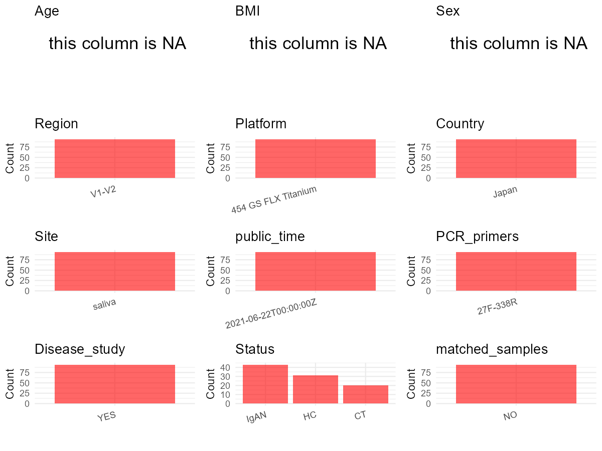

R Notebook: Metadata Processing Workflow
================

# Step 1: Obtain Initial Metadata from Each Project

To obtain the initial metadata: 1. Search for the BioProject ID (e.g.,
“PRJEBXXXX”) on the [NCBI SRA
website](https://www.ncbi.nlm.nih.gov/Traces/study/). 2. In the “Select”
table, click on “Metadata” and download the file. 3. The downloaded file
is typically named “SraRunTable.csv” and contains metadata for the
project.

``` r
# Load necessary libraries
library(dplyr)
library(ggplot2)
library(cowplot)
library(stringr)

# Set working directory (update this path to your local directory)
setwd("E:/bioproject_YSD/PRJDB10651")

# Read the initial metadata files
initial_meta <- read.csv("SraRunTable.csv", header = T)

# Display the first few rows of the metadata
head(initial_meta)
```

    ##         Run AGE Assay.Type AvgSpotLen   Bases BioProject    BioSample
    ## 1 DRR261405  21   AMPLICON        294 2927092 PRJDB10651 SAMD00266230
    ## 2 DRR261406  32   AMPLICON        294 4907049 PRJDB10651 SAMD00266231
    ## 3 DRR261407  31   AMPLICON        289 4526258 PRJDB10651 SAMD00266232
    ## 4 DRR261408  50   AMPLICON        294 5331428 PRJDB10651 SAMD00266233
    ## 5 DRR261409  33   AMPLICON        292 4398612 PRJDB10651 SAMD00266234
    ## 6 DRR261410  36   AMPLICON        292 4934322 PRJDB10651 SAMD00266235
    ##       BioSampleModel   Bytes Center.Name Collection_Date Consent
    ## 1 MIMS.me.human-oral 1736902     OKAYAMA         missing  public
    ## 2 MIMS.me.human-oral 3394310     OKAYAMA         missing  public
    ## 3 MIMS.me.human-oral 3153678     OKAYAMA         missing  public
    ## 4 MIMS.me.human-oral 3669226     OKAYAMA         missing  public
    ## 5 MIMS.me.human-oral 3031507     OKAYAMA         missing  public
    ## 6 MIMS.me.human-oral 3458635     OKAYAMA         missing  public
    ##   DATASTORE.filetype DATASTORE.provider                     DATASTORE.region
    ## 1         run.zq,sra         gs,ncbi,s3 gs.us-east1,ncbi.public,s3.us-east-1
    ## 2         run.zq,sra         gs,ncbi,s3 gs.us-east1,ncbi.public,s3.us-east-1
    ## 3         run.zq,sra         gs,ncbi,s3 gs.us-east1,ncbi.public,s3.us-east-1
    ## 4         run.zq,sra         gs,ncbi,s3 gs.us-east1,ncbi.public,s3.us-east-1
    ## 5         run.zq,sra         gs,ncbi,s3 gs.us-east1,ncbi.public,s3.us-east-1
    ## 6         run.zq,sra         gs,ncbi,s3 gs.us-east1,ncbi.public,s3.us-east-1
    ##   env_broad_scale env_local_scale env_medium Experiment geo_loc_name_country
    ## 1   notapplicable   notapplicable     saliva  DRX251108                Japan
    ## 2   notapplicable   notapplicable     saliva  DRX251109                Japan
    ## 3   notapplicable   notapplicable     saliva  DRX251110                Japan
    ## 4   notapplicable   notapplicable     saliva  DRX251111                Japan
    ## 5   notapplicable   notapplicable     saliva  DRX251112                Japan
    ## 6   notapplicable   notapplicable     saliva  DRX251113                Japan
    ##   geo_loc_name_country_continent geo_loc_name host_body_site         HOST
    ## 1                           Asia        Japan   Mouth/saliva Homo sapiens
    ## 2                           Asia        Japan   Mouth/saliva Homo sapiens
    ## 3                           Asia        Japan   Mouth/saliva Homo sapiens
    ## 4                           Asia        Japan   Mouth/saliva Homo sapiens
    ## 5                           Asia        Japan   Mouth/saliva Homo sapiens
    ## 6                           Asia        Japan   Mouth/saliva Homo sapiens
    ##          host_subject_id          Instrument                   last_meal
    ## 1 CT-Jo-Saliva-Before024 454 GS FLX Titanium atleast2hoursbeforesampling
    ## 2 CT-Jo-Saliva-Before029 454 GS FLX Titanium atleast2hoursbeforesampling
    ## 3 CT-Jo-Saliva-Before041 454 GS FLX Titanium atleast2hoursbeforesampling
    ## 4 CT-Jo-Saliva-Before048 454 GS FLX Titanium atleast2hoursbeforesampling
    ## 5 CT-Jo-Saliva-Before051 454 GS FLX Titanium atleast2hoursbeforesampling
    ## 6 CT-Jo-Saliva-Before052 454 GS FLX Titanium atleast2hoursbeforesampling
    ##                lat_lon Library.Name LibraryLayout LibrarySelection
    ## 1 35.6762 N 139.6503 E           NA        SINGLE              PCR
    ## 2 35.6762 N 139.6503 E           NA        SINGLE              PCR
    ## 3 35.6762 N 139.6503 E           NA        SINGLE              PCR
    ## 4 35.6762 N 139.6503 E           NA        SINGLE              PCR
    ## 5 35.6762 N 139.6503 E           NA        SINGLE              PCR
    ## 6 35.6762 N 139.6503 E           NA        SINGLE              PCR
    ##   LibrarySource                Organism Platform
    ## 1   METAGENOMIC human saliva metagenome    LS454
    ## 2   METAGENOMIC human saliva metagenome    LS454
    ## 3   METAGENOMIC human saliva metagenome    LS454
    ## 4   METAGENOMIC human saliva metagenome    LS454
    ## 5   METAGENOMIC human saliva metagenome    LS454
    ## 6   METAGENOMIC human saliva metagenome    LS454
    ##                                                                              project_name
    ## 1 SalivarymicrobiomeofJapaneseIgANpatients\\,Chronictonsillitispatientsandhealthycontrols
    ## 2 SalivarymicrobiomeofJapaneseIgANpatients\\,Chronictonsillitispatientsandhealthycontrols
    ## 3 SalivarymicrobiomeofJapaneseIgANpatients\\,Chronictonsillitispatientsandhealthycontrols
    ## 4 SalivarymicrobiomeofJapaneseIgANpatients\\,Chronictonsillitispatientsandhealthycontrols
    ## 5 SalivarymicrobiomeofJapaneseIgANpatients\\,Chronictonsillitispatientsandhealthycontrols
    ## 6 SalivarymicrobiomeofJapaneseIgANpatients\\,Chronictonsillitispatientsandhealthycontrols
    ##            ReleaseDate          create_date version  Sample.Name
    ## 1 2021-06-22T00:00:00Z 2021-06-22T12:45:00Z       1 SAMD00266230
    ## 2 2021-06-22T00:00:00Z 2021-06-22T12:45:00Z       1 SAMD00266231
    ## 3 2021-06-22T00:00:00Z 2021-06-22T12:45:00Z       1 SAMD00266232
    ## 4 2021-06-22T00:00:00Z 2021-06-22T12:45:00Z       1 SAMD00266233
    ## 5 2021-06-22T00:00:00Z 2021-06-22T12:45:00Z       1 SAMD00266234
    ## 6 2021-06-22T00:00:00Z 2021-06-22T12:44:00Z       1 SAMD00266235
    ##              sample_name SRA.Study        time_last_toothbrush
    ## 1 CT-Jo-Saliva-Before024 DRP007426 atleast2hoursbeforesampling
    ## 2 CT-Jo-Saliva-Before029 DRP007426 atleast2hoursbeforesampling
    ## 3 CT-Jo-Saliva-Before041 DRP007426 atleast2hoursbeforesampling
    ## 4 CT-Jo-Saliva-Before048 DRP007426 atleast2hoursbeforesampling
    ## 5 CT-Jo-Saliva-Before051 DRP007426 atleast2hoursbeforesampling
    ## 6 CT-Jo-Saliva-Before052 DRP007426 atleast2hoursbeforesampling

# Step 2: Create a Uniform Metadata Template

The uniform metadata should include the following columns:

1.  **BioProject**: Project ID (e.g., “PRJNA339212”)
2.  **Run**: Sample ID (e.g., “ERRXXXXXX” or “SRRXXXXXX”)
3.  **sample_name**: Original sample name submitted by the authors (not
    the database-assigned ID)
4.  **Age**: Age of the subject (if available)
5.  **BMI**: Body Mass Index (if available)
6.  **Sex**: Sex of the subject (“F” or “M”)
7.  **Region**: Targeted 16S rRNA region (e.g., “V3-V4”)
8.  **Platform**: Sequencing platform (e.g., “Illumina MiSeq”)
9.  **Country**: Country of sample origin (e.g., “China”)
10. **Site**: Sample site (e.g., “saliva”, “dental plaque”)
11. **public_time**: Data release date (format: “YYYY-MM-DD”)
12. **PCR_primers**: PCR primers used (e.g., “515F-806R”)
13. **title**: Title of the associated publication
14. **Disease_study**: Whether the study involves a disease (“YES” or
    “NO”)
15. **Status**: Disease status (e.g., “T2DM”, “HC”). Note: If the study
    includes both disease and healthy samples, this must be specified
    per sample.
16. **matched_samples**: matched samples (“YES” or “NO”)

``` r
# Create a uniform metadata dataframe
metadata <- data.frame(
  BioProject = initial_meta$BioProject,
  Run = initial_meta$Run,
  sample_name = initial_meta$host_subject_id,
  Age = NA,
  BMI = NA,  
  Sex = NA,
  Region = "V1-V2",
  Platform = initial_meta$Instrument,
  Country = initial_meta$geo_loc_name_country,
  Site = "saliva",
  public_time = initial_meta$ReleaseDate,
  Status = initial_meta$host_subject_id,
  stringsAsFactors = FALSE
)
```

# Step 3: Manually Add Information from the Publication

Some information (e.g. PCR primers, study title, disease status) must be
manually extracted from the publication and added to the metadata.

``` r
# Add information obtained from the publication
metadata$PCR_primers <- "27F-338R"
metadata$title <- "Dysbiosis in the salivary microbiome associated with IgA nephropathy a japanese cohort study"
metadata$Disease_study <- "YES"
# Assign disease status based on sample_name patterns
metadata <- metadata %>%
  mutate(Status = case_when(
    str_detect(Status, "^CT") ~ "CT",
    str_detect(Status, "^IgAN") ~ "IgAN",
    TRUE ~ "HC"
  ))

# Check initial data distribution
cat("Initial sample distribution:\n")
```

    ## Initial sample distribution:

``` r
table(metadata$sample_name)
```

    ## 
    ##   CT-Jo-Saliva-Before024   CT-Jo-Saliva-Before029   CT-Jo-Saliva-Before041 
    ##                        1                        1                        1 
    ##   CT-Jo-Saliva-Before048   CT-Jo-Saliva-Before051   CT-Jo-Saliva-Before052 
    ##                        1                        1                        1 
    ##   CT-Jo-Saliva-Before063   CT-Jo-Saliva-Before078   CT-Jo-Saliva-Before102 
    ##                        1                        1                        1 
    ##   CT-Jo-Saliva-Before104   CT-Jo-Saliva-Before108   CT-Jo-Saliva-Before118 
    ##                        1                        1                        1 
    ##   CT-Jo-Saliva-Before143   CT-Jo-Saliva-Before165   CT-Jo-Saliva-Before167 
    ##                        1                        1                        1 
    ##   CT-Jo-Saliva-Before173   CT-Jo-Saliva-Before178   CT-Jo-Saliva-Before182 
    ##                        1                        1                        1 
    ##   CT-Jo-Saliva-Before185   CT-Jo-Saliva-Before192               HC-S-AKO01 
    ##                        1                        1                        1 
    ##               HC-S-AKO02               HC-S-AKO04               HC-S-AKO06 
    ##                        1                        1                        1 
    ##               HC-S-AKO07               HC-S-AKO08               HC-S-AKO09 
    ##                        1                        1                        1 
    ##               HC-S-AKO10               HC-S-AKO11               HC-S-AKO12 
    ##                        1                        1                        1 
    ##               HC-S-AKO13               HC-S-AKO14               HC-S-AKO15 
    ##                        1                        1                        1 
    ##               HC-S-AKO16               HC-S-AKO17               HC-S-AKO18 
    ##                        1                        1                        1 
    ##               HC-S-AKO19               HC-S-AKO21               HC-S-AKO23 
    ##                        1                        1                        1 
    ##               HC-S-AKO24               HC-S-AKO25               HC-S-AKO26 
    ##                        1                        1                        1 
    ##               HC-S-AKO28               HC-S-AKO29               HC-S-AKO30 
    ##                        1                        1                        1 
    ##              HC-S-BANK01              HC-S-BANK04              HC-S-BANK05 
    ##                        1                        1                        1 
    ##              HC-S-BANK06              HC-S-BANK07              HC-S-BANK08 
    ##                        1                        1                        1 
    ## IgAN-Jo-Saliva-Before003 IgAN-Jo-Saliva-Before004 IgAN-Jo-Saliva-Before007 
    ##                        1                        1                        1 
    ## IgAN-Jo-Saliva-Before010 IgAN-Jo-Saliva-Before011 IgAN-Jo-Saliva-Before012 
    ##                        1                        1                        1 
    ## IgAN-Jo-Saliva-Before013 IgAN-Jo-Saliva-Before015 IgAN-Jo-Saliva-Before016 
    ##                        1                        1                        1 
    ## IgAN-Jo-Saliva-Before017 IgAN-Jo-Saliva-Before018 IgAN-Jo-Saliva-Before020 
    ##                        1                        1                        1 
    ## IgAN-Jo-Saliva-Before022 IgAN-Jo-Saliva-Before025 IgAN-Jo-Saliva-Before035 
    ##                        1                        1                        1 
    ## IgAN-Jo-Saliva-Before037 IgAN-Jo-Saliva-Before046 IgAN-Jo-Saliva-Before047 
    ##                        1                        1                        1 
    ## IgAN-Jo-Saliva-Before057 IgAN-Jo-Saliva-Before058 IgAN-Jo-Saliva-Before060 
    ##                        1                        1                        1 
    ## IgAN-Jo-Saliva-Before061 IgAN-Jo-Saliva-Before065 IgAN-Jo-Saliva-Before070 
    ##                        1                        1                        1 
    ## IgAN-Jo-Saliva-Before071 IgAN-Jo-Saliva-Before074 IgAN-Jo-Saliva-Before079 
    ##                        1                        1                        1 
    ## IgAN-Jo-Saliva-Before080 IgAN-Jo-Saliva-Before081 IgAN-Jo-Saliva-Before084 
    ##                        1                        1                        1 
    ## IgAN-Jo-Saliva-Before085 IgAN-Jo-Saliva-Before086 IgAN-Jo-Saliva-Before088 
    ##                        1                        1                        1 
    ## IgAN-Jo-Saliva-Before089 IgAN-Jo-Saliva-Before090 IgAN-Jo-Saliva-Before091 
    ##                        1                        1                        1 
    ## IgAN-Jo-Saliva-Before092 IgAN-Jo-Saliva-Before096 IgAN-Jo-Saliva-Before099 
    ##                        1                        1                        1 
    ## IgAN-Jo-Saliva-Before120 IgAN-Jo-Saliva-Before122 IgAN-Jo-Saliva-Before123 
    ##                        1                        1                        1 
    ## IgAN-Jo-Saliva-Before124 
    ##                        1

``` r
table(metadata$Site)
```

    ## 
    ## saliva 
    ##     94

``` r
# Calculate sampling frequency per subject
sample_counts <- table(metadata$sample_name)
cat("\nNumber of samples per subject:\n")
```

    ## 
    ## Number of samples per subject:

``` r
print(sample_counts)
```

    ## 
    ##   CT-Jo-Saliva-Before024   CT-Jo-Saliva-Before029   CT-Jo-Saliva-Before041 
    ##                        1                        1                        1 
    ##   CT-Jo-Saliva-Before048   CT-Jo-Saliva-Before051   CT-Jo-Saliva-Before052 
    ##                        1                        1                        1 
    ##   CT-Jo-Saliva-Before063   CT-Jo-Saliva-Before078   CT-Jo-Saliva-Before102 
    ##                        1                        1                        1 
    ##   CT-Jo-Saliva-Before104   CT-Jo-Saliva-Before108   CT-Jo-Saliva-Before118 
    ##                        1                        1                        1 
    ##   CT-Jo-Saliva-Before143   CT-Jo-Saliva-Before165   CT-Jo-Saliva-Before167 
    ##                        1                        1                        1 
    ##   CT-Jo-Saliva-Before173   CT-Jo-Saliva-Before178   CT-Jo-Saliva-Before182 
    ##                        1                        1                        1 
    ##   CT-Jo-Saliva-Before185   CT-Jo-Saliva-Before192               HC-S-AKO01 
    ##                        1                        1                        1 
    ##               HC-S-AKO02               HC-S-AKO04               HC-S-AKO06 
    ##                        1                        1                        1 
    ##               HC-S-AKO07               HC-S-AKO08               HC-S-AKO09 
    ##                        1                        1                        1 
    ##               HC-S-AKO10               HC-S-AKO11               HC-S-AKO12 
    ##                        1                        1                        1 
    ##               HC-S-AKO13               HC-S-AKO14               HC-S-AKO15 
    ##                        1                        1                        1 
    ##               HC-S-AKO16               HC-S-AKO17               HC-S-AKO18 
    ##                        1                        1                        1 
    ##               HC-S-AKO19               HC-S-AKO21               HC-S-AKO23 
    ##                        1                        1                        1 
    ##               HC-S-AKO24               HC-S-AKO25               HC-S-AKO26 
    ##                        1                        1                        1 
    ##               HC-S-AKO28               HC-S-AKO29               HC-S-AKO30 
    ##                        1                        1                        1 
    ##              HC-S-BANK01              HC-S-BANK04              HC-S-BANK05 
    ##                        1                        1                        1 
    ##              HC-S-BANK06              HC-S-BANK07              HC-S-BANK08 
    ##                        1                        1                        1 
    ## IgAN-Jo-Saliva-Before003 IgAN-Jo-Saliva-Before004 IgAN-Jo-Saliva-Before007 
    ##                        1                        1                        1 
    ## IgAN-Jo-Saliva-Before010 IgAN-Jo-Saliva-Before011 IgAN-Jo-Saliva-Before012 
    ##                        1                        1                        1 
    ## IgAN-Jo-Saliva-Before013 IgAN-Jo-Saliva-Before015 IgAN-Jo-Saliva-Before016 
    ##                        1                        1                        1 
    ## IgAN-Jo-Saliva-Before017 IgAN-Jo-Saliva-Before018 IgAN-Jo-Saliva-Before020 
    ##                        1                        1                        1 
    ## IgAN-Jo-Saliva-Before022 IgAN-Jo-Saliva-Before025 IgAN-Jo-Saliva-Before035 
    ##                        1                        1                        1 
    ## IgAN-Jo-Saliva-Before037 IgAN-Jo-Saliva-Before046 IgAN-Jo-Saliva-Before047 
    ##                        1                        1                        1 
    ## IgAN-Jo-Saliva-Before057 IgAN-Jo-Saliva-Before058 IgAN-Jo-Saliva-Before060 
    ##                        1                        1                        1 
    ## IgAN-Jo-Saliva-Before061 IgAN-Jo-Saliva-Before065 IgAN-Jo-Saliva-Before070 
    ##                        1                        1                        1 
    ## IgAN-Jo-Saliva-Before071 IgAN-Jo-Saliva-Before074 IgAN-Jo-Saliva-Before079 
    ##                        1                        1                        1 
    ## IgAN-Jo-Saliva-Before080 IgAN-Jo-Saliva-Before081 IgAN-Jo-Saliva-Before084 
    ##                        1                        1                        1 
    ## IgAN-Jo-Saliva-Before085 IgAN-Jo-Saliva-Before086 IgAN-Jo-Saliva-Before088 
    ##                        1                        1                        1 
    ## IgAN-Jo-Saliva-Before089 IgAN-Jo-Saliva-Before090 IgAN-Jo-Saliva-Before091 
    ##                        1                        1                        1 
    ## IgAN-Jo-Saliva-Before092 IgAN-Jo-Saliva-Before096 IgAN-Jo-Saliva-Before099 
    ##                        1                        1                        1 
    ## IgAN-Jo-Saliva-Before120 IgAN-Jo-Saliva-Before122 IgAN-Jo-Saliva-Before123 
    ##                        1                        1                        1 
    ## IgAN-Jo-Saliva-Before124 
    ##                        1

``` r
# Create matched_samples column
metadata$matched_samples <- ifelse(metadata$sample_name %in% names(sample_counts[sample_counts >= 2]), "YES", "NO")

cat("\nMatched samples distribution:\n")
```

    ## 
    ## Matched samples distribution:

``` r
table(metadata$matched_samples)
```

    ## 
    ## NO 
    ## 94

``` r
# Identify samples for removal: single samples excluding saliva
single_samples <- names(sample_counts[sample_counts == 1])
samples_to_remove <- metadata$sample_name %in% single_samples & 
                     !(metadata$Site %in% c("saliva"))

cat("\nNumber of samples to be removed:", sum(samples_to_remove), "\n")
```

    ## 
    ## Number of samples to be removed: 0

``` r
# Remove identified samples
metadata_clean <- metadata[!samples_to_remove, ]

cat("\nFinal sample distribution after cleaning:\n")
```

    ## 
    ## Final sample distribution after cleaning:

``` r
table(metadata_clean$sample_name)
```

    ## 
    ##   CT-Jo-Saliva-Before024   CT-Jo-Saliva-Before029   CT-Jo-Saliva-Before041 
    ##                        1                        1                        1 
    ##   CT-Jo-Saliva-Before048   CT-Jo-Saliva-Before051   CT-Jo-Saliva-Before052 
    ##                        1                        1                        1 
    ##   CT-Jo-Saliva-Before063   CT-Jo-Saliva-Before078   CT-Jo-Saliva-Before102 
    ##                        1                        1                        1 
    ##   CT-Jo-Saliva-Before104   CT-Jo-Saliva-Before108   CT-Jo-Saliva-Before118 
    ##                        1                        1                        1 
    ##   CT-Jo-Saliva-Before143   CT-Jo-Saliva-Before165   CT-Jo-Saliva-Before167 
    ##                        1                        1                        1 
    ##   CT-Jo-Saliva-Before173   CT-Jo-Saliva-Before178   CT-Jo-Saliva-Before182 
    ##                        1                        1                        1 
    ##   CT-Jo-Saliva-Before185   CT-Jo-Saliva-Before192               HC-S-AKO01 
    ##                        1                        1                        1 
    ##               HC-S-AKO02               HC-S-AKO04               HC-S-AKO06 
    ##                        1                        1                        1 
    ##               HC-S-AKO07               HC-S-AKO08               HC-S-AKO09 
    ##                        1                        1                        1 
    ##               HC-S-AKO10               HC-S-AKO11               HC-S-AKO12 
    ##                        1                        1                        1 
    ##               HC-S-AKO13               HC-S-AKO14               HC-S-AKO15 
    ##                        1                        1                        1 
    ##               HC-S-AKO16               HC-S-AKO17               HC-S-AKO18 
    ##                        1                        1                        1 
    ##               HC-S-AKO19               HC-S-AKO21               HC-S-AKO23 
    ##                        1                        1                        1 
    ##               HC-S-AKO24               HC-S-AKO25               HC-S-AKO26 
    ##                        1                        1                        1 
    ##               HC-S-AKO28               HC-S-AKO29               HC-S-AKO30 
    ##                        1                        1                        1 
    ##              HC-S-BANK01              HC-S-BANK04              HC-S-BANK05 
    ##                        1                        1                        1 
    ##              HC-S-BANK06              HC-S-BANK07              HC-S-BANK08 
    ##                        1                        1                        1 
    ## IgAN-Jo-Saliva-Before003 IgAN-Jo-Saliva-Before004 IgAN-Jo-Saliva-Before007 
    ##                        1                        1                        1 
    ## IgAN-Jo-Saliva-Before010 IgAN-Jo-Saliva-Before011 IgAN-Jo-Saliva-Before012 
    ##                        1                        1                        1 
    ## IgAN-Jo-Saliva-Before013 IgAN-Jo-Saliva-Before015 IgAN-Jo-Saliva-Before016 
    ##                        1                        1                        1 
    ## IgAN-Jo-Saliva-Before017 IgAN-Jo-Saliva-Before018 IgAN-Jo-Saliva-Before020 
    ##                        1                        1                        1 
    ## IgAN-Jo-Saliva-Before022 IgAN-Jo-Saliva-Before025 IgAN-Jo-Saliva-Before035 
    ##                        1                        1                        1 
    ## IgAN-Jo-Saliva-Before037 IgAN-Jo-Saliva-Before046 IgAN-Jo-Saliva-Before047 
    ##                        1                        1                        1 
    ## IgAN-Jo-Saliva-Before057 IgAN-Jo-Saliva-Before058 IgAN-Jo-Saliva-Before060 
    ##                        1                        1                        1 
    ## IgAN-Jo-Saliva-Before061 IgAN-Jo-Saliva-Before065 IgAN-Jo-Saliva-Before070 
    ##                        1                        1                        1 
    ## IgAN-Jo-Saliva-Before071 IgAN-Jo-Saliva-Before074 IgAN-Jo-Saliva-Before079 
    ##                        1                        1                        1 
    ## IgAN-Jo-Saliva-Before080 IgAN-Jo-Saliva-Before081 IgAN-Jo-Saliva-Before084 
    ##                        1                        1                        1 
    ## IgAN-Jo-Saliva-Before085 IgAN-Jo-Saliva-Before086 IgAN-Jo-Saliva-Before088 
    ##                        1                        1                        1 
    ## IgAN-Jo-Saliva-Before089 IgAN-Jo-Saliva-Before090 IgAN-Jo-Saliva-Before091 
    ##                        1                        1                        1 
    ## IgAN-Jo-Saliva-Before092 IgAN-Jo-Saliva-Before096 IgAN-Jo-Saliva-Before099 
    ##                        1                        1                        1 
    ## IgAN-Jo-Saliva-Before120 IgAN-Jo-Saliva-Before122 IgAN-Jo-Saliva-Before123 
    ##                        1                        1                        1 
    ## IgAN-Jo-Saliva-Before124 
    ##                        1

``` r
table(metadata_clean$Site)
```

    ## 
    ## saliva 
    ##     94

``` r
table(metadata_clean$matched_samples)
```

    ## 
    ## NO 
    ## 94

``` r
# Use cleaned dataset for subsequent analysis
metadata <- metadata_clean
```

# Step 4: Summarize and Validate the Metadata

``` r
# Check the number of unique runs and sample names
print(paste("Number of unique runs:", length(unique(metadata$Run))))
```

    ## [1] "Number of unique runs: 94"

``` r
print(paste("Number of unique sample names:", length(unique(metadata$sample_name))))
```

    ## [1] "Number of unique sample names: 94"

# Step 5: Visualize the Metadata

``` r

```


# Step 6: Finalize and Export the Metadata

``` r
# Reorder columns to match the desired format
metadata <- metadata[, c(
  "BioProject", "Run", "sample_name", "Age", "BMI", "Sex", 
  "Region", "Platform", "Country", "Site", "public_time", 
  "PCR_primers", "title", "Disease_study", "Status", "matched_samples"
)]

# Export the uniform metadata to a CSV file
write.csv(metadata, file = "metadata.csv", quote = FALSE)
head(metadata)
```

    ##   BioProject       Run            sample_name Age BMI Sex Region
    ## 1 PRJDB10651 DRR261405 CT-Jo-Saliva-Before024  NA  NA  NA  V1-V2
    ## 2 PRJDB10651 DRR261406 CT-Jo-Saliva-Before029  NA  NA  NA  V1-V2
    ## 3 PRJDB10651 DRR261407 CT-Jo-Saliva-Before041  NA  NA  NA  V1-V2
    ## 4 PRJDB10651 DRR261408 CT-Jo-Saliva-Before048  NA  NA  NA  V1-V2
    ## 5 PRJDB10651 DRR261409 CT-Jo-Saliva-Before051  NA  NA  NA  V1-V2
    ## 6 PRJDB10651 DRR261410 CT-Jo-Saliva-Before052  NA  NA  NA  V1-V2
    ##              Platform Country   Site          public_time PCR_primers
    ## 1 454 GS FLX Titanium   Japan saliva 2021-06-22T00:00:00Z    27F-338R
    ## 2 454 GS FLX Titanium   Japan saliva 2021-06-22T00:00:00Z    27F-338R
    ## 3 454 GS FLX Titanium   Japan saliva 2021-06-22T00:00:00Z    27F-338R
    ## 4 454 GS FLX Titanium   Japan saliva 2021-06-22T00:00:00Z    27F-338R
    ## 5 454 GS FLX Titanium   Japan saliva 2021-06-22T00:00:00Z    27F-338R
    ## 6 454 GS FLX Titanium   Japan saliva 2021-06-22T00:00:00Z    27F-338R
    ##                                                                                          title
    ## 1 Dysbiosis in the salivary microbiome associated with IgA nephropathy a japanese cohort study
    ## 2 Dysbiosis in the salivary microbiome associated with IgA nephropathy a japanese cohort study
    ## 3 Dysbiosis in the salivary microbiome associated with IgA nephropathy a japanese cohort study
    ## 4 Dysbiosis in the salivary microbiome associated with IgA nephropathy a japanese cohort study
    ## 5 Dysbiosis in the salivary microbiome associated with IgA nephropathy a japanese cohort study
    ## 6 Dysbiosis in the salivary microbiome associated with IgA nephropathy a japanese cohort study
    ##   Disease_study Status matched_samples
    ## 1           YES     CT              NO
    ## 2           YES     CT              NO
    ## 3           YES     CT              NO
    ## 4           YES     CT              NO
    ## 5           YES     CT              NO
    ## 6           YES     CT              NO

## Notes for Students:

1.  **Metadata Accuracy**: Always cross-check the metadata with the
    original publication to ensure accuracy.
2.  **Manual Entries**: Columns like `PCR_primers`, and `Status` often
    require manual entry based on the publication.
3.  **Disease Status**: Be careful when assigning `Status`—some studies
    include both disease and healthy samples.
4.  **Visualization**: The plots help quickly identify the distribution
    of values in each column, which is useful for quality control.
5.  **Reproducibility**: Update the working directory and file paths to
    match your local environment.
