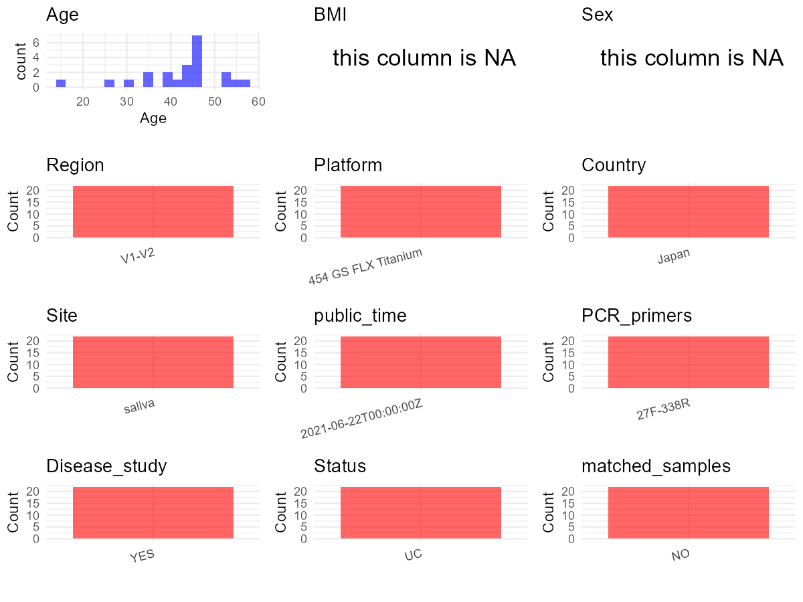

R Notebook: Metadata Processing Workflow
================

# Step 1: Obtain Initial Metadata from Each Project

To obtain the initial metadata: 1. Search for the BioProject ID (e.g.,
“PRJEBXXXX”) on the [NCBI SRA
website](https://www.ncbi.nlm.nih.gov/Traces/study/). 2. In the “Select”
table, click on “Metadata” and download the file. 3. The downloaded file
is typically named “SraRunTable.csv” and contains metadata for the
project.

``` r
# Load necessary libraries
library(dplyr)
library(ggplot2)
library(cowplot)

# Set working directory (update this path to your local directory)
setwd("E:/bioproject_YSD/PRJDB10985")

# Read the initial metadata files
initial_meta <- read.csv("SraRunTable.csv", header = T)

# Display the first few rows of the metadata
head(initial_meta)
```

    ##         Run AGE Assay.Type AvgSpotLen   Bases BioProject    BioSample
    ## 1 DRR261499  39   AMPLICON        282 2159882 PRJDB10985 SAMD00267409
    ## 2 DRR261500  31   AMPLICON        278 2131245 PRJDB10985 SAMD00267410
    ## 3 DRR261501  57   AMPLICON        307 2519288 PRJDB10985 SAMD00267411
    ## 4 DRR261502  54   AMPLICON        277 2177378 PRJDB10985 SAMD00267412
    ## 5 DRR261503  46   AMPLICON        280 2383422 PRJDB10985 SAMD00267413
    ## 6 DRR261504  34   AMPLICON        280 2272547 PRJDB10985 SAMD00267414
    ##       BioSampleModel   Bytes Center.Name Collection_Date Consent
    ## 1 MIMS.me.human-oral 1420231     OKAYAMA         missing  public
    ## 2 MIMS.me.human-oral 1407685     OKAYAMA         missing  public
    ## 3 MIMS.me.human-oral 1609880     OKAYAMA         missing  public
    ## 4 MIMS.me.human-oral 1445096     OKAYAMA         missing  public
    ## 5 MIMS.me.human-oral 1578675     OKAYAMA         missing  public
    ## 6 MIMS.me.human-oral 1475266     OKAYAMA         missing  public
    ##   DATASTORE.filetype DATASTORE.provider                     DATASTORE.region
    ## 1         run.zq,sra         gs,ncbi,s3 gs.us-east1,ncbi.public,s3.us-east-1
    ## 2         run.zq,sra         gs,ncbi,s3 gs.us-east1,ncbi.public,s3.us-east-1
    ## 3         run.zq,sra         gs,ncbi,s3 gs.us-east1,ncbi.public,s3.us-east-1
    ## 4         run.zq,sra         gs,ncbi,s3 gs.us-east1,ncbi.public,s3.us-east-1
    ## 5         run.zq,sra         gs,ncbi,s3 gs.us-east1,ncbi.public,s3.us-east-1
    ## 6         run.zq,sra         gs,ncbi,s3 gs.us-east1,ncbi.public,s3.us-east-1
    ##   env_broad_scale env_local_scale env_medium Experiment geo_loc_name_country
    ## 1   notapplicable   notapplicable     saliva  DRX251202                Japan
    ## 2   notapplicable   notapplicable     saliva  DRX251203                Japan
    ## 3   notapplicable   notapplicable     saliva  DRX251204                Japan
    ## 4   notapplicable   notapplicable     saliva  DRX251205                Japan
    ## 5   notapplicable   notapplicable     saliva  DRX251206                Japan
    ## 6   notapplicable   notapplicable     saliva  DRX251207                Japan
    ##   geo_loc_name_country_continent geo_loc_name host_body_site         HOST
    ## 1                           Asia        Japan   Mouth/saliva Homo sapiens
    ## 2                           Asia        Japan   Mouth/saliva Homo sapiens
    ## 3                           Asia        Japan   Mouth/saliva Homo sapiens
    ## 4                           Asia        Japan   Mouth/saliva Homo sapiens
    ## 5                           Asia        Japan   Mouth/saliva Homo sapiens
    ## 6                           Asia        Japan   Mouth/saliva Homo sapiens
    ##   host_subject_id          Instrument                   last_meal
    ## 1         S-YUC03 454 GS FLX Titanium atleast2hoursbeforesampling
    ## 2         S-YUC04 454 GS FLX Titanium atleast2hoursbeforesampling
    ## 3         S-YUC05 454 GS FLX Titanium atleast2hoursbeforesampling
    ## 4         S-YUC06 454 GS FLX Titanium atleast2hoursbeforesampling
    ## 5         S-YUC07 454 GS FLX Titanium atleast2hoursbeforesampling
    ## 6         S-YUC08 454 GS FLX Titanium atleast2hoursbeforesampling
    ##                lat_lon Library.Name LibraryLayout LibrarySelection
    ## 1 35.6762 N 139.6503 E           NA        SINGLE              PCR
    ## 2 35.6762 N 139.6503 E           NA        SINGLE              PCR
    ## 3 35.6762 N 139.6503 E           NA        SINGLE              PCR
    ## 4 35.6762 N 139.6503 E           NA        SINGLE              PCR
    ## 5 35.6762 N 139.6503 E           NA        SINGLE              PCR
    ## 6 35.6762 N 139.6503 E           NA        SINGLE              PCR
    ##   LibrarySource                Organism Platform
    ## 1   METAGENOMIC human saliva metagenome    LS454
    ## 2   METAGENOMIC human saliva metagenome    LS454
    ## 3   METAGENOMIC human saliva metagenome    LS454
    ## 4   METAGENOMIC human saliva metagenome    LS454
    ## 5   METAGENOMIC human saliva metagenome    LS454
    ## 6   METAGENOMIC human saliva metagenome    LS454
    ##                                                  project_name
    ## 1 Salivary microbiome of Japanese ulcerative colitis patients
    ## 2 Salivary microbiome of Japanese ulcerative colitis patients
    ## 3 Salivary microbiome of Japanese ulcerative colitis patients
    ## 4 Salivary microbiome of Japanese ulcerative colitis patients
    ## 5 Salivary microbiome of Japanese ulcerative colitis patients
    ## 6 Salivary microbiome of Japanese ulcerative colitis patients
    ##            ReleaseDate          create_date version  Sample.Name sample_name
    ## 1 2021-06-22T00:00:00Z 2021-06-22T12:46:00Z       1 SAMD00267409     S-YUC03
    ## 2 2021-06-22T00:00:00Z 2021-06-22T12:46:00Z       1 SAMD00267410     S-YUC04
    ## 3 2021-06-22T00:00:00Z 2021-06-22T12:46:00Z       1 SAMD00267411     S-YUC05
    ## 4 2021-06-22T00:00:00Z 2021-06-22T12:46:00Z       1 SAMD00267412     S-YUC06
    ## 5 2021-06-22T00:00:00Z 2021-06-22T12:46:00Z       1 SAMD00267413     S-YUC07
    ## 6 2021-06-22T00:00:00Z 2021-06-22T12:46:00Z       1 SAMD00267414     S-YUC08
    ##   SRA.Study        time_last_toothbrush
    ## 1 DRP007422 atleast2hoursbeforesampling
    ## 2 DRP007422 atleast2hoursbeforesampling
    ## 3 DRP007422 atleast2hoursbeforesampling
    ## 4 DRP007422 atleast2hoursbeforesampling
    ## 5 DRP007422 atleast2hoursbeforesampling
    ## 6 DRP007422 atleast2hoursbeforesampling

# Step 2: Create a Uniform Metadata Template

The uniform metadata should include the following columns:

1.  **BioProject**: Project ID (e.g., “PRJNA339212”)
2.  **Run**: Sample ID (e.g., “ERRXXXXXX” or “SRRXXXXXX”)
3.  **sample_name**: Original sample name submitted by the authors (not
    the database-assigned ID)
4.  **Age**: Age of the subject (if available)
5.  **BMI**: Body Mass Index (if available)
6.  **Sex**: Sex of the subject (“F” or “M”)
7.  **Region**: Targeted 16S rRNA region (e.g., “V3-V4”)
8.  **Platform**: Sequencing platform (e.g., “Illumina MiSeq”)
9.  **Country**: Country of sample origin (e.g., “China”)
10. **Site**: Sample site (e.g., “saliva”, “dental plaque”)
11. **public_time**: Data release date (format: “YYYY-MM-DD”)
12. **PCR_primers**: PCR primers used (e.g., “515F-806R”)
13. **title**: Title of the associated publication
14. **Disease_study**: Whether the study involves a disease (“YES” or
    “NO”)
15. **Status**: Disease status (e.g., “T2DM”, “HC”). Note: If the study
    includes both disease and healthy samples, this must be specified
    per sample.
16. **matched_samples**: matched samples (“YES” or “NO”)

``` r
metadata <- data.frame(
  BioProject = initial_meta$BioProject,
  Run = initial_meta$Run,
  sample_name = initial_meta$sample_name,
  Age = initial_meta$AGE,
  BMI = NA,  
  Sex = NA,
  Region = "V1-V2",
  Platform = initial_meta$Instrument,
  Country = initial_meta$geo_loc_name_country,
  Site = initial_meta$env_medium,
  public_time = initial_meta$ReleaseDate,
  stringsAsFactors = FALSE
)
```

# Step 3: Manually Add Information from the Publication

Some information (e.g. PCR primers, study title, disease status) must be
manually extracted from the publication and added to the metadata.

``` r
# Add information obtained from the publication
metadata$PCR_primers <- "27F-338R"
metadata$title <- "Dysbiosis in the salivary microbiome associated with IgA nephropathy a japanese cohort study"
metadata$Disease_study <- "YES"
# Assign disease status based on sample_name patterns
metadata$Status <- "UC"

# Check initial data distribution
cat("Initial sample distribution:\n")
```

    ## Initial sample distribution:

``` r
table(metadata$sample_name)
```

    ## 
    ## S-YUC03 S-YUC04 S-YUC05 S-YUC06 S-YUC07 S-YUC08 S-YUC10 S-YUC11 S-YUC12 S-YUC13 
    ##       1       1       1       1       1       1       1       1       1       1 
    ## S-YUC14 S-YUC15 S-YUC17 S-YUC18 S-YUC21 S-YUC22 S-YUC26 S-YUC29 S-YUC32 S-YUC33 
    ##       1       1       1       1       1       1       1       1       1       1 
    ## S-YUC34 S-YUC35 
    ##       1       1

``` r
table(metadata$Site)
```

    ## 
    ## saliva 
    ##     22

``` r
# Calculate sampling frequency per subject
sample_counts <- table(metadata$sample_name)
cat("\nNumber of samples per subject:\n")
```

    ## 
    ## Number of samples per subject:

``` r
print(sample_counts)
```

    ## 
    ## S-YUC03 S-YUC04 S-YUC05 S-YUC06 S-YUC07 S-YUC08 S-YUC10 S-YUC11 S-YUC12 S-YUC13 
    ##       1       1       1       1       1       1       1       1       1       1 
    ## S-YUC14 S-YUC15 S-YUC17 S-YUC18 S-YUC21 S-YUC22 S-YUC26 S-YUC29 S-YUC32 S-YUC33 
    ##       1       1       1       1       1       1       1       1       1       1 
    ## S-YUC34 S-YUC35 
    ##       1       1

``` r
# Create matched_samples column
metadata$matched_samples <- ifelse(metadata$sample_name %in% names(sample_counts[sample_counts >= 2]), "YES", "NO")

cat("\nMatched samples distribution:\n")
```

    ## 
    ## Matched samples distribution:

``` r
table(metadata$matched_samples)
```

    ## 
    ## NO 
    ## 22

``` r
# Identify samples for removal: single samples excluding saliva
single_samples <- names(sample_counts[sample_counts == 1])
samples_to_remove <- metadata$sample_name %in% single_samples & 
                     !(metadata$Site %in% c("saliva"))

cat("\nNumber of samples to be removed:", sum(samples_to_remove), "\n")
```

    ## 
    ## Number of samples to be removed: 0

``` r
# Remove identified samples
metadata_clean <- metadata[!samples_to_remove, ]

cat("\nFinal sample distribution after cleaning:\n")
```

    ## 
    ## Final sample distribution after cleaning:

``` r
table(metadata_clean$sample_name)
```

    ## 
    ## S-YUC03 S-YUC04 S-YUC05 S-YUC06 S-YUC07 S-YUC08 S-YUC10 S-YUC11 S-YUC12 S-YUC13 
    ##       1       1       1       1       1       1       1       1       1       1 
    ## S-YUC14 S-YUC15 S-YUC17 S-YUC18 S-YUC21 S-YUC22 S-YUC26 S-YUC29 S-YUC32 S-YUC33 
    ##       1       1       1       1       1       1       1       1       1       1 
    ## S-YUC34 S-YUC35 
    ##       1       1

``` r
table(metadata_clean$Site)
```

    ## 
    ## saliva 
    ##     22

``` r
table(metadata_clean$matched_samples)
```

    ## 
    ## NO 
    ## 22

``` r
# Use cleaned dataset for subsequent analysis
metadata <- metadata_clean
```

# Step 4: Summarize and Validate the Metadata

``` r
# Check the number of unique runs and sample names
print(paste("Number of unique runs:", length(unique(metadata$Run))))
```

    ## [1] "Number of unique runs: 22"

``` r
print(paste("Number of unique sample names:", length(unique(metadata$sample_name))))
```

    ## [1] "Number of unique sample names: 22"

# Step 5: Visualize the Metadata

``` r

```


# Step 6: Finalize and Export the Metadata

``` r
# Reorder columns to match the desired format
metadata <- metadata[, c(
  "BioProject", "Run", "sample_name", "Age", "BMI", "Sex", 
  "Region", "Platform", "Country", "Site", "public_time", 
  "PCR_primers", "title", "Disease_study", "Status", "matched_samples"
)]

# Export the uniform metadata to a CSV file
write.csv(metadata, file = "metadata.csv", quote = FALSE)
head(metadata)
```

    ##   BioProject       Run sample_name Age BMI Sex Region            Platform
    ## 1 PRJDB10985 DRR261499     S-YUC03  39  NA  NA  V1-V2 454 GS FLX Titanium
    ## 2 PRJDB10985 DRR261500     S-YUC04  31  NA  NA  V1-V2 454 GS FLX Titanium
    ## 3 PRJDB10985 DRR261501     S-YUC05  57  NA  NA  V1-V2 454 GS FLX Titanium
    ## 4 PRJDB10985 DRR261502     S-YUC06  54  NA  NA  V1-V2 454 GS FLX Titanium
    ## 5 PRJDB10985 DRR261503     S-YUC07  46  NA  NA  V1-V2 454 GS FLX Titanium
    ## 6 PRJDB10985 DRR261504     S-YUC08  34  NA  NA  V1-V2 454 GS FLX Titanium
    ##   Country   Site          public_time PCR_primers
    ## 1   Japan saliva 2021-06-22T00:00:00Z    27F-338R
    ## 2   Japan saliva 2021-06-22T00:00:00Z    27F-338R
    ## 3   Japan saliva 2021-06-22T00:00:00Z    27F-338R
    ## 4   Japan saliva 2021-06-22T00:00:00Z    27F-338R
    ## 5   Japan saliva 2021-06-22T00:00:00Z    27F-338R
    ## 6   Japan saliva 2021-06-22T00:00:00Z    27F-338R
    ##                                                                                          title
    ## 1 Dysbiosis in the salivary microbiome associated with IgA nephropathy a japanese cohort study
    ## 2 Dysbiosis in the salivary microbiome associated with IgA nephropathy a japanese cohort study
    ## 3 Dysbiosis in the salivary microbiome associated with IgA nephropathy a japanese cohort study
    ## 4 Dysbiosis in the salivary microbiome associated with IgA nephropathy a japanese cohort study
    ## 5 Dysbiosis in the salivary microbiome associated with IgA nephropathy a japanese cohort study
    ## 6 Dysbiosis in the salivary microbiome associated with IgA nephropathy a japanese cohort study
    ##   Disease_study Status matched_samples
    ## 1           YES     UC              NO
    ## 2           YES     UC              NO
    ## 3           YES     UC              NO
    ## 4           YES     UC              NO
    ## 5           YES     UC              NO
    ## 6           YES     UC              NO

## Notes for Students:

1.  **Metadata Accuracy**: Always cross-check the metadata with the
    original publication to ensure accuracy.
2.  **Manual Entries**: Columns like `PCR_primers`, and `Status` often
    require manual entry based on the publication.
3.  **Disease Status**: Be careful when assigning `Status`—some studies
    include both disease and healthy samples.
4.  **Visualization**: The plots help quickly identify the distribution
    of values in each column, which is useful for quality control.
5.  **Reproducibility**: Update the working directory and file paths to
    match your local environment.
