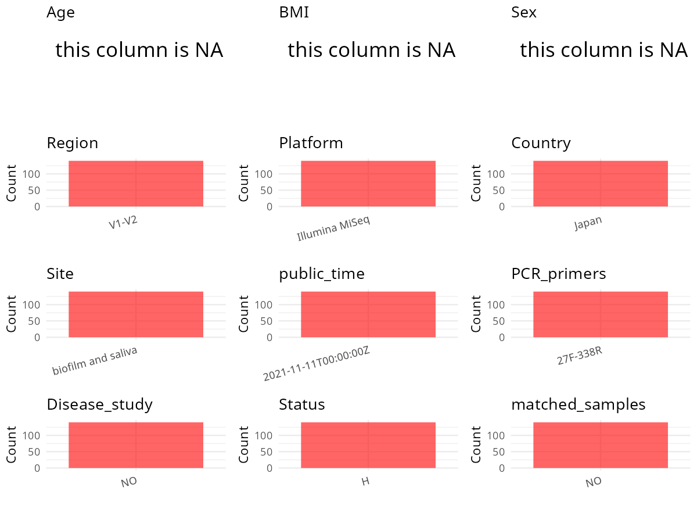

R Notebook: Metadata Processing Workflow
================

# Step 1: Obtain Initial Metadata from Each Project

To obtain the initial metadata: 1. Search for the BioProject ID (e.g.,
“PRJEBXXXX”) on the [NCBI SRA
website](https://www.ncbi.nlm.nih.gov/Traces/study/). 2. In the “Select”
table, click on “Metadata” and download the file. 3. The downloaded file
is typically named “SraRunTable.csv” and contains metadata for the
project.

``` r
# Load necessary libraries
library(dplyr)
library(ggplot2)
library(cowplot)
library(stringr)

# Set working directory (update this path to your local directory)
setwd("/home/hby/oral_project/PRJDB11559")

# Read the initial metadata files
initial_meta <- read.csv("SraRunTable.csv", header = T)

# Combine the two metadata files
# meta <- rbind(initial_meta, initial_meta1)

# Remove entries non-oral samples
# initial_meta <- subset(initial_meta,isolate %in% c("saliva","tongue coat"))

# Check the number of samples containing "HT" in Sample.Name (e.g., healthy controls)
# nrow(subset(meta, grepl("HT", Sample.Name)))

# Display the first few rows of the metadata
head(initial_meta)
```

    ##         Run Assay.Type AvgSpotLen    Bases BioProject    BioSample     BioSampleModel    Bytes Center.Name Collection_Date Consent DATASTORE.filetype DATASTORE.provider
    ## 1 DRR291824   AMPLICON        502 58758598 PRJDB11559 SAMD00322092 MIMS.me.human-oral 38465844        GIRC       2019/2/26  public         run.zq,sra         gs,ncbi,s3
    ## 2 DRR291825   AMPLICON        502 58913214 PRJDB11559 SAMD00322093 MIMS.me.human-oral 37685250        GIRC       2019/2/26  public         run.zq,sra         gs,ncbi,s3
    ## 3 DRR291826   AMPLICON        502 49314472 PRJDB11559 SAMD00322094 MIMS.me.human-oral 31586054        GIRC       2019/2/26  public         run.zq,sra         gs,ncbi,s3
    ## 4 DRR291827   AMPLICON        502 59723944 PRJDB11559 SAMD00322095 MIMS.me.human-oral 38411942        GIRC       2019/2/26  public         run.zq,sra         gs,ncbi,s3
    ## 5 DRR291828   AMPLICON        502 51479096 PRJDB11559 SAMD00322096 MIMS.me.human-oral 32333194        GIRC       2019/2/26  public         run.zq,sra         gs,ncbi,s3
    ## 6 DRR291829   AMPLICON        502 54979040 PRJDB11559 SAMD00322097 MIMS.me.human-oral 34665811        GIRC       2019/2/26  public         run.zq,sra         gs,ncbi,s3
    ##                       DATASTORE.region env_broad_scale env_local_scale     env_medium Experiment geo_loc_name_country geo_loc_name_country_continent         geo_loc_name         HOST
    ## 1 gs.us-east1,ncbi.public,s3.us-east-1  not applicable  not applicable not applicable  DRX281280                Japan                           Asia Japan:Osaka\\, Suita Homo sapiens
    ## 2 gs.us-east1,ncbi.public,s3.us-east-1  not applicable  not applicable not applicable  DRX281281                Japan                           Asia Japan:Osaka\\, Suita Homo sapiens
    ## 3 gs.us-east1,ncbi.public,s3.us-east-1  not applicable  not applicable not applicable  DRX281282                Japan                           Asia Japan:Osaka\\, Suita Homo sapiens
    ## 4 gs.us-east1,ncbi.public,s3.us-east-1  not applicable  not applicable not applicable  DRX281283                Japan                           Asia Japan:Osaka\\, Suita Homo sapiens
    ## 5 gs.us-east1,ncbi.public,s3.us-east-1  not applicable  not applicable not applicable  DRX281284                Japan                           Asia Japan:Osaka\\, Suita Homo sapiens
    ## 6 gs.us-east1,ncbi.public,s3.us-east-1  not applicable  not applicable not applicable  DRX281285                Japan                           Asia Japan:Osaka\\, Suita Homo sapiens
    ##       Instrument          lat_lon Library.Name LibraryLayout LibrarySelection LibrarySource              Organism Platform                                            project_name
    ## 1 Illumina MiSeq 34.82 N 135.52 E           NA        PAIRED              PCR       GENOMIC human oral metagenome ILLUMINA 16S amplicon sequence analysis of human oral microbiome
    ## 2 Illumina MiSeq 34.82 N 135.52 E           NA        PAIRED              PCR       GENOMIC human oral metagenome ILLUMINA 16S amplicon sequence analysis of human oral microbiome
    ## 3 Illumina MiSeq 34.82 N 135.52 E           NA        PAIRED              PCR       GENOMIC human oral metagenome ILLUMINA 16S amplicon sequence analysis of human oral microbiome
    ## 4 Illumina MiSeq 34.82 N 135.52 E           NA        PAIRED              PCR       GENOMIC human oral metagenome ILLUMINA 16S amplicon sequence analysis of human oral microbiome
    ## 5 Illumina MiSeq 34.82 N 135.52 E           NA        PAIRED              PCR       GENOMIC human oral metagenome ILLUMINA 16S amplicon sequence analysis of human oral microbiome
    ## 6 Illumina MiSeq 34.82 N 135.52 E           NA        PAIRED              PCR       GENOMIC human oral metagenome ILLUMINA 16S amplicon sequence analysis of human oral microbiome
    ##            ReleaseDate          create_date version  Sample.Name sample_name SRA.Study
    ## 1 2021-11-11T00:00:00Z 2021-10-31T11:41:00Z       1 SAMD00322092    day.1.bu DRP007836
    ## 2 2021-11-11T00:00:00Z 2021-10-31T11:43:00Z       1 SAMD00322093    day.1.hp DRP007836
    ## 3 2021-11-11T00:00:00Z 2021-10-31T11:41:00Z       1 SAMD00322094    day.1.kg DRP007836
    ## 4 2021-11-11T00:00:00Z 2021-10-31T11:42:00Z       1 SAMD00322095   day.1.sub DRP007836
    ## 5 2021-11-11T00:00:00Z 2021-10-31T11:43:00Z       1 SAMD00322096   day.1.sup DRP007836
    ## 6 2021-11-11T00:00:00Z 2021-10-31T11:42:00Z       1 SAMD00322097 day.1.sv24h DRP007836

# Step 2: Create a Uniform Metadata Template

The uniform metadata should include the following columns:

1.  **BioProject**: Project ID (e.g., “PRJNA339212”)
2.  **Run**: Sample ID (e.g., “ERRXXXXXX” or “SRRXXXXXX”)
3.  **sample_name**: Original sample name submitted by the authors (not
    the database-assigned ID)
4.  **Age**: Age of the subject (if available)
5.  **BMI**: Body Mass Index (if available)
6.  **Sex**: Sex of the subject (“F” or “M”)
7.  **Region**: Targeted 16S rRNA region (e.g., “V3-V4”)
8.  **Platform**: Sequencing platform (e.g., “Illumina MiSeq”)
9.  **Country**: Country of sample origin (e.g., “China”)
10. **Site**: Sample site (e.g., “saliva”, “dental plaque”)
11. **public_time**: Data release date (format: “YYYY-MM-DD”)
12. **PCR_primers**: PCR primers used (e.g., “515F-806R”)
13. **title**: Title of the associated publication
14. **Disease_study**: Whether the study involves a disease (“YES” or
    “NO”)
15. **Status**: Disease status (e.g., “T2DM”, “HC”). Note: If the study
    includes both disease and healthy samples, this must be specified
    per sample.
16. **matched_samples**: matched samples (“YES” or “NO”)

``` r
# Create a uniform metadata dataframe
metadata <- data.frame(
  BioProject = initial_meta$BioProject,
  Run = initial_meta$Run,
  sample_name = initial_meta$sample_name,
  Platform = initial_meta$Instrument,
  Country = initial_meta$geo_loc_name_country,
  public_time = initial_meta$ReleaseDate,
  Sex = NA,
  Age = NA,
  BMI = NA
)
```

# Step 3: Manually Add Information from the Publication

Some information (e.g. PCR primers, study title, disease status) must be
manually extracted from the publication and added to the metadata.

``` r
# Add information obtained from the publication
metadata$Status <- "H"
metadata$Site <- "biofilm and saliva"
metadata$Region <- "V1-V2"
metadata$PCR_primers <- "27F-338R"
metadata$title <- "Impact of sleep on the microbiome of oral biofilms"
metadata$Disease_study <- "NO"
metadata$matched_samples <- "NO"
```

# Step 4: Summarize and Validate the Metadata

``` r
# Check the number of unique runs and sample names
print(paste("Number of unique runs:", length(unique(metadata$Run))))
```

    ## [1] "Number of unique runs: 140"

``` r
print(paste("Number of unique sample names:", length(unique(metadata$sample_name))))
```

    ## [1] "Number of unique sample names: 140"

# Step 5: Visualize the Metadata

``` r

```


# Step 6: Finalize and Export the Metadata

``` r
# Reorder columns to match the desired format
metadata <- metadata[, c(
  "BioProject", "Run", "sample_name", "Age", "BMI", "Sex",
  "Region", "Platform", "Country", "Site", "public_time",
  "PCR_primers", "title", "Disease_study", "Status", "matched_samples"
)]

# Export the uniform metadata to a CSV file
write.csv(metadata, file = "metadata.csv", quote = FALSE)
head(metadata)
```

    ##   BioProject       Run sample_name Age BMI Sex Region       Platform Country               Site          public_time PCR_primers                                              title
    ## 1 PRJDB11559 DRR291824    day.1.bu  NA  NA  NA  V1-V2 Illumina MiSeq   Japan biofilm and saliva 2021-11-11T00:00:00Z    27F-338R Impact of sleep on the microbiome of oral biofilms
    ## 2 PRJDB11559 DRR291825    day.1.hp  NA  NA  NA  V1-V2 Illumina MiSeq   Japan biofilm and saliva 2021-11-11T00:00:00Z    27F-338R Impact of sleep on the microbiome of oral biofilms
    ## 3 PRJDB11559 DRR291826    day.1.kg  NA  NA  NA  V1-V2 Illumina MiSeq   Japan biofilm and saliva 2021-11-11T00:00:00Z    27F-338R Impact of sleep on the microbiome of oral biofilms
    ## 4 PRJDB11559 DRR291827   day.1.sub  NA  NA  NA  V1-V2 Illumina MiSeq   Japan biofilm and saliva 2021-11-11T00:00:00Z    27F-338R Impact of sleep on the microbiome of oral biofilms
    ## 5 PRJDB11559 DRR291828   day.1.sup  NA  NA  NA  V1-V2 Illumina MiSeq   Japan biofilm and saliva 2021-11-11T00:00:00Z    27F-338R Impact of sleep on the microbiome of oral biofilms
    ## 6 PRJDB11559 DRR291829 day.1.sv24h  NA  NA  NA  V1-V2 Illumina MiSeq   Japan biofilm and saliva 2021-11-11T00:00:00Z    27F-338R Impact of sleep on the microbiome of oral biofilms
    ##   Disease_study Status matched_samples
    ## 1            NO      H              NO
    ## 2            NO      H              NO
    ## 3            NO      H              NO
    ## 4            NO      H              NO
    ## 5            NO      H              NO
    ## 6            NO      H              NO

## Notes for Students:

1.  **Metadata Accuracy**: Always cross-check the metadata with the
    original publication to ensure accuracy.
2.  **Manual Entries**: Columns like `PCR_primers`, and `Status` often
    require manual entry based on the publication.
3.  **Disease Status**: Be careful when assigning `Status`—some studies
    include both disease and healthy samples.
4.  **Visualization**: The plots help quickly identify the distribution
    of values in each column, which is useful for quality control.
5.  **Reproducibility**: Update the working directory and file paths to
    match your local environment.
