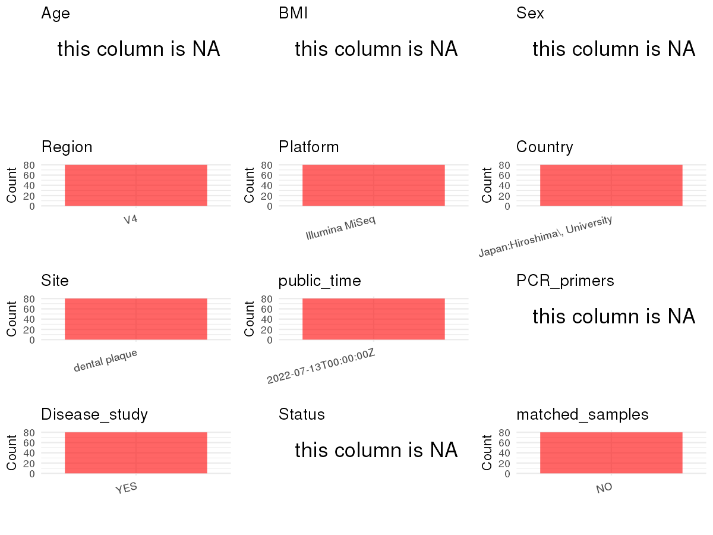

R Notebook: Metadata Processing Workflow
================

# Step 1: Obtain Initial Metadata from Each Project

To obtain the initial metadata: 1. Search for the BioProject ID (e.g.,
“PRJEBXXXX”) on the [NCBI SRA
website](https://www.ncbi.nlm.nih.gov/Traces/study/). 2. In the “Select”
table, click on “Metadata” and download the file. 3. The downloaded file
is typically named “SraRunTable.csv” and contains metadata for the
project.

``` r
# Load necessary libraries
library(dplyr)
library(ggplot2)
library(cowplot)
library(readxl)

# Set working directory (update this path to your local directory)
setwd("/home/dongbiao/word_embedding_microbiome/all_data/oral/global-oral-microbiome/data/projects/PRJDB13496")

# Read the initial metadata files
initial_meta<-read.csv("SraRunTable.csv") 

head(initial_meta)
```

    ##         Run Assay.Type AvgSpotLen    Bases BioProject    BioSample   Bytes
    ## 1 DRR362309   AMPLICON        150 16020787 PRJDB13496 SAMD00469367 9876717
    ## 2 DRR362310   AMPLICON        150 14240319 PRJDB13496 SAMD00469368 8907182
    ## 3 DRR362311   AMPLICON        150 14055959 PRJDB13496 SAMD00469369 8766441
    ## 4 DRR362312   AMPLICON        150 15391700 PRJDB13496 SAMD00469370 9237699
    ## 5 DRR362313   AMPLICON        150 13053639 PRJDB13496 SAMD00469371 8056934
    ## 6 DRR362314   AMPLICON        150 12246753 PRJDB13496 SAMD00469372 7569374
    ##   Center.Name Collection_Date Consent DATASTORE.filetype DATASTORE.provider
    ## 1   HIROSHIMA      2019-01-09  public         run.zq,sra         gs,ncbi,s3
    ## 2   HIROSHIMA      2019-01-10  public         run.zq,sra         gs,ncbi,s3
    ## 3   HIROSHIMA      2019-01-11  public         run.zq,sra         gs,ncbi,s3
    ## 4   HIROSHIMA      2019-01-11  public         run.zq,sra         gs,ncbi,s3
    ## 5   HIROSHIMA      2019-01-11  public         run.zq,sra         gs,ncbi,s3
    ## 6   HIROSHIMA      2019-01-11  public         run.zq,sra         gs,ncbi,s3
    ##                       DATASTORE.region Experiment geo_loc_name_country
    ## 1 gs.us-east1,ncbi.public,s3.us-east-1  DRX348210                Japan
    ## 2 gs.us-east1,ncbi.public,s3.us-east-1  DRX348211                Japan
    ## 3 gs.us-east1,ncbi.public,s3.us-east-1  DRX348212                Japan
    ## 4 gs.us-east1,ncbi.public,s3.us-east-1  DRX348213                Japan
    ## 5 gs.us-east1,ncbi.public,s3.us-east-1  DRX348214                Japan
    ## 6 gs.us-east1,ncbi.public,s3.us-east-1  DRX348215                Japan
    ##   geo_loc_name_country_continent                  geo_loc_name         HOST
    ## 1                           Asia Japan:Hiroshima\\, University Homo sapiens
    ## 2                           Asia Japan:Hiroshima\\, University Homo sapiens
    ## 3                           Asia Japan:Hiroshima\\, University Homo sapiens
    ## 4                           Asia Japan:Hiroshima\\, University Homo sapiens
    ## 5                           Asia Japan:Hiroshima\\, University Homo sapiens
    ## 6                           Asia Japan:Hiroshima\\, University Homo sapiens
    ##       Instrument             lat_lon Library.Name LibraryLayout
    ## 1 Illumina MiSeq 34.3995 N 132.711 E           NA        SINGLE
    ## 2 Illumina MiSeq 34.3995 N 132.712 E           NA        SINGLE
    ## 3 Illumina MiSeq 34.3995 N 132.713 E           NA        SINGLE
    ## 4 Illumina MiSeq 34.3995 N 132.714 E           NA        SINGLE
    ## 5 Illumina MiSeq 34.3995 N 132.715 E           NA        SINGLE
    ## 6 Illumina MiSeq 34.3995 N 132.716 E           NA        SINGLE
    ##   LibrarySelection LibrarySource         Organism Platform          ReleaseDate
    ## 1              PCR   METAGENOMIC human metagenome ILLUMINA 2022-07-13T00:00:00Z
    ## 2              PCR   METAGENOMIC human metagenome ILLUMINA 2022-07-13T00:00:00Z
    ## 3              PCR   METAGENOMIC human metagenome ILLUMINA 2022-07-13T00:00:00Z
    ## 4              PCR   METAGENOMIC human metagenome ILLUMINA 2022-07-13T00:00:00Z
    ## 5              PCR   METAGENOMIC human metagenome ILLUMINA 2022-07-13T00:00:00Z
    ## 6              PCR   METAGENOMIC human metagenome ILLUMINA 2022-07-13T00:00:00Z
    ##            create_date version  Sample.Name Sample_name SRA.Study
    ## 1 2022-07-13T12:51:00Z       1 SAMD00469367          S1 DRP008750
    ## 2 2022-07-13T12:51:00Z       1 SAMD00469368          S2 DRP008750
    ## 3 2022-07-13T12:52:00Z       1 SAMD00469369          S3 DRP008750
    ## 4 2022-07-13T12:50:00Z       1 SAMD00469370          S4 DRP008750
    ## 5 2022-07-13T12:52:00Z       1 SAMD00469371          S5 DRP008750
    ## 6 2022-07-13T12:53:00Z       1 SAMD00469372          S6 DRP008750

# Step 2: Create a Uniform Metadata Template

The uniform metadata should include the following columns:

1.  **BioProject**: Project ID (e.g., “PRJNA339212”)
2.  **Run**: Sample ID (e.g., “ERRXXXXXX” or “SRRXXXXXX”)
3.  **sample_name**: Original sample name submitted by the authors (not
    the database-assigned ID)
4.  **Age**: Age of the subject (if available)
5.  **BMI**: Body Mass Index (if available)
6.  **Sex**: Sex of the subject (“F” or “M”)
7.  **Region**: Targeted 16S rRNA region (e.g., “V3-V4”)
8.  **Platform**: Sequencing platform (e.g., “Illumina MiSeq”)
9.  **Country**: Country of sample origin (e.g., “China”)
10. **Site**: Sample site (e.g., “saliva”, “dental plaque”)
11. **public_time**: Data release date (format: “YYYY-MM-DD”)
12. **PCR_primers**: PCR primers used (e.g., “515F-806R”)
13. **title**: Title of the associated publication
14. **Disease_study**: Whether the study involves a disease (“YES” or
    “NO”)
15. **Status**: Disease status (e.g., “T2DM”, “HC”). Note: If the study
    includes both disease and healthy samples, this must be specified
    per sample.

``` r
# Create a uniform metadata dataframe
metadata <- data.frame(
  BioProject = initial_meta$BioProject,
  Run = initial_meta$Run,
  sample_name = initial_meta$Sample_name,
  Age = NA,
  BMI = NA,
  Sex=NA,
  Region = "V4",
  Platform = initial_meta$Instrument,
  Country = initial_meta$geo_loc_name,
  Site = "dental plaque",
  public_time = initial_meta$ReleaseDate,
  stringsAsFactors = FALSE
)
metadata<-unique(metadata)
```

# Step 3: Manually Add Information from the Publication

Some information (e.g. PCR primers, study title, disease status) must be
manually extracted from the publication and added to the metadata.

``` r
# Add information obtained from the publication
metadata$PCR_primers <- NA
metadata$title <- "Characterization of the unique oral microbiome of children with Down syndrome"
metadata$Disease_study <- "YES"

# Assign disease status based on sample_name patterns
metadata$Status <- NA
metadata$matched_samples <- "NO"
```

# Step 4: Summarize and Validate the Metadata

``` r
# Check the number of unique runs and sample names
print(paste("Number of unique runs:", length(unique(metadata$Run))))
```

    ## [1] "Number of unique runs: 80"

``` r
print(paste("Number of unique sample names:", length(unique(metadata$sample_name))))
```

    ## [1] "Number of unique sample names: 80"

# Step 5: Visualize the Metadata

``` r

```


# Step 6: Finalize and Export the Metadata

``` r
# Reorder columns to match the desired format
metadata <- metadata[, c(
  "BioProject", "Run", "sample_name", "Age", "BMI", "Sex", 
  "Region", "Platform", "Country", "Site", "public_time", 
  "PCR_primers", "title", "Disease_study", "Status","matched_samples"
)]

# Export the uniform metadata to a CSV file
metadata<-unique(metadata)
write.csv(metadata, file = "metadata.csv", quote = TRUE)
head(metadata)
```

    ##   BioProject       Run sample_name Age BMI Sex Region       Platform
    ## 1 PRJDB13496 DRR362309          S1  NA  NA  NA     V4 Illumina MiSeq
    ## 2 PRJDB13496 DRR362310          S2  NA  NA  NA     V4 Illumina MiSeq
    ## 3 PRJDB13496 DRR362311          S3  NA  NA  NA     V4 Illumina MiSeq
    ## 4 PRJDB13496 DRR362312          S4  NA  NA  NA     V4 Illumina MiSeq
    ## 5 PRJDB13496 DRR362313          S5  NA  NA  NA     V4 Illumina MiSeq
    ## 6 PRJDB13496 DRR362314          S6  NA  NA  NA     V4 Illumina MiSeq
    ##                         Country          Site          public_time PCR_primers
    ## 1 Japan:Hiroshima\\, University dental plaque 2022-07-13T00:00:00Z          NA
    ## 2 Japan:Hiroshima\\, University dental plaque 2022-07-13T00:00:00Z          NA
    ## 3 Japan:Hiroshima\\, University dental plaque 2022-07-13T00:00:00Z          NA
    ## 4 Japan:Hiroshima\\, University dental plaque 2022-07-13T00:00:00Z          NA
    ## 5 Japan:Hiroshima\\, University dental plaque 2022-07-13T00:00:00Z          NA
    ## 6 Japan:Hiroshima\\, University dental plaque 2022-07-13T00:00:00Z          NA
    ##                                                                           title
    ## 1 Characterization of the unique oral microbiome of children with Down syndrome
    ## 2 Characterization of the unique oral microbiome of children with Down syndrome
    ## 3 Characterization of the unique oral microbiome of children with Down syndrome
    ## 4 Characterization of the unique oral microbiome of children with Down syndrome
    ## 5 Characterization of the unique oral microbiome of children with Down syndrome
    ## 6 Characterization of the unique oral microbiome of children with Down syndrome
    ##   Disease_study Status matched_samples
    ## 1           YES     NA              NO
    ## 2           YES     NA              NO
    ## 3           YES     NA              NO
    ## 4           YES     NA              NO
    ## 5           YES     NA              NO
    ## 6           YES     NA              NO

## Notes for Students:

1.  **Metadata Accuracy**: Always cross-check the metadata with the
    original publication to ensure accuracy.
2.  **Manual Entries**: Columns like `PCR_primers`, and `Status` often
    require manual entry based on the publication.
3.  **Disease Status**: Be careful when assigning `Status`—some studies
    include both disease and healthy samples.
4.  **Visualization**: The plots help quickly identify the distribution
    of values in each column, which is useful for quality control.
5.  **Reproducibility**: Update the working directory and file paths to
    match your local environment.
