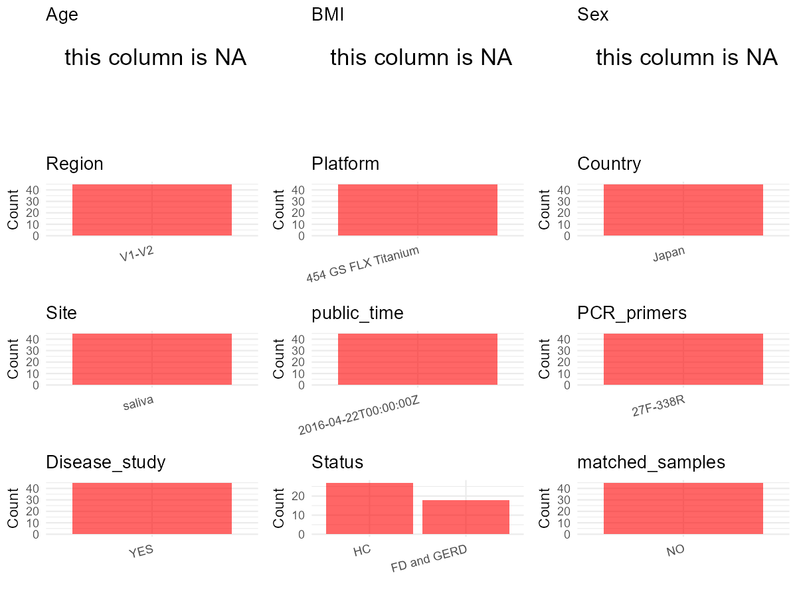

R Notebook: Metadata Processing Workflow
================

# Step 1: Obtain Initial Metadata from Each Project

To obtain the initial metadata: 1. Search for the BioProject ID (e.g.,
“PRJEBXXXX”) on the [NCBI SRA
website](https://www.ncbi.nlm.nih.gov/Traces/study/). 2. In the “Select”
table, click on “Metadata” and download the file. 3. The downloaded file
is typically named “SraRunTable.csv” and contains metadata for the
project.

``` r
# Load necessary libraries
library(dplyr)
library(ggplot2)
library(cowplot)
library(stringr)

# Set working directory (update this path to your local directory)
setwd("E:/bioproject_YSD/PRJDB3211")

# Read the initial metadata files
initial_meta <- read.csv("SraRunTable.csv", header = T)

# Remove entries non-oral samples
initial_meta <- initial_meta %>%
  filter(!str_detect(sample_name, "^(F|P-F|G|P-G)"))

# Display the first few rows of the metadata
head(initial_meta)
```

    ##         Run Assay.Type AvgSpotLen   Bases BioProject    BioSample
    ## 1 DRR024122   AMPLICON        407 1223840  PRJDB3211 SAMD00020766
    ## 2 DRR024123   AMPLICON        401 1205060  PRJDB3211 SAMD00020767
    ## 3 DRR024124   AMPLICON        406 1219099  PRJDB3211 SAMD00020768
    ## 4 DRR024125   AMPLICON        409 1227088  PRJDB3211 SAMD00020769
    ## 5 DRR024126   AMPLICON        399 1199413  PRJDB3211 SAMD00020770
    ## 6 DRR024127   AMPLICON        402 1207314  PRJDB3211 SAMD00020771
    ##                    BioSampleModel   Bytes Center.Name Collection_Date Consent
    ## 1 MIMARKS.survey.human-associated 3047297      UT_COB              NA  public
    ## 2 MIMARKS.survey.human-associated 2835648      UT_COB              NA  public
    ## 3 MIMARKS.survey.human-associated 3061658      UT_COB              NA  public
    ## 4 MIMARKS.survey.human-associated 3072010      UT_COB              NA  public
    ## 5 MIMARKS.survey.human-associated 2847054      UT_COB              NA  public
    ## 6 MIMARKS.survey.human-associated 2830534      UT_COB              NA  public
    ##   DATASTORE.filetype DATASTORE.provider                     DATASTORE.region
    ## 1         run.zq,sra         gs,ncbi,s3 gs.us-east1,ncbi.public,s3.us-east-1
    ## 2         run.zq,sra         gs,ncbi,s3 gs.us-east1,ncbi.public,s3.us-east-1
    ## 3         run.zq,sra         gs,ncbi,s3 gs.us-east1,ncbi.public,s3.us-east-1
    ## 4         run.zq,sra         gs,ncbi,s3 gs.us-east1,ncbi.public,s3.us-east-1
    ## 5         run.zq,sra         gs,ncbi,s3 gs.us-east1,ncbi.public,s3.us-east-1
    ## 6         run.zq,sra         gs,ncbi,s3 gs.us-east1,ncbi.public,s3.us-east-1
    ##   env_broad_scale env_local_scale env_medium Experiment geo_loc_name_country
    ## 1        bacteria              NA         NA  DRX021872         uncalculated
    ## 2        bacteria              NA         NA  DRX021873         uncalculated
    ## 3        bacteria              NA         NA  DRX021874         uncalculated
    ## 4        bacteria              NA         NA  DRX021875         uncalculated
    ## 5        bacteria              NA         NA  DRX021876         uncalculated
    ## 6        bacteria              NA         NA  DRX021877         uncalculated
    ##   geo_loc_name_country_continent geo_loc_name         HOST          Instrument
    ## 1                   uncalculated           NA Homo sapiens 454 GS FLX Titanium
    ## 2                   uncalculated           NA Homo sapiens 454 GS FLX Titanium
    ## 3                   uncalculated           NA Homo sapiens 454 GS FLX Titanium
    ## 4                   uncalculated           NA Homo sapiens 454 GS FLX Titanium
    ## 5                   uncalculated           NA Homo sapiens 454 GS FLX Titanium
    ## 6                   uncalculated           NA Homo sapiens 454 GS FLX Titanium
    ##   lat_lon Library.Name LibraryLayout LibrarySelection LibrarySource
    ## 1      NA           NA        SINGLE              PCR   METAGENOMIC
    ## 2      NA           NA        SINGLE              PCR   METAGENOMIC
    ## 3      NA           NA        SINGLE              PCR   METAGENOMIC
    ## 4      NA           NA        SINGLE              PCR   METAGENOMIC
    ## 5      NA           NA        SINGLE              PCR   METAGENOMIC
    ## 6      NA           NA        SINGLE              PCR   METAGENOMIC
    ##           Organism Platform
    ## 1 human metagenome    LS454
    ## 2 human metagenome    LS454
    ## 3 human metagenome    LS454
    ## 4 human metagenome    LS454
    ## 5 human metagenome    LS454
    ## 6 human metagenome    LS454
    ##                                                                                    project_name
    ## 1 16S amplicon sequence analysis of microbial communities in the oral cavity\\, stomach and gut
    ## 2 16S amplicon sequence analysis of microbial communities in the oral cavity\\, stomach and gut
    ## 3 16S amplicon sequence analysis of microbial communities in the oral cavity\\, stomach and gut
    ## 4 16S amplicon sequence analysis of microbial communities in the oral cavity\\, stomach and gut
    ## 5 16S amplicon sequence analysis of microbial communities in the oral cavity\\, stomach and gut
    ## 6 16S amplicon sequence analysis of microbial communities in the oral cavity\\, stomach and gut
    ##            ReleaseDate          create_date version  Sample.Name sample_name
    ## 1 2016-04-22T00:00:00Z 2016-04-22T10:33:00Z       1 SAMD00020766    P-S-TS02
    ## 2 2016-04-22T00:00:00Z 2016-04-22T10:33:00Z       1 SAMD00020767    P-S-TS03
    ## 3 2016-04-22T00:00:00Z 2016-04-22T10:33:00Z       1 SAMD00020768    P-S-TS04
    ## 4 2016-04-22T00:00:00Z 2016-04-22T10:33:00Z       1 SAMD00020769    P-S-TS12
    ## 5 2016-04-22T00:00:00Z 2016-04-22T10:33:00Z       1 SAMD00020770    P-S-TS15
    ## 6 2016-04-22T00:00:00Z 2016-04-22T10:33:00Z       1 SAMD00020771    P-S-TS16
    ##   SRA.Study
    ## 1 DRP003100
    ## 2 DRP003100
    ## 3 DRP003100
    ## 4 DRP003100
    ## 5 DRP003100
    ## 6 DRP003100

# Step 2: Create a Uniform Metadata Template

The uniform metadata should include the following columns:

1.  **BioProject**: Project ID (e.g., “PRJNA339212”)
2.  **Run**: Sample ID (e.g., “ERRXXXXXX” or “SRRXXXXXX”)
3.  **sample_name**: Original sample name submitted by the authors (not
    the database-assigned ID)
4.  **Age**: Age of the subject (if available)
5.  **BMI**: Body Mass Index (if available)
6.  **Sex**: Sex of the subject (“F” or “M”)
7.  **Region**: Targeted 16S rRNA region (e.g., “V3-V4”)
8.  **Platform**: Sequencing platform (e.g., “Illumina MiSeq”)
9.  **Country**: Country of sample origin (e.g., “China”)
10. **Site**: Sample site (e.g., “saliva”, “dental plaque”)
11. **public_time**: Data release date (format: “YYYY-MM-DD”)
12. **PCR_primers**: PCR primers used (e.g., “515F-806R”)
13. **title**: Title of the associated publication
14. **Disease_study**: Whether the study involves a disease (“YES” or
    “NO”)
15. **Status**: Disease status (e.g., “T2DM”, “HC”). Note: If the study
    includes both disease and healthy samples, this must be specified
    per sample.
16. **matched_samples**: matched samples (“YES” or “NO”)

``` r
# Create a uniform metadata dataframe
metadata <- data.frame(
  BioProject = initial_meta$BioProject,
  Run = initial_meta$Run,
  sample_name = initial_meta$sample_name,
  Age = NA,
  BMI = NA,  
  Sex = NA,
  Region = "V1-V2",
  Platform = initial_meta$Instrument,
  Country = "Japan",
  Site = "saliva",
  public_time = initial_meta$ReleaseDate,
  stringsAsFactors = FALSE
)
```

# Step 3: Manually Add Information from the Publication

Some information (e.g. PCR primers, study title, disease status) must be
manually extracted from the publication and added to the metadata.

``` r
# Add information obtained from the publication
metadata$PCR_primers <- "27F-338R"
metadata$title <- "Influence of proton-pump inhibitors on the luminal microbiota in the gastrointestinal tract"
metadata$Disease_study <- "YES"
# Assign disease status based on sample_name patterns
metadata <- metadata %>%
  mutate(Status = case_when(
    str_detect(sample_name, "^P") ~ "FD and GERD",
    TRUE ~ "HC"))

# Check initial data distribution
cat("Initial sample distribution:\n")
```

    ## Initial sample distribution:

``` r
table(metadata$sample_name)
```

    ## 
    ## P-S-TS02 P-S-TS03 P-S-TS04 P-S-TS12 P-S-TS15 P-S-TS16 P-S-TS17 P-S-TS19 
    ##        1        1        1        1        1        1        1        1 
    ## P-S-TS22 P-S-TS23 P-S-TS25 P-S-TS26 P-S-TS35 P-S-TS37 P-S-TS38 P-S-TS46 
    ##        1        1        1        1        1        1        1        1 
    ## P-S-TS47 P-S-TS48   S-TS01   S-TS06   S-TS07   S-TS08   S-TS09   S-TS10 
    ##        1        1        1        1        1        1        1        1 
    ##   S-TS11   S-TS13   S-TS14   S-TS18   S-TS20   S-TS21   S-TS24   S-TS27 
    ##        1        1        1        1        1        1        1        1 
    ##   S-TS28   S-TS29   S-TS30   S-TS31   S-TS32   S-TS33   S-TS34   S-TS39 
    ##        1        1        1        1        1        1        1        1 
    ##   S-TS40   S-TS41   S-TS42   S-TS43   S-TS45 
    ##        1        1        1        1        1

``` r
table(metadata$Site)
```

    ## 
    ## saliva 
    ##     45

``` r
# Calculate sampling frequency per subject
sample_counts <- table(metadata$sample_name)
cat("\nNumber of samples per subject:\n")
```

    ## 
    ## Number of samples per subject:

``` r
print(sample_counts)
```

    ## 
    ## P-S-TS02 P-S-TS03 P-S-TS04 P-S-TS12 P-S-TS15 P-S-TS16 P-S-TS17 P-S-TS19 
    ##        1        1        1        1        1        1        1        1 
    ## P-S-TS22 P-S-TS23 P-S-TS25 P-S-TS26 P-S-TS35 P-S-TS37 P-S-TS38 P-S-TS46 
    ##        1        1        1        1        1        1        1        1 
    ## P-S-TS47 P-S-TS48   S-TS01   S-TS06   S-TS07   S-TS08   S-TS09   S-TS10 
    ##        1        1        1        1        1        1        1        1 
    ##   S-TS11   S-TS13   S-TS14   S-TS18   S-TS20   S-TS21   S-TS24   S-TS27 
    ##        1        1        1        1        1        1        1        1 
    ##   S-TS28   S-TS29   S-TS30   S-TS31   S-TS32   S-TS33   S-TS34   S-TS39 
    ##        1        1        1        1        1        1        1        1 
    ##   S-TS40   S-TS41   S-TS42   S-TS43   S-TS45 
    ##        1        1        1        1        1

``` r
# Create matched_samples column
metadata$matched_samples <- ifelse(metadata$sample_name %in% names(sample_counts[sample_counts >= 2]), "YES", "NO")

cat("\nMatched samples distribution:\n")
```

    ## 
    ## Matched samples distribution:

``` r
table(metadata$matched_samples)
```

    ## 
    ## NO 
    ## 45

``` r
# Identify samples for removal: single samples excluding saliva
single_samples <- names(sample_counts[sample_counts == 1])
samples_to_remove <- metadata$sample_name %in% single_samples & 
                     !(metadata$Site %in% c("saliva"))

cat("\nNumber of samples to be removed:", sum(samples_to_remove), "\n")
```

    ## 
    ## Number of samples to be removed: 0

``` r
# Remove identified samples
metadata_clean <- metadata[!samples_to_remove, ]

cat("\nFinal sample distribution after cleaning:\n")
```

    ## 
    ## Final sample distribution after cleaning:

``` r
table(metadata_clean$sample_name)
```

    ## 
    ## P-S-TS02 P-S-TS03 P-S-TS04 P-S-TS12 P-S-TS15 P-S-TS16 P-S-TS17 P-S-TS19 
    ##        1        1        1        1        1        1        1        1 
    ## P-S-TS22 P-S-TS23 P-S-TS25 P-S-TS26 P-S-TS35 P-S-TS37 P-S-TS38 P-S-TS46 
    ##        1        1        1        1        1        1        1        1 
    ## P-S-TS47 P-S-TS48   S-TS01   S-TS06   S-TS07   S-TS08   S-TS09   S-TS10 
    ##        1        1        1        1        1        1        1        1 
    ##   S-TS11   S-TS13   S-TS14   S-TS18   S-TS20   S-TS21   S-TS24   S-TS27 
    ##        1        1        1        1        1        1        1        1 
    ##   S-TS28   S-TS29   S-TS30   S-TS31   S-TS32   S-TS33   S-TS34   S-TS39 
    ##        1        1        1        1        1        1        1        1 
    ##   S-TS40   S-TS41   S-TS42   S-TS43   S-TS45 
    ##        1        1        1        1        1

``` r
table(metadata_clean$Site)
```

    ## 
    ## saliva 
    ##     45

``` r
table(metadata_clean$matched_samples)
```

    ## 
    ## NO 
    ## 45

``` r
# Use cleaned dataset for subsequent analysis
metadata <- metadata_clean
```

# Step 4: Summarize and Validate the Metadata

``` r
# Check the number of unique runs and sample names
print(paste("Number of unique runs:", length(unique(metadata$Run))))
```

    ## [1] "Number of unique runs: 45"

``` r
print(paste("Number of unique sample names:", length(unique(metadata$sample_name))))
```

    ## [1] "Number of unique sample names: 45"

# Step 5: Visualize the Metadata

``` r

```


# Step 6: Finalize and Export the Metadata

``` r
# Reorder columns to match the desired format
metadata <- metadata[, c(
  "BioProject", "Run", "sample_name", "Age", "BMI", "Sex", 
  "Region", "Platform", "Country", "Site", "public_time", 
  "PCR_primers", "title", "Disease_study", "Status", "matched_samples"
)]

# Export the uniform metadata to a CSV file
write.csv(metadata, file = "metadata.csv", quote = FALSE)
head(metadata)
```

    ##   BioProject       Run sample_name Age BMI Sex Region            Platform
    ## 1  PRJDB3211 DRR024122    P-S-TS02  NA  NA  NA  V1-V2 454 GS FLX Titanium
    ## 2  PRJDB3211 DRR024123    P-S-TS03  NA  NA  NA  V1-V2 454 GS FLX Titanium
    ## 3  PRJDB3211 DRR024124    P-S-TS04  NA  NA  NA  V1-V2 454 GS FLX Titanium
    ## 4  PRJDB3211 DRR024125    P-S-TS12  NA  NA  NA  V1-V2 454 GS FLX Titanium
    ## 5  PRJDB3211 DRR024126    P-S-TS15  NA  NA  NA  V1-V2 454 GS FLX Titanium
    ## 6  PRJDB3211 DRR024127    P-S-TS16  NA  NA  NA  V1-V2 454 GS FLX Titanium
    ##   Country   Site          public_time PCR_primers
    ## 1   Japan saliva 2016-04-22T00:00:00Z    27F-338R
    ## 2   Japan saliva 2016-04-22T00:00:00Z    27F-338R
    ## 3   Japan saliva 2016-04-22T00:00:00Z    27F-338R
    ## 4   Japan saliva 2016-04-22T00:00:00Z    27F-338R
    ## 5   Japan saliva 2016-04-22T00:00:00Z    27F-338R
    ## 6   Japan saliva 2016-04-22T00:00:00Z    27F-338R
    ##                                                                                         title
    ## 1 Influence of proton-pump inhibitors on the luminal microbiota in the gastrointestinal tract
    ## 2 Influence of proton-pump inhibitors on the luminal microbiota in the gastrointestinal tract
    ## 3 Influence of proton-pump inhibitors on the luminal microbiota in the gastrointestinal tract
    ## 4 Influence of proton-pump inhibitors on the luminal microbiota in the gastrointestinal tract
    ## 5 Influence of proton-pump inhibitors on the luminal microbiota in the gastrointestinal tract
    ## 6 Influence of proton-pump inhibitors on the luminal microbiota in the gastrointestinal tract
    ##   Disease_study      Status matched_samples
    ## 1           YES FD and GERD              NO
    ## 2           YES FD and GERD              NO
    ## 3           YES FD and GERD              NO
    ## 4           YES FD and GERD              NO
    ## 5           YES FD and GERD              NO
    ## 6           YES FD and GERD              NO

## Notes for Students:

1.  **Metadata Accuracy**: Always cross-check the metadata with the
    original publication to ensure accuracy.
2.  **Manual Entries**: Columns like `PCR_primers`, and `Status` often
    require manual entry based on the publication.
3.  **Disease Status**: Be careful when assigning `Status`—some studies
    include both disease and healthy samples.
4.  **Visualization**: The plots help quickly identify the distribution
    of values in each column, which is useful for quality control.
5.  **Reproducibility**: Update the working directory and file paths to
    match your local environment.
