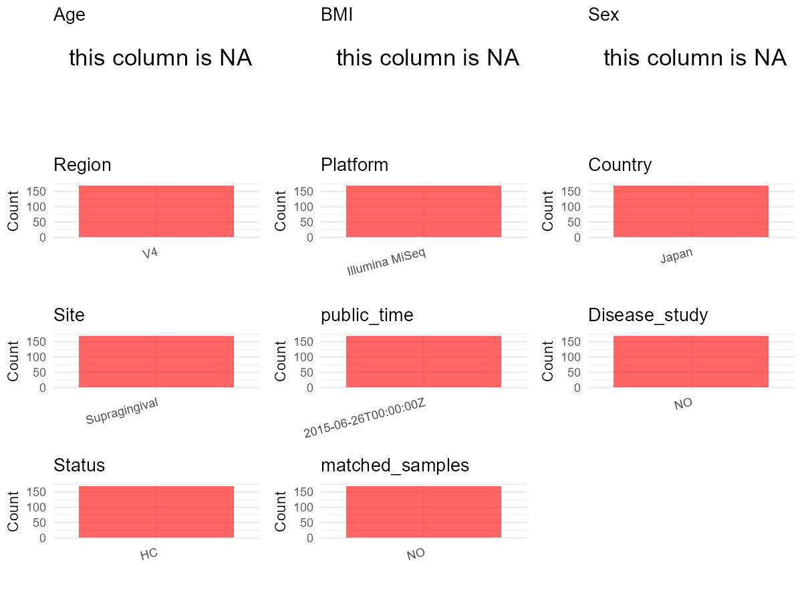

# Step 1: Obtain Initial Metadata from Each Project

To obtain the initial metadata: 1. Search for the BioProject ID (e.g.,
“PRJEBXXXX”) on the [NCBI SRA
website](https://www.ncbi.nlm.nih.gov/Traces/study/). 2. In the “Select”
table, click on “Metadata” and download the file. 3. The downloaded file
is typically named “SraRunTable.csv” and contains metadata for the
project.

    library(tidyverse)
    library(ggplot2)
    library(cowplot)

    setwd("C:/Users/zyc/Desktop/oral_project/data/projects/PRJDB3518")
    initial_meta <- read.csv("SraRunTable.csv", header = TRUE) 
    head(initial_meta)

    ##         Run Assay.Type AvgSpotLen    Bases            BIOMATERIAL_PROVIDER BioProject    BioSample            BioSampleModel   Bytes
    ## 1 DRR030443   AMPLICON        249 11681025 http://nagasakilab.csml.org/en/  PRJDB3518 SAMD00025858 MIMARKS.survey.human-oral 6064573
    ## 2 DRR030444   AMPLICON        249 11680972 http://nagasakilab.csml.org/en/  PRJDB3518 SAMD00025859 MIMARKS.survey.human-oral 6156062
    ## 3 DRR030445   AMPLICON        249 13394073 http://nagasakilab.csml.org/en/  PRJDB3518 SAMD00025860 MIMARKS.survey.human-oral 7243620
    ## 4 DRR030446   AMPLICON        249 13392675 http://nagasakilab.csml.org/en/  PRJDB3518 SAMD00025861 MIMARKS.survey.human-oral 7384590
    ## 5 DRR030447   AMPLICON        249 11214676 http://nagasakilab.csml.org/en/  PRJDB3518 SAMD00025862 MIMARKS.survey.human-oral 5795865
    ## 6 DRR030448   AMPLICON        250 11215805 http://nagasakilab.csml.org/en/  PRJDB3518 SAMD00025863 MIMARKS.survey.human-oral 5915507
    ##   Center.Name Collection_Date Consent DATASTORE.filetype DATASTORE.provider                     DATASTORE.region          env_broad_scale
    ## 1      TOHOKU      2014-08-04  public         run.zq,sra         gs,ncbi,s3 gs.us-east1,ncbi.public,s3.us-east-1 human-associated habitat
    ## 2      TOHOKU      2014-08-04  public         run.zq,sra         gs,ncbi,s3 gs.us-east1,ncbi.public,s3.us-east-1 human-associated habitat
    ## 3      TOHOKU      2014-08-04  public         run.zq,sra         gs,ncbi,s3 gs.us-east1,ncbi.public,s3.us-east-1 human-associated habitat
    ## 4      TOHOKU      2014-08-04  public         run.zq,sra         gs,ncbi,s3 gs.us-east1,ncbi.public,s3.us-east-1 human-associated habitat
    ## 5      TOHOKU      2014-08-04  public         run.zq,sra         gs,ncbi,s3 gs.us-east1,ncbi.public,s3.us-east-1 human-associated habitat
    ## 6      TOHOKU      2014-08-04  public         run.zq,sra         gs,ncbi,s3 gs.us-east1,ncbi.public,s3.us-east-1 human-associated habitat
    ##   env_local_scale    env_medium Experiment geo_loc_name_country geo_loc_name_country_continent geo_loc_name host_disease_stat         HOST
    ## 1           Mouth Supragingival  DRX027459                Japan                           Asia Japan:Sendai           Healthy Homo sapiens
    ## 2           Mouth Supragingival  DRX027460                Japan                           Asia Japan:Sendai           Healthy Homo sapiens
    ## 3           Mouth Supragingival  DRX027461                Japan                           Asia Japan:Sendai           Healthy Homo sapiens
    ## 4           Mouth Supragingival  DRX027462                Japan                           Asia Japan:Sendai           Healthy Homo sapiens
    ## 5           Mouth Supragingival  DRX027463                Japan                           Asia Japan:Sendai           Healthy Homo sapiens
    ## 6           Mouth Supragingival  DRX027464                Japan                           Asia Japan:Sendai           Healthy Homo sapiens
    ##       Instrument last_meal                lat_lon          Library.Name LibraryLayout LibrarySelection LibrarySource
    ## 1 Illumina MiSeq   5 hours 38.27404 N 140.86087 E  P1_D1_Ev_Incisor_R1         PAIRED              PCR   METAGENOMIC
    ## 2 Illumina MiSeq   5 hours 38.27404 N 140.86087 E  P1_D1_Ev_Incisor_R2         PAIRED              PCR   METAGENOMIC
    ## 3 Illumina MiSeq   5 hours 38.27404 N 140.86087 E    P1_D1_Ev_Molar_R1         PAIRED              PCR   METAGENOMIC
    ## 4 Illumina MiSeq   5 hours 38.27404 N 140.86087 E    P1_D1_Ev_Molar_R2         PAIRED              PCR   METAGENOMIC
    ## 5 Illumina MiSeq   5 hours 38.27404 N 140.86087 E P1_D1_Ev_Premolar_R1         PAIRED              PCR   METAGENOMIC
    ## 6 Illumina MiSeq   5 hours 38.27404 N 140.86087 E P1_D1_Ev_Premolar_R2         PAIRED              PCR   METAGENOMIC
    ##                          Organism Platform                                                                project_name          ReleaseDate
    ## 1 uncultured human oral bacterium ILLUMINA Oral bacterial 16S rRNA-V4 sequencing in multiple time points duaring a day 2015-06-26T00:00:00Z
    ## 2 uncultured human oral bacterium ILLUMINA Oral bacterial 16S rRNA-V4 sequencing in multiple time points duaring a day 2015-06-26T00:00:00Z
    ## 3 uncultured human oral bacterium ILLUMINA Oral bacterial 16S rRNA-V4 sequencing in multiple time points duaring a day 2015-06-26T00:00:00Z
    ## 4 uncultured human oral bacterium ILLUMINA Oral bacterial 16S rRNA-V4 sequencing in multiple time points duaring a day 2015-06-26T00:00:00Z
    ## 5 uncultured human oral bacterium ILLUMINA Oral bacterial 16S rRNA-V4 sequencing in multiple time points duaring a day 2015-06-26T00:00:00Z
    ## 6 uncultured human oral bacterium ILLUMINA Oral bacterial 16S rRNA-V4 sequencing in multiple time points duaring a day 2015-06-26T00:00:00Z
    ##   samp_collect_device  samp_store_temp  Sample.Name          Sample_name  sex SRA.Study time_last_toothbrush          create_date version
    ## 1             Curette Minus 30 Celsius SAMD00025858  P1_D1_Ev_Incisor_R1 male DRP002688              4 hours 2015-06-26T10:33:00Z       1
    ## 2             Curette Minus 30 Celsius SAMD00025859  P1_D1_Ev_Incisor_R2 male DRP002688              4 hours 2015-06-26T10:33:00Z       1
    ## 3             Curette Minus 30 Celsius SAMD00025860    P1_D1_Ev_Molar_R1 male DRP002688              4 hours 2015-06-26T10:33:00Z       1
    ## 4             Curette Minus 30 Celsius SAMD00025861    P1_D1_Ev_Molar_R2 male DRP002688              4 hours 2015-06-26T10:33:00Z       1
    ## 5             Curette Minus 30 Celsius SAMD00025862 P1_D1_Ev_Premolar_R1 male DRP002688              4 hours 2015-06-26T10:33:00Z       1
    ## 6             Curette Minus 30 Celsius SAMD00025863 P1_D1_Ev_Premolar_R2 male DRP002688              4 hours 2015-06-26T10:33:00Z       1

# Step 2: Create a Uniform Metadata Template

The uniform metadata should include the following columns:

1.  **BioProject**: Project ID (e.g., “PRJNA339212”)
2.  **Run**: Sample ID (e.g., “ERRXXXXXX” or “SRRXXXXXX”)
3.  **sample\_name**: Original sample name submitted by the authors (not
    the database-assigned ID)
4.  **Age**: Age of the subject (if available)
5.  **BMI**: Body Mass Index (if available)
6.  **Sex**: Sex of the subject (“F” or “M”)
7.  **Region**: Targeted 16S rRNA region (e.g., “V3-V4”)
8.  **Platform**: Sequencing platform (e.g., “Illumina MiSeq”)
9.  **Country**: Country of sample origin (e.g., “China”)
10. **Site**: Sample site (e.g., “saliva”, “dental plaque”)
11. **public\_time**: Data release date (format: “YYYY-MM-DD”)
12. **PCR\_primers**: PCR primers used (e.g., “515F-806R”)
13. **title**: Title of the associated publication
14. **Disease\_study**: Whether the study involves a disease (“YES” or
    “NO”)
15. **Status**: Disease status (e.g., “T2DM”, “HC”). Note: If the study
    includes both disease and healthy samples, this must be specified
    per sample.
16. **matched\_samples**: matched samples (“YES” or “NO”)

<!-- -->

    metadata <- data.frame(
      BioProject = initial_meta$BioProject,
      Run = initial_meta$Run,
      sample_name = initial_meta$Sample_name,
      Age = NA, 
      BMI = NA,  
      Sex = NA,
      Platform = initial_meta$Instrument,
      Country = initial_meta$geo_loc_name_country,
      Site = initial_meta$env_medium,
      public_time = initial_meta$ReleaseDate,
      Status = initial_meta$host_disease_stat,
      stringsAsFactors = FALSE
    )

# Step 3: Manually Add Information from the Publication

Some information (e.g. PCR primers, study title, disease status) must be
manually extracted from the publication and added to the metadata.

    # metadata <- metadata %>% mutate(Site = case_when(
    #   grepl("Supragingival dental plaque",Site) ~ "Supragingival dental plaque",
    #   TRUE ~ Site
    # ))
    metadata <- metadata %>% mutate(Status = case_when(
      grepl("Healthy",Status) ~ "HC",
      TRUE ~ Status
    ))
    # metadata <- metadata %>%mutate(Status = case_when(
    #   Status == "Oral Neoplasm (Healthy Control)" ~ "HC",
    #   Status == "Oral Neoplasm (OSCC)" ~ "OSCC",
    #   TRUE ~ "Precancer"
    # ))
    # metadata <- metadata %>%
    #   mutate(Sex = recode(Sex, "female" = "F", "male" = "M"))
    # metadata <-metadata%>%
    #   mutate(Country = case_when(Country == "Taiwan" ~ "China"))

    metadata$matched_samples <- "NO"
    metadata$Region <- "V4"
    metadata$title <- "Inter-Individual Differences in the Oral Bacteriome Are Greater than Intra-Day Fluctuations in Individuals"
    metadata$Disease_study <- "NO"
    metadata$PCR_primers <- "F(5'-ACACTCTTTCCCTACACGACGCTCTTCCGATCTNNNNNNGTGCCAGCMGCCGCGGTAA-3')R(5'-GTGACTGGAGTTCAGACGTGTGCTCTTCCGATCTNNNNNNGGACTACHVGGGTWTCTAAT-3')"

    head(metadata)

    ##   BioProject       Run          sample_name Age BMI Sex       Platform Country          Site          public_time Status matched_samples
    ## 1  PRJDB3518 DRR030443  P1_D1_Ev_Incisor_R1  NA  NA  NA Illumina MiSeq   Japan Supragingival 2015-06-26T00:00:00Z     HC              NO
    ## 2  PRJDB3518 DRR030444  P1_D1_Ev_Incisor_R2  NA  NA  NA Illumina MiSeq   Japan Supragingival 2015-06-26T00:00:00Z     HC              NO
    ## 3  PRJDB3518 DRR030445    P1_D1_Ev_Molar_R1  NA  NA  NA Illumina MiSeq   Japan Supragingival 2015-06-26T00:00:00Z     HC              NO
    ## 4  PRJDB3518 DRR030446    P1_D1_Ev_Molar_R2  NA  NA  NA Illumina MiSeq   Japan Supragingival 2015-06-26T00:00:00Z     HC              NO
    ## 5  PRJDB3518 DRR030447 P1_D1_Ev_Premolar_R1  NA  NA  NA Illumina MiSeq   Japan Supragingival 2015-06-26T00:00:00Z     HC              NO
    ## 6  PRJDB3518 DRR030448 P1_D1_Ev_Premolar_R2  NA  NA  NA Illumina MiSeq   Japan Supragingival 2015-06-26T00:00:00Z     HC              NO
    ##   Region                                                                                                      title Disease_study
    ## 1     V4 Inter-Individual Differences in the Oral Bacteriome Are Greater than Intra-Day Fluctuations in Individuals            NO
    ## 2     V4 Inter-Individual Differences in the Oral Bacteriome Are Greater than Intra-Day Fluctuations in Individuals            NO
    ## 3     V4 Inter-Individual Differences in the Oral Bacteriome Are Greater than Intra-Day Fluctuations in Individuals            NO
    ## 4     V4 Inter-Individual Differences in the Oral Bacteriome Are Greater than Intra-Day Fluctuations in Individuals            NO
    ## 5     V4 Inter-Individual Differences in the Oral Bacteriome Are Greater than Intra-Day Fluctuations in Individuals            NO
    ## 6     V4 Inter-Individual Differences in the Oral Bacteriome Are Greater than Intra-Day Fluctuations in Individuals            NO
    ##                                                                                                                                PCR_primers
    ## 1 F(5'-ACACTCTTTCCCTACACGACGCTCTTCCGATCTNNNNNNGTGCCAGCMGCCGCGGTAA-3')R(5'-GTGACTGGAGTTCAGACGTGTGCTCTTCCGATCTNNNNNNGGACTACHVGGGTWTCTAAT-3')
    ## 2 F(5'-ACACTCTTTCCCTACACGACGCTCTTCCGATCTNNNNNNGTGCCAGCMGCCGCGGTAA-3')R(5'-GTGACTGGAGTTCAGACGTGTGCTCTTCCGATCTNNNNNNGGACTACHVGGGTWTCTAAT-3')
    ## 3 F(5'-ACACTCTTTCCCTACACGACGCTCTTCCGATCTNNNNNNGTGCCAGCMGCCGCGGTAA-3')R(5'-GTGACTGGAGTTCAGACGTGTGCTCTTCCGATCTNNNNNNGGACTACHVGGGTWTCTAAT-3')
    ## 4 F(5'-ACACTCTTTCCCTACACGACGCTCTTCCGATCTNNNNNNGTGCCAGCMGCCGCGGTAA-3')R(5'-GTGACTGGAGTTCAGACGTGTGCTCTTCCGATCTNNNNNNGGACTACHVGGGTWTCTAAT-3')
    ## 5 F(5'-ACACTCTTTCCCTACACGACGCTCTTCCGATCTNNNNNNGTGCCAGCMGCCGCGGTAA-3')R(5'-GTGACTGGAGTTCAGACGTGTGCTCTTCCGATCTNNNNNNGGACTACHVGGGTWTCTAAT-3')
    ## 6 F(5'-ACACTCTTTCCCTACACGACGCTCTTCCGATCTNNNNNNGTGCCAGCMGCCGCGGTAA-3')R(5'-GTGACTGGAGTTCAGACGTGTGCTCTTCCGATCTNNNNNNGGACTACHVGGGTWTCTAAT-3')

# Step 4: Summarize and Validate the Metadata

    print(paste("Number of unique runs:", length(unique(metadata$Run))))

    ## [1] "Number of unique runs: 170"

    print(paste("Number of unique sample names:", length(unique(metadata$sample_name))))

    ## [1] "Number of unique sample names: 170"

# Step 5: Visualize the Metadata

    plot_data <- metadata %>%
      select(-BioProject, -Run, -sample_name, -title)

    # Function to create simple plots for each column
    create_simple_plots <- function(data) {
      plots <- list()
      
      for (col in colnames(data)) {
        # Check if the column is all NA
        if (all(is.na(data[[col]]))) {
          # Create an empty plot with text indicating all NA
          p <- ggplot() +
            annotate("text", x = 0.5, y = 0.5, label = "this column is NA", size = 6) +
            labs(title = col) +
            theme_void()
        } else if (is.numeric(data[[col]])) {
          # Numeric variable: histogram
          p <- ggplot(data, aes(x = .data[[col]])) +
            geom_histogram(fill = "blue", alpha = 0.6, bins = 20, na.rm = TRUE) +
            labs(title = col) +
            theme_minimal()
        } else {
          # Categorical variable: bar plot (remove NA values)
          count_data <- as.data.frame(table(data[[col]], useNA = "ifany"))
          p <- ggplot(count_data, aes(x = reorder(Var1, -Freq), y = Freq)) +
            geom_col(fill = "red", alpha = 0.6) +
            labs(title = col, x = NULL, y = "Count") +
            theme_minimal() +
            theme(axis.text.x = element_text(angle = 15, hjust = 1))
        }
        plots[[col]] <- p
      }
      
      return(plots)
    }

    plots <- create_simple_plots(plot_data)
    p<-plot_grid(plots$Age, 
              plots$BMI, 
              plots$Sex, 
              plots$Region, 
              plots$Platform, 
              plots$Country, 
              plots$Site,
              plots$public_time, 
              # plots$PCR_primers,
              plots$Disease_study,
              plots$Status,
              plots$matched_samples,# add 
              ncol = 3, align = "hv", axis = "lb")
    ggsave("Metadata_Summary.png", plot = p, width = 8, height = 6, dpi = 150)

    

 \# Step 6: Finalize and Export the Metadata

    metadata <- metadata[, c(
      "BioProject", "Run", "sample_name", "Age", "BMI", "Sex", 
      "Region", "Platform", "Country", "Site", "public_time", 
      "PCR_primers", "title", "Disease_study", "Status","matched_samples"
    )]

    write.csv(metadata, file = "metadata.csv", quote = TRUE)
