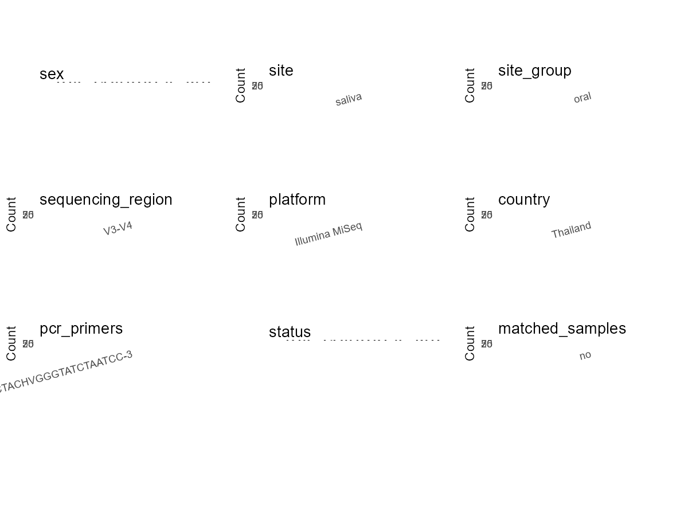

R Notebook: Metadata Processing Workflow
================

# Step 1: Obtain Initial Metadata from Each Project

This step sets the project directory, loads the raw SRA metadata, and
optionally merges supplement tables.

``` r
# Load libraries
library(dplyr)
library(ggplot2)
library(cowplot)

# (1) Setting working directory
# EDIT HERE: change project_id for each study
project_id <- "PRJDB5440" 

base_dir <- "E:/oral/26/metadata-2604/Oral-Metadata-YL-02"
setwd(file.path(base_dir, project_id))

# (2) Loading raw SRA metadata file
sra_file <- "SraRunTable.csv"
initial_meta <- read.csv(sra_file, header = TRUE)

# (3) OPTIONAL: If extra metadata (e.g., Table.x or supplemental materials) are available from the article, you may need to merge the file with initial_meta manually. Below is example code for merging. Depending on the specific case of each study, you can customize the code as needed.
supp_table <- read.csv("supplemental_table_v2.csv", header = TRUE)
initial_meta <- left_join(initial_meta, supp_table, by = "Sample_name")
initial_meta <- initial_meta %>%
  filter(Sample_name %in% supp_table$Sample_name) # Filter out samples that are not matched
```

# Step 2: Data Overview

First, you need to get an overview of the data, which includes two
steps: reading the article and reading the initial metadata. This step
is very IMPORTANT!

``` r
# (1) Read the article in the following order: abstract, the beginning of the results section, and the methods. Understand the sample size, experimental design, and disease group overview. Clarify the sampling sites; for oral and gut samples, specify the exact sites like supragingival plaque, tongue, etc.

# (2) IMPORTANT: MUST go through each column of initial_meta
head(initial_meta, 10)
```

    ##          Run Assay.Type AvgSpotLen    Bases BioProject    BioSample
    ## 1  DRR082910   AMPLICON        602 13702122  PRJDB5440 SAMD00070851
    ## 2  DRR082911   AMPLICON        602 13623260  PRJDB5440 SAMD00070852
    ## 3  DRR082912   AMPLICON        602 13467944  PRJDB5440 SAMD00070853
    ## 4  DRR082913   AMPLICON        602 13281324  PRJDB5440 SAMD00070854
    ## 5  DRR082914   AMPLICON        602 14331212  PRJDB5440 SAMD00070855
    ## 6  DRR082915   AMPLICON        602 14205394  PRJDB5440 SAMD00070856
    ## 7  DRR082916   AMPLICON        602 13267478  PRJDB5440 SAMD00070857
    ## 8  DRR082917   AMPLICON        602 14270410  PRJDB5440 SAMD00070858
    ## 9  DRR082918   AMPLICON        602 14014560  PRJDB5440 SAMD00070859
    ## 10 DRR082922   AMPLICON        602 13738844  PRJDB5440 SAMD00070863
    ##        BioSampleModel   Bytes Center.Name Collection_Date Consent
    ## 1  MIMS.me.human-oral 7489539          UB      2015-03-23  public
    ## 2  MIMS.me.human-oral 7341031          UB      2015-03-23  public
    ## 3  MIMS.me.human-oral 7369055          UB      2015-03-23  public
    ## 4  MIMS.me.human-oral 7161874          UB      2015-03-23  public
    ## 5  MIMS.me.human-oral 7657480          UB      2015-03-23  public
    ## 6  MIMS.me.human-oral 7619319          UB      2015-03-23  public
    ## 7  MIMS.me.human-oral 6855052          UB      2015-03-23  public
    ## 8  MIMS.me.human-oral 7556582          UB      2015-03-23  public
    ## 9  MIMS.me.human-oral 7634882          UB      2015-03-23  public
    ## 10 MIMS.me.human-oral 7423774          UB      2015-03-23  public
    ##    DATASTORE.filetype DATASTORE.provider                     DATASTORE.region
    ## 1          run.zq,sra         gs,ncbi,s3 gs.us-east1,ncbi.public,s3.us-east-1
    ## 2          run.zq,sra         gs,ncbi,s3 gs.us-east1,ncbi.public,s3.us-east-1
    ## 3          run.zq,sra         gs,ncbi,s3 gs.us-east1,ncbi.public,s3.us-east-1
    ## 4          run.zq,sra         gs,ncbi,s3 gs.us-east1,ncbi.public,s3.us-east-1
    ## 5          run.zq,sra         gs,ncbi,s3 gs.us-east1,ncbi.public,s3.us-east-1
    ## 6          run.zq,sra         gs,ncbi,s3 gs.us-east1,ncbi.public,s3.us-east-1
    ## 7          run.zq,sra         gs,ncbi,s3 gs.us-east1,ncbi.public,s3.us-east-1
    ## 8          run.zq,sra         gs,ncbi,s3 gs.us-east1,ncbi.public,s3.us-east-1
    ## 9          run.zq,sra         gs,ncbi,s3 gs.us-east1,ncbi.public,s3.us-east-1
    ## 10         run.zq,sra         gs,ncbi,s3 gs.us-east1,ncbi.public,s3.us-east-1
    ##    env_broad_scale env_local_scale   env_medium Experiment geo_loc_name_country
    ## 1   not applicable  not applicable human saliva  DRX076741             Thailand
    ## 2   not applicable  not applicable human saliva  DRX076742             Thailand
    ## 3   not applicable  not applicable human saliva  DRX076743             Thailand
    ## 4   not applicable  not applicable human saliva  DRX076744             Thailand
    ## 5   not applicable  not applicable human saliva  DRX076745             Thailand
    ## 6   not applicable  not applicable human saliva  DRX076746             Thailand
    ## 7   not applicable  not applicable human saliva  DRX076747             Thailand
    ## 8   not applicable  not applicable human saliva  DRX076748             Thailand
    ## 9   not applicable  not applicable human saliva  DRX076749             Thailand
    ## 10  not applicable  not applicable human saliva  DRX076753             Thailand
    ##    geo_loc_name_country_continent                           geo_loc_name
    ## 1                            Asia Thailand:Bangkok\\, Mahidol university
    ## 2                            Asia Thailand:Bangkok\\, Mahidol university
    ## 3                            Asia Thailand:Bangkok\\, Mahidol university
    ## 4                            Asia Thailand:Bangkok\\, Mahidol university
    ## 5                            Asia Thailand:Bangkok\\, Mahidol university
    ## 6                            Asia Thailand:Bangkok\\, Mahidol university
    ## 7                            Asia Thailand:Bangkok\\, Mahidol university
    ## 8                            Asia Thailand:Bangkok\\, Mahidol university
    ## 9                            Asia Thailand:Bangkok\\, Mahidol university
    ## 10                           Asia Thailand:Bangkok\\, Mahidol university
    ##            Host     Instrument        lat_lon Library.Name LibraryLayout
    ## 1  Homo sapiens Illumina MiSeq not applicable           NA        PAIRED
    ## 2  Homo sapiens Illumina MiSeq not applicable           NA        PAIRED
    ## 3  Homo sapiens Illumina MiSeq not applicable           NA        PAIRED
    ## 4  Homo sapiens Illumina MiSeq not applicable           NA        PAIRED
    ## 5  Homo sapiens Illumina MiSeq not applicable           NA        PAIRED
    ## 6  Homo sapiens Illumina MiSeq not applicable           NA        PAIRED
    ## 7  Homo sapiens Illumina MiSeq not applicable           NA        PAIRED
    ## 8  Homo sapiens Illumina MiSeq not applicable           NA        PAIRED
    ## 9  Homo sapiens Illumina MiSeq not applicable           NA        PAIRED
    ## 10 Homo sapiens Illumina MiSeq not applicable           NA        PAIRED
    ##    LibrarySelection LibrarySource                Organism Platform
    ## 1               PCR       GENOMIC human saliva metagenome ILLUMINA
    ## 2               PCR       GENOMIC human saliva metagenome ILLUMINA
    ## 3               PCR       GENOMIC human saliva metagenome ILLUMINA
    ## 4               PCR       GENOMIC human saliva metagenome ILLUMINA
    ## 5               PCR       GENOMIC human saliva metagenome ILLUMINA
    ## 6               PCR       GENOMIC human saliva metagenome ILLUMINA
    ## 7               PCR       GENOMIC human saliva metagenome ILLUMINA
    ## 8               PCR       GENOMIC human saliva metagenome ILLUMINA
    ## 9               PCR       GENOMIC human saliva metagenome ILLUMINA
    ## 10              PCR       GENOMIC human saliva metagenome ILLUMINA
    ##                       project_name          ReleaseDate  Sample.Name
    ## 1  Exploring Human Oral Microbiome 2017-09-22T00:00:00Z SAMD00070851
    ## 2  Exploring Human Oral Microbiome 2017-09-22T00:00:00Z SAMD00070852
    ## 3  Exploring Human Oral Microbiome 2017-09-22T00:00:00Z SAMD00070853
    ## 4  Exploring Human Oral Microbiome 2017-09-22T00:00:00Z SAMD00070854
    ## 5  Exploring Human Oral Microbiome 2017-09-22T00:00:00Z SAMD00070855
    ## 6  Exploring Human Oral Microbiome 2017-09-22T00:00:00Z SAMD00070856
    ## 7  Exploring Human Oral Microbiome 2017-09-22T00:00:00Z SAMD00070857
    ## 8  Exploring Human Oral Microbiome 2017-09-22T00:00:00Z SAMD00070858
    ## 9  Exploring Human Oral Microbiome 2017-09-22T00:00:00Z SAMD00070859
    ## 10 Exploring Human Oral Microbiome 2017-09-22T00:00:00Z SAMD00070863
    ##    Sample_name SRA.Study          create_date version Sample_ID
    ## 1        L3010 DRP003829 2017-09-22T16:06:00Z       1       G-1
    ## 2        L3011 DRP003829 2017-09-22T16:08:00Z       1       G-2
    ## 3        L3012 DRP003829 2017-09-22T16:08:00Z       1       P-1
    ## 4        L3013 DRP003829 2017-09-22T16:05:00Z       1       P-2
    ## 5        L3014 DRP003829 2017-09-22T16:07:00Z       1       M-1
    ## 6        L3015 DRP003829 2017-09-22T16:06:00Z       1       M-2
    ## 7        L2069 DRP003829 2017-09-22T16:07:00Z       1       G-3
    ## 8        L2070 DRP003829 2017-09-22T16:07:00Z       1       P-3
    ## 9        L3016 DRP003829 2017-09-22T16:08:00Z       1       M-3
    ## 10       L3018 DRP003829 2017-09-22T16:08:00Z       1       P-4
    ##                    Group
    ## 1      Good oral hygeine
    ## 2      Good oral hygeine
    ## 3      Poor oral hygeine
    ## 4      Poor oral hygeine
    ## 5  Moderate oral hygeine
    ## 6  Moderate oral hygeine
    ## 7      Good oral hygeine
    ## 8      Poor oral hygeine
    ## 9  Moderate oral hygeine
    ## 10     Poor oral hygeine

``` r
# IMPORTANT: Check the unique values in the column of interest or query column.
lapply(initial_meta[c('env_medium')], table) # site
```

    ## $env_medium
    ## 
    ## human saliva 
    ##           90

``` r
lapply(initial_meta[c('Host', 'Organism', 'project_name')], table) # organism
```

    ## $Host
    ## 
    ## Homo sapiens 
    ##           90 
    ## 
    ## $Organism
    ## 
    ## human saliva metagenome 
    ##                      90 
    ## 
    ## $project_name
    ## 
    ## Exploring Human Oral Microbiome 
    ##                              90

``` r
table(initial_meta$Sample_ID) # subject id
```

    ## 
    ##  G-1 G-10 G-11 G-12 G-13 G-14 G-15 G-16 G-17 G-18 G-19  G-2 G-20 G-21 G-22 G-23 
    ##    1    1    1    1    1    1    1    1    1    1    1    1    1    1    1    1 
    ## G-24  G-3  G-4  G-5  G-6  G-7  G-8  G-9  M-1 M-10 M-11 M-12 M-13 M-14 M-15 M-16 
    ##    1    1    1    1    1    1    1    1    1    1    1    1    1    1    1    1 
    ## M-17 M-18 M-19  M-2 M-20 M-21 M-22 M-23 M-24 M-25 M-26 M-27 M-28 M-29  M-3 M-30 
    ##    1    1    1    1    1    1    1    1    1    1    1    1    1    1    1    1 
    ## M-31  M-4  M-5  M-6  M-7  M-8  M-9  P-1 P-10 P-11 P-12 P-13 P-14 P-15 P-16 P-17 
    ##    1    1    1    1    1    1    1    1    1    1    1    1    1    1    1    1 
    ## P-18 P-19  P-2 P-20 P-21 P-22 P-23 P-24 P-25 P-26 P-27 P-28 P-29  P-3 P-30 P-31 
    ##    1    1    1    1    1    1    1    1    1    1    1    1    1    1    1    1 
    ## P-32 P-33 P-34 P-35  P-4  P-5  P-6  P-7  P-8  P-9 
    ##    1    1    1    1    1    1    1    1    1    1

``` r
#table(initial_meta$sequencing_meth..exp.) # output is pyrosequencing
table(initial_meta$Platform) # output is Illumina. according to the methods, Illumina is correct.
```

    ## 
    ## ILLUMINA 
    ##       90

``` r
# table(initial_meta$target_subfragment..exp.)
```

# Step 3: Removing Control and Non-human Samples

First, we need to remove control samples(including both negative
controls and positive controls) and non-human samples.

``` r
# (1) EDIT HERE: Parameter setup
control_column <- "" # column name in initial_meta
# unique(initial_meta[[control_column]])
control_keywords <- c() # Enter exact keywords

species_column <- "" # column name in initial_meta
unique(initial_meta[[species_column]])
```

    ## NULL

``` r
non_human_keywords <- c() # Enter exact keywords

# (2) Remove controls and non-human samples. DO NOT need to modify code in this part, just run it.
n_samples <- nrow(initial_meta)
# Control evaluation
if (length(control_keywords) > 0) {
  if (is.null(control_column) || control_column == "") {
    stop("Error: control_keywords provided but control_column is missing.")
  }
  
  if (!(control_column %in% colnames(initial_meta))) {
    stop(sprintf("Error: Column '%s' not found in initial_meta.", control_column))
  }
  
  control_pattern <- paste(control_keywords, collapse = "|")
  control_text <- initial_meta[[control_column]]
  is_control <- grepl(control_pattern, control_text)
  
} else {
  is_control <- rep(FALSE, n_samples)
}

# Non-human evaluation
if (length(non_human_keywords) > 0) {
  if (is.null(species_column) || species_column == "") {
    stop("Error: non_human_keywords provided but species_column is missing.")
  }
  
  if (!(species_column %in% colnames(initial_meta))) {
    stop(sprintf("Error: Column '%s' not found in initial_meta.", species_column))
  }
  
  non_human_pattern <- paste(non_human_keywords, collapse = "|")
  species_text <- initial_meta[[species_column]]
  is_non_human <- grepl(non_human_pattern, species_text)
} else {
  is_non_human <- rep(FALSE, n_samples)
}

# Execute removal
samples_to_remove <- is_control | is_non_human
initial_meta <- initial_meta[!samples_to_remove, ]

cat("Initial samples counts:",n_samples,"\n")
```

    ## Initial samples counts: 90

``` r
cat("Removed control samples:", sum(is_control), "\n")
```

    ## Removed control samples: 0

``` r
cat("Removed non-human samples:", sum(is_non_human), "\n")
```

    ## Removed non-human samples: 0

``` r
cat("Total samples removed ", sum(samples_to_remove), "\n")
```

    ## Total samples removed  0

``` r
cat("Remaining samples after Step 2:", nrow(initial_meta), "\n")
```

    ## Remaining samples after Step 2: 90

# Step 4: Creating a Uniform Metadata Template

This step converts the raw SRA table into the standard metadata format
used in our meta-analysis. The uniform metadata should include the
following columns: 1. **bioproject**: Project ID from SRA or other
database e.g. `PRJNA1234`, `CNP1234`, ‘OEP1234’, ‘qiita_1234’ 2.
**sample_id**: SRA sample/run ID. Unique id for each sample!
e.g. `DRR1234567`, `ERR1234567` and `SRR1234567`. If no such column
exists, can use column like sample_name. 3. **subject_id**: subject id
for each person if available. e.g. `patient_01`, `Host_03_before`,
`subject12` 4. **age**: Age of the subject if available. e.g. `35`, `42`
\| not `adult`, `chilren` 5. **age_info**: If the age is not explicitly
stated but approximate age range information is available, mark it in
this column. e.g., `18-55`, `children`, `infant`, `elder` 6. **bmi**:
Body Mass Index if available. e.g. `22.5`, `18.9` \| not `normal`,
`overweight` 7. **sex**: Sex of the subject. Mandatory to write as M/F
\| not `female`, `woman` 8. **sequencing_region**: Targeted 16S rRNA
region. e.g. `V3-V4`, `V4` 9. **platform**: Sequencing platform.
e.g. `Illumina MiSeq`, `454 GS FLX Titanium`, `Ion Torrent` 10.
**country**: Country of sample origin. e.g. `China`, `Japan` \| not city
name like `Beijing` 11. **site**: Sampling site. For oral and gut sites,
specify the exact sites as detailed as possible. For example, if it is
known to be supragingival plaque, do not record it as ‘dental plaque’,
unless the original text provides only a vague description.
e.g. `saliva`, `tongue coating` \| not broad term like `oral` 12.
**site_group**: only accepts one of following three values: ‘oral’,
‘gut’, or ‘other’. 13. **public_time**: Data release date.
e.g. `2021-06-22` \| not `June 2021` 14. **pcr_primers**: PCR primers
used. e.g. `515F-806R`, `27F-338R` \| not primer sequences 15.
**title**: Title of the associated publication. 16. **disease_study**:
Whether the study involves disease samples. If it’s not clear, can
record as NA. Only three values accepted: ‘yes’, ‘no’ or NA 17.
**status**: Disease status for each sample if available, else record as
NA. Only accept following abbreviations, Write full names for all other
diseases. HC: healthy control CD: Crohn’s disease CRC: colorectal cancer
COPD: chronic obstructive pulmonary disease HIV: human immunodeficiency
virus ICU: intensive care unit OSCC: oral squamous cell carcinoma RA:
rheumatoid arthritis UC: ulcerative colitis 18. **matched_samples**:
Whether the subject has matched samples. Only accept ‘yes’ or ‘no’. 19.
**is_time_series**: Whether the study is a time series study. Only
accept ‘yes’ or ‘no’.

``` r
# Extract columns from initial_meta as follows: (1) No modification needed → extract directly. (2) Modification needed → create a new column with the prefix raw_ and mark the original column as “pending”. (3) Need to find or determine based on the article.
metadata <- data.frame(
  bioproject = initial_meta$BioProject,
  sample_id = initial_meta$Run,
  subject_id = initial_meta$Sample_ID,
  age = NA,
  age_info = "7-15", # extract from methods section
  bmi = NA,
  sex = NA, 
  sequencing_region = "V3-V4", # extract from abstract section
  platform = "Illumina MiSeq", # extract from methods section, NOT initial_meta
  country = initial_meta$geo_loc_name_country,
  raw_site = initial_meta$env_medium,
  site = "pending", # modify later
  site_group = "pending", # modify later
  public_time = initial_meta$ReleaseDate,
  pcr_primers = "F:5'-TCGTCGGCAGCGTCAGATGTGTATAAGAGACAGCCTACGGGNGGCWGCAG-3';R:5'-GTCTCGTGGGCTCGGAGATGTGTATAAGAGACAGGACTACHVGGGTATCTAATCC-3", # Format: xxF-xxR
  title = "Exploring the salivary microbiome of children stratified by the oral hygiene index", # extract from article
  disease_study = NA, # determine according to the article
  status = NA, 
  matched_samples = "pending", # modify later
  is_time_series = "no", # determine according to the article
  stringsAsFactors = FALSE
)
metadata$public_time <- as.Date(metadata$public_time)
```

# Step 5: Manually solving pending issues

This step involves two parts: (1) handle the columns with the `raw_`
prefix, and next (2) handle the `site_group` and `matched_samples`
columns.

``` r
# (1) Handle the columns with the `raw_` prefix.
# In this part, you need to customize the code based on the situation of the raw_ columns to obtain the content of the target columns. IMPORTANT: Add comments if the modification is not straightforward!!
metadata$site <- gsub("human ", "", metadata$raw_site) # according to the 'env_medium' column of initial_meta
```

``` r
# (2) Filling the 'site_group' and 'matched_samples' columns
# editing site_group
unique(metadata$site)
```

    ## [1] "saliva"

``` r
# EDIT HERE: add oral sites
Oral_site = unique(metadata$site)
# EDIT HERE: add gut sites
Gut_site = c()
# just run
metadata <- metadata %>%
  mutate(site_group = case_when(
    site %in% Oral_site ~ "oral",
    site %in% Gut_site ~ "gut",
    TRUE ~ "other" 
  ))

# editing matched_samples, just run.
metadata$matched_samples <- ifelse(
  ave(metadata$subject_id, metadata$subject_id, FUN = length) > 1, 
  "yes", 
  "no"
)
```

``` r
# (3) check if there is pending value in metadata. If there is pending value, go on modify the metadata.
# Function to check if a column contains "pending"
has_pending <- function(col) {
  if (is.character(col) || is.factor(col)) {
    any(col == "pending", na.rm = TRUE)
  } else {
    FALSE
  }
}

# Check for any pending value
any_pending_value <- any(sapply(metadata, has_pending))

if (!any_pending_value) {
  message("Good! No cell contains the value 'pending'.")
} else {
  pending_cols <- names(metadata)[sapply(metadata, has_pending)]
  message("Columns containing 'pending': ", paste(pending_cols, collapse = ", "))
  message("Please continue to resolve these pending columns!")
}
```

    ## Good! No cell contains the value 'pending'.

# Step 6: Visualize the Metadata

This step makes a quick set of plots for checking the distribution of
key metadata fields.

``` r
# Select columns for visualization, just run
plot_data <- metadata %>%
  select(-bioproject, -sample_id, -subject_id, -title)

create_simple_plots <- function(data) {
  plots <- list()
  continuous_vars <- c("age", "bmi")

  for (col in colnames(data)) {
    if (all(is.na(data[[col]]))) {
      p <- ggplot() +
        annotate("text", x = 0.5, y = 0.5, label = "this column is NA", size = 6) +
        labs(title = col) +
        theme_void()
    } else if (col %in% continuous_vars && is.numeric(data[[col]])) {
      p <- ggplot(data, aes(x = .data[[col]])) +
        geom_histogram(fill = "blue", alpha = 0.6, bins = 20, na.rm = TRUE) +
        labs(title = col, x = col, y = "Count") +
        theme_minimal()
    } else {
      count_data <- as.data.frame(table(data[[col]], useNA = "ifany"))
      p <- ggplot(count_data, aes(x = reorder(Var1, -Freq), y = Freq)) +
        geom_col(fill = "red", alpha = 0.6) +
        labs(title = col, x = NULL, y = "Count") +
        theme_minimal() +
        theme(axis.text.x = element_text(angle = 15, hjust = 1))
    }
    plots[[col]] <- p
  }

  return(plots)
}

# Generate and arrange plots
plots <- create_simple_plots(plot_data)
p <- plot_grid(plots$age,
               plots$age_info,
               plots$bmi,
               plots$sex,
               plots$site,
               plots$site_group,
               plots$sequencing_region,
               plots$platform,
               plots$country,
               plots$pcr_primers,
               plots$status,
               plots$matched_samples,
               ncol = 3, align = "hv", axis = "lb")
ggsave("Metadata_Summary_v2.png", plot = p, width = 8, height = 6, dpi = 150)
```

``` r
# Insert Metadata_Summary.png into the current Rmd output

```


# Step 7: Sort and export the metadata

This step saves the cleaned metadata table as the final `metadata.csv`
file.

``` r
# Reorder the data frame
fixed_cols <- c("bioproject", "sample_id", "subject_id", "age", "age_info",
                "bmi", "sex", "platform", "sequencing_region", "pcr_primers", 
                "country", "site", "site_group", "disease_study", "status", 
                "title", "public_time", "matched_samples", "is_time_series")  
metadata <- metadata %>%
  select(all_of(fixed_cols), everything())

# save metadata 
# head(metadata)
write.csv(metadata, file = "metadata_v2.csv", quote = TRUE)
```
