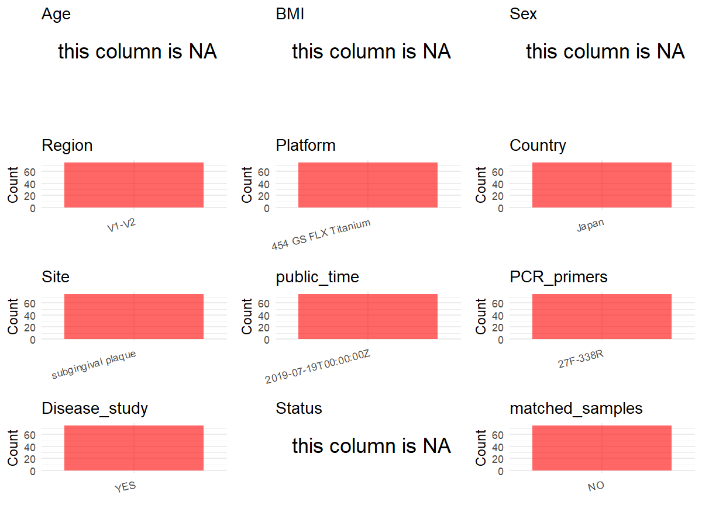

R Notebook: Metadata Processing Workflow
================

# Step 1: Obtain Initial Metadata from Each Project

To obtain the initial metadata: 1. Search for the BioProject ID (e.g.,
“PRJEBXXXX”) on the [NCBI SRA
website](https://www.ncbi.nlm.nih.gov/Traces/study/). 2. In the “Select”
table, click on “Metadata” and download the file. 3. The downloaded file
is typically named “SraRunTable.csv” and contains metadata for the
project.

``` r
# Load necessary libraries
library(dplyr)
library(ggplot2)
library(cowplot)

# Set working directory (update this path to your local directory)
setwd("D:/metadata/3/PRJDB5944")

# Read the initial metadata files
initial_meta<-read.csv("SraRunTable.csv",header = T)

# Combine the two metadata files
#meta <- rbind(initial_meta, initial_meta1)

#Remove entries non-oral samples
#initial_meta <- subset(initial_meta,BioSampleModel != "Metagenome or environmental")

# Check the number of samples containing "HT" in Sample.Name (e.g., healthy controls)
#nrow(subset(meta, grepl("HT", Sample.Name)))

# Display the first few rows of the metadata
head(initial_meta)
```

    ##         Run Assay.Type AvgSpotLen   Bases BioProject    BioSample
    ## 1 DRR098401   AMPLICON        406 1220903  PRJDB5944 SAMD00085665
    ## 2 DRR098402   AMPLICON        406 1219627  PRJDB5944 SAMD00085666
    ## 3 DRR098403   AMPLICON        404 1213316  PRJDB5944 SAMD00085667
    ## 4 DRR098404   AMPLICON        404 1212049  PRJDB5944 SAMD00085668
    ## 5 DRR098405   AMPLICON        409 1229731  PRJDB5944 SAMD00085669
    ## 6 DRR098406   AMPLICON        407 1223028  PRJDB5944 SAMD00085670
    ##       BioSampleModel   Bytes Center.Name Collection_Date Consent
    ## 1 MIMS.me.human-oral 3039520      UT_COB         missing  public
    ## 2 MIMS.me.human-oral 3044455      UT_COB         missing  public
    ## 3 MIMS.me.human-oral 3034465      UT_COB         missing  public
    ## 4 MIMS.me.human-oral 3019633      UT_COB         missing  public
    ## 5 MIMS.me.human-oral 3039809      UT_COB         missing  public
    ## 6 MIMS.me.human-oral 3031761      UT_COB         missing  public
    ##   DATASTORE.filetype DATASTORE.provider                     DATASTORE.region
    ## 1         run.zq,sra         gs,ncbi,s3 gs.us-east1,ncbi.public,s3.us-east-1
    ## 2         run.zq,sra         gs,ncbi,s3 gs.us-east1,ncbi.public,s3.us-east-1
    ## 3         run.zq,sra         gs,ncbi,s3 gs.us-east1,ncbi.public,s3.us-east-1
    ## 4         run.zq,sra         gs,ncbi,s3 gs.us-east1,ncbi.public,s3.us-east-1
    ## 5         run.zq,sra         gs,ncbi,s3 gs.us-east1,ncbi.public,s3.us-east-1
    ## 6         run.zq,sra         gs,ncbi,s3 gs.us-east1,ncbi.public,s3.us-east-1
    ##   env_broad_scale env_local_scale                env_medium Experiment
    ## 1         missing         missing gingival crevicular fluid  DRX091888
    ## 2         missing         missing gingival crevicular fluid  DRX091889
    ## 3         missing         missing gingival crevicular fluid  DRX091890
    ## 4         missing         missing gingival crevicular fluid  DRX091891
    ## 5         missing         missing gingival crevicular fluid  DRX091892
    ## 6         missing         missing gingival crevicular fluid  DRX091893
    ##   geo_loc_name_country geo_loc_name_country_continent geo_loc_name         HOST
    ## 1                Japan                           Asia        Japan Homo sapiens
    ## 2                Japan                           Asia        Japan Homo sapiens
    ## 3                Japan                           Asia        Japan Homo sapiens
    ## 4                Japan                           Asia        Japan Homo sapiens
    ## 5                Japan                           Asia        Japan Homo sapiens
    ## 6                Japan                           Asia        Japan Homo sapiens
    ##            Instrument lat_lon Library.Name LibraryLayout LibrarySelection
    ## 1 454 GS FLX Titanium missing           NA        SINGLE              PCR
    ## 2 454 GS FLX Titanium missing           NA        SINGLE              PCR
    ## 3 454 GS FLX Titanium missing           NA        SINGLE              PCR
    ## 4 454 GS FLX Titanium missing           NA        SINGLE              PCR
    ## 5 454 GS FLX Titanium missing           NA        SINGLE              PCR
    ## 6 454 GS FLX Titanium missing           NA        SINGLE              PCR
    ##   LibrarySource              Organism Platform
    ## 1   METAGENOMIC human oral metagenome    LS454
    ## 2   METAGENOMIC human oral metagenome    LS454
    ## 3   METAGENOMIC human oral metagenome    LS454
    ## 4   METAGENOMIC human oral metagenome    LS454
    ## 5   METAGENOMIC human oral metagenome    LS454
    ## 6   METAGENOMIC human oral metagenome    LS454
    ##                                                            project_name
    ## 1 Subgingival microbiota of 30 Japanese healthy or periodontitis adults
    ## 2 Subgingival microbiota of 30 Japanese healthy or periodontitis adults
    ## 3 Subgingival microbiota of 30 Japanese healthy or periodontitis adults
    ## 4 Subgingival microbiota of 30 Japanese healthy or periodontitis adults
    ## 5 Subgingival microbiota of 30 Japanese healthy or periodontitis adults
    ## 6 Subgingival microbiota of 30 Japanese healthy or periodontitis adults
    ##            ReleaseDate          create_date version  Sample.Name Sample_name
    ## 1 2019-07-19T00:00:00Z 2019-07-18T23:03:00Z       1 SAMD00085665     P01.sff
    ## 2 2019-07-19T00:00:00Z 2019-07-18T23:04:00Z       1 SAMD00085666     P02.sff
    ## 3 2019-07-19T00:00:00Z 2019-07-18T23:00:00Z       1 SAMD00085667     P03.sff
    ## 4 2019-07-19T00:00:00Z 2019-07-18T23:04:00Z       1 SAMD00085668     P04.sff
    ## 5 2019-07-19T00:00:00Z 2019-07-18T23:04:00Z       1 SAMD00085669     P05.sff
    ## 6 2019-07-19T00:00:00Z 2019-07-18T23:01:00Z       1 SAMD00085670     P06.sff
    ##   SRA.Study
    ## 1 DRP005290
    ## 2 DRP005290
    ## 3 DRP005290
    ## 4 DRP005290
    ## 5 DRP005290
    ## 6 DRP005290

# Step 2: Create a Uniform Metadata Template

The uniform metadata should include the following columns:

1.  **BioProject**: Project ID (e.g., “PRJNA339212”)
2.  **Run**: Sample ID (e.g., “ERRXXXXXX” or “SRRXXXXXX”)
3.  **sample_name**: Original sample name submitted by the authors (not
    the database-assigned ID)
4.  **Age**: Age of the subject (if available)
5.  **BMI**: Body Mass Index (if available)
6.  **Sex**: Sex of the subject (“F” or “M”)
7.  **Region**: Targeted 16S rRNA region (e.g., “V3-V4”)
8.  **Platform**: Sequencing platform (e.g., “Illumina MiSeq”)
9.  **Country**: Country of sample origin (e.g., “China”)
10. **Site**: Sample site (e.g., “saliva”, “dental plaque”)
11. **public_time**: Data release date (format: “YYYY-MM-DD”)
12. **PCR_primers**: PCR primers used (e.g., “515F-806R”)
13. **title**: Title of the associated publication
14. **Disease_study**: Whether the study involves a disease (“YES” or
    “NO”)
15. **Status**: Disease status (e.g., “T2DM”, “HC”). Note: If the study
    includes both disease and healthy samples, this must be specified
    per sample.
16. **matched_samples**: matched samples (“YES” or “NO”)

``` r
# Create a uniform metadata dataframe
metadata <- data.frame(
  BioProject = initial_meta$BioProject,
  Run = initial_meta$Run,
  sample_name = initial_meta$Sample.Name,
  Age = NA,
  BMI = NA,
  Sex=NA,
  Region = "V1-V2",
  Platform = initial_meta$Instrument,
  Country = initial_meta$geo_loc_name_country,
  Site = "subgingival plaque",
  public_time = initial_meta$ReleaseDate,
  Status = NA,
  stringsAsFactors = FALSE
)
```

# Step 3: Manually Add Information from the Publication

Some information (e.g. PCR primers, study title, disease status) must be
manually extracted from the publication and added to the metadata.

``` r
# Add information obtained from the publication
metadata$PCR_primers <- "27F-338R"
metadata$title <- "Japanese subgingival microbiota in health vs disease and their roles in predicted functions associated with periodontitis"
metadata$Disease_study <- "YES"
# Assign disease status based on sample_name patterns
#metadata <- metadata %>%
#  mutate(Status = case_when(
#    initial_meta$Sample.Name == "Oral mucosa of healthy patients" ~ "H",
#    initial_meta$Sample.Name %in% c("Oral mucosa from affected regions of oral lichen planus patients", "Bacterial community associated with the unaffected regions from oral mucosa of Oral Lichen Planus patients") ~ "OLP"
#  ))

metadata$matched_samples <- "NO"
```

# Step 4: Summarize and Validate the Metadata

``` r
# Check the number of unique runs and sample names
print(paste("Number of unique runs:", length(unique(metadata$Run))))
```

    ## [1] "Number of unique runs: 75"

``` r
print(paste("Number of unique sample names:", length(unique(metadata$sample_name))))
```

    ## [1] "Number of unique sample names: 75"

# Step 5: Visualize the Metadata

``` r

```

<!-- -->

# Step 6: Finalize and Export the Metadata

``` r
# Reorder columns to match the desired format
metadata <- metadata[, c(
  "BioProject", "Run", "sample_name", "Age", "BMI", "Sex", 
  "Region", "Platform", "Country", "Site", "public_time", 
  "PCR_primers", "title", "Disease_study", "Status","matched_samples"
)]

# Export the uniform metadata to a CSV file
write.csv(metadata, file = "metadata.csv", quote = TRUE)
head(metadata)
```

    ##   BioProject       Run  sample_name Age BMI Sex Region            Platform
    ## 1  PRJDB5944 DRR098401 SAMD00085665  NA  NA  NA  V1-V2 454 GS FLX Titanium
    ## 2  PRJDB5944 DRR098402 SAMD00085666  NA  NA  NA  V1-V2 454 GS FLX Titanium
    ## 3  PRJDB5944 DRR098403 SAMD00085667  NA  NA  NA  V1-V2 454 GS FLX Titanium
    ## 4  PRJDB5944 DRR098404 SAMD00085668  NA  NA  NA  V1-V2 454 GS FLX Titanium
    ## 5  PRJDB5944 DRR098405 SAMD00085669  NA  NA  NA  V1-V2 454 GS FLX Titanium
    ## 6  PRJDB5944 DRR098406 SAMD00085670  NA  NA  NA  V1-V2 454 GS FLX Titanium
    ##   Country               Site          public_time PCR_primers
    ## 1   Japan subgingival plaque 2019-07-19T00:00:00Z    27F-338R
    ## 2   Japan subgingival plaque 2019-07-19T00:00:00Z    27F-338R
    ## 3   Japan subgingival plaque 2019-07-19T00:00:00Z    27F-338R
    ## 4   Japan subgingival plaque 2019-07-19T00:00:00Z    27F-338R
    ## 5   Japan subgingival plaque 2019-07-19T00:00:00Z    27F-338R
    ## 6   Japan subgingival plaque 2019-07-19T00:00:00Z    27F-338R
    ##                                                                                                                       title
    ## 1 Japanese subgingival microbiota in health vs disease and their roles in predicted functions associated with periodontitis
    ## 2 Japanese subgingival microbiota in health vs disease and their roles in predicted functions associated with periodontitis
    ## 3 Japanese subgingival microbiota in health vs disease and their roles in predicted functions associated with periodontitis
    ## 4 Japanese subgingival microbiota in health vs disease and their roles in predicted functions associated with periodontitis
    ## 5 Japanese subgingival microbiota in health vs disease and their roles in predicted functions associated with periodontitis
    ## 6 Japanese subgingival microbiota in health vs disease and their roles in predicted functions associated with periodontitis
    ##   Disease_study Status matched_samples
    ## 1           YES     NA              NO
    ## 2           YES     NA              NO
    ## 3           YES     NA              NO
    ## 4           YES     NA              NO
    ## 5           YES     NA              NO
    ## 6           YES     NA              NO

## Notes for Students:

1.  **Metadata Accuracy**: Always cross-check the metadata with the
    original publication to ensure accuracy.
2.  **Manual Entries**: Columns like `PCR_primers`, and `Status` often
    require manual entry based on the publication.
3.  **Disease Status**: Be careful when assigning `Status`—some studies
    include both disease and healthy samples.
4.  **Visualization**: The plots help quickly identify the distribution
    of values in each column, which is useful for quality control.
5.  **Reproducibility**: Update the working directory and file paths to
    match your local environment.
