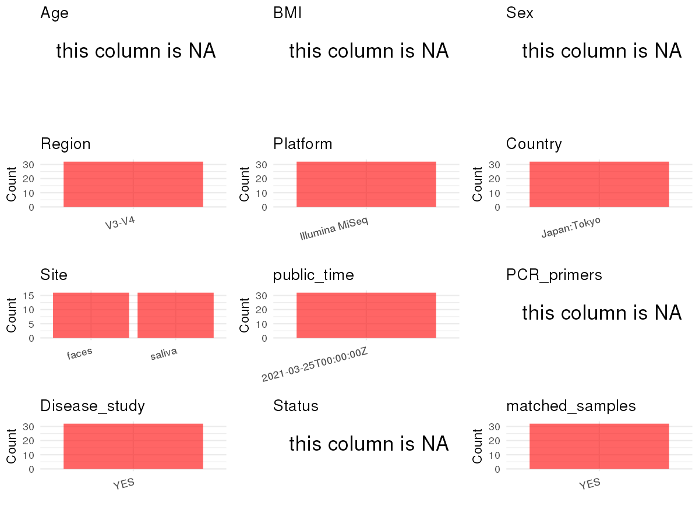

R Notebook: Metadata Processing Workflow
================

# Step 1: Obtain Initial Metadata from Each Project

To obtain the initial metadata: 1. Search for the BioProject ID (e.g.,
“PRJEBXXXX”) on the [NCBI SRA
website](https://www.ncbi.nlm.nih.gov/Traces/study/). 2. In the “Select”
table, click on “Metadata” and download the file. 3. The downloaded file
is typically named “SraRunTable.csv” and contains metadata for the
project.

``` r
# Load necessary libraries
library(dplyr)
library(ggplot2)
library(cowplot)
library(readxl)

# Set working directory (update this path to your local directory)
setwd("/home/dongbiao/word_embedding_microbiome/all_data/oral/global-oral-microbiome/data/projects/PRJDB8122")

# Read the initial metadata files
initial_meta<-read.csv("SraRunTable.csv")

head(initial_meta)
```

    ##         Run Assay.Type AvgSpotLen    Bases BioProject    BioSample
    ## 1 DRR173018   AMPLICON        500 62030500  PRJDB8122 SAMD00165180
    ## 2 DRR173019   AMPLICON        500 64030500  PRJDB8122 SAMD00165181
    ## 3 DRR173020   AMPLICON        500 61517000  PRJDB8122 SAMD00165182
    ## 4 DRR173021   AMPLICON        500 59886500  PRJDB8122 SAMD00165183
    ## 5 DRR173022   AMPLICON        500 51576500  PRJDB8122 SAMD00165184
    ## 6 DRR173023   AMPLICON        500 37786000  PRJDB8122 SAMD00165185
    ##             BioSampleModel    Bytes Center.Name Collection_Date Consent
    ## 1 MIMS.me.human-associated 29849718 TOKYO_MEDEN            2017  public
    ## 2 MIMS.me.human-associated 30764173 TOKYO_MEDEN            2017  public
    ## 3 MIMS.me.human-associated 29908706 TOKYO_MEDEN            2018  public
    ## 4 MIMS.me.human-associated 29272554 TOKYO_MEDEN            2018  public
    ## 5 MIMS.me.human-associated 26643787 TOKYO_MEDEN            2018  public
    ## 6 MIMS.me.human-associated 21436226 TOKYO_MEDEN            2018  public
    ##   DATASTORE.filetype DATASTORE.provider                     DATASTORE.region
    ## 1         run.zq,sra         gs,ncbi,s3 gs.us-east1,ncbi.public,s3.us-east-1
    ## 2         run.zq,sra         gs,ncbi,s3 gs.us-east1,ncbi.public,s3.us-east-1
    ## 3         run.zq,sra         gs,ncbi,s3 gs.us-east1,ncbi.public,s3.us-east-1
    ## 4         run.zq,sra         gs,ncbi,s3 gs.us-east1,ncbi.public,s3.us-east-1
    ## 5         run.zq,sra         gs,ncbi,s3 gs.us-east1,ncbi.public,s3.us-east-1
    ## 6         run.zq,sra         gs,ncbi,s3 gs.us-east1,ncbi.public,s3.us-east-1
    ##   env_broad_scale env_local_scale env_medium Experiment geo_loc_name_country
    ## 1  not applicable  not applicable      faces  DRX163629                Japan
    ## 2  not applicable  not applicable      faces  DRX163630                Japan
    ## 3  not applicable  not applicable      faces  DRX163631                Japan
    ## 4  not applicable  not applicable      faces  DRX163632                Japan
    ## 5  not applicable  not applicable      faces  DRX163633                Japan
    ## 6  not applicable  not applicable      faces  DRX163634                Japan
    ##   geo_loc_name_country_continent geo_loc_name         HOST     Instrument
    ## 1                           Asia  Japan:Tokyo Homo sapiens Illumina MiSeq
    ## 2                           Asia  Japan:Tokyo Homo sapiens Illumina MiSeq
    ## 3                           Asia  Japan:Tokyo Homo sapiens Illumina MiSeq
    ## 4                           Asia  Japan:Tokyo Homo sapiens Illumina MiSeq
    ## 5                           Asia  Japan:Tokyo Homo sapiens Illumina MiSeq
    ## 6                           Asia  Japan:Tokyo Homo sapiens Illumina MiSeq
    ##            lat_lon Library.Name LibraryLayout LibrarySelection LibrarySource
    ## 1 35.70 N 139.76 E           NA        PAIRED              PCR   METAGENOMIC
    ## 2 35.70 N 139.76 E           NA        PAIRED              PCR   METAGENOMIC
    ## 3 35.70 N 139.76 E           NA        PAIRED              PCR   METAGENOMIC
    ## 4 35.70 N 139.76 E           NA        PAIRED              PCR   METAGENOMIC
    ## 5 35.70 N 139.76 E           NA        PAIRED              PCR   METAGENOMIC
    ## 6 35.70 N 139.76 E           NA        PAIRED              PCR   METAGENOMIC
    ##               Organism Platform
    ## 1 human gut metagenome ILLUMINA
    ## 2 human gut metagenome ILLUMINA
    ## 3 human gut metagenome ILLUMINA
    ## 4 human gut metagenome ILLUMINA
    ## 5 human gut metagenome ILLUMINA
    ## 6 human gut metagenome ILLUMINA
    ##                                                project_name
    ## 1 Re-initiation of oral food intake and oral/gut microbiota
    ## 2 Re-initiation of oral food intake and oral/gut microbiota
    ## 3 Re-initiation of oral food intake and oral/gut microbiota
    ## 4 Re-initiation of oral food intake and oral/gut microbiota
    ## 5 Re-initiation of oral food intake and oral/gut microbiota
    ## 6 Re-initiation of oral food intake and oral/gut microbiota
    ##            ReleaseDate          create_date version  Sample.Name Sample_name
    ## 1 2021-03-25T00:00:00Z 2021-03-25T13:20:00Z       1 SAMD00165180         FT1
    ## 2 2021-03-25T00:00:00Z 2021-03-25T13:21:00Z       1 SAMD00165181         FT2
    ## 3 2021-03-25T00:00:00Z 2021-03-25T13:20:00Z       1 SAMD00165182         FT3
    ## 4 2021-03-25T00:00:00Z 2021-03-25T13:21:00Z       1 SAMD00165183         FT4
    ## 5 2021-03-25T00:00:00Z 2021-03-25T13:20:00Z       1 SAMD00165184         FT5
    ## 6 2021-03-25T00:00:00Z 2021-03-25T13:20:00Z       1 SAMD00165185         FT6
    ##   SRA.Study
    ## 1 DRP007079
    ## 2 DRP007079
    ## 3 DRP007079
    ## 4 DRP007079
    ## 5 DRP007079
    ## 6 DRP007079

# Step 2: Create a Uniform Metadata Template

The uniform metadata should include the following columns:

1.  **BioProject**: Project ID (e.g., “PRJNA339212”)
2.  **Run**: Sample ID (e.g., “ERRXXXXXX” or “SRRXXXXXX”)
3.  **sample_name**: Original sample name submitted by the authors (not
    the database-assigned ID)
4.  **Age**: Age of the subject (if available)
5.  **BMI**: Body Mass Index (if available)
6.  **Sex**: Sex of the subject (“F” or “M”)
7.  **Region**: Targeted 16S rRNA region (e.g., “V3-V4”)
8.  **Platform**: Sequencing platform (e.g., “Illumina MiSeq”)
9.  **Country**: Country of sample origin (e.g., “China”)
10. **Site**: Sample site (e.g., “saliva”, “dental plaque”)
11. **public_time**: Data release date (format: “YYYY-MM-DD”)
12. **PCR_primers**: PCR primers used (e.g., “515F-806R”)
13. **title**: Title of the associated publication
14. **Disease_study**: Whether the study involves a disease (“YES” or
    “NO”)
15. **Status**: Disease status (e.g., “T2DM”, “HC”). Note: If the study
    includes both disease and healthy samples, this must be specified
    per sample.

``` r
# Create a uniform metadata dataframe
metadata <- data.frame(
  BioProject = initial_meta$BioProject,
  Run = initial_meta$Run,
  sample_name = initial_meta$Sample_name,
  Age = NA,
  BMI = NA,
  Sex=NA,
  Region = "V3-V4",
  Platform = initial_meta$Instrument,
  Country = initial_meta$geo_loc_name,
  Site = initial_meta$env_medium,
  public_time = initial_meta$ReleaseDate,
  stringsAsFactors = FALSE
)
metadata<-unique(metadata)
```

# Step 3: Manually Add Information from the Publication

Some information (e.g. PCR primers, study title, disease status) must be
manually extracted from the publication and added to the metadata.

``` r
# Add information obtained from the publication
metadata$PCR_primers <- NA
metadata$title <- "Re-initiation of Oral Food Intake Following Enteral Nutrition Alters Oral and Gut Microbiota Communities"
metadata$Disease_study <- "YES"

# Assign disease status based on sample_name patterns
metadata$Status <- NA
metadata$matched_samples <- "YES"
```

# Step 4: Summarize and Validate the Metadata

``` r
# Check the number of unique runs and sample names
print(paste("Number of unique runs:", length(unique(metadata$Run))))
```

    ## [1] "Number of unique runs: 32"

``` r
print(paste("Number of unique sample names:", length(unique(metadata$sample_name))))
```

    ## [1] "Number of unique sample names: 32"

# Step 5: Visualize the Metadata

``` r

```


# Step 6: Finalize and Export the Metadata

``` r
# Reorder columns to match the desired format
metadata <- metadata[, c(
  "BioProject", "Run", "sample_name", "Age", "BMI", "Sex", 
  "Region", "Platform", "Country", "Site", "public_time", 
  "PCR_primers", "title", "Disease_study", "Status","matched_samples"
)]

# Export the uniform metadata to a CSV file
metadata<-unique(metadata)
write.csv(metadata, file = "metadata.csv", quote = FALSE)
head(metadata)
```

    ##   BioProject       Run sample_name Age BMI Sex Region       Platform
    ## 1  PRJDB8122 DRR173018         FT1  NA  NA  NA  V3-V4 Illumina MiSeq
    ## 2  PRJDB8122 DRR173019         FT2  NA  NA  NA  V3-V4 Illumina MiSeq
    ## 3  PRJDB8122 DRR173020         FT3  NA  NA  NA  V3-V4 Illumina MiSeq
    ## 4  PRJDB8122 DRR173021         FT4  NA  NA  NA  V3-V4 Illumina MiSeq
    ## 5  PRJDB8122 DRR173022         FT5  NA  NA  NA  V3-V4 Illumina MiSeq
    ## 6  PRJDB8122 DRR173023         FT6  NA  NA  NA  V3-V4 Illumina MiSeq
    ##       Country  Site          public_time PCR_primers
    ## 1 Japan:Tokyo faces 2021-03-25T00:00:00Z          NA
    ## 2 Japan:Tokyo faces 2021-03-25T00:00:00Z          NA
    ## 3 Japan:Tokyo faces 2021-03-25T00:00:00Z          NA
    ## 4 Japan:Tokyo faces 2021-03-25T00:00:00Z          NA
    ## 5 Japan:Tokyo faces 2021-03-25T00:00:00Z          NA
    ## 6 Japan:Tokyo faces 2021-03-25T00:00:00Z          NA
    ##                                                                                                      title
    ## 1 Re-initiation of Oral Food Intake Following Enteral Nutrition Alters Oral and Gut Microbiota Communities
    ## 2 Re-initiation of Oral Food Intake Following Enteral Nutrition Alters Oral and Gut Microbiota Communities
    ## 3 Re-initiation of Oral Food Intake Following Enteral Nutrition Alters Oral and Gut Microbiota Communities
    ## 4 Re-initiation of Oral Food Intake Following Enteral Nutrition Alters Oral and Gut Microbiota Communities
    ## 5 Re-initiation of Oral Food Intake Following Enteral Nutrition Alters Oral and Gut Microbiota Communities
    ## 6 Re-initiation of Oral Food Intake Following Enteral Nutrition Alters Oral and Gut Microbiota Communities
    ##   Disease_study Status matched_samples
    ## 1           YES     NA             YES
    ## 2           YES     NA             YES
    ## 3           YES     NA             YES
    ## 4           YES     NA             YES
    ## 5           YES     NA             YES
    ## 6           YES     NA             YES

## Notes for Students:

1.  **Metadata Accuracy**: Always cross-check the metadata with the
    original publication to ensure accuracy.
2.  **Manual Entries**: Columns like `PCR_primers`, and `Status` often
    require manual entry based on the publication.
3.  **Disease Status**: Be careful when assigning `Status`—some studies
    include both disease and healthy samples.
4.  **Visualization**: The plots help quickly identify the distribution
    of values in each column, which is useful for quality control.
5.  **Reproducibility**: Update the working directory and file paths to
    match your local environment.
