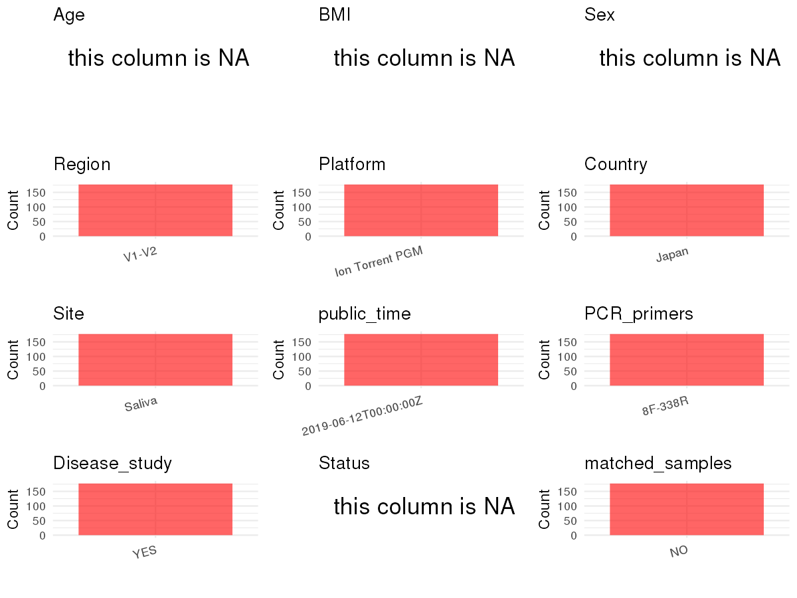

```{r}
# =============================================================
# Curation Notes - PRJDB8324
# subject_id : extracted from Sample_name column (last token, e.g. CAN_001)
# age        : not available in metadata; paper (Table 1) only reports group means (digestive tract cancer: 66.4±10.2, controls: 66.4±10.3)
# sex        : not available in metadata
# bmi        : not available in metadata
# platform   : Paper Methods — Ion Torrent PGM (Ion PGM); metadata Platform col = ION_TORRENT (consistent)
# region     : Paper Methods — V1-V2 (8F / 338R primers)
# pcr_primers: Paper Methods — 8F-338R
# site       : env_local_scale and env_medium both = "Saliva"; confirmed by paper (saliva samples)
# disease_study: "yes" — case-control study comparing digestive tract cancer patients vs. healthy controls
# status     : "digestive tract cancer" for samples collected 2015-2017 (CAN_001 to CAN_059), "healthy" for 2012 (CAN_060 to CAN_177); resolved via Collection_Date column
# is_time_series: "no" — single timepoint case-control design; each participant sampled once
# controls   : none in metadata (no control_column); lab/sequencing controls not deposited separately
# non-human  : none (all Organism = Homo sapiens)
# age_info   : NA — paper only provides group means±SD, no explicit age range given
# =============================================================
```

# Step 1: Obtain Initial Metadata from Each Project

```{r message=FALSE, warning=FALSE}
# Load libraries
library(dplyr)
library(ggplot2)
library(cowplot)

# (1) Setting working directory
# EDIT HERE: change project_id for each study
project_id <- "PRJDB8324"

base_dir <- "/home/dongbiao/word_embedding_microbiome/all_data/oral/global-oral-microbiome/data/projects"
setwd(file.path(base_dir, project_id))

# (2) Loading raw SRA metadata file
sra_file <- "SraRunTable.csv"
initial_meta <- read.csv(sra_file, header = TRUE)
```

# Step 2: Data Overview

```{r message=FALSE, warning=FALSE}
# (1) Paper: Kageyama et al. (2019) Front. Microbiol. 10:1780
# Case-control study; 59 digestive tract cancer patients + 118 matched control subjects; all saliva samples from Japan.
# DTC patient subgroups: tongue/pharyngeal (n=13), esophageal (n=12), gastric (n=10), colorectal (n=24).
# Platform: Ion PGM; primers 8F-338R; V1-V2 region.

# (2) Column overview
# head(initial_meta, 5)
# colnames(initial_meta)
# table(initial_meta$Organism)         # all Homo sapiens
# table(initial_meta$Platform)         # ION_TORRENT
# table(initial_meta$env_local_scale)  # Saliva
# table(initial_meta$env_medium)       # Saliva
# table(initial_meta$geo_loc_name_country) # Japan
# head(initial_meta$Sample_name)       # "16S amplicon analysis of oral microbiome CAN_001"
```

# Step 3: Removing Control and Non-human Samples

```{r}
# (1) Parameter setup
control_column <- ""        # no control column in metadata
control_keywords <- c()     # no control keywords

species_column <- "Organism"
# unique(initial_meta[[species_column]])  # all "Homo sapiens" or "human oral metagenome"
non_human_keywords <- c()   # all samples are human

# (2) Remove controls and non-human samples
n_samples <- nrow(initial_meta)
if (length(control_keywords) > 0) {
  if (is.null(control_column) || control_column == "") {
    stop("Error: control_keywords provided but control_column is missing.")
  }
  if (!(control_column %in% colnames(initial_meta))) {
    stop(sprintf("Error: Column '%s' not found in initial_meta.", control_column))
  }
  control_pattern <- paste(control_keywords, collapse = "|")
  control_text <- initial_meta[[control_column]]
  is_control <- grepl(control_pattern, control_text)
} else {
  is_control <- rep(FALSE, n_samples)
}

if (length(non_human_keywords) > 0) {
  if (is.null(species_column) || species_column == "") {
    stop("Error: non_human_keywords provided but species_column is missing.")
  }
  if (!(species_column %in% colnames(initial_meta))) {
    stop(sprintf("Error: Column '%s' not found in initial_meta.", species_column))
  }
  non_human_pattern <- paste(non_human_keywords, collapse = "|")
  species_text <- initial_meta[[species_column]]
  is_non_human <- grepl(non_human_pattern, species_text)
} else {
  is_non_human <- rep(FALSE, n_samples)
}

samples_to_remove <- is_control | is_non_human
initial_meta <- initial_meta[!samples_to_remove, ]

cat("Initial samples counts:", n_samples, "\n")
cat("Removed control samples:", sum(is_control), "\n")
cat("Removed non-human samples:", sum(is_non_human), "\n")
cat("Total samples removed:", sum(samples_to_remove), "\n")
cat("Remaining samples after Step 3:", nrow(initial_meta), "\n")
```

# Step 4: Creating a Uniform Metadata Template

```{r}
metadata <- data.frame(
  bioproject = initial_meta$BioProject,
  sample_id = initial_meta$Run,
  # subject_id: extracted from Sample_name last token (e.g. "CAN_001")
  subject_id = sub(".*\\s(\\S+)$", "\\1", initial_meta$Sample_name),
  age = NA,
  age_info = NA,   # paper only reports group means±SD (digestive tract cancer: 66.4±10.2, controls: 66.4±10.3)
  bmi = NA,
  sex = NA,
  sequencing_region = "V1-V2",  # paper Methods: "V1-V2 regions of 16S rRNA gene"
  platform = "Ion Torrent PGM", # paper Methods: Ion PGM (Thermo Fisher Scientific)
  country = initial_meta$geo_loc_name_country,
  site = "saliva",              # env_local_scale/env_medium = Saliva; confirmed by paper
  site_group = "oral",
  public_time = initial_meta$ReleaseDate,
  pcr_primers = "8F-338R",      # paper Methods: 8F and 338R primers for V1-V2
  title = "Characteristics of the Salivary Microbiota in Patients With Various Digestive Tract Cancers",
  disease_study = "yes",        # case-control study comparing digestive tract cancer patients to healthy controls
  status = ifelse(as.integer(substr(initial_meta$Collection_Date, 1, 4)) >= 2015, "digestive tract cancer", "healthy"),
  matched_samples = "pending",
  is_time_series = "no",        # single timepoint per subject; case-control cross-sectional design
  stringsAsFactors = FALSE
)
metadata$public_time <- as.Date(metadata$public_time)
```

# Step 5: Manually solving pending issues

```{r}
# (1) No raw_ columns requiring conversion in this dataset.
```

```{r}
# (2) Filling 'site_group' and 'matched_samples'
unique(metadata$site)
Oral_site = c("saliva")
Gut_site = c()

metadata <- metadata %>%
  mutate(site_group = case_when(
    site %in% Oral_site ~ "oral",
    site %in% Gut_site ~ "gut",
    TRUE ~ "other"
  ))

metadata$matched_samples <- ifelse(
  ave(metadata$subject_id, metadata$subject_id, FUN = length) > 1,
  "yes", "no"
)
```

```{r}
# (3) Check for pending values
has_pending <- function(col) {
  if (is.character(col) || is.factor(col)) {
    any(col == "pending", na.rm = TRUE)
  } else {
    FALSE
  }
}

any_pending_value <- any(sapply(metadata, has_pending))

if (!any_pending_value) {
  message("Good! No cell contains the value 'pending'.")
} else {
  pending_cols <- names(metadata)[sapply(metadata, has_pending)]
  message("Columns containing 'pending': ", paste(pending_cols, collapse = ", "))
  message("Please continue to resolve these pending columns!")
}
```

# Step 6: Visualize the Metadata

```{r}
plot_data <- metadata %>%
  select(-bioproject, -sample_id, -subject_id, -title)

create_simple_plots <- function(data) {
  plots <- list()
  continuous_vars <- c("age", "bmi")

  for (col in colnames(data)) {
    if (all(is.na(data[[col]]))) {
      p <- ggplot() +
        annotate("text", x = 0.5, y = 0.5, label = "this column is NA", size = 6) +
        labs(title = col) +
        theme_void()
    } else if (col %in% continuous_vars && is.numeric(data[[col]])) {
      p <- ggplot(data, aes(x = .data[[col]])) +
        geom_histogram(fill = "blue", alpha = 0.6, bins = 20, na.rm = TRUE) +
        labs(title = col, x = col, y = "Count") +
        theme_minimal()
    } else {
      count_data <- as.data.frame(table(data[[col]], useNA = "ifany"))
      p <- ggplot(count_data, aes(x = reorder(Var1, -Freq), y = Freq)) +
        geom_col(fill = "red", alpha = 0.6) +
        labs(title = col, x = NULL, y = "Count") +
        theme_minimal() +
        theme(axis.text.x = element_text(angle = 15, hjust = 1))
    }
    plots[[col]] <- p
  }
  return(plots)
}

plots <- create_simple_plots(plot_data)
p <- plot_grid(plots$age,
               plots$age_info,
               plots$bmi,
               plots$sex,
               plots$site,
               plots$site_group,
               plots$sequencing_region,
               plots$platform,
               plots$country,
               plots$pcr_primers,
               plots$status,
               plots$matched_samples,
               ncol = 3, align = "hv", axis = "lb")
ggsave("Metadata_Summary.png", plot = p, width = 8, height = 6, dpi = 150)
```

```{r}

```

# Step 7: Sort and export the metadata

```{r}
fixed_cols <- c("bioproject", "sample_id", "subject_id", "age", "age_info",
                "bmi", "sex", "platform", "sequencing_region", "pcr_primers",
                "country", "site", "site_group", "disease_study", "status",
                "title", "public_time", "matched_samples", "is_time_series")
metadata <- metadata %>%
  select(all_of(fixed_cols), everything())

# head(metadata)
write.csv(metadata, file = "metadata_v2.csv", quote = TRUE)
```
