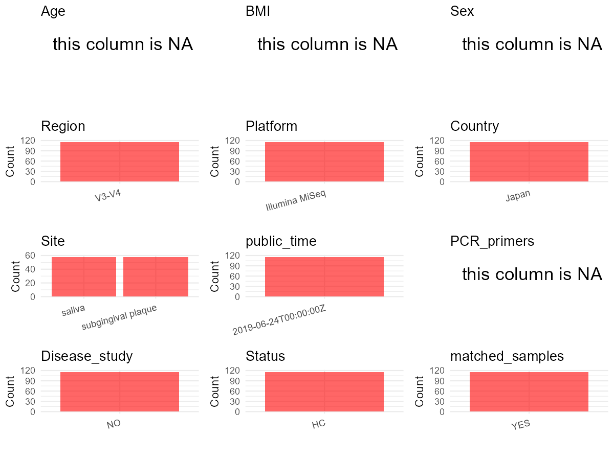

R Notebook: Metadata Processing Workflow
================

# Step 1: Obtain Initial Metadata from Each Project

To obtain the initial metadata: 1. Search for the BioProject ID (e.g.,
“PRJEBXXXX”) on the [NCBI SRA
website](https://www.ncbi.nlm.nih.gov/Traces/study/). 2. In the “Select”
table, click on “Metadata” and download the file. 3. The downloaded file
is typically named “SraRunTable.csv” and contains metadata for the
project.

``` r
# Load necessary libraries
library(dplyr)
library(ggplot2)
library(cowplot)

# Set working directory (update this path to your local directory)
setwd("E:/bioproject_YSD/PRJDB8487")

# Read the initial metadata files
initial_meta <- read.csv("SraRunTable.csv", header = T)

# Remove entries non-oral samples
initial_meta <- initial_meta[initial_meta$env_medium != "feces", ]

# Display the first few rows of the metadata
head(initial_meta)
```

    ##          Run Assay.Type AvgSpotLen    Bases BioProject    BioSample
    ## 60 DRR182732   AMPLICON        556 21691784  PRJDB8487 SAMD00176904
    ## 61 DRR182733   AMPLICON        555 19616514  PRJDB8487 SAMD00176905
    ## 62 DRR182734   AMPLICON        555 19560358  PRJDB8487 SAMD00176906
    ## 63 DRR182735   AMPLICON        555 15394806  PRJDB8487 SAMD00176907
    ## 64 DRR182736   AMPLICON        555 21535270  PRJDB8487 SAMD00176908
    ## 65 DRR182737   AMPLICON        555 17432268  PRJDB8487 SAMD00176909
    ##       BioSampleModel    Bytes Center.Name Collection_Date Consent
    ## 60 MIMS.me.human-gut 14357560    MORINAGA            2016  public
    ## 61 MIMS.me.human-gut 13116926    MORINAGA            2016  public
    ## 62 MIMS.me.human-gut 13040711    MORINAGA            2016  public
    ## 63 MIMS.me.human-gut 10124181    MORINAGA            2016  public
    ## 64 MIMS.me.human-gut 14404848    MORINAGA            2016  public
    ## 65 MIMS.me.human-gut 11561983    MORINAGA            2016  public
    ##    DATASTORE.filetype DATASTORE.provider                     DATASTORE.region
    ## 60         run.zq,sra         gs,ncbi,s3 gs.us-east1,ncbi.public,s3.us-east-1
    ## 61         run.zq,sra         gs,ncbi,s3 gs.us-east1,ncbi.public,s3.us-east-1
    ## 62         run.zq,sra         gs,ncbi,s3 gs.us-east1,ncbi.public,s3.us-east-1
    ## 63         run.zq,sra         gs,ncbi,s3 gs.us-east1,ncbi.public,s3.us-east-1
    ## 64         run.zq,sra         gs,ncbi,s3 gs.us-east1,ncbi.public,s3.us-east-1
    ## 65         run.zq,sra         gs,ncbi,s3 gs.us-east1,ncbi.public,s3.us-east-1
    ##    env_broad_scale env_local_scale env_medium Experiment geo_loc_name_country
    ## 60  not applicable  not applicable     plaque  DRX173238                Japan
    ## 61  not applicable  not applicable     plaque  DRX173239                Japan
    ## 62  not applicable  not applicable     plaque  DRX173240                Japan
    ## 63  not applicable  not applicable     plaque  DRX173241                Japan
    ## 64  not applicable  not applicable     plaque  DRX173242                Japan
    ## 65  not applicable  not applicable     plaque  DRX173243                Japan
    ##    geo_loc_name_country_continent geo_loc_name         HOST host_subject_id
    ## 60                           Asia        Japan Homo sapiens adult subject 1
    ## 61                           Asia        Japan Homo sapiens adult subject 2
    ## 62                           Asia        Japan Homo sapiens adult subject 3
    ## 63                           Asia        Japan Homo sapiens adult subject 4
    ## 64                           Asia        Japan Homo sapiens adult subject 5
    ## 65                           Asia        Japan Homo sapiens adult subject 6
    ##        Instrument lat_lon Library.Name LibraryLayout LibrarySelection
    ## 60 Illumina MiSeq missing           NA        PAIRED              PCR
    ## 61 Illumina MiSeq missing           NA        PAIRED              PCR
    ## 62 Illumina MiSeq missing           NA        PAIRED              PCR
    ## 63 Illumina MiSeq missing           NA        PAIRED              PCR
    ## 64 Illumina MiSeq missing           NA        PAIRED              PCR
    ## 65 Illumina MiSeq missing           NA        PAIRED              PCR
    ##    LibrarySource              Organism Platform              project_name
    ## 60       GENOMIC human oral metagenome ILLUMINA Oral_and_Fecal_microbiota
    ## 61       GENOMIC human oral metagenome ILLUMINA Oral_and_Fecal_microbiota
    ## 62       GENOMIC human oral metagenome ILLUMINA Oral_and_Fecal_microbiota
    ## 63       GENOMIC human oral metagenome ILLUMINA Oral_and_Fecal_microbiota
    ## 64       GENOMIC human oral metagenome ILLUMINA Oral_and_Fecal_microbiota
    ## 65       GENOMIC human oral metagenome ILLUMINA Oral_and_Fecal_microbiota
    ##             ReleaseDate          create_date version  Sample.Name sample_name
    ## 60 2019-06-24T00:00:00Z 2019-06-24T18:17:00Z       1 SAMD00176904        PA01
    ## 61 2019-06-24T00:00:00Z 2019-06-24T18:16:00Z       1 SAMD00176905        PA02
    ## 62 2019-06-24T00:00:00Z 2019-06-24T18:16:00Z       1 SAMD00176906        PA03
    ## 63 2019-06-24T00:00:00Z 2019-06-24T18:15:00Z       1 SAMD00176907        PA04
    ## 64 2019-06-24T00:00:00Z 2019-06-24T18:16:00Z       1 SAMD00176908        PA05
    ## 65 2019-06-24T00:00:00Z 2019-06-24T18:15:00Z       1 SAMD00176909        PA06
    ##    SRA.Study
    ## 60 DRP005188
    ## 61 DRP005188
    ## 62 DRP005188
    ## 63 DRP005188
    ## 64 DRP005188
    ## 65 DRP005188

# Step 2: Create a Uniform Metadata Template

The uniform metadata should include the following columns:

1.  **BioProject**: Project ID (e.g., “PRJNA339212”)
2.  **Run**: Sample ID (e.g., “ERRXXXXXX” or “SRRXXXXXX”)
3.  **sample_name**: Original sample name submitted by the authors (not
    the database-assigned ID)
4.  **Age**: Age of the subject (if available)
5.  **BMI**: Body Mass Index (if available)
6.  **Sex**: Sex of the subject (“F” or “M”)
7.  **Region**: Targeted 16S rRNA region (e.g., “V3-V4”)
8.  **Platform**: Sequencing platform (e.g., “Illumina MiSeq”)
9.  **Country**: Country of sample origin (e.g., “China”)
10. **Site**: Sample site (e.g., “saliva”, “dental plaque”)
11. **public_time**: Data release date (format: “YYYY-MM-DD”)
12. **PCR_primers**: PCR primers used (e.g., “515F-806R”)
13. **title**: Title of the associated publication
14. **Disease_study**: Whether the study involves a disease (“YES” or
    “NO”)
15. **Status**: Disease status (e.g., “T2DM”, “HC”). Note: If the study
    includes both disease and healthy samples, this must be specified
    per sample.
16. **matched_samples**: matched samples (“YES” or “NO”)

``` r
# Create a uniform metadata dataframe
metadata <- data.frame(
  BioProject = initial_meta$BioProject,
  Run = initial_meta$Run,
  sample_name = initial_meta$sample_name,
  Age = NA,
  BMI = NA,  
  Sex = NA,
  Region = "V3-V4",
  Platform = initial_meta$Instrument,
  Country = initial_meta$geo_loc_name_country,
  Site = initial_meta$env_medium,
  public_time = initial_meta$ReleaseDate,
  stringsAsFactors = FALSE
)

# Add the prefix subgingival to all plaque values in the site column
metadata <- metadata %>%
  mutate(Site = case_when(
      Site == "plaque" ~ paste("subgingival", Site),
      TRUE ~ Site))
```

# Step 3: Manually Add Information from the Publication

Some information (e.g. PCR primers, study title, disease status) must be
manually extracted from the publication and added to the metadata.

``` r
# Add information obtained from the publication
metadata$PCR_primers <- NA
metadata$title <- "Relationship between oral and gut microbiota in elderly people"
metadata$Disease_study <- "NO"
# Assign disease status based on sample_name patterns
metadata$Status<-"HC"

#extract subject id by remove prefix of sample_name
metadata$sample_name <- gsub("P|T", "", metadata$sample_name)

# Check initial data distribution
cat("Initial sample distribution:\n")
```

    ## Initial sample distribution:

``` r
table(metadata$sample_name)
```

    ## 
    ## A01 A02 A03 A04 A05 A06 A07 A08 A09 A10 A11 A12 A13 A14 A15 A16 A17 A18 A19 A20 
    ##   2   2   2   2   2   2   2   2   2   2   2   2   2   2   2   2   2   2   2   2 
    ## A21 A22 A23 A24 A25 A27 A28 A29 A30 E01 E02 E03 E04 E05 E06 E07 E08 E09 E10 E11 
    ##   2   2   2   2   2   2   2   2   2   2   2   2   2   2   2   2   2   2   2   2 
    ## E12 E13 E14 E15 E16 E17 E18 E19 E20 E21 E22 E23 E24 E25 E26 E27 E28 E30 
    ##   2   2   2   2   2   2   2   2   2   2   2   2   2   2   2   2   2   2

``` r
table(metadata$Site)
```

    ## 
    ##             saliva subgingival plaque 
    ##                 58                 58

``` r
# Calculate sampling frequency per subject
sample_counts <- table(metadata$sample_name)
cat("\nNumber of samples per subject:\n")
```

    ## 
    ## Number of samples per subject:

``` r
print(sample_counts)
```

    ## 
    ## A01 A02 A03 A04 A05 A06 A07 A08 A09 A10 A11 A12 A13 A14 A15 A16 A17 A18 A19 A20 
    ##   2   2   2   2   2   2   2   2   2   2   2   2   2   2   2   2   2   2   2   2 
    ## A21 A22 A23 A24 A25 A27 A28 A29 A30 E01 E02 E03 E04 E05 E06 E07 E08 E09 E10 E11 
    ##   2   2   2   2   2   2   2   2   2   2   2   2   2   2   2   2   2   2   2   2 
    ## E12 E13 E14 E15 E16 E17 E18 E19 E20 E21 E22 E23 E24 E25 E26 E27 E28 E30 
    ##   2   2   2   2   2   2   2   2   2   2   2   2   2   2   2   2   2   2

``` r
# Create matched_samples column
metadata$matched_samples <- ifelse(metadata$sample_name %in% names(sample_counts[sample_counts >= 2]), "YES", "NO")

cat("\nMatched samples distribution:\n")
```

    ## 
    ## Matched samples distribution:

``` r
table(metadata$matched_samples)
```

    ## 
    ## YES 
    ## 116

``` r
# Identify samples for removal: single samples excluding saliva and subgingival plaque
single_samples <- names(sample_counts[sample_counts == 1])
samples_to_remove <- metadata$sample_name %in% single_samples & 
                     !(metadata$Site %in% c("saliva", "subgingival plaque"))

cat("\nNumber of samples to be removed:", sum(samples_to_remove), "\n")
```

    ## 
    ## Number of samples to be removed: 0

``` r
# Remove identified samples
metadata_clean <- metadata[!samples_to_remove, ]

cat("\nFinal sample distribution after cleaning:\n")
```

    ## 
    ## Final sample distribution after cleaning:

``` r
table(metadata_clean$sample_name)
```

    ## 
    ## A01 A02 A03 A04 A05 A06 A07 A08 A09 A10 A11 A12 A13 A14 A15 A16 A17 A18 A19 A20 
    ##   2   2   2   2   2   2   2   2   2   2   2   2   2   2   2   2   2   2   2   2 
    ## A21 A22 A23 A24 A25 A27 A28 A29 A30 E01 E02 E03 E04 E05 E06 E07 E08 E09 E10 E11 
    ##   2   2   2   2   2   2   2   2   2   2   2   2   2   2   2   2   2   2   2   2 
    ## E12 E13 E14 E15 E16 E17 E18 E19 E20 E21 E22 E23 E24 E25 E26 E27 E28 E30 
    ##   2   2   2   2   2   2   2   2   2   2   2   2   2   2   2   2   2   2

``` r
table(metadata_clean$Site)
```

    ## 
    ##             saliva subgingival plaque 
    ##                 58                 58

``` r
table(metadata_clean$matched_samples)
```

    ## 
    ## YES 
    ## 116

``` r
# Use cleaned dataset for subsequent analysis
metadata <- metadata_clean
```

# Step 4: Summarize and Validate the Metadata

``` r
# Check the number of unique runs and sample names
print(paste("Number of unique runs:", length(unique(metadata$Run))))
```

    ## [1] "Number of unique runs: 116"

``` r
print(paste("Number of unique sample names:", length(unique(metadata$sample_name))))
```

    ## [1] "Number of unique sample names: 58"

# Step 5: Visualize the Metadata

``` r

```


# Step 6: Finalize and Export the Metadata

``` r
# Reorder columns to match the desired format
metadata <- metadata[, c(
  "BioProject", "Run", "sample_name", "Age", "BMI", "Sex", 
  "Region", "Platform", "Country", "Site", "public_time", 
  "PCR_primers", "title", "Disease_study", "Status", "matched_samples"
)]

# Export the uniform metadata to a CSV file
write.csv(metadata, file = "metadata.csv", quote = TRUE)
head(metadata)
```

    ##   BioProject       Run sample_name Age BMI Sex Region       Platform Country
    ## 1  PRJDB8487 DRR182732         A01  NA  NA  NA  V3-V4 Illumina MiSeq   Japan
    ## 2  PRJDB8487 DRR182733         A02  NA  NA  NA  V3-V4 Illumina MiSeq   Japan
    ## 3  PRJDB8487 DRR182734         A03  NA  NA  NA  V3-V4 Illumina MiSeq   Japan
    ## 4  PRJDB8487 DRR182735         A04  NA  NA  NA  V3-V4 Illumina MiSeq   Japan
    ## 5  PRJDB8487 DRR182736         A05  NA  NA  NA  V3-V4 Illumina MiSeq   Japan
    ## 6  PRJDB8487 DRR182737         A06  NA  NA  NA  V3-V4 Illumina MiSeq   Japan
    ##                 Site          public_time PCR_primers
    ## 1 subgingival plaque 2019-06-24T00:00:00Z          NA
    ## 2 subgingival plaque 2019-06-24T00:00:00Z          NA
    ## 3 subgingival plaque 2019-06-24T00:00:00Z          NA
    ## 4 subgingival plaque 2019-06-24T00:00:00Z          NA
    ## 5 subgingival plaque 2019-06-24T00:00:00Z          NA
    ## 6 subgingival plaque 2019-06-24T00:00:00Z          NA
    ##                                                            title Disease_study
    ## 1 Relationship between oral and gut microbiota in elderly people            NO
    ## 2 Relationship between oral and gut microbiota in elderly people            NO
    ## 3 Relationship between oral and gut microbiota in elderly people            NO
    ## 4 Relationship between oral and gut microbiota in elderly people            NO
    ## 5 Relationship between oral and gut microbiota in elderly people            NO
    ## 6 Relationship between oral and gut microbiota in elderly people            NO
    ##   Status matched_samples
    ## 1     HC             YES
    ## 2     HC             YES
    ## 3     HC             YES
    ## 4     HC             YES
    ## 5     HC             YES
    ## 6     HC             YES

## Notes for Students:

1.  **Metadata Accuracy**: Always cross-check the metadata with the
    original publication to ensure accuracy.
2.  **Manual Entries**: Columns like `PCR_primers`, and `Status` often
    require manual entry based on the publication.
3.  **Disease Status**: Be careful when assigning `Status`—some studies
    include both disease and healthy samples.
4.  **Visualization**: The plots help quickly identify the distribution
    of values in each column, which is useful for quality control.
5.  **Reproducibility**: Update the working directory and file paths to
    match your local environment.
