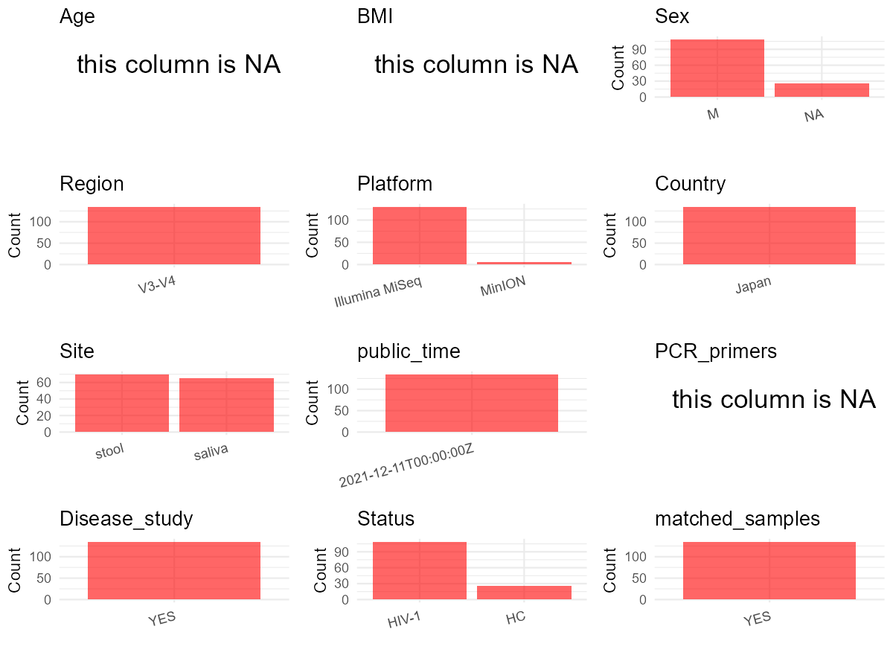

R Notebook: Metadata Processing Workflow
================

# Step 1: Obtain Initial Metadata from Each Project

To obtain the initial metadata: 1. Search for the BioProject ID (e.g.,
“PRJEBXXXX”) on the [NCBI SRA
website](https://www.ncbi.nlm.nih.gov/Traces/study/). 2. In the “Select”
table, click on “Metadata” and download the file. 3. The downloaded file
is typically named “SraRunTable.csv” and contains metadata for the
project.

``` r
# Load necessary libraries
library(dplyr)
library(ggplot2)
library(cowplot)

# Set working directory (update this path to your local directory)
setwd("D:/oral_project/PRJDB9093")

# Read the initial metadata files
initial_meta<-read.csv("SraRunTable.csv",header = T)

# Combine the two metadata files
#meta <- rbind(initial_meta, initial_meta1)

#Remove entries non-oral samples
#initial_meta <- subset(initial_meta,isolate %in% c("saliva","tongue coat"))

# Check the number of samples containing "HT" in Sample.Name (e.g., healthy controls)
#nrow(subset(meta, grepl("HT", Sample.Name)))

# Display the first few rows of the metadata
head(initial_meta)
```

    ##         Run Assay.Type AvgSpotLen     Bases BioProject    BioSample
    ## 1 DRR201342   AMPLICON        597 638409528  PRJDB9093 SAMD00197681
    ## 2 DRR201343   AMPLICON        597 857813031  PRJDB9093 SAMD00197682
    ## 3 DRR201344   AMPLICON        597 690099715  PRJDB9093 SAMD00197683
    ## 4 DRR201345   AMPLICON        597 439780001  PRJDB9093 SAMD00197684
    ## 5 DRR201346   AMPLICON        597 368968386  PRJDB9093 SAMD00197685
    ## 6 DRR201347   AMPLICON        597 636782401  PRJDB9093 SAMD00197686
    ##             BioSampleModel     Bytes Center.Name Collection_Date Consent
    ## 1 MIMS.me.human-associated 459955945  NAGOYA_MED            2014  public
    ## 2 MIMS.me.human-associated 599902004  NAGOYA_MED            2014  public
    ## 3 MIMS.me.human-associated 479217024  NAGOYA_MED            2014  public
    ## 4 MIMS.me.human-associated 313125943  NAGOYA_MED            2014  public
    ## 5 MIMS.me.human-associated 261656992  NAGOYA_MED            2014  public
    ## 6 MIMS.me.human-associated 443797162  NAGOYA_MED            2014  public
    ##   DATASTORE.filetype DATASTORE.provider                     DATASTORE.region
    ## 1         run.zq,sra         gs,ncbi,s3 gs.us-east1,ncbi.public,s3.us-east-1
    ## 2         run.zq,sra         gs,ncbi,s3 gs.us-east1,ncbi.public,s3.us-east-1
    ## 3         run.zq,sra         gs,ncbi,s3 gs.us-east1,ncbi.public,s3.us-east-1
    ## 4         run.zq,sra         gs,ncbi,s3 gs.us-east1,ncbi.public,s3.us-east-1
    ## 5         run.zq,sra         gs,ncbi,s3 gs.us-east1,ncbi.public,s3.us-east-1
    ## 6         run.zq,sra         gs,ncbi,s3 gs.us-east1,ncbi.public,s3.us-east-1
    ##   env_broad_scale env_local_scale     env_medium Experiment
    ## 1  not applicable  not applicable not applicable  DRX191742
    ## 2  not applicable  not applicable not applicable  DRX191743
    ## 3  not applicable  not applicable not applicable  DRX191744
    ## 4  not applicable  not applicable not applicable  DRX191745
    ## 5  not applicable  not applicable not applicable  DRX191746
    ## 6  not applicable  not applicable not applicable  DRX191747
    ##   geo_loc_name_country geo_loc_name_country_continent geo_loc_name         HOST
    ## 1                Japan                           Asia Japan:Nagoya Homo sapiens
    ## 2                Japan                           Asia Japan:Nagoya Homo sapiens
    ## 3                Japan                           Asia Japan:Nagoya Homo sapiens
    ## 4                Japan                           Asia Japan:Nagoya Homo sapiens
    ## 5                Japan                           Asia Japan:Nagoya Homo sapiens
    ## 6                Japan                           Asia Japan:Nagoya Homo sapiens
    ##       Instrument        lat_lon Library.Name LibraryLayout LibrarySelection
    ## 1 Illumina MiSeq not applicable           NA        PAIRED              PCR
    ## 2 Illumina MiSeq not applicable           NA        PAIRED              PCR
    ## 3 Illumina MiSeq not applicable           NA        PAIRED              PCR
    ## 4 Illumina MiSeq not applicable           NA        PAIRED              PCR
    ## 5 Illumina MiSeq not applicable           NA        PAIRED              PCR
    ## 6 Illumina MiSeq not applicable           NA        PAIRED              PCR
    ##   LibrarySource             Organism Platform
    ## 1   METAGENOMIC human gut metagenome ILLUMINA
    ## 2   METAGENOMIC human gut metagenome ILLUMINA
    ## 3   METAGENOMIC human gut metagenome ILLUMINA
    ## 4   METAGENOMIC human gut metagenome ILLUMINA
    ## 5   METAGENOMIC human gut metagenome ILLUMINA
    ## 6   METAGENOMIC human gut metagenome ILLUMINA
    ##                                     project_name          ReleaseDate
    ## 1 Microbiome of Japanese HIV-1-infected patients 2021-12-11T00:00:00Z
    ## 2 Microbiome of Japanese HIV-1-infected patients 2021-12-11T00:00:00Z
    ## 3 Microbiome of Japanese HIV-1-infected patients 2021-12-11T00:00:00Z
    ## 4 Microbiome of Japanese HIV-1-infected patients 2021-12-11T00:00:00Z
    ## 5 Microbiome of Japanese HIV-1-infected patients 2021-12-11T00:00:00Z
    ## 6 Microbiome of Japanese HIV-1-infected patients 2021-12-11T00:00:00Z
    ##            create_date version  Sample.Name Sample_name SRA.Study
    ## 1 2021-12-11T16:36:00Z       1 SAMD00197681  HD01_stool DRP007971
    ## 2 2021-12-11T16:37:00Z       1 SAMD00197682  HD02_stool DRP007971
    ## 3 2021-12-11T16:36:00Z       1 SAMD00197683  HD03_stool DRP007971
    ## 4 2021-12-11T16:36:00Z       1 SAMD00197684  HD04_stool DRP007971
    ## 5 2021-12-11T16:34:00Z       1 SAMD00197685  HD05_stool DRP007971
    ## 6 2021-12-11T16:37:00Z       1 SAMD00197686  HD06_stool DRP007971

# Step 2: Create a Uniform Metadata Template

The uniform metadata should include the following columns:

1.  **BioProject**: Project ID (e.g., “PRJNA339212”)
2.  **Run**: Sample ID (e.g., “ERRXXXXXX” or “SRRXXXXXX”)
3.  **sample_name**: Original sample name submitted by the authors (not
    the database-assigned ID)
4.  **Age**: Age of the subject (if available)
5.  **BMI**: Body Mass Index (if available)
6.  **Sex**: Sex of the subject (“F” or “M”)
7.  **Region**: Targeted 16S rRNA region (e.g., “V3-V4”)
8.  **Platform**: Sequencing platform (e.g., “Illumina MiSeq”)
9.  **Country**: Country of sample origin (e.g., “China”)
10. **Site**: Sample site (e.g., “saliva”, “dental plaque”)
11. **public_time**: Data release date (format: “YYYY-MM-DD”)
12. **PCR_primers**: PCR primers used (e.g., “515F-806R”)
13. **title**: Title of the associated publication
14. **Disease_study**: Whether the study involves a disease (“YES” or
    “NO”)
15. **Status**: Disease status (e.g., “T2DM”, “HC”). Note: If the study
    includes both disease and healthy samples, this must be specified
    per sample.
16. **matched_samples**: matched samples (“YES” or “NO”)

``` r
# Create a uniform metadata dataframe
metadata <- data.frame(
  BioProject = initial_meta$BioProject,
  Run = initial_meta$Run,
  sample_name = initial_meta$Sample_name,
  Age = NA,
  BMI = NA,
  #Sex = NA,
  Region = "V3-V4",
  Platform = initial_meta$Instrument,
  Country = initial_meta$geo_loc_name_country,
  #Site = initial_meta$isolate,
  public_time = initial_meta$ReleaseDate,
  stringsAsFactors = FALSE
)
```

``` r
metadata <- metadata %>%
  mutate(
    Sex = case_when(
      grepl("MB", sample_name) ~ "M",  # 如果样本名称包含"A"，则性别为"F"（女性）
      TRUE ~ NA_character_  # 其他所有情况，性别也设为NA
    )
  )
```

# Step 3: Manually Add Information from the Publication

Some information (e.g. PCR primers, study title, disease status) must be
manually extracted from the publication and added to the metadata.

``` r
#get subjects id according to sample id
metadata<-metadata%>%
  mutate(Site=case_when(grepl("saliva",sample_name)~"saliva",grepl("stool",sample_name)~"stool"))

# Add information obtained from the publication
metadata$PCR_primers <- NA
metadata$title <- "Impact of long-term antiretroviral therapy on gut and oral microbiotas in HIV-1-infected patients"
metadata$Disease_study <- "YES"
# Assign disease status based on sample_name patterns
metadata <- metadata %>%
  mutate(Status = case_when(
    grepl("HD", sample_name) ~ "HC",
    grepl("MB", sample_name) ~ "HIV-1"
  ))

#get subjects id according to sample id
metadata$sample_name<-gsub("_stool|_saliva","",metadata$sample_name)
#get subjects id with Saliva available
keep_subjects<-subset(metadata,Site %in% "saliva")
#remove subjects without Saliva samples
metadata<-subset(metadata,sample_name %in% keep_subjects$sample_name)
#get subjects sampling counts
sample_counts <- table(metadata$sample_name)
# Create matched_samples column, any subjects have >=2 samples will be label "YES", otherwise "NO"
metadata$matched_samples <- ifelse(metadata$sample_name %in% names(sample_counts[sample_counts >= 2]), "YES", "NO")
```

# Step 4: Summarize and Validate the Metadata

``` r
# Check the number of unique runs and sample names
print(paste("Number of unique runs:", length(unique(metadata$Run))))
```

    ## [1] "Number of unique runs: 135"

``` r
print(paste("Number of unique sample names:", length(unique(metadata$sample_name))))
```

    ## [1] "Number of unique sample names: 65"

# Step 5: Visualize the Metadata

``` r

```


# Step 6: Finalize and Export the Metadata

``` r
# Reorder columns to match the desired format
metadata <- metadata[, c(
  "BioProject", "Run", "sample_name", "Age", "BMI", "Sex", 
  "Region", "Platform", "Country", "Site", "public_time", 
  "PCR_primers", "title", "Disease_study", "Status","matched_samples"
)]

# Export the uniform metadata to a CSV file
write.csv(metadata, file = "metadata.csv", quote = TRUE)
head(metadata)
```

    ##   BioProject       Run sample_name Age BMI  Sex Region       Platform Country
    ## 1  PRJDB9093 DRR201342        HD01  NA  NA <NA>  V3-V4 Illumina MiSeq   Japan
    ## 2  PRJDB9093 DRR201343        HD02  NA  NA <NA>  V3-V4 Illumina MiSeq   Japan
    ## 3  PRJDB9093 DRR201344        HD03  NA  NA <NA>  V3-V4 Illumina MiSeq   Japan
    ## 4  PRJDB9093 DRR201345        HD04  NA  NA <NA>  V3-V4 Illumina MiSeq   Japan
    ## 5  PRJDB9093 DRR201346        HD05  NA  NA <NA>  V3-V4 Illumina MiSeq   Japan
    ## 6  PRJDB9093 DRR201347        HD06  NA  NA <NA>  V3-V4 Illumina MiSeq   Japan
    ##    Site          public_time PCR_primers
    ## 1 stool 2021-12-11T00:00:00Z          NA
    ## 2 stool 2021-12-11T00:00:00Z          NA
    ## 3 stool 2021-12-11T00:00:00Z          NA
    ## 4 stool 2021-12-11T00:00:00Z          NA
    ## 5 stool 2021-12-11T00:00:00Z          NA
    ## 6 stool 2021-12-11T00:00:00Z          NA
    ##                                                                                               title
    ## 1 Impact of long-term antiretroviral therapy on gut and oral microbiotas in HIV-1-infected patients
    ## 2 Impact of long-term antiretroviral therapy on gut and oral microbiotas in HIV-1-infected patients
    ## 3 Impact of long-term antiretroviral therapy on gut and oral microbiotas in HIV-1-infected patients
    ## 4 Impact of long-term antiretroviral therapy on gut and oral microbiotas in HIV-1-infected patients
    ## 5 Impact of long-term antiretroviral therapy on gut and oral microbiotas in HIV-1-infected patients
    ## 6 Impact of long-term antiretroviral therapy on gut and oral microbiotas in HIV-1-infected patients
    ##   Disease_study Status matched_samples
    ## 1           YES     HC             YES
    ## 2           YES     HC             YES
    ## 3           YES     HC             YES
    ## 4           YES     HC             YES
    ## 5           YES     HC             YES
    ## 6           YES     HC             YES

## Notes for Students:

1.  **Metadata Accuracy**: Always cross-check the metadata with the
    original publication to ensure accuracy.
2.  **Manual Entries**: Columns like `PCR_primers`, and `Status` often
    require manual entry based on the publication.
3.  **Disease Status**: Be careful when assigning `Status`—some studies
    include both disease and healthy samples.
4.  **Visualization**: The plots help quickly identify the distribution
    of values in each column, which is useful for quality control.
5.  **Reproducibility**: Update the working directory and file paths to
    match your local environment.
