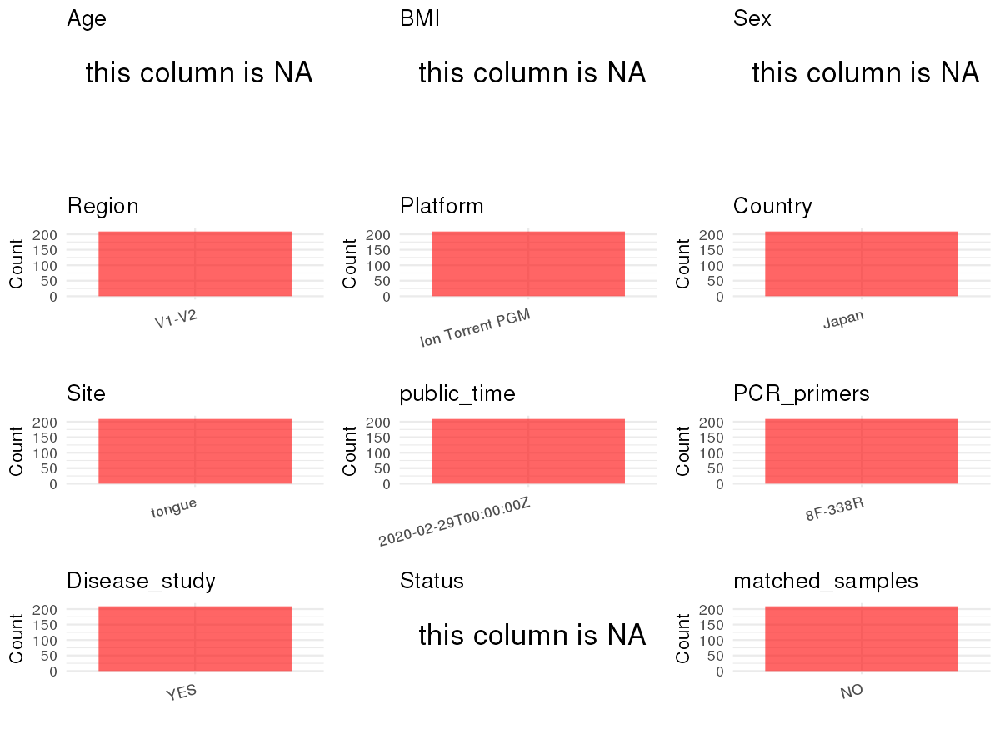

R Notebook: Metadata Processing Workflow
================

# Step 1: Obtain Initial Metadata from Each Project

To obtain the initial metadata: 1. Search for the BioProject ID (e.g.,
“PRJEBXXXX”) on the [NCBI SRA
website](https://www.ncbi.nlm.nih.gov/Traces/study/). 2. In the “Select”
table, click on “Metadata” and download the file. 3. The downloaded file
is typically named “SraRunTable.csv” and contains metadata for the
project.

``` r
# Load necessary libraries
library(dplyr)
library(ggplot2)
library(cowplot)
library(readxl)

# Set working directory (update this path to your local directory)
setwd("/home/dongbiao/word_embedding_microbiome/all_data/oral/global-oral-microbiome/data/projects/PRJDB9265")

# Read the initial metadata files
initial_meta<-read.csv("SraRunTable.csv") %>% filter(Instrument != "Sequel")

head(initial_meta)
```

    ##         Run Assay.Type AvgSpotLen   Bases BioProject    BioSample
    ## 1 DRR205823   AMPLICON        354 8528647  PRJDB9265 SAMD00202845
    ## 2 DRR205825   AMPLICON        352 6218410  PRJDB9265 SAMD00202847
    ## 3 DRR205826   AMPLICON        351 7307555  PRJDB9265 SAMD00202848
    ## 4 DRR205838   AMPLICON        354 8684819  PRJDB9265 SAMD00202860
    ## 5 DRR205857   AMPLICON        351 7257939  PRJDB9265 SAMD00202879
    ## 6 DRR205907   AMPLICON        354 5141640  PRJDB9265 SAMD00202929
    ##              BioSampleModel   Bytes Center.Name Collection_Date Consent
    ## 1 MIMARKS.survey.human-oral 6104154      KYUSHU            2016  public
    ## 2 MIMARKS.survey.human-oral 4579728      KYUSHU            2016  public
    ## 3 MIMARKS.survey.human-oral 5199012      KYUSHU            2016  public
    ## 4 MIMARKS.survey.human-oral 6262349      KYUSHU            2016  public
    ## 5 MIMARKS.survey.human-oral 5164461      KYUSHU            2016  public
    ## 6 MIMARKS.survey.human-oral 3745093      KYUSHU            2016  public
    ##   DATASTORE.filetype DATASTORE.provider                     DATASTORE.region
    ## 1         run.zq,sra         gs,ncbi,s3 gs.us-east1,ncbi.public,s3.us-east-1
    ## 2         run.zq,sra         gs,ncbi,s3 gs.us-east1,ncbi.public,s3.us-east-1
    ## 3         run.zq,sra         gs,ncbi,s3 gs.us-east1,ncbi.public,s3.us-east-1
    ## 4         run.zq,sra         gs,ncbi,s3 gs.us-east1,ncbi.public,s3.us-east-1
    ## 5         run.zq,sra         gs,ncbi,s3 gs.us-east1,ncbi.public,s3.us-east-1
    ## 6         run.zq,sra         gs,ncbi,s3 gs.us-east1,ncbi.public,s3.us-east-1
    ##     env_broad_scale env_local_scale     env_medium Experiment
    ## 1 human oral cavity  Tongue coating Tongue coating  DRX196222
    ## 2 human oral cavity  Tongue coating Tongue coating  DRX196224
    ## 3 human oral cavity  Tongue coating Tongue coating  DRX196225
    ## 4 human oral cavity  Tongue coating Tongue coating  DRX196237
    ## 5 human oral cavity  Tongue coating Tongue coating  DRX196256
    ## 6 human oral cavity  Tongue coating Tongue coating  DRX196306
    ##   geo_loc_name_country geo_loc_name_country_continent geo_loc_name         HOST
    ## 1                Japan                           Asia        Japan Homo sapiens
    ## 2                Japan                           Asia        Japan Homo sapiens
    ## 3                Japan                           Asia        Japan Homo sapiens
    ## 4                Japan                           Asia        Japan Homo sapiens
    ## 5                Japan                           Asia        Japan Homo sapiens
    ## 6                Japan                           Asia        Japan Homo sapiens
    ##        Instrument    lat_lon Library.Name LibraryLayout LibrarySelection
    ## 1 Ion Torrent PGM 33 N 130 E           NA        SINGLE              PCR
    ## 2 Ion Torrent PGM 33 N 130 E           NA        SINGLE              PCR
    ## 3 Ion Torrent PGM 33 N 130 E           NA        SINGLE              PCR
    ## 4 Ion Torrent PGM 33 N 130 E           NA        SINGLE              PCR
    ## 5 Ion Torrent PGM 33 N 130 E           NA        SINGLE              PCR
    ## 6 Ion Torrent PGM 33 N 130 E           NA        SINGLE              PCR
    ##   LibrarySource              Organism    Platform
    ## 1       GENOMIC human oral metagenome ION_TORRENT
    ## 2       GENOMIC human oral metagenome ION_TORRENT
    ## 3       GENOMIC human oral metagenome ION_TORRENT
    ## 4       GENOMIC human oral metagenome ION_TORRENT
    ## 5       GENOMIC human oral metagenome ION_TORRENT
    ## 6       GENOMIC human oral metagenome ION_TORRENT
    ##                                                                                           project_name
    ## 1 Identification of tongue microbiota of allogeneic hematopoietic stem cell transplantation recipients
    ## 2 Identification of tongue microbiota of allogeneic hematopoietic stem cell transplantation recipients
    ## 3 Identification of tongue microbiota of allogeneic hematopoietic stem cell transplantation recipients
    ## 4 Identification of tongue microbiota of allogeneic hematopoietic stem cell transplantation recipients
    ## 5 Identification of tongue microbiota of allogeneic hematopoietic stem cell transplantation recipients
    ## 6 Identification of tongue microbiota of allogeneic hematopoietic stem cell transplantation recipients
    ##            ReleaseDate          create_date version  Sample.Name
    ## 1 2020-02-29T00:00:00Z 2020-02-29T16:31:00Z       1 SAMD00202845
    ## 2 2020-02-29T00:00:00Z 2020-02-29T16:30:00Z       1 SAMD00202847
    ## 3 2020-02-29T00:00:00Z 2020-02-29T16:31:00Z       1 SAMD00202848
    ## 4 2020-02-29T00:00:00Z 2020-02-29T16:32:00Z       1 SAMD00202860
    ## 5 2020-02-29T00:00:00Z 2020-02-29T16:31:00Z       1 SAMD00202879
    ## 6 2020-02-29T00:00:00Z 2020-02-29T16:31:00Z       1 SAMD00202929
    ##                                        sample_name SRA.Study
    ## 1 Tongue microbiota of an adult subject HY54100004 DRP005872
    ## 2 Tongue microbiota of an adult subject HY54100006 DRP005872
    ## 3 Tongue microbiota of an adult subject HY54100007 DRP005872
    ## 4 Tongue microbiota of an adult subject HY54100019 DRP005872
    ## 5 Tongue microbiota of an adult subject HY54700013 DRP005872
    ## 6 Tongue microbiota of an adult subject HY55100016 DRP005872

# Step 2: Create a Uniform Metadata Template

The uniform metadata should include the following columns:

1.  **BioProject**: Project ID (e.g., “PRJNA339212”)
2.  **Run**: Sample ID (e.g., “ERRXXXXXX” or “SRRXXXXXX”)
3.  **sample_name**: Original sample name submitted by the authors (not
    the database-assigned ID)
4.  **Age**: Age of the subject (if available)
5.  **BMI**: Body Mass Index (if available)
6.  **Sex**: Sex of the subject (“F” or “M”)
7.  **Region**: Targeted 16S rRNA region (e.g., “V3-V4”)
8.  **Platform**: Sequencing platform (e.g., “Illumina MiSeq”)
9.  **Country**: Country of sample origin (e.g., “China”)
10. **Site**: Sample site (e.g., “saliva”, “dental plaque”)
11. **public_time**: Data release date (format: “YYYY-MM-DD”)
12. **PCR_primers**: PCR primers used (e.g., “515F-806R”)
13. **title**: Title of the associated publication
14. **Disease_study**: Whether the study involves a disease (“YES” or
    “NO”)
15. **Status**: Disease status (e.g., “T2DM”, “HC”). Note: If the study
    includes both disease and healthy samples, this must be specified
    per sample.

``` r
# Create a uniform metadata dataframe
metadata <- data.frame(
  BioProject = initial_meta$BioProject,
  Run = initial_meta$Run,
  sample_name = initial_meta$sample_name,
  Age = NA,
  BMI = NA,
  Sex=NA,
  Region = "V1-V2",
  Platform = initial_meta$Instrument,
  Country = initial_meta$geo_loc_name,
  Site = "tongue",
  public_time = initial_meta$ReleaseDate,
  stringsAsFactors = FALSE
)
metadata<-unique(metadata)
```

# Step 3: Manually Add Information from the Publication

Some information (e.g. PCR primers, study title, disease status) must be
manually extracted from the publication and added to the metadata.

``` r
# Add information obtained from the publication
metadata$PCR_primers <- "8F-338R"
metadata$title <- "Disrupted tongue microbiota and detection of nonindigenous bacteria on the day of allogeneic hematopoietic stem cell transplantation"
metadata$Disease_study <- "YES"

# Assign disease status based on sample_name patterns
metadata$Status <- NA
metadata$matched_samples <- "NO"
```

# Step 4: Summarize and Validate the Metadata

``` r
# Check the number of unique runs and sample names
print(paste("Number of unique runs:", length(unique(metadata$Run))))
```

    ## [1] "Number of unique runs: 209"

``` r
print(paste("Number of unique sample names:", length(unique(metadata$sample_name))))
```

    ## [1] "Number of unique sample names: 209"

# Step 5: Visualize the Metadata

``` r

```


# Step 6: Finalize and Export the Metadata

``` r
# Reorder columns to match the desired format
metadata <- metadata[, c(
  "BioProject", "Run", "sample_name", "Age", "BMI", "Sex", 
  "Region", "Platform", "Country", "Site", "public_time", 
  "PCR_primers", "title", "Disease_study", "Status","matched_samples"
)]

# Export the uniform metadata to a CSV file
metadata<-unique(metadata)
write.csv(metadata, file = "metadata.csv", quote = FALSE)
head(metadata)
```

    ##   BioProject       Run                                      sample_name Age BMI
    ## 1  PRJDB9265 DRR205823 Tongue microbiota of an adult subject HY54100004  NA  NA
    ## 2  PRJDB9265 DRR205825 Tongue microbiota of an adult subject HY54100006  NA  NA
    ## 3  PRJDB9265 DRR205826 Tongue microbiota of an adult subject HY54100007  NA  NA
    ## 4  PRJDB9265 DRR205838 Tongue microbiota of an adult subject HY54100019  NA  NA
    ## 5  PRJDB9265 DRR205857 Tongue microbiota of an adult subject HY54700013  NA  NA
    ## 6  PRJDB9265 DRR205907 Tongue microbiota of an adult subject HY55100016  NA  NA
    ##   Sex Region        Platform Country   Site          public_time PCR_primers
    ## 1  NA  V1-V2 Ion Torrent PGM   Japan tongue 2020-02-29T00:00:00Z     8F-338R
    ## 2  NA  V1-V2 Ion Torrent PGM   Japan tongue 2020-02-29T00:00:00Z     8F-338R
    ## 3  NA  V1-V2 Ion Torrent PGM   Japan tongue 2020-02-29T00:00:00Z     8F-338R
    ## 4  NA  V1-V2 Ion Torrent PGM   Japan tongue 2020-02-29T00:00:00Z     8F-338R
    ## 5  NA  V1-V2 Ion Torrent PGM   Japan tongue 2020-02-29T00:00:00Z     8F-338R
    ## 6  NA  V1-V2 Ion Torrent PGM   Japan tongue 2020-02-29T00:00:00Z     8F-338R
    ##                                                                                                                                  title
    ## 1 Disrupted tongue microbiota and detection of nonindigenous bacteria on the day of allogeneic hematopoietic stem cell transplantation
    ## 2 Disrupted tongue microbiota and detection of nonindigenous bacteria on the day of allogeneic hematopoietic stem cell transplantation
    ## 3 Disrupted tongue microbiota and detection of nonindigenous bacteria on the day of allogeneic hematopoietic stem cell transplantation
    ## 4 Disrupted tongue microbiota and detection of nonindigenous bacteria on the day of allogeneic hematopoietic stem cell transplantation
    ## 5 Disrupted tongue microbiota and detection of nonindigenous bacteria on the day of allogeneic hematopoietic stem cell transplantation
    ## 6 Disrupted tongue microbiota and detection of nonindigenous bacteria on the day of allogeneic hematopoietic stem cell transplantation
    ##   Disease_study Status matched_samples
    ## 1           YES     NA              NO
    ## 2           YES     NA              NO
    ## 3           YES     NA              NO
    ## 4           YES     NA              NO
    ## 5           YES     NA              NO
    ## 6           YES     NA              NO

## Notes for Students:

1.  **Metadata Accuracy**: Always cross-check the metadata with the
    original publication to ensure accuracy.
2.  **Manual Entries**: Columns like `PCR_primers`, and `Status` often
    require manual entry based on the publication.
3.  **Disease Status**: Be careful when assigning `Status`—some studies
    include both disease and healthy samples.
4.  **Visualization**: The plots help quickly identify the distribution
    of values in each column, which is useful for quality control.
5.  **Reproducibility**: Update the working directory and file paths to
    match your local environment.
