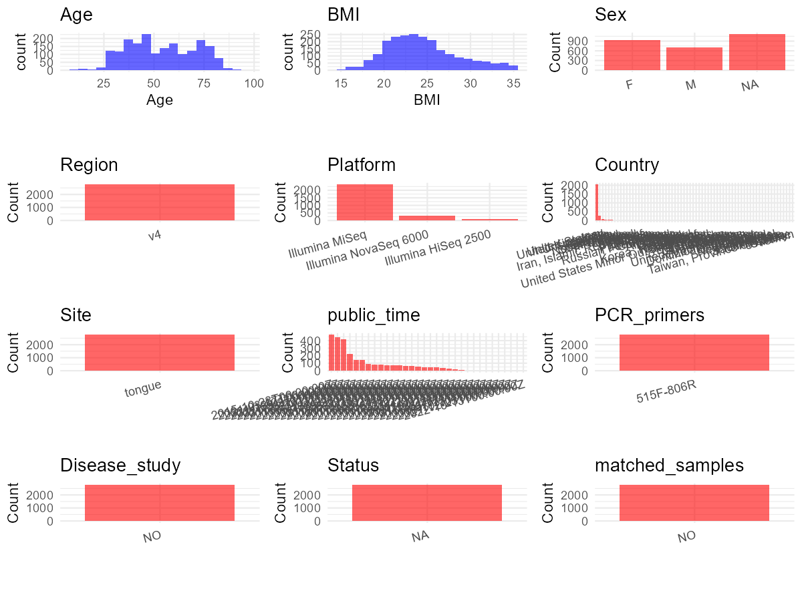

R Notebook: Metadata Processing Workflow
================

# Step 1: Obtain Initial Metadata from Each Project

To obtain the initial metadata: 1. Search for the BioProject ID (e.g.,
“PRJEBXXXX”) on the [NCBI SRA
website](https://www.ncbi.nlm.nih.gov/Traces/study/). 2. In the “Select”
table, click on “Metadata” and download the file. 3. The downloaded file
is typically named “SraRunTable.csv” and contains metadata for the
project.

``` r
# Load necessary libraries
library(dplyr)
library(ggplot2)
library(cowplot)

# Set working directory (update this path to your local directory)
setwd("D:/oral_project/PRJEB11419")

# Read the initial metadata files
initial_meta<-read.csv("SraRunTable.csv",header = T)

# Combine the two metadata files
#meta <- rbind(initial_meta, initial_meta1)

#Remove entries non-oral samples
#initial_meta <- subset(initial_meta,isolate %in% c("saliva","tongue coat"))

# Check the number of samples containing "HT" in Sample.Name (e.g., healthy controls)
#nrow(subset(meta, grepl("HT", Sample.Name)))

# Display the first few rows of the metadata
head(initial_meta)
```

    ##          Run Assay.Type BioProject    BioSample center_name..exp.
    ## 1 ERR1077494      OTHER PRJEB11419 SAMEA3612923            UCSDMI
    ## 2 ERR1077495      OTHER PRJEB11419 SAMEA3612924            UCSDMI
    ## 3 ERR1077496      OTHER PRJEB11419 SAMEA3612925            UCSDMI
    ## 4 ERR1077497      OTHER PRJEB11419 SAMEA3612926            UCSDMI
    ## 5 ERR1077498      OTHER PRJEB11419 SAMEA3612927            UCSDMI
    ## 6 ERR1077499      OTHER PRJEB11419 SAMEA3612928            UCSDMI
    ##                                          Center.Name Consent
    ## 1 UNIVERSITY OF CALIFORNIA SAN DIEGO MICROBIOME INIT  public
    ## 2 UNIVERSITY OF CALIFORNIA SAN DIEGO MICROBIOME INIT  public
    ## 3 UNIVERSITY OF CALIFORNIA SAN DIEGO MICROBIOME INIT  public
    ## 4 UNIVERSITY OF CALIFORNIA SAN DIEGO MICROBIOME INIT  public
    ## 5 UNIVERSITY OF CALIFORNIA SAN DIEGO MICROBIOME INIT  public
    ## 6 UNIVERSITY OF CALIFORNIA SAN DIEGO MICROBIOME INIT  public
    ##   ENA.FIRST.PUBLIC..run. ENA.LAST.UPDATE..run. Experiment
    ## 1             2015-10-15            2018-11-16 ERX1157509
    ## 2             2015-10-15            2018-11-16 ERX1157510
    ## 3             2015-10-15            2018-11-16 ERX1157511
    ## 4             2015-10-15            2018-11-16 ERX1157512
    ## 5             2015-10-15            2018-11-16 ERX1157513
    ## 6             2015-10-15            2018-11-16 ERX1157514
    ##                                          INSDC_center_name   INSDC_first_public
    ## 1 University of California San Diego Microbiome Initiative 2015-10-15T17:01:20Z
    ## 2 University of California San Diego Microbiome Initiative 2015-10-15T17:01:25Z
    ## 3 University of California San Diego Microbiome Initiative 2015-10-15T17:01:25Z
    ## 4 University of California San Diego Microbiome Initiative 2015-10-15T17:01:20Z
    ## 5 University of California San Diego Microbiome Initiative 2015-10-15T17:01:20Z
    ## 6 University of California San Diego Microbiome Initiative 2015-10-15T17:01:24Z
    ##      INSDC_last_update INSDC_status     Instrument    Library.Name
    ## 1 2017-08-10T13:39:52Z       public Illumina MiSeq 10317.000007750
    ## 2 2017-08-10T13:39:52Z       public Illumina MiSeq 10317.000007751
    ## 3 2017-08-10T13:39:52Z       public Illumina MiSeq 10317.000007752
    ## 4 2017-08-10T13:39:52Z       public Illumina MiSeq 10317.000007753
    ## 5 2017-08-10T13:39:52Z       public Illumina MiSeq 10317.000007754
    ## 6 2017-08-10T13:39:52Z       public Illumina MiSeq 10317.000007756
    ##   LibraryLayout LibrarySelection LibrarySource              Organism Platform
    ## 1        SINGLE              PCR   METAGENOMIC  human gut metagenome ILLUMINA
    ## 2        SINGLE              PCR   METAGENOMIC human oral metagenome ILLUMINA
    ## 3        SINGLE              PCR   METAGENOMIC human skin metagenome ILLUMINA
    ## 4        SINGLE              PCR   METAGENOMIC human oral metagenome ILLUMINA
    ## 5        SINGLE              PCR   METAGENOMIC  human gut metagenome ILLUMINA
    ## 6        SINGLE              PCR   METAGENOMIC  human gut metagenome ILLUMINA
    ##            ReleaseDate  Sample.Name                     Sample_name
    ## 1 2015-10-28T00:00:00Z SAMEA3612923 qiita_sid_10317:10317.000007750
    ## 2 2015-10-28T00:00:00Z SAMEA3612924 qiita_sid_10317:10317.000007751
    ## 3 2015-10-28T00:00:00Z SAMEA3612925 qiita_sid_10317:10317.000007752
    ## 4 2015-10-28T00:00:00Z SAMEA3612926 qiita_sid_10317:10317.000007753
    ## 5 2015-10-28T00:00:00Z SAMEA3612927 qiita_sid_10317:10317.000007754
    ## 6 2015-10-28T00:00:00Z SAMEA3612928 qiita_sid_10317:10317.000007756
    ##     sequencing_meth..exp. SRA.Study   Bytes DATASTORE.filetype
    ## 1 Sequencing by synthesis ERP012803  922403   fastq,run.zq,sra
    ## 2 Sequencing by synthesis ERP012803  370128   fastq,run.zq,sra
    ## 3 Sequencing by synthesis ERP012803 2659295   fastq,run.zq,sra
    ## 4 Sequencing by synthesis ERP012803  590452   fastq,run.zq,sra
    ## 5 Sequencing by synthesis ERP012803 1880732   fastq,run.zq,sra
    ## 6 Sequencing by synthesis ERP012803 1009948   fastq,run.zq,sra
    ##   DATASTORE.provider                         DATASTORE.region
    ## 1     ena,gs,ncbi,s3 ena,gs.us-east1,ncbi.public,s3.us-east-1
    ## 2     ena,gs,ncbi,s3 ena,gs.us-east1,ncbi.public,s3.us-east-1
    ## 3     ena,gs,ncbi,s3 ena,gs.us-east1,ncbi.public,s3.us-east-1
    ## 4     ena,gs,ncbi,s3 ena,gs.us-east1,ncbi.public,s3.us-east-1
    ## 5     ena,gs,ncbi,s3 ena,gs.us-east1,ncbi.public,s3.us-east-1
    ## 6     ena,gs,ncbi,s3 ena,gs.us-east1,ncbi.public,s3.us-east-1
    ##   well_description..exp.          create_date version center_project_name..exp.
    ## 1         AG_53_7750_D11 2015-12-08T15:40:00Z       1                      AG16
    ## 2         AG_41_7751_C12 2015-12-08T15:40:00Z       1                      AG16
    ## 3          AG_51_7752_F5 2015-12-08T15:40:00Z       1                      AG16
    ## 4         AG_41_7753_E12 2015-12-08T15:40:00Z       1                      AG16
    ## 5         AG_53_7754_G11 2015-12-08T15:39:00Z       1                      AG16
    ## 6         AG_53_7756_C10 2015-12-08T15:39:00Z       1                      AG16
    ##       run_prefix..exp. AvgSpotLen   Bases run_date..exp. run_center..exp.
    ## 1 Undetermined_S0_L001        151 1680026        8/21/14             CCME
    ## 2 Undetermined_S0_L001        151  625442        8/21/14             CCME
    ## 3 Undetermined_S0_L001        151 4602027        8/21/14             CCME
    ## 4 Undetermined_S0_L001        151 1017589        8/21/14             CCME
    ## 5 Undetermined_S0_L001        151 3317470        8/21/14             CCME
    ## 6 Undetermined_S0_L001        151 1862434        8/21/14             CCME
    ##   sample_plate..exp.  external_id                    Submitter_Id
    ## 1              AG_53 SAMEA3612923 qiita_sid_10317:10317.000007750
    ## 2              AG_41 SAMEA3612924 qiita_sid_10317:10317.000007751
    ## 3              AG_51 SAMEA3612925 qiita_sid_10317:10317.000007752
    ## 4              AG_41 SAMEA3612926 qiita_sid_10317:10317.000007753
    ## 5              AG_53 SAMEA3612927 qiita_sid_10317:10317.000007754
    ## 6              AG_53 SAMEA3612928 qiita_sid_10317:10317.000007756
    ##   prepared_meals_frequency country_of_birth Birth_Year red_meat_frequency
    ## 1             Not provided          Belgium     1978.0       Not provided
    ## 2             Not provided          Belgium     2006.0       Not provided
    ## 3             Not provided          Belgium     2009.0       Not provided
    ## 4             Not provided          Belgium     1978.0       Not provided
    ## 5             Not provided          Belgium     2006.0       Not provided
    ## 6             Not provided          Belgium     2006.0       Not provided
    ##   diet_type      Race                             antibiotic_history
    ## 1  Omnivore Caucasian I have not taken antibiotics in the past year.
    ## 2  Omnivore Caucasian                                           Year
    ## 3  Omnivore Caucasian I have not taken antibiotics in the past year.
    ## 4  Omnivore Caucasian I have not taken antibiotics in the past year.
    ## 5  Omnivore Caucasian                                           Year
    ## 6  Omnivore Caucasian                                           Year
    ##              exercise_frequency vitamin_b_supplement_frequency
    ## 1                         Never                   Not provided
    ## 2 Occasionally (1-2 times/week)                   Not provided
    ## 3 Occasionally (1-2 times/week)                   Not provided
    ## 4                         Never                   Not provided
    ## 5 Occasionally (1-2 times/week)                   Not provided
    ## 6 Occasionally (1-2 times/week)                   Not provided
    ##   vitamin_d_supplement_frequency bowel_movement_frequency
    ## 1                   Not provided             Not provided
    ## 2                   Not provided             Not provided
    ## 3                   Not provided             Not provided
    ## 4                   Not provided             Not provided
    ## 5                   Not provided             Not provided
    ## 6                   Not provided             Not provided
    ##               contraceptive whole_grain_frequency age_cat probiotic_frequency
    ## 1 Yes, I am taking the pill          Not provided     30s        Not provided
    ## 2              Not provided          Not provided   child        Not provided
    ## 3                        No          Not provided   child        Not provided
    ## 4 Yes, I am taking the pill          Not provided     30s        Not provided
    ## 5              Not provided          Not provided   child        Not provided
    ## 6              Not provided          Not provided   child        Not provided
    ##   sugary_sweets_frequency cosmetics_frequency                pool_frequency
    ## 1            Not provided               Daily                         Never
    ## 2            Not provided               Never Occasionally (1-2 times/week)
    ## 3            Not provided               Never    Rarely (a few times/month)
    ## 4            Not provided               Daily                         Never
    ## 5            Not provided               Never Occasionally (1-2 times/week)
    ## 6            Not provided               Never Occasionally (1-2 times/week)
    ##     whole_eggs exercise_location types_of_plants vivid_dreams    olive_oil
    ## 1 Not provided None of the above     Less than 5 Not provided Not provided
    ## 2 Not provided           Indoors         6 to 10 Not provided Not provided
    ## 3 Not provided           Indoors         6 to 10 Not provided Not provided
    ## 4 Not provided None of the above     Less than 5 Not provided Not provided
    ## 5 Not provided           Indoors         6 to 10 Not provided Not provided
    ## 6 Not provided           Indoors         6 to 10 Not provided Not provided
    ##    last_travel level_of_education fermented_plant_frequency
    ## 1        Month       Not provided              Not provided
    ## 2 Not provided       Not provided              Not provided
    ## 3 Not provided       Not provided              Not provided
    ## 4        Month       Not provided              Not provided
    ## 5 Not provided       Not provided              Not provided
    ## 6 Not provided       Not provided              Not provided
    ##            alcohol_frequency drinks_per_session salted_snacks_frequency
    ## 1 Regularly (3-5 times/week)       Not provided            Not provided
    ## 2                      Never       Not provided            Not provided
    ## 3                      Never       Not provided            Not provided
    ## 4 Regularly (3-5 times/week)       Not provided            Not provided
    ## 5                      Never       Not provided            Not provided
    ## 6                      Never       Not provided            Not provided
    ##   sugar_sweetened_drink_frequency teethbrushing_frequency
    ## 1                    Not provided                   Daily
    ## 2                    Not provided                   Daily
    ## 3                    Not provided                   Daily
    ## 4                    Not provided                   Daily
    ## 5                    Not provided                   Daily
    ## 6                    Not provided                   Daily
    ##   one_liter_of_water_a_day_frequency    last_move poultry_frequency
    ## 1                       Not provided Not provided      Not provided
    ## 2                       Not provided Not provided      Not provided
    ## 3                       Not provided Not provided      Not provided
    ## 4                       Not provided Not provided      Not provided
    ## 5                       Not provided Not provided      Not provided
    ## 6                       Not provided Not provided      Not provided
    ##   ready_to_eat_meals_frequency seafood_frequency  sleep_duration
    ## 1                 Not provided      Not provided       7-8 hours
    ## 2                 Not provided      Not provided 8 or more hours
    ## 3                 Not provided      Not provided 8 or more hours
    ## 4                 Not provided      Not provided       7-8 hours
    ## 5                 Not provided      Not provided 8 or more hours
    ## 6                 Not provided      Not provided 8 or more hours
    ##   smoking_frequency      thyroid vegetable_frequency
    ## 1             Never Not provided        Not provided
    ## 2             Never Not provided        Not provided
    ## 3             Never Not provided        Not provided
    ## 4             Never Not provided        Not provided
    ## 5             Never Not provided        Not provided
    ## 6             Never Not provided        Not provided
    ##                                               deodorant_use
    ## 1 Not sure, but I use some form of deodorant/antiperspirant
    ## 2               I do not use deodorant or an antiperspirant
    ## 3               I do not use deodorant or an antiperspirant
    ## 4 Not sure, but I use some form of deodorant/antiperspirant
    ## 5               I do not use deodorant or an antiperspirant
    ## 6               I do not use deodorant or an antiperspirant
    ##   drinking_water_source fed_as_infant flossing_frequency
    ## 1              Filtered  Not provided              Never
    ## 2              Filtered  Not provided              Never
    ## 3              Filtered  Not provided              Never
    ## 4              Filtered  Not provided              Never
    ## 5              Filtered  Not provided              Never
    ## 6              Filtered  Not provided              Never
    ##                                      flu_vaccine_date fruit_frequency
    ## 1 I have not gotten the flu vaccine in the past year.    Not provided
    ## 2 I have not gotten the flu vaccine in the past year.    Not provided
    ## 3 I have not gotten the flu vaccine in the past year.    Not provided
    ## 4 I have not gotten the flu vaccine in the past year.    Not provided
    ## 5 I have not gotten the flu vaccine in the past year.    Not provided
    ## 6 I have not gotten the flu vaccine in the past year.    Not provided
    ##   fungal_overgrowth homecooked_meals_frequency meat_eggs_frequency     add_adhd
    ## 1      Not provided               Not provided        Not provided Not provided
    ## 2      Not provided               Not provided        Not provided Not provided
    ## 3      Not provided               Not provided        Not provided Not provided
    ## 4      Not provided               Not provided        Not provided Not provided
    ## 5      Not provided               Not provided        Not provided Not provided
    ## 6      Not provided               Not provided        Not provided Not provided
    ##     autoimmune frozen_dessert_frequency high_fat_red_meat_frequency
    ## 1 Not provided             Not provided                Not provided
    ## 2 Not provided             Not provided                Not provided
    ## 3 Not provided             Not provided                Not provided
    ## 4 Not provided             Not provided                Not provided
    ## 5 Not provided             Not provided                Not provided
    ## 6 Not provided             Not provided                Not provided
    ##   milk_cheese_frequency artificial_sweeteners milk_substitute_frequency
    ## 1          Not provided          Not provided              Not provided
    ## 2          Not provided          Not provided              Not provided
    ## 3          Not provided          Not provided              Not provided
    ## 4          Not provided          Not provided              Not provided
    ## 5          Not provided          Not provided              Not provided
    ## 6          Not provided          Not provided              Not provided
    ##   bowel_movement_quality gluten                     migraine          ibs
    ## 1           Not provided     No I do not have this condition Not provided
    ## 2           Not provided     No I do not have this condition Not provided
    ## 3           Not provided     No I do not have this condition Not provided
    ## 4           Not provided     No I do not have this condition Not provided
    ## 5           Not provided     No I do not have this condition Not provided
    ## 6           Not provided     No I do not have this condition Not provided
    ##   roommates_in_study   weight_change tonsils_removed
    ## 1       Not provided Remained stable           false
    ## 2       Not provided Remained stable           false
    ## 3       Not provided Remained stable           false
    ## 4       Not provided Remained stable           false
    ## 5       Not provided Remained stable           false
    ## 6       Not provided Remained stable           false
    ##                 skin_condition appendix_removed consume_animal_products_abx
    ## 1 I do not have this condition            false                Not provided
    ## 2 I do not have this condition            false                Not provided
    ## 3 I do not have this condition            false                Not provided
    ## 4 I do not have this condition            false                Not provided
    ## 5 I do not have this condition            false                Not provided
    ## 6 I do not have this condition            false                Not provided
    ##   csection     dominant_hand livingwith          asd chickenpox  acid_reflux
    ## 1    false I am right handed        Yes Not provided        Yes Not provided
    ## 2     true I am right handed        Yes Not provided         No Not provided
    ## 3     true I am right handed        Yes Not provided         No Not provided
    ## 4    false I am right handed        Yes Not provided        Yes Not provided
    ## 5     true I am right handed        Yes Not provided         No Not provided
    ## 6     true I am right handed        Yes Not provided         No Not provided
    ##   breastmilk_formula_ensure clinical_condition     pregnant         sibo
    ## 1              Not provided       Not provided        false Not provided
    ## 2              Not provided       Not provided Not provided Not provided
    ## 3              Not provided       Not provided        false Not provided
    ## 4              Not provided       Not provided        false Not provided
    ## 5              Not provided       Not provided Not provided Not provided
    ## 6              Not provided       Not provided Not provided Not provided
    ##                            ibd                     Diabetes cancer_treatment
    ## 1 I do not have this condition I do not have this condition     Not provided
    ## 2 I do not have this condition I do not have this condition     Not provided
    ## 3 I do not have this condition I do not have this condition     Not provided
    ## 4 I do not have this condition I do not have this condition     Not provided
    ## 5 I do not have this condition I do not have this condition     Not provided
    ## 6 I do not have this condition I do not have this condition     Not provided
    ##   height_cm weight_kg INSDC_center_alias          sex country_residence
    ## 1     169.0      51.0             UCSDMI       female      Not provided
    ## 2     120.0      18.0             UCSDMI Not provided      Not provided
    ## 3      96.0      15.0             UCSDMI       female      Not provided
    ## 4     169.0      51.0             UCSDMI       female      Not provided
    ## 5     120.0      18.0             UCSDMI Not provided      Not provided
    ## 6     120.0      18.0             UCSDMI Not provided      Not provided
    ##   ENA_first_public ENA_last_update cardiovascular_disease
    ## 1       2015-10-15      2017-08-10           Not provided
    ## 2       2015-10-15      2017-08-10           Not provided
    ## 3       2015-10-15      2017-08-10           Not provided
    ## 4       2015-10-15      2017-08-10           Not provided
    ## 5       2015-10-15      2017-08-10           Not provided
    ## 6       2015-10-15      2017-08-10           Not provided
    ##                   lung_disease diabetes_type ibd_diagnosis_refined
    ## 1 I do not have this condition  Not provided          Not provided
    ## 2 I do not have this condition  Not provided          Not provided
    ## 3 I do not have this condition  Not provided          Not provided
    ## 4 I do not have this condition  Not provided          Not provided
    ## 5 I do not have this condition  Not provided          Not provided
    ## 6 I do not have this condition  Not provided          Not provided
    ##   Barcode..exp. linker..exp.                                 pcr_primers..exp.
    ## 1  AGACAGTAGGAG           GT FWD:GTGCCAGCMGCCGCGGTAA; REV:GGACTACHVGGGTWTCTAAT
    ## 2  TACGAGCCCTAA           GT FWD:GTGCCAGCMGCCGCGGTAA; REV:GGACTACHVGGGTWTCTAAT
    ## 3  AGTGTTTCGGAC           GT FWD:GTGCCAGCMGCCGCGGTAA; REV:GGACTACHVGGGTWTCTAAT
    ## 4  ACAATAGACACC           GT FWD:GTGCCAGCMGCCGCGGTAA; REV:GGACTACHVGGGTWTCTAAT
    ## 5  TAACGCTGTGTG           GT FWD:GTGCCAGCMGCCGCGGTAA; REV:GGACTACHVGGGTWTCTAAT
    ## 6  GTCGCCGTACAT           GT FWD:GTGCCAGCMGCCGCGGTAA; REV:GGACTACHVGGGTWTCTAAT
    ##            primer..exp. target_gene..exp. target_subfragment..exp.
    ## 1 GTGTGCCAGCMGCCGCGGTAA          16S rRNA                       V4
    ## 2 GTGTGCCAGCMGCCGCGGTAA          16S rRNA                       V4
    ## 3 GTGTGCCAGCMGCCGCGGTAA          16S rRNA                       V4
    ## 4 GTGTGCCAGCMGCCGCGGTAA          16S rRNA                       V4
    ## 5 GTGTGCCAGCMGCCGCGGTAA          16S rRNA                       V4
    ## 6 GTGTGCCAGCMGCCGCGGTAA          16S rRNA                       V4
    ##   liver_disease kidney_disease        cdiff acne_medication
    ## 1  Not provided   Not provided Not provided           false
    ## 2  Not provided   Not provided Not provided           false
    ## 3  Not provided   Not provided Not provided           false
    ## 4  Not provided   Not provided Not provided           false
    ## 5  Not provided   Not provided Not provided           false
    ## 6  Not provided   Not provided Not provided           false
    ##   other_supplement_frequency softener seasonal_allergies acne_medication_otc
    ## 1                      false    false              false               false
    ## 2                      false    false              false               false
    ## 3                      false    false              false               false
    ## 4                      false    false              false               false
    ## 5                      false    false              false               false
    ## 6                      false    false              false               false
    ##   nail_biter
    ## 1      false
    ## 2      false
    ## 3      false
    ## 4      false
    ## 5      false
    ## 6      false

# Step 2: Create a Uniform Metadata Template

The uniform metadata should include the following columns:

1.  **BioProject**: Project ID (e.g., “PRJNA339212”)
2.  **Run**: Sample ID (e.g., “ERRXXXXXX” or “SRRXXXXXX”)
3.  **sample_name**: Original sample name submitted by the authors (not
    the database-assigned ID)
4.  **Age**: Age of the subject (if available)
5.  **BMI**: Body Mass Index (if available)
6.  **Sex**: Sex of the subject (“F” or “M”)
7.  **Region**: Targeted 16S rRNA region (e.g., “V3-V4”)
8.  **Platform**: Sequencing platform (e.g., “Illumina MiSeq”)
9.  **Country**: Country of sample origin (e.g., “China”)
10. **Site**: Sample site (e.g., “saliva”, “dental plaque”)
11. **public_time**: Data release date (format: “YYYY-MM-DD”)
12. **PCR_primers**: PCR primers used (e.g., “515F-806R”)
13. **title**: Title of the associated publication
14. **Disease_study**: Whether the study involves a disease (“YES” or
    “NO”)
15. **Status**: Disease status (e.g., “T2DM”, “HC”). Note: If the study
    includes both disease and healthy samples, this must be specified
    per sample.
16. **matched_samples**: matched samples (“YES” or “NO”)

``` r
# Create a uniform metadata dataframe
metadata <- data.frame(
  BioProject = initial_meta$BioProject,
  Run = initial_meta$Run,
  sample_name = initial_meta$Sample_name,
  Age = initial_meta$Birth_Year,
  BMI = {
    # 创建临时变量，将非数值内容转换为NA
    weight <- as.numeric(ifelse(
      initial_meta$weight_kg %in% c("", "Unspecified", "Not provided"), 
      NA, 
      initial_meta$weight_kg
    ))
    height <- as.numeric(ifelse(
      initial_meta$height_cm %in% c("", "Unspecified", "Not provided"), 
      NA, 
      initial_meta$height_cm
    ))
    # 计算BMI
    bmi <- ifelse(!is.na(weight) & !is.na(height), weight / (height / 100)^2, NA)
    
    # 将BMI值限制在15-35之间，超出范围的设为NA
    ifelse(bmi >= 15 & bmi <= 35, bmi, NA)
  },
  Sex = initial_meta$sex,
  Region = "v4",
  Platform = initial_meta$Instrument,
  Country = initial_meta$country_of_birth,
  Site = replace(initial_meta$Organism, initial_meta$Organism == "human oral metagenome", "tongue"),
  public_time = initial_meta$ReleaseDate,
  PCR_primers = "515F-806R",
  stringsAsFactors = FALSE
)
```

    ## Warning in data.frame(BioProject = initial_meta$BioProject, Run =
    ## initial_meta$Run, : NAs introduced by coercion
    ## Warning in data.frame(BioProject = initial_meta$BioProject, Run =
    ## initial_meta$Run, : NAs introduced by coercion

``` r
library(dplyr)
metadata$Age <- ifelse(
  # 检查是否为有效的年份格式（4位数字且在合理范围内）
  grepl("^\\d{4}$", metadata$Age) & 
    as.numeric(metadata$Age) >= 1900 & 
    as.numeric(metadata$Age) <= 2025,
  # 如果是有效年份，计算年龄（2025 - 出生年份）
  2025 - as.numeric(metadata$Age),
  # 如果不是有效年份，设为NA
  NA
)
```

    ## Warning in ifelse(grepl("^\\d{4}$", metadata$Age) & as.numeric(metadata$Age) >=
    ## : NAs introduced by coercion
    ## Warning in ifelse(grepl("^\\d{4}$", metadata$Age) & as.numeric(metadata$Age) >=
    ## : NAs introduced by coercion
    ## Warning in ifelse(grepl("^\\d{4}$", metadata$Age) & as.numeric(metadata$Age) >=
    ## : NAs introduced by coercion

``` r
metadata <- metadata %>%
  mutate(
    Sex = trimws(Sex),                # 去掉首尾空格
    Sex = tolower(Sex),               # 全部转小写，方便统一处理
    Sex = case_when(
      Sex == "female" ~ "F",
      Sex == "male" ~ "M",
      Sex %in% c("not provided", "unspecified", "other", "", NA) ~ NA_character_,
      TRUE ~ NA_character_            # 其他未识别的情况也转成 NA
    )
  )
```

# Step 3: Manually Add Information from the Publication

Some information (e.g. PCR primers, study title, disease status) must be
manually extracted from the publication and added to the metadata.

``` r
# Add information obtained from the publication
metadata$title <- "American Gut: an Open Platform for Citizen Science Microbiome Research"
metadata$Disease_study <- "NO"
# Assign disease status based on sample_name patterns
metadata$Status <- "NA"

#get subjects id according to sample id
metadata$sample_name<-gsub("qiita_sid_10317:10317.|ERS|X","",metadata$sample_name)
#get subjects id with Saliva available
keep_subjects<-subset(metadata,Site %in% "tongue")
#remove subjects without Saliva samples
metadata<-subset(metadata,sample_name %in% keep_subjects$sample_name)
#get subjects sampling counts
sample_counts <- table(metadata$sample_name)
# Create matched_samples column, any subjects have >=2 samples will be label "YES", otherwise "NO"
# 计算每个sample_name对应的不同Site的数量
unique_sites_per_sample <- tapply(metadata$Site, metadata$sample_name, function(x) length(unique(x)))

# 创建matched_samples列
metadata$matched_samples <- ifelse(
  metadata$sample_name %in% names(sample_counts[sample_counts >= 2]) & 
  metadata$sample_name %in% names(unique_sites_per_sample[unique_sites_per_sample >= 2]),
  "YES", 
  "NO"
)
```

# Step 4: Summarize and Validate the Metadata

``` r
# Check the number of unique runs and sample names
print(paste("Number of unique runs:", length(unique(metadata$Run))))
```

    ## [1] "Number of unique runs: 2755"

``` r
print(paste("Number of unique sample names:", length(unique(metadata$sample_name))))
```

    ## [1] "Number of unique sample names: 2265"

# Step 5: Visualize the Metadata

``` r

```


# Step 6: Finalize and Export the Metadata

``` r
# Reorder columns to match the desired format
metadata <- metadata[, c(
  "BioProject", "Run", "sample_name", "Age", "BMI", "Sex", 
  "Region", "Platform", "Country", "Site", "public_time", 
  "PCR_primers", "title", "Disease_study", "Status","matched_samples"
)]

# Export the uniform metadata to a CSV file
write.csv(metadata, file = "metadata.csv", quote = FALSE)
head(metadata)
```

    ##    BioProject        Run sample_name Age      BMI  Sex Region       Platform
    ## 2  PRJEB11419 ERR1077495   000007751  NA       NA <NA>     v4 Illumina MiSeq
    ## 4  PRJEB11419 ERR1077497   000007753  NA 17.85652    F     v4 Illumina MiSeq
    ## 8  PRJEB11419 ERR1077501   000007758  NA 16.27604    F     v4 Illumina MiSeq
    ## 9  PRJEB11419 ERR1077502   000007759  NA 17.85652    F     v4 Illumina MiSeq
    ## 11 PRJEB11419 ERR1077504   000007761  NA 22.98190    M     v4 Illumina MiSeq
    ## 16 PRJEB11419 ERR1077509   000007767  NA 17.85652    F     v4 Illumina MiSeq
    ##    Country   Site          public_time PCR_primers
    ## 2  Belgium tongue 2015-10-28T00:00:00Z   515F-806R
    ## 4  Belgium tongue 2015-10-28T00:00:00Z   515F-806R
    ## 8  Belgium tongue 2015-10-28T00:00:00Z   515F-806R
    ## 9  Belgium tongue 2015-10-28T00:00:00Z   515F-806R
    ## 11 Belgium tongue 2015-10-28T00:00:00Z   515F-806R
    ## 16 Belgium tongue 2015-10-28T00:00:00Z   515F-806R
    ##                                                                     title
    ## 2  American Gut: an Open Platform for Citizen Science Microbiome Research
    ## 4  American Gut: an Open Platform for Citizen Science Microbiome Research
    ## 8  American Gut: an Open Platform for Citizen Science Microbiome Research
    ## 9  American Gut: an Open Platform for Citizen Science Microbiome Research
    ## 11 American Gut: an Open Platform for Citizen Science Microbiome Research
    ## 16 American Gut: an Open Platform for Citizen Science Microbiome Research
    ##    Disease_study Status matched_samples
    ## 2             NO     NA              NO
    ## 4             NO     NA              NO
    ## 8             NO     NA              NO
    ## 9             NO     NA              NO
    ## 11            NO     NA              NO
    ## 16            NO     NA              NO

## Notes for Students:

1.  **Metadata Accuracy**: Always cross-check the metadata with the
    original publication to ensure accuracy.
2.  **Manual Entries**: Columns like `PCR_primers`, and `Status` often
    require manual entry based on the publication.
3.  **Disease Status**: Be careful when assigning `Status`—some studies
    include both disease and healthy samples.
4.  **Visualization**: The plots help quickly identify the distribution
    of values in each column, which is useful for quality control.
5.  **Reproducibility**: Update the working directory and file paths to
    match your local environment.
