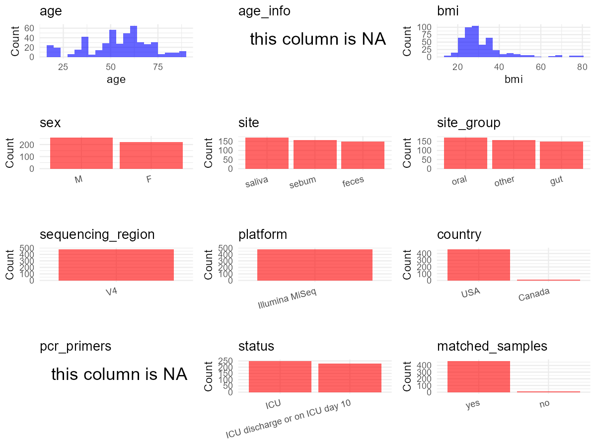

R Notebook: Metadata Processing Workflow
================

# Step 1: Obtain Initial Metadata from Each Project

This step sets the project directory, loads the raw SRA metadata, and
optionally merges supplement tables.

``` r
# Load libraries
library(dplyr)
library(ggplot2)
library(cowplot)

# (1) Setting working directory
# EDIT HERE: change project_id for each study
project_id <- "PRJEB11425" 

base_dir <- "E:/oral/26/metadata-2604/Oral-Metadata-YL-02"
setwd(file.path(base_dir, project_id))

# (2) Loading raw SRA metadata file
sra_file <- "SraRunTable.csv"
initial_meta <- read.csv(sra_file, header = TRUE)

# (3) OPTIONAL: If extra metadata (e.g., Table.x or supplemental materials) are available from the article, you may need to merge the file with initial_meta manually. Below is example code for merging. Depending on the specific case of each study, you can customize the code as needed.
#supp_table <- read.csv("supplemental_table_v2.csv", header = TRUE)
#initial_meta <- left_join(initial_meta, supp_table, by = "Sample.Name")
```

# Step 2: Data Overview

First, you need to get an overview of the data, which includes two
steps: reading the article and reading the initial metadata. This step
is very IMPORTANT!

``` r
# (1) Read the article in the following order: abstract, the beginning of the results section, and the methods. Understand the sample size, experimental design, and disease group overview. Clarify the sampling sites; for oral and gut samples, specify the exact sites like supragingival plaque, tongue, etc.

# (2) IMPORTANT: MUST go through each column of initial_meta
head(initial_meta, 10)
```

    ##           Run age_unit age_units anonymized_name Assay.Type AvgSpotLen
    ## 1  ERR1076083    years     years            6143      OTHER        151
    ## 2  ERR1076084    years     years            6144      OTHER        151
    ## 3  ERR1076085    years     years            6145      OTHER        151
    ## 4  ERR1076086    years     years            6146      OTHER        151
    ## 5  ERR1076087    years     years            6147      OTHER        151
    ## 6  ERR1076088    years     years            6149      OTHER        151
    ## 7  ERR1076089    years     years            6150      OTHER        151
    ## 8  ERR1076090    years     years            6152      OTHER        151
    ## 9  ERR1076091    years     years            6153      OTHER        151
    ## 10 ERR1076092    years     years            6155      OTHER        151
    ##    barcode..exp.   Bases BioProject    BioSample   Bytes center_name..exp.
    ## 1   TACCGCTTCTTC 1065909 PRJEB11425 SAMEA3611562  838881              CCME
    ## 2   ACGAGACTGATT 5142456 PRJEB11425 SAMEA3611563 3238501              CCME
    ## 3   GTCGAATTTGCG 3913316 PRJEB11425 SAMEA3611564 2439267              CCME
    ## 4   GTGCAACCAATC 2813432 PRJEB11425 SAMEA3611565 1967312              CCME
    ## 5   ATGGGTTCCGTC 5658272 PRJEB11425 SAMEA3611566 3375152              CCME
    ## 6   GATCACGAGAGG 4977564 PRJEB11425 SAMEA3611567 3195861              CCME
    ## 7   GCTGTACGGATT 5727128 PRJEB11425 SAMEA3611568 3726026              CCME
    ## 8   TGCAGCAAGATT 5256763 PRJEB11425 SAMEA3611569 2839246              CCME
    ## 9   GTGGAGTCTCAT 3987155 PRJEB11425 SAMEA3611570 2698612              CCME
    ## 10  TTAGAGCCATGC 4285229 PRJEB11425 SAMEA3611571 2487414              CCME
    ##                                           Center.Name center_project_name..exp.
    ## 1  UNIVERSITY OF CALIFORNIA SAN DIEGO MICROBIOME INIT            ICU microbiome
    ## 2  UNIVERSITY OF CALIFORNIA SAN DIEGO MICROBIOME INIT            ICU microbiome
    ## 3  UNIVERSITY OF CALIFORNIA SAN DIEGO MICROBIOME INIT            ICU microbiome
    ## 4  UNIVERSITY OF CALIFORNIA SAN DIEGO MICROBIOME INIT            ICU microbiome
    ## 5  UNIVERSITY OF CALIFORNIA SAN DIEGO MICROBIOME INIT            ICU microbiome
    ## 6  UNIVERSITY OF CALIFORNIA SAN DIEGO MICROBIOME INIT            ICU microbiome
    ## 7  UNIVERSITY OF CALIFORNIA SAN DIEGO MICROBIOME INIT            ICU microbiome
    ## 8  UNIVERSITY OF CALIFORNIA SAN DIEGO MICROBIOME INIT            ICU microbiome
    ## 9  UNIVERSITY OF CALIFORNIA SAN DIEGO MICROBIOME INIT            ICU microbiome
    ## 10 UNIVERSITY OF CALIFORNIA SAN DIEGO MICROBIOME INIT            ICU microbiome
    ##    collection_timestamp           common_name Consent COUNTRY
    ## 1                1/1/59 human oral metagenome  public     USA
    ## 2                1/1/59 human skin metagenome  public     USA
    ## 3                1/1/59  human gut metagenome  public     USA
    ## 4                1/1/59 human oral metagenome  public     USA
    ## 5                1/1/59 human skin metagenome  public     USA
    ## 6                1/1/59 human oral metagenome  public     USA
    ## 7                1/1/59 human skin metagenome  public     USA
    ## 8                1/1/59 human oral metagenome  public     USA
    ## 9                1/1/59 human skin metagenome  public     USA
    ## 10               1/1/59 human oral metagenome  public     USA
    ##    DATASTORE.filetype DATASTORE.provider
    ## 1    fastq,run.zq,sra     ena,gs,ncbi,s3
    ## 2    fastq,run.zq,sra     ena,gs,ncbi,s3
    ## 3    fastq,run.zq,sra     ena,gs,ncbi,s3
    ## 4    fastq,run.zq,sra     ena,gs,ncbi,s3
    ## 5    fastq,run.zq,sra     ena,gs,ncbi,s3
    ## 6    fastq,run.zq,sra     ena,gs,ncbi,s3
    ## 7    fastq,run.zq,sra     ena,gs,ncbi,s3
    ## 8    fastq,run.zq,sra     ena,gs,ncbi,s3
    ## 9    fastq,run.zq,sra     ena,gs,ncbi,s3
    ## 10   fastq,run.zq,sra     ena,gs,ncbi,s3
    ##                            DATASTORE.region Depth dna_extracted elevation
    ## 1  ena,gs.us-east1,ncbi.public,s3.us-east-1     0          True       193
    ## 2  ena,gs.us-east1,ncbi.public,s3.us-east-1     0          True       193
    ## 3  ena,gs.us-east1,ncbi.public,s3.us-east-1     0          True       193
    ## 4  ena,gs.us-east1,ncbi.public,s3.us-east-1     0          True       193
    ## 5  ena,gs.us-east1,ncbi.public,s3.us-east-1     0          True       193
    ## 6  ena,gs.us-east1,ncbi.public,s3.us-east-1     0          True       193
    ## 7  ena,gs.us-east1,ncbi.public,s3.us-east-1     0          True       193
    ## 8  ena,gs.us-east1,ncbi.public,s3.us-east-1     0          True       193
    ## 9  ena,gs.us-east1,ncbi.public,s3.us-east-1     0          True       193
    ## 10 ena,gs.us-east1,ncbi.public,s3.us-east-1     0          True       193
    ##    emp_status..exp. ENA.FIRST.PUBLIC..run. ENA_first_public
    ## 1               EMP             2015-10-15       2015-10-15
    ## 2               EMP             2015-10-15       2015-10-15
    ## 3               EMP             2015-10-15       2015-10-15
    ## 4               EMP             2015-10-15       2015-10-15
    ## 5               EMP             2015-10-15       2015-10-15
    ## 6               EMP             2015-10-15       2015-10-15
    ## 7               EMP             2015-10-15       2015-10-15
    ## 8               EMP             2015-10-15       2015-10-15
    ## 9               EMP             2015-10-15       2015-10-15
    ## 10              EMP             2015-10-15       2015-10-15
    ##    ENA.LAST.UPDATE..run. ENA_last_update   env_biome              env_feature
    ## 1             2018-11-16      2016-05-11 urban biome human-associated habitat
    ## 2             2018-11-16      2016-05-11 urban biome human-associated habitat
    ## 3             2018-11-16      2016-05-11 urban biome human-associated habitat
    ## 4             2018-11-16      2016-05-11 urban biome human-associated habitat
    ## 5             2018-11-16      2016-05-11 urban biome human-associated habitat
    ## 6             2018-11-16      2016-05-11 urban biome human-associated habitat
    ## 7             2018-11-16      2016-05-11 urban biome human-associated habitat
    ## 8             2018-11-16      2016-05-11 urban biome human-associated habitat
    ## 9             2018-11-16      2016-05-11 urban biome human-associated habitat
    ## 10            2018-11-16      2016-05-11 urban biome human-associated habitat
    ##    env_material  env_matter Env_package experiment_center..exp. Experiment
    ## 1        saliva ENVO:saliva  human-oral               UC Denver ERX1156148
    ## 2         sebum  ENVO:sebum  human-skin               UC Denver ERX1156149
    ## 3         feces  ENVO:feces   human-gut               UC Denver ERX1156150
    ## 4        saliva ENVO:saliva  human-oral               UC Denver ERX1156151
    ## 5         sebum  ENVO:sebum  human-skin               UC Denver ERX1156152
    ## 6        saliva ENVO:saliva  human-oral               UC Denver ERX1156153
    ## 7         sebum  ENVO:sebum  human-skin               UC Denver ERX1156154
    ## 8        saliva ENVO:saliva  human-oral               UC Denver ERX1156155
    ## 9         sebum  ENVO:sebum  human-skin               UC Denver ERX1156156
    ## 10       saliva ENVO:saliva  human-oral               UC Denver ERX1156157
    ##    experiment_title..exp.  external_id extraction_robot..exp.
    ## 1      AGP ICU microbiome SAMEA3611562                   HOWE
    ## 2      AGP ICU microbiome SAMEA3611563                   HOWE
    ## 3      AGP ICU microbiome SAMEA3611564                   NEWE
    ## 4      AGP ICU microbiome SAMEA3611565                   HOWE
    ## 5      AGP ICU microbiome SAMEA3611566                   HOWE
    ## 6      AGP ICU microbiome SAMEA3611567                   HOWE
    ## 7      AGP ICU microbiome SAMEA3611568                   HOWE
    ## 8      AGP ICU microbiome SAMEA3611569                   HOWE
    ## 9      AGP ICU microbiome SAMEA3611570                   HOWE
    ## 10     AGP ICU microbiome SAMEA3611571                   HOWE
    ##    extractionkit_lot..exp. has_physical_specimen host_common_name
    ## 1                  PS13I16                  True            human
    ## 2                  PS13I16                  True            human
    ## 3                  PS13G10                  True            human
    ## 4                  PS13I16                  True            human
    ## 5                  PS13I16                  True            human
    ## 6                  PS13I16                  True            human
    ## 7                  PS13I16                  True            human
    ## 8                  PS13I16                  True            human
    ## 9                  PS13I16                  True            human
    ## 10                 PS13I16                  True            human
    ##    host_scientific_name host_subject_id host_taxid INSDC_center_alias
    ## 1          Homo sapiens           980-1       9606             UCSDMI
    ## 2          Homo sapiens           980-1       9606             UCSDMI
    ## 3          Homo sapiens           980-1       9606             UCSDMI
    ## 4          Homo sapiens           980-1       9606             UCSDMI
    ## 5          Homo sapiens           980-1       9606             UCSDMI
    ## 6          Homo sapiens           980-2       9606             UCSDMI
    ## 7          Homo sapiens           980-2       9606             UCSDMI
    ## 8          Homo sapiens           980-2       9606             UCSDMI
    ## 9          Homo sapiens           980-2       9606             UCSDMI
    ## 10         Homo sapiens           980-3       9606             UCSDMI
    ##                                           INSDC_center_name
    ## 1  University of California San Diego Microbiome Initiative
    ## 2  University of California San Diego Microbiome Initiative
    ## 3  University of California San Diego Microbiome Initiative
    ## 4  University of California San Diego Microbiome Initiative
    ## 5  University of California San Diego Microbiome Initiative
    ## 6  University of California San Diego Microbiome Initiative
    ## 7  University of California San Diego Microbiome Initiative
    ## 8  University of California San Diego Microbiome Initiative
    ## 9  University of California San Diego Microbiome Initiative
    ## 10 University of California San Diego Microbiome Initiative
    ##      INSDC_first_public    INSDC_last_update INSDC_status     Instrument
    ## 1  2015-10-15T17:01:22Z 2016-05-11T15:47:54Z       public Illumina MiSeq
    ## 2  2015-10-15T17:01:24Z 2016-05-11T15:47:54Z       public Illumina MiSeq
    ## 3  2015-10-15T17:01:25Z 2016-05-11T15:47:54Z       public Illumina MiSeq
    ## 4  2015-10-15T17:01:25Z 2016-05-11T15:47:54Z       public Illumina MiSeq
    ## 5  2015-10-15T17:01:19Z 2016-05-11T15:47:54Z       public Illumina MiSeq
    ## 6  2015-10-15T17:01:25Z 2016-05-11T15:47:54Z       public Illumina MiSeq
    ## 7  2015-10-15T17:01:25Z 2016-05-11T15:47:54Z       public Illumina MiSeq
    ## 8  2015-10-15T17:01:22Z 2016-05-11T15:47:54Z       public Illumina MiSeq
    ## 9  2015-10-15T17:01:22Z 2016-05-11T15:47:54Z       public Illumina MiSeq
    ## 10 2015-10-15T17:01:22Z 2016-05-11T15:47:54Z       public Illumina MiSeq
    ##    latitude   Library.Name LibraryLayout LibrarySelection LibrarySource
    ## 1      32.8 2136.000006143        SINGLE              PCR   METAGENOMIC
    ## 2      32.8 2136.000006144        SINGLE              PCR   METAGENOMIC
    ## 3      32.8 2136.000006145        SINGLE              PCR   METAGENOMIC
    ## 4      32.8 2136.000006146        SINGLE              PCR   METAGENOMIC
    ## 5      32.8 2136.000006147        SINGLE              PCR   METAGENOMIC
    ## 6      32.8 2136.000006149        SINGLE              PCR   METAGENOMIC
    ## 7      32.8 2136.000006150        SINGLE              PCR   METAGENOMIC
    ## 8      32.8 2136.000006152        SINGLE              PCR   METAGENOMIC
    ## 9      32.8 2136.000006153        SINGLE              PCR   METAGENOMIC
    ## 10     32.8 2136.000006155        SINGLE              PCR   METAGENOMIC
    ##    linker..exp. longitude mastermix_lot..exp.              Organism
    ## 1            GT    -117.3            14503598 human oral metagenome
    ## 2            GT    -117.3            14503598 human skin metagenome
    ## 3            GT    -117.3            14503598  human gut metagenome
    ## 4            GT    -117.3            14503598 human oral metagenome
    ## 5            GT    -117.3            14503598 human skin metagenome
    ## 6            GT    -117.3            14503598 human oral metagenome
    ## 7            GT    -117.3            14503598 human skin metagenome
    ## 8            GT    -117.3            14503598 human oral metagenome
    ## 9            GT    -117.3            14503598 human skin metagenome
    ## 10           GT    -117.3            14503598 human oral metagenome
    ##    orig_name..exp.                                 pcr_primers..exp.
    ## 1             6143 FWD:GTGCCAGCMGCCGCGGTAA; REV:GGACTACHVGGGTWTCTAAT
    ## 2             6144 FWD:GTGCCAGCMGCCGCGGTAA; REV:GGACTACHVGGGTWTCTAAT
    ## 3             6145 FWD:GTGCCAGCMGCCGCGGTAA; REV:GGACTACHVGGGTWTCTAAT
    ## 4             6146 FWD:GTGCCAGCMGCCGCGGTAA; REV:GGACTACHVGGGTWTCTAAT
    ## 5             6147 FWD:GTGCCAGCMGCCGCGGTAA; REV:GGACTACHVGGGTWTCTAAT
    ## 6             6149 FWD:GTGCCAGCMGCCGCGGTAA; REV:GGACTACHVGGGTWTCTAAT
    ## 7             6150 FWD:GTGCCAGCMGCCGCGGTAA; REV:GGACTACHVGGGTWTCTAAT
    ## 8             6152 FWD:GTGCCAGCMGCCGCGGTAA; REV:GGACTACHVGGGTWTCTAAT
    ## 9             6153 FWD:GTGCCAGCMGCCGCGGTAA; REV:GGACTACHVGGGTWTCTAAT
    ## 10            6155 FWD:GTGCCAGCMGCCGCGGTAA; REV:GGACTACHVGGGTWTCTAAT
    ##    physical_specimen_location physical_specimen_remaining Platform
    ## 1                      UCSDMI                        True ILLUMINA
    ## 2                      UCSDMI                        True ILLUMINA
    ## 3                      UCSDMI                        True ILLUMINA
    ## 4                      UCSDMI                        True ILLUMINA
    ## 5                      UCSDMI                        True ILLUMINA
    ## 6                      UCSDMI                        True ILLUMINA
    ## 7                      UCSDMI                        True ILLUMINA
    ## 8                      UCSDMI                        True ILLUMINA
    ## 9                      UCSDMI                        True ILLUMINA
    ## 10                     UCSDMI                        True ILLUMINA
    ##    plating..exp. primer_date..exp.        primer..exp. primer_plate..exp.
    ## 1             GG            101013 GTGCCAGCMGCCGCGGTAA                  2
    ## 2             JG            101013 GTGCCAGCMGCCGCGGTAA                  1
    ## 3             GG            101013 GTGCCAGCMGCCGCGGTAA                  3
    ## 4             GG            101013 GTGCCAGCMGCCGCGGTAA                  2
    ## 5             JG            101013 GTGCCAGCMGCCGCGGTAA                  1
    ## 6             GG            101013 GTGCCAGCMGCCGCGGTAA                  2
    ## 7             JG            101013 GTGCCAGCMGCCGCGGTAA                  1
    ## 8             GG            101013 GTGCCAGCMGCCGCGGTAA                  2
    ## 9             JG            101013 GTGCCAGCMGCCGCGGTAA                  1
    ## 10            GG            101013 GTGCCAGCMGCCGCGGTAA                  2
    ##    processing_robot..exp. project_name..exp. public          ReleaseDate
    ## 1                    JERE        AmericanGut   True 2015-10-28T00:00:00Z
    ## 2                    JERE        AmericanGut   True 2015-10-28T00:00:00Z
    ## 3                    ROBE        AmericanGut   True 2015-10-28T00:00:00Z
    ## 4                    JERE        AmericanGut   True 2015-10-28T00:00:00Z
    ## 5                    JERE        AmericanGut   True 2015-10-28T00:00:00Z
    ## 6                    JERE        AmericanGut   True 2015-10-28T00:00:00Z
    ## 7                    JERE        AmericanGut   True 2015-10-28T00:00:00Z
    ## 8                    JERE        AmericanGut   True 2015-10-28T00:00:00Z
    ## 9                    JERE        AmericanGut   True 2015-10-28T00:00:00Z
    ## 10                   JERE        AmericanGut   True 2015-10-28T00:00:00Z
    ##    required_sample_info_status run_center..exp. run_date..exp.
    ## 1                    completed             CCME       12/18/13
    ## 2                    completed             CCME       12/18/13
    ## 3                    completed             CCME       12/18/13
    ## 4                    completed             CCME       12/18/13
    ## 5                    completed             CCME       12/18/13
    ## 6                    completed             CCME       12/18/13
    ## 7                    completed             CCME       12/18/13
    ## 8                    completed             CCME       12/18/13
    ## 9                    completed             CCME       12/18/13
    ## 10                   completed             CCME       12/18/13
    ##           run_prefix..exp. samp_size..exp.  Sample.Name
    ## 1  AGP6_121813_16S_NoIndex           0.1,g SAMEA3611562
    ## 2  AGP6_121813_16S_NoIndex           0.1,g SAMEA3611563
    ## 3  AGP6_121813_16S_NoIndex           0.1,g SAMEA3611564
    ## 4  AGP6_121813_16S_NoIndex           0.1,g SAMEA3611565
    ## 5  AGP6_121813_16S_NoIndex           0.1,g SAMEA3611566
    ## 6  AGP6_121813_16S_NoIndex           0.1,g SAMEA3611567
    ## 7  AGP6_121813_16S_NoIndex           0.1,g SAMEA3611568
    ## 8  AGP6_121813_16S_NoIndex           0.1,g SAMEA3611569
    ## 9  AGP6_121813_16S_NoIndex           0.1,g SAMEA3611570
    ## 10 AGP6_121813_16S_NoIndex           0.1,g SAMEA3611571
    ##                      Sample_name sample_plate..exp. sample_type
    ## 1  qiita_sid_2136:2136.000006143           ICUOral2      saliva
    ## 2  qiita_sid_2136:2136.000006144           ICUSkin1        skin
    ## 3  qiita_sid_2136:2136.000006145          ICUFecal3       stool
    ## 4  qiita_sid_2136:2136.000006146           ICUOral2      saliva
    ## 5  qiita_sid_2136:2136.000006147           ICUSkin1        skin
    ## 6  qiita_sid_2136:2136.000006149           ICUOral2      saliva
    ## 7  qiita_sid_2136:2136.000006150           ICUSkin1        skin
    ## 8  qiita_sid_2136:2136.000006152           ICUOral2      saliva
    ## 9  qiita_sid_2136:2136.000006153           ICUSkin1        skin
    ## 10 qiita_sid_2136:2136.000006155           ICUOral2      saliva
    ##      sequencing_meth..exp. SRA.Study                  Submitter_Id
    ## 1  Sequencing by synthesis ERP012810 qiita_sid_2136:2136.000006143
    ## 2  Sequencing by synthesis ERP012810 qiita_sid_2136:2136.000006144
    ## 3  Sequencing by synthesis ERP012810 qiita_sid_2136:2136.000006145
    ## 4  Sequencing by synthesis ERP012810 qiita_sid_2136:2136.000006146
    ## 5  Sequencing by synthesis ERP012810 qiita_sid_2136:2136.000006147
    ## 6  Sequencing by synthesis ERP012810 qiita_sid_2136:2136.000006149
    ## 7  Sequencing by synthesis ERP012810 qiita_sid_2136:2136.000006150
    ## 8  Sequencing by synthesis ERP012810 qiita_sid_2136:2136.000006152
    ## 9  Sequencing by synthesis ERP012810 qiita_sid_2136:2136.000006153
    ## 10 Sequencing by synthesis ERP012810 qiita_sid_2136:2136.000006155
    ##    target_gene..exp. target_subfragment..exp. tm1000_8_tool..exp.
    ## 1           16S rRNA                       V4             311169B
    ## 2           16S rRNA                       V4             311169B
    ## 3           16S rRNA                       V4             311172B
    ## 4           16S rRNA                       V4             311169B
    ## 5           16S rRNA                       V4             311169B
    ## 6           16S rRNA                       V4             311169B
    ## 7           16S rRNA                       V4             311169B
    ## 8           16S rRNA                       V4             311169B
    ## 9           16S rRNA                       V4             311169B
    ## 10          16S rRNA                       V4             311169B
    ##    tm300_8_tool..exp. tm50_8_tool..exp. water_lot..exp. well_description..exp.
    ## 1             111569B           311426B        RNBC2791       ICUOral2_6143_A1
    ## 2             111569B           311426B        RNBC2791       ICUSkin1_6144_A2
    ## 3             311313B           111075B        RNBC2791      ICUFecal3_6145_A1
    ## 4             111569B           311426B        RNBC2791       ICUOral2_6146_H1
    ## 5             111569B           311426B        RNBC2791       ICUSkin1_6147_G2
    ## 6             111569B           311426B        RNBC2791       ICUOral2_6149_F3
    ## 7             111569B           311426B        RNBC2791       ICUSkin1_6150_A3
    ## 8             111569B           311426B        RNBC2791       ICUOral2_6152_D3
    ## 9             111569B           311426B        RNBC2791       ICUSkin1_6153_F2
    ## 10            111569B           311426B        RNBC2791       ICUOral2_6155_E1
    ##    well_id..exp.          create_date version adequacycalsen_class
    ## 1             A1 2015-12-08T16:15:00Z       1                  mid
    ## 2             A2 2015-12-08T16:15:00Z       1                  mid
    ## 3             A1 2015-12-08T16:15:00Z       1                  mid
    ## 4             H1 2015-12-08T16:15:00Z       1                  mid
    ## 5             G2 2015-12-08T16:15:00Z       1                  mid
    ## 6             F3 2015-12-08T16:15:00Z       1                  low
    ## 7             A3 2015-12-08T16:15:00Z       1                  low
    ## 8             D3 2015-12-08T16:15:00Z       1                  low
    ## 9             F2 2015-12-08T16:15:00Z       1                  low
    ## 10            E1 2015-12-08T16:15:00Z       1               normal
    ##    adequacycalsen_median adequacyproten_class adequacyproten_median
    ## 1               40.77586                  low              27.48175
    ## 2               40.77586                  low              27.48175
    ## 3               40.77586                  low              27.48175
    ## 4               40.77586                  low              27.48175
    ## 5               40.77586                  low              27.48175
    ## 6                0.00000                  low               0.00000
    ## 7                0.00000                  low               0.00000
    ## 8                0.00000                  low               0.00000
    ## 9                0.00000                  low               0.00000
    ## 10              82.35904                 high             110.99290
    ##       admission_type age_category AGE apache_score ards_yn        bmi_category
    ## 1            Medical          60s  67           31      No Very severely obese
    ## 2            Medical          60s  67           31      No Very severely obese
    ## 3            Medical          60s  67           31      No Very severely obese
    ## 4            Medical          60s  67           31      No Very severely obese
    ## 5            Medical          60s  67           31      No Very severely obese
    ## 6  Surgical Elective          20s  29           21      No Very severely obese
    ## 7  Surgical Elective          20s  29           21      No Very severely obese
    ## 8  Surgical Elective          20s  29           21      No Very severely obese
    ## 9  Surgical Elective          20s  29           21      No Very severely obese
    ## 10           Medical          40s  47           22      No          Overweight
    ##     BMI       body_habitat  body_product     body_site daysfromhosp
    ## 1  42.1 UBERON:oral cavity UBERON:saliva UBERON:tongue   0.09444445
    ## 2  42.1        UBERON:skin  UBERON:sebum   UBERON:skin   0.09444445
    ## 3  42.1       UBERON:feces  UBERON:feces  UBERON:feces   0.09444445
    ## 4  42.1 UBERON:oral cavity UBERON:saliva UBERON:tongue   0.09444445
    ## 5  42.1        UBERON:skin  UBERON:sebum   UBERON:skin   0.09444445
    ## 6  40.8 UBERON:oral cavity UBERON:saliva UBERON:tongue   0.29513890
    ## 7  40.8        UBERON:skin  UBERON:sebum   UBERON:skin   0.29513890
    ## 8  40.8 UBERON:oral cavity UBERON:saliva UBERON:tongue   0.29513890
    ## 9  40.8        UBERON:skin  UBERON:sebum   UBERON:skin   0.29513890
    ## 10 28.4 UBERON:oral cavity UBERON:saliva UBERON:tongue   0.00000000
    ##                                        first_pn highest_glucose_mmoll
    ## 1  PN not initiated during first 12 days in ICU             10.555555
    ## 2  PN not initiated during first 12 days in ICU             10.555555
    ## 3  PN not initiated during first 12 days in ICU             10.555555
    ## 4  PN not initiated during first 12 days in ICU             10.555555
    ## 5  PN not initiated during first 12 days in ICU             10.555555
    ## 6  PN not initiated during first 12 days in ICU              8.666667
    ## 7  PN not initiated during first 12 days in ICU              8.666667
    ## 8  PN not initiated during first 12 days in ICU              8.666667
    ## 9  PN not initiated during first 12 days in ICU              8.666667
    ## 10 PN not initiated during first 12 days in ICU             10.222222
    ##    highest_glucose hmp_site hospdays_lt_22  hospdays hospevent
    ## 1              190     ORAL              f 25.490278         1
    ## 2              190     SKIN              f 25.490278         1
    ## 3              190    FECAL              f 25.490278         1
    ## 4              190     ORAL              f 25.490278         1
    ## 5              190     SKIN              f 25.490278         1
    ## 6              156     ORAL              t  6.104166         1
    ## 7              156     SKIN              t  6.104166         1
    ## 8              156     ORAL              t  6.104166         1
    ## 9              156     SKIN              t  6.104166         1
    ## 10             184     ORAL              t 13.945833         1
    ##                                            icu icudays_lt_15   icudays icuevent
    ## 1  University of Colorado - Surgical - medical             f 25.490278        1
    ## 2  University of Colorado - Surgical - medical             f 25.490278        1
    ## 3  University of Colorado - Surgical - medical             f 25.490278        1
    ## 4  University of Colorado - Surgical - medical             f 25.490278        1
    ## 5  University of Colorado - Surgical - medical             f 25.490278        1
    ## 6  University of Colorado - Surgical - medical             t  4.177084        1
    ## 7  University of Colorado - Surgical - medical             t  4.177084        1
    ## 8  University of Colorado - Surgical - medical             t  4.177084        1
    ## 9  University of Colorado - Surgical - medical             t  4.177084        1
    ## 10 University of Colorado - Surgical - medical             t 13.945833        1
    ##    is_pgp lowest_glucose_mmoll lowest_glucose mv_start_yn nutric_age
    ## 1   FALSE             7.555555            136         Yes          1
    ## 2   FALSE             7.555555            136         Yes          1
    ## 3   FALSE             7.555555            136         Yes          1
    ## 4   FALSE             7.555555            136         Yes          1
    ## 5   FALSE             7.555555            136         Yes          1
    ## 6   FALSE             6.722222            121         Yes          0
    ## 7   FALSE             6.722222            121         Yes          0
    ## 8   FALSE             6.722222            121         Yes          0
    ## 9   FALSE             6.722222            121         Yes          0
    ## 10  FALSE             4.944445             89         Yes          0
    ##    nutric_apache nutric_comob nutric_score_lt_5 nutric_score nutric_sofa
    ## 1              3            1                 f            6           1
    ## 2              3            1                 f            6           1
    ## 3              3            1                 f            6           1
    ## 4              3            1                 f            6           1
    ## 5              3            1                 f            6           1
    ## 6              2            0                 t            3           1
    ## 7              2            0                 t            3           1
    ## 8              2            0                 t            3           1
    ## 9              2            0                 t            3           1
    ## 10             2            0                 t            3           1
    ##    patientdied        pn_gt_5 probiotics_yn pt_die_icu_yn    sex
    ## 1            0 NO_PN_RECEIVED            No            No female
    ## 2            0 NO_PN_RECEIVED            No            No female
    ## 3            0 NO_PN_RECEIVED            No            No female
    ## 4            0 NO_PN_RECEIVED            No            No female
    ## 5            0 NO_PN_RECEIVED            No            No female
    ## 6            0 NO_PN_RECEIVED            No            No female
    ## 7            0 NO_PN_RECEIVED            No            No female
    ## 8            0 NO_PN_RECEIVED            No            No female
    ## 9            0 NO_PN_RECEIVED            No            No female
    ## 10           0 NO_PN_RECEIVED            No            No   male
    ##    simple_body_site sofa_score study_id  timepoint title_acronym
    ## 1              ORAL          9    980-1  ADMISSION           ICU
    ## 2              SKIN          9    980-1  ADMISSION           ICU
    ## 3             FECAL          9    980-1 D10 or D/C           ICU
    ## 4              ORAL          9    980-1 D10 or D/C           ICU
    ## 5              SKIN          9    980-1 D10 or D/C           ICU
    ## 6              ORAL          7    980-2  ADMISSION           ICU
    ## 7              SKIN          7    980-2  ADMISSION           ICU
    ## 8              ORAL          7    980-2 D10 or D/C           ICU
    ## 9              SKIN          7    980-2 D10 or D/C           ICU
    ## 10             ORAL          9    980-3  ADMISSION           ICU
    ##    title_body_site ventdays_lt_7   ventdays daily_kcal_presc_entered
    ## 1         ICU-ORAL             f 25.4902780                     2320
    ## 2         ICU-SKIN             f 25.4902780                     2320
    ## 3        ICU-FECAL             f 25.4902780                     2320
    ## 4         ICU-ORAL             f 25.4902780                     2320
    ## 5         ICU-SKIN             f 25.4902780                     2320
    ## 6         ICU-ORAL             t  3.9194446                     1899
    ## 7         ICU-SKIN             t  3.9194446                     1899
    ## 8         ICU-ORAL             t  3.9194446                     1899
    ## 9         ICU-SKIN             t  3.9194446                     1899
    ## 10        ICU-ORAL             t  0.8895833                     2412
    ##    icu_day_60_yn pt_die_hosp_yn
    ## 1             No             No
    ## 2             No             No
    ## 3             No             No
    ## 4             No             No
    ## 5             No             No
    ## 6             No             No
    ## 7             No             No
    ## 8             No             No
    ## 9             No             No
    ## 10            No             No

``` r
# IMPORTANT: Check the unique values in the column of interest or query column.
lapply(initial_meta[c('env_material', 'env_matter', 'Env_package', 'sample_plate..exp.', 'sample_type', 'body_product', 'body_site', 'simple_body_site', 'title_body_site')], table) # site
```

    ## $env_material
    ## 
    ##         feces        saliva         sebum sterile water 
    ##           150           171           157            66 
    ## 
    ## $env_matter
    ## 
    ##         ENVO:feces        ENVO:saliva         ENVO:sebum ENVO:sterile water 
    ##                150                171                157                 66 
    ## 
    ## $Env_package
    ## 
    ##        human-gut       human-oral       human-skin misc environment 
    ##              150              171              157               66 
    ## 
    ## $sample_plate..exp.
    ## 
    ##     ICU_4     ICU_5     ICU_6 ICUFecal3  ICUOral2  ICUSkin1 
    ##        92        91        88        84        96        93 
    ## 
    ## $sample_type
    ## 
    ## control blank        saliva          skin         stool 
    ##            66           171           157           150 
    ## 
    ## $body_product
    ## 
    ##                UBERON:feces UBERON:saliva  UBERON:sebum 
    ##            66           150           171           157 
    ## 
    ## $body_site
    ## 
    ##                UBERON:feces   UBERON:skin UBERON:tongue 
    ##            66           150           157           171 
    ## 
    ## $simple_body_site
    ## 
    ##       FECAL  ORAL  SKIN 
    ##    66   150   171   157 
    ## 
    ## $title_body_site
    ## 
    ##           ICU-FECAL  ICU-ORAL  ICU-SKIN 
    ##        66       150       171       157

``` r
lapply(initial_meta[c('center_project_name..exp.', 'common_name', 'host_common_name', 'host_scientific_name')], table) # organism
```

    ## $center_project_name..exp.
    ## 
    ## ICU microbiome 
    ##            544 
    ## 
    ## $common_name
    ## 
    ##  human gut metagenome human oral metagenome human skin metagenome 
    ##                   150                   171                   157 
    ##            metagenome 
    ##                    66 
    ## 
    ## $host_common_name
    ## 
    ## control blank         human 
    ##            66           478 
    ## 
    ## $host_scientific_name
    ## 
    ## Homo sapiens   metagenome 
    ##          478           66

``` r
table(initial_meta$host_subject_id) # subject id
```

    ## 
    ##      1017-1     1017-10     1017-11     1017-12     1017-13     1017-15 
    ##           4           5           6           6           5           6 
    ##     1017-16     1017-17     1017-19      1017-2     1017-20      1017-3 
    ##           6           6           6           3           6           6 
    ##      1017-4      1017-5      1017-6      1017-7      1017-8      1017-9 
    ##           6           4           6           5           6           6 
    ##       663-1      663-11      663-12      663-13      663-14      663-17 
    ##           1           1           1           2           1           1 
    ##      663-18      663-19      663-20       663-3       663-4       663-5 
    ##           2           2           2           2           2           1 
    ##       663-7       663-8       663-9      664-10      664-11      664-14 
    ##           1           1           1           2           2           2 
    ##      664-15      664-16      664-20       664-3       664-4       664-5 
    ##           2           2           2           2           2           1 
    ##       664-8       664-9       780-1      780-15      780-16       780-2 
    ##           1           2           3           4           1           3 
    ##       780-3       980-1      980-10      980-11      980-12      980-13 
    ##           4           5           5           6           4           4 
    ##      980-15      980-17      980-18      980-19       980-2      980-20 
    ##           5           4           4           6           4           6 
    ##      980-21      980-22      980-23      980-24      980-25      980-26 
    ##           6           5           5           6           5           6 
    ##      980-27      980-28      980-29       980-3      980-30      980-31 
    ##           2           6           5           4           6           5 
    ##      980-32      980-33      980-34      980-35      980-36      980-37 
    ##           5           4           6           5           3           4 
    ##      980-38      980-39       980-4      980-40      980-41      980-42 
    ##           5           5           2           4           6           6 
    ##      980-43      980-44      980-45      980-46      980-47      980-48 
    ##           6           6           2           4           5           4 
    ##      980-49       980-5      980-50      980-51      980-52      980-53 
    ##           6           5           6           5           3           5 
    ##      980-54      980-55      980-56      980-57      980-58      980-59 
    ##           6           6           4           5           4           2 
    ##       980-6      980-60      980-61      980-62      980-63      980-64 
    ##           4           3           2           6           6           6 
    ##      980-65      980-66      980-67      980-68      980-69       980-7 
    ##           4           6           5           6           4           5 
    ##      980-70       980-8       980-9 BLANK.4.11F BLANK.4.11G BLANK.4.11H 
    ##           4           4           2           1           1           1 
    ## BLANK.4.12A BLANK.4.12B BLANK.4.12C BLANK.4.12D BLANK.4.12E BLANK.4.12F 
    ##           1           1           1           1           1           1 
    ## BLANK.4.12G BLANK.4.12H  BLANK.4.4B  BLANK.4.4C  BLANK.4.4E  BLANK.4.4F 
    ##           1           1           1           1           1           1 
    ##  BLANK.4.4G  BLANK.4.4H  BLANK.4.A4 BLANK.5.12G BLANK.5.12H  BLANK.5.5A 
    ##           1           1           1           1           1           1 
    ##  BLANK.5.5B  BLANK.5.5C  BLANK.5.5D  BLANK.5.5E  BLANK.5.5F  BLANK.5.5G 
    ##           1           1           1           1           1           1 
    ##  BLANK.5.5H BLANK.6.12A BLANK.6.12B BLANK.6.12C BLANK.6.12D BLANK.6.12F 
    ##           1           1           1           1           1           1 
    ## BLANK.6.12G BLANK.6.12H  BLANK.6.6A  BLANK.6.6C  BLANK.6.6D  BLANK.6.6E 
    ##           1           1           1           1           1           1 
    ##  BLANK.6.6F  BLANK.6.6G  BLANK.6.6H   BLANK1.A1   BLANK1.B1   BLANK1.C1 
    ##           1           1           1           1           1           1 
    ##   BLANK1.D1   BLANK1.E1   BLANK1.F1   BLANK1.G1   BLANK1.H1   BLANK2.A2 
    ##           1           1           1           1           1           1 
    ##   BLANK2.B2   BLANK2.C2   BLANK2.D2   BLANK2.E2   BLANK2.F2   BLANK2.G2 
    ##           1           1           1           1           1           1 
    ##   BLANK2.H2   BLANK3.A3   BLANK3.B3   BLANK3.C3   BLANK3.D3   BLANK3.E3 
    ##           1           1           1           1           1           1 
    ##   BLANK3.F3   BLANK3.G3   BLANK3.H3   IMS-00014   IMS-00016 
    ##           1           1           1           2           2

``` r
table(initial_meta$sequencing_meth..exp.) # output is Sequencing by synthesis
```

    ## 
    ## Sequencing by synthesis 
    ##                     544

``` r
table(initial_meta$Platform) # output is Illumina. according to the methods, Illumina is correct.
```

    ## 
    ## ILLUMINA 
    ##      544

``` r
table(initial_meta$target_subfragment..exp.) # output is V4
```

    ## 
    ##  V4 
    ## 544

# Step 3: Removing Control and Non-human Samples

First, we need to remove control samples(including both negative
controls and positive controls) and non-human samples.

``` r
# (1) EDIT HERE: Parameter setup
control_column <- "sample_type" # column name in initial_meta
# unique(initial_meta[[control_column]])
control_keywords <- c("control blank") # Enter exact keywords

species_column <- "" # column name in initial_meta
unique(initial_meta[[species_column]])
```

    ## NULL

``` r
non_human_keywords <- c() # Enter exact keywords

# (2) Remove controls and non-human samples. DO NOT need to modify code in this part, just run it.
n_samples <- nrow(initial_meta)
# Control evaluation
if (length(control_keywords) > 0) {
  if (is.null(control_column) || control_column == "") {
    stop("Error: control_keywords provided but control_column is missing.")
  }
  
  if (!(control_column %in% colnames(initial_meta))) {
    stop(sprintf("Error: Column '%s' not found in initial_meta.", control_column))
  }
  
  control_pattern <- paste(control_keywords, collapse = "|")
  control_text <- initial_meta[[control_column]]
  is_control <- grepl(control_pattern, control_text)
  
} else {
  is_control <- rep(FALSE, n_samples)
}

# Non-human evaluation
if (length(non_human_keywords) > 0) {
  if (is.null(species_column) || species_column == "") {
    stop("Error: non_human_keywords provided but species_column is missing.")
  }
  
  if (!(species_column %in% colnames(initial_meta))) {
    stop(sprintf("Error: Column '%s' not found in initial_meta.", species_column))
  }
  
  non_human_pattern <- paste(non_human_keywords, collapse = "|")
  species_text <- initial_meta[[species_column]]
  is_non_human <- grepl(non_human_pattern, species_text)
} else {
  is_non_human <- rep(FALSE, n_samples)
}

# Execute removal
samples_to_remove <- is_control | is_non_human
initial_meta <- initial_meta[!samples_to_remove, ]

cat("Initial samples counts:",n_samples,"\n")
```

    ## Initial samples counts: 544

``` r
cat("Removed control samples:", sum(is_control), "\n")
```

    ## Removed control samples: 66

``` r
cat("Removed non-human samples:", sum(is_non_human), "\n")
```

    ## Removed non-human samples: 0

``` r
cat("Total samples removed ", sum(samples_to_remove), "\n")
```

    ## Total samples removed  66

``` r
cat("Remaining samples after Step 2:", nrow(initial_meta), "\n")
```

    ## Remaining samples after Step 2: 478

# Step 4: Creating a Uniform Metadata Template

This step converts the raw SRA table into the standard metadata format
used in our meta-analysis. The uniform metadata should include the
following columns: 1. **bioproject**: Project ID from SRA or other
database e.g. `PRJNA1234`, `CNP1234`, ‘OEP1234’, ‘qiita_1234’ 2.
**sample_id**: SRA sample/run ID. Unique id for each sample!
e.g. `DRR1234567`, `ERR1234567` and `SRR1234567`. If no such column
exists, can use column like sample_name. 3. **subject_id**: subject id
for each person if available. e.g. `patient_01`, `Host_03_before`,
`subject12` 4. **age**: Age of the subject if available. e.g. `35`, `42`
\| not `adult`, `chilren` 5. **age_info**: If the age is not explicitly
stated but approximate age range information is available, mark it in
this column. e.g., `18-55`, `children`, `infant`, `elder` 6. **bmi**:
Body Mass Index if available. e.g. `22.5`, `18.9` \| not `normal`,
`overweight` 7. **sex**: Sex of the subject. Mandatory to write as M/F
\| not `female`, `woman` 8. **sequencing_region**: Targeted 16S rRNA
region. e.g. `V3-V4`, `V4` 9. **platform**: Sequencing platform.
e.g. `Illumina MiSeq`, `454 GS FLX Titanium`, `Ion Torrent` 10.
**country**: Country of sample origin. e.g. `China`, `Japan` \| not city
name like `Beijing` 11. **site**: Sampling site. For oral and gut sites,
specify the exact sites as detailed as possible. For example, if it is
known to be supragingival plaque, do not record it as ‘dental plaque’,
unless the original text provides only a vague description.
e.g. `saliva`, `tongue coating` \| not broad term like `oral` 12.
**site_group**: only accepts one of following three values: ‘oral’,
‘gut’, or ‘other’. 13. **public_time**: Data release date.
e.g. `2021-06-22` \| not `June 2021` 14. **pcr_primers**: PCR primers
used. e.g. `515F-806R`, `27F-338R` \| not primer sequences 15.
**title**: Title of the associated publication. 16. **disease_study**:
Whether the study involves disease samples. If it’s not clear, can
record as NA. Only three values accepted: ‘yes’, ‘no’ or NA 17.
**status**: Disease status for each sample if available, else record as
NA. Only accept following abbreviations, Write full names for all other
diseases. HC: healthy control CD: Crohn’s disease CRC: colorectal cancer
COPD: chronic obstructive pulmonary disease HIV: human immunodeficiency
virus ICU: intensive care unit OSCC: oral squamous cell carcinoma RA:
rheumatoid arthritis UC: ulcerative colitis 18. **matched_samples**:
Whether the subject has matched samples. Only accept ‘yes’ or ‘no’. 19.
**is_time_series**: Whether the study is a time series study. Only
accept ‘yes’ or ‘no’.

``` r
# Extract columns from initial_meta as follows: (1) No modification needed → extract directly. (2) Modification needed → create a new column with the prefix raw_ and mark the original column as “pending”. (3) Need to find or determine based on the article.
metadata <- data.frame(
  bioproject = initial_meta$BioProject,
  sample_id = initial_meta$Run,
  subject_id = initial_meta$host_subject_id,
  age = initial_meta$AGE,
  age_info = NA,
  bmi = initial_meta$BMI,
  raw_sex = initial_meta$sex,
  sex = "pending", # modify later
  sequencing_region = "V4", # extract from methods section
  platform = "Illumina MiSeq", # extract from methods section, NOT initial_meta
  country = initial_meta$COUNTRY,
  site = initial_meta$env_material,
  site_group = "pending", # modify later
  public_time = initial_meta$ReleaseDate,
  pcr_primers = NA, # Format: xxF-xxR
  title = "Extreme dysbiosis of the microbiome in critical illness", # extract from article
  disease_study = "yes", # determine according to the article
  raw_status = initial_meta$timepoint,
  status = "pending", # modify later
  matched_samples = "pending", # modify later
  is_time_series = "no", # determine according to the article
  stringsAsFactors = FALSE
)
metadata$public_time <- as.Date(metadata$public_time)
```

# Step 5: Manually solving pending issues

This step involves two parts: (1) handle the columns with the `raw_`
prefix, and next (2) handle the `site_group` and `matched_samples`
columns.

``` r
# (1) Handle the columns with the `raw_` prefix.
# In this part, you need to customize the code based on the situation of the raw_ columns to obtain the content of the target columns. IMPORTANT: Add comments if the modification is not straightforward!!
metadata <- metadata %>%
  mutate(sex = case_when(
    raw_sex == "male" ~ "M",
    raw_sex == "female" ~ "F",
    TRUE ~ NA_character_
  )) # according to the 'sex' column of initial_meta

metadata <- metadata %>%
  mutate(status = case_when(
    grepl("ADMISSION", raw_status) ~ "ICU", 
    grepl("D10 or D/C", raw_status) ~ "NA",
    TRUE ~ NA_character_
  )) # according to the 'tissue' column of initial_meta, Article: Samples were collected at two time points: within 48 h of ICU admission, and at ICU discharge or on ICU day 10.
```

``` r
# (2) Filling the 'site_group' and 'matched_samples' columns
# editing site_group
unique(metadata$site)
```

    ## [1] "saliva" "sebum"  "feces"

``` r
# EDIT HERE: add oral sites
Oral_site = c("saliva")
# EDIT HERE: add gut sites
Gut_site = c("feces")
# just run
metadata <- metadata %>%
  mutate(site_group = case_when(
    site %in% Oral_site ~ "oral",
    site %in% Gut_site ~ "gut",
    TRUE ~ "other" 
  ))

# editing matched_samples, just run.
metadata$matched_samples <- ifelse(
  ave(metadata$subject_id, metadata$subject_id, FUN = length) > 1, 
  "yes", 
  "no"
)
```

``` r
# (3) check if there is pending value in metadata. If there is pending value, go on modify the metadata.
# Function to check if a column contains "pending"
has_pending <- function(col) {
  if (is.character(col) || is.factor(col)) {
    any(col == "pending", na.rm = TRUE)
  } else {
    FALSE
  }
}

# Check for any pending value
any_pending_value <- any(sapply(metadata, has_pending))

if (!any_pending_value) {
  message("Good! No cell contains the value 'pending'.")
} else {
  pending_cols <- names(metadata)[sapply(metadata, has_pending)]
  message("Columns containing 'pending': ", paste(pending_cols, collapse = ", "))
  message("Please continue to resolve these pending columns!")
}
```

    ## Good! No cell contains the value 'pending'.

# Step 6: Visualize the Metadata

This step makes a quick set of plots for checking the distribution of
key metadata fields.

``` r
# Select columns for visualization, just run
plot_data <- metadata %>%
  select(-bioproject, -sample_id, -subject_id, -title)

create_simple_plots <- function(data) {
  plots <- list()
  continuous_vars <- c("age", "bmi")

  for (col in colnames(data)) {
    if (all(is.na(data[[col]]))) {
      p <- ggplot() +
        annotate("text", x = 0.5, y = 0.5, label = "this column is NA", size = 6) +
        labs(title = col) +
        theme_void()
    } else if (col %in% continuous_vars && is.numeric(data[[col]])) {
      p <- ggplot(data, aes(x = .data[[col]])) +
        geom_histogram(fill = "blue", alpha = 0.6, bins = 20, na.rm = TRUE) +
        labs(title = col, x = col, y = "Count") +
        theme_minimal()
    } else {
      count_data <- as.data.frame(table(data[[col]], useNA = "ifany"))
      p <- ggplot(count_data, aes(x = reorder(Var1, -Freq), y = Freq)) +
        geom_col(fill = "red", alpha = 0.6) +
        labs(title = col, x = NULL, y = "Count") +
        theme_minimal() +
        theme(axis.text.x = element_text(angle = 15, hjust = 1))
    }
    plots[[col]] <- p
  }

  return(plots)
}

# Generate and arrange plots
plots <- create_simple_plots(plot_data)
p <- plot_grid(plots$age,
               plots$age_info,
               plots$bmi,
               plots$sex,
               plots$site,
               plots$site_group,
               plots$sequencing_region,
               plots$platform,
               plots$country,
               plots$pcr_primers,
               plots$status,
               plots$matched_samples,
               ncol = 3, align = "hv", axis = "lb")
ggsave("Metadata_Summary_v2.png", plot = p, width = 8, height = 6, dpi = 150)
```

``` r
# Insert Metadata_Summary.png into the current Rmd output

```


# Step 7: Sort and export the metadata

This step saves the cleaned metadata table as the final `metadata.csv`
file.

``` r
# Reorder the data frame
fixed_cols <- c("bioproject", "sample_id", "subject_id", "age", "age_info",
                "bmi", "sex", "platform", "sequencing_region", "pcr_primers", 
                "country", "site", "site_group", "disease_study", "status", 
                "title", "public_time", "matched_samples", "is_time_series")  
metadata <- metadata %>%
  select(all_of(fixed_cols), everything())

# save metadata 
# head(metadata)
write.csv(metadata, file = "metadata_v2.csv", quote = TRUE)
```
