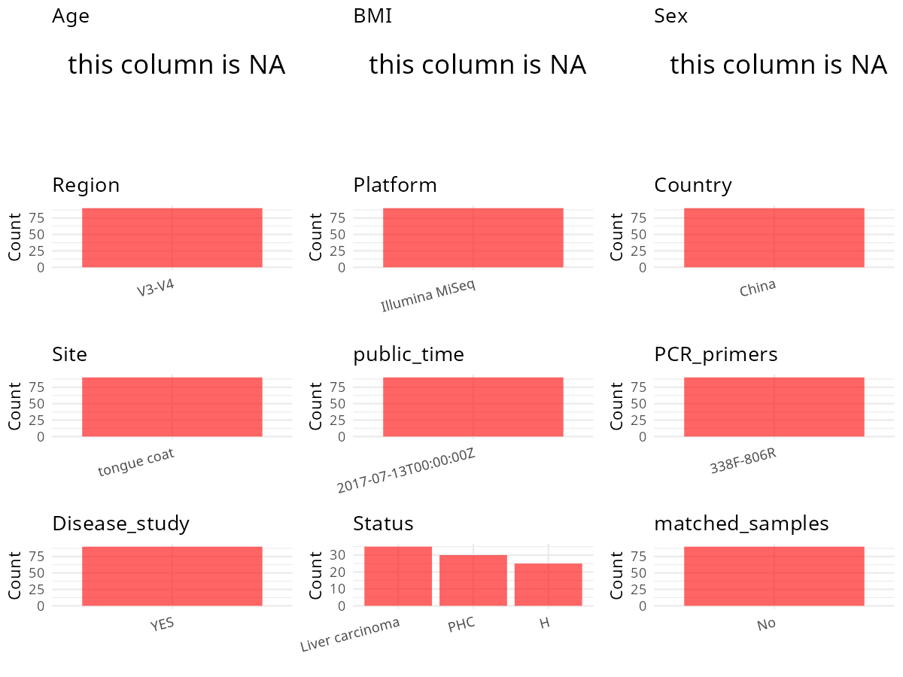

R Notebook: Metadata Processing Workflow
================

# Step 1: Obtain Initial Metadata from Each Project

To obtain the initial metadata: 1. Search for the BioProject ID (e.g.,
“PRJEBXXXX”) on the [NCBI SRA
website](https://www.ncbi.nlm.nih.gov/Traces/study/). 2. In the “Select”
table, click on “Metadata” and download the file. 3. The downloaded file
is typically named “SraRunTable.csv” and contains metadata for the
project.

``` r
# Load necessary libraries
library(dplyr)
library(ggplot2)
library(cowplot)

# Set working directory (update this path to your local directory)
setwd("/home/hby/oral_project/PRJEB12503")

# Read the initial metadata files
initial_meta <- read.csv("SraRunTable.csv", header = T)

# Display the first few rows of the metadata
head(initial_meta)
```

    ##          Run Assay.Type AvgSpotLen   Bases BioProject      BioSample   Bytes                                Center.Name Collection_Date Consent DATASTORE.filetype DATASTORE.provider
    ## 1 ERR2030897   AMPLICON        500 2060500 PRJEB12503 SAMEA104158208 1000461 ZHEJIANG UNIVERSITY, HANGZHOU, P. R. CHINA            2012  public   fastq,run.zq,sra     ena,gs,ncbi,s3
    ## 2 ERR2030936   AMPLICON        500 2543500 PRJEB12503 SAMEA104158247 1225541 ZHEJIANG UNIVERSITY, HANGZHOU, P. R. CHINA            2012  public   fastq,run.zq,sra     ena,gs,ncbi,s3
    ## 3 ERR2030916   AMPLICON        500 2663500 PRJEB12503 SAMEA104158227 1286466 ZHEJIANG UNIVERSITY, HANGZHOU, P. R. CHINA            2012  public   fastq,run.zq,sra     ena,gs,ncbi,s3
    ## 4 ERR2030912   AMPLICON        500 2696500 PRJEB12503 SAMEA104158223 1291556 ZHEJIANG UNIVERSITY, HANGZHOU, P. R. CHINA            2012  public   fastq,run.zq,sra     ena,gs,ncbi,s3
    ## 5 ERR2030890   AMPLICON        500 2022500 PRJEB12503 SAMEA104158201  969946 ZHEJIANG UNIVERSITY, HANGZHOU, P. R. CHINA            2012  public   fastq,run.zq,sra     ena,gs,ncbi,s3
    ## 6 ERR2030918   AMPLICON        500 2229000 PRJEB12503 SAMEA104158229 1080227 ZHEJIANG UNIVERSITY, HANGZHOU, P. R. CHINA            2012  public   fastq,run.zq,sra     ena,gs,ncbi,s3
    ##                           DATASTORE.region ENA.FIRST.PUBLIC..run. ENA.LAST.UPDATE..run. environment_.biome. environment_.feature. environment_material Experiment    external_id
    ## 1 ena,gs.us-east1,ncbi.public,s3.us-east-1              2017/7/11            2018/11/16         tongue coat           tongue coat          tongue coat ERX2089954 SAMEA104158208
    ## 2 ena,gs.us-east1,ncbi.public,s3.us-east-1              2017/7/11            2018/11/16         tongue coat           tongue coat          tongue coat ERX2089993 SAMEA104158247
    ## 3 ena,gs.us-east1,ncbi.public,s3.us-east-1              2017/7/11            2018/11/16         tongue coat           tongue coat          tongue coat ERX2089973 SAMEA104158227
    ## 4 ena,gs.us-east1,ncbi.public,s3.us-east-1              2017/7/11            2018/11/16         tongue coat           tongue coat          tongue coat ERX2089969 SAMEA104158223
    ## 5 ena,gs.us-east1,ncbi.public,s3.us-east-1              2017/7/11            2018/11/16         tongue coat           tongue coat          tongue coat ERX2089947 SAMEA104158201
    ## 6 ena,gs.us-east1,ncbi.public,s3.us-east-1              2017/7/11            2018/11/16         tongue coat           tongue coat          tongue coat ERX2089975 SAMEA104158229
    ##   geo_loc_name_country geo_loc_name_country_continent geographic_location_.country_and.or_sea. geographic_location_.latitude. geographic_location_.longitude.
    ## 1                China                           Asia                                    China                            120                              30
    ## 2                China                           Asia                                    China                            120                              30
    ## 3                China                           Asia                                    China                            120                              30
    ## 4                China                           Asia                                    China                            120                              30
    ## 5                China                           Asia                                    China                            120                              30
    ## 6                China                           Asia                                    China                            120                              30
    ##   humam_oral_environmental_package                              INSDC_center_name   INSDC_first_public    INSDC_last_update INSDC_status     Instrument investigation_type Library.Name
    ## 1                       human-oral ZHEJIANG UNIVERSITY\\, HANGZHOU\\, P. R. CHINA 2017-07-11T17:02:04Z 2017-07-11T04:15:37Z       public Illumina MiSeq         metagenome  unspecified
    ## 2                       human-oral ZHEJIANG UNIVERSITY\\, HANGZHOU\\, P. R. CHINA 2017-07-11T17:02:04Z 2017-07-11T04:15:38Z       public Illumina MiSeq         metagenome  unspecified
    ## 3                       human-oral ZHEJIANG UNIVERSITY\\, HANGZHOU\\, P. R. CHINA 2017-07-11T17:02:04Z 2017-07-11T04:15:37Z       public Illumina MiSeq         metagenome  unspecified
    ## 4                       human-oral ZHEJIANG UNIVERSITY\\, HANGZHOU\\, P. R. CHINA 2017-07-11T17:02:04Z 2017-07-11T04:15:37Z       public Illumina MiSeq         metagenome  unspecified
    ## 5                       human-oral ZHEJIANG UNIVERSITY\\, HANGZHOU\\, P. R. CHINA 2017-07-11T17:02:04Z 2017-07-11T04:15:37Z       public Illumina MiSeq         metagenome  unspecified
    ## 6                       human-oral ZHEJIANG UNIVERSITY\\, HANGZHOU\\, P. R. CHINA 2017-07-11T17:02:04Z 2017-07-11T04:15:37Z       public Illumina MiSeq         metagenome  unspecified
    ##   LibraryLayout LibrarySelection LibrarySource   Organism Platform               project_name          ReleaseDate          create_date version    Sample_Name status sample_name
    ## 1        PAIRED              PCR       GENOMIC metagenome ILLUMINA tongue coat of LC patients 2017-07-13T00:00:00Z 2017-07-13T14:48:00Z       1 SAMEA104158208      H        HT_1
    ## 2        PAIRED              PCR       GENOMIC metagenome ILLUMINA tongue coat of LC patients 2017-07-13T00:00:00Z 2017-07-13T14:52:00Z       1 SAMEA104158247      H       HT_10
    ## 3        PAIRED              PCR       GENOMIC metagenome ILLUMINA tongue coat of LC patients 2017-07-13T00:00:00Z 2017-07-13T14:50:00Z       1 SAMEA104158227      H       HT_11
    ## 4        PAIRED              PCR       GENOMIC metagenome ILLUMINA tongue coat of LC patients 2017-07-13T00:00:00Z 2017-07-13T14:49:00Z       1 SAMEA104158223      H       HT_12
    ## 5        PAIRED              PCR       GENOMIC metagenome ILLUMINA tongue coat of LC patients 2017-07-13T00:00:00Z 2017-07-13T14:47:00Z       1 SAMEA104158201      H       HT_13
    ## 6        PAIRED              PCR       GENOMIC metagenome ILLUMINA tongue coat of LC patients 2017-07-13T00:00:00Z 2017-07-13T14:50:00Z       1 SAMEA104158229      H       HT_14
    ##          Sequencing_method SRA.Study Submitter_Id ENA_first_public ENA_last_update                             INSDC_center_alias   ENA_first_public.1    ENA_last_update.1
    ## 1 Illumina miseq sequencer ERP013989         HT_1        2017/7/11       2017/7/11 ZHEJIANG UNIVERSITY\\, HANGZHOU\\, P. R. CHINA                                          
    ## 2 Illumina miseq sequencer ERP013989        HT_10        2017/7/11       2017/7/11 ZHEJIANG UNIVERSITY\\, HANGZHOU\\, P. R. CHINA                                          
    ## 3 Illumina miseq sequencer ERP013989        HT_11        2017/7/11       2017/7/11 ZHEJIANG UNIVERSITY\\, HANGZHOU\\, P. R. CHINA                                          
    ## 4 Illumina miseq sequencer ERP013989        HT_12        2017/7/11       2017/7/11 ZHEJIANG UNIVERSITY\\, HANGZHOU\\, P. R. CHINA                                          
    ## 5 Illumina miseq sequencer ERP013989        HT_13                                                                                 2017-07-11T17:02:04Z 2017-07-11T04:15:37Z
    ## 6 Illumina miseq sequencer ERP013989        HT_14        2017/7/11       2017/7/11 ZHEJIANG UNIVERSITY\\, HANGZHOU\\, P. R. CHINA                                          
    ##   scientific_name
    ## 1                
    ## 2                
    ## 3                
    ## 4                
    ## 5      metagenome
    ## 6

# Step 2: Create a Uniform Metadata Template

The uniform metadata should include the following columns:

1.  **BioProject**: Project ID (e.g., “PRJNA339212”)
2.  **Run**: Sample ID (e.g., “ERRXXXXXX” or “SRRXXXXXX”)
3.  **sample_name**: Original sample name submitted by the authors (not
    the database-assigned ID)
4.  **Age**: Age of the subject (if available)
5.  **BMI**: Body Mass Index (if available)
6.  **Sex**: Sex of the subject (“F” or “M”)
7.  **Region**: Targeted 16S rRNA region (e.g., “V3-V4”)
8.  **Platform**: Sequencing platform (e.g., “Illumina MiSeq”)
9.  **Country**: Country of sample origin (e.g., “China”)
10. **Site**: Sample site (e.g., “saliva”, “dental plaque”)
11. **public_time**: Data release date (format: “YYYY-MM-DD”)
12. **PCR_primers**: PCR primers used (e.g., “515F-806R”)
13. **title**: Title of the associated publication
14. **Disease_study**: Whether the study involves a disease (“YES” or
    “NO”)
15. **Status**: Disease status (e.g., “T2DM”, “HC”). Note: If the study
    includes both disease and healthy samples, this must be specified
    per sample.
16. **matched_samples**: matched samples (“YES” or “NO”)

``` r
# Create a uniform metadata dataframe
metadata <- data.frame(
  BioProject = initial_meta$BioProject,
  Run = initial_meta$Run,
  sample_name = initial_meta$sample_name,
  Platform = initial_meta$Instrument,
  Country = initial_meta$geo_loc_name_country,
  Site = initial_meta$environment_material,
  public_time = initial_meta$ReleaseDate,
  Status = initial_meta$status,
  stringsAsFactors = FALSE,
  Sex = NA,
  Age = NA,
  BMI = NA
)
```

# Step 3: Manually Add Information from the Publication

Some information (e.g. PCR primers, study title, disease status) must be
manually extracted from the publication and added to the metadata.

``` r
# Add information obtained from the publication
metadata$Region <- "V3-V4"
metadata$PCR_primers <- "338F-806R"
metadata$matched_samples <- "No"
metadata$title <- "Deep sequencing reveals microbiota dysbiosis of tongue coat in patients with liver carcinoma/Tongue coating microbiome data distinguish patients with pancreatic head cancer from healthy controls"
metadata$Disease_study <- "YES"
```

# Step 4: Summarize and Validate the Metadata

``` r
# Check the number of unique runs and sample names
print(paste("Number of unique runs:", length(unique(metadata$Run))))
```

    ## [1] "Number of unique runs: 90"

``` r
print(paste("Number of unique sample names:", length(unique(metadata$sample_name))))
```

    ## [1] "Number of unique sample names: 90"

# Step 5: Visualize the Metadata

``` r

```


# Step 6: Finalize and Export the Metadata

``` r
# Reorder columns to match the desired format
metadata <- metadata[, c(
  "BioProject", "Run", "sample_name", "Age", "BMI", "Sex",
  "Region", "Platform", "Country", "Site", "public_time",
  "PCR_primers", "title", "Disease_study", "Status", "matched_samples"
)]

# Export the uniform metadata to a CSV file
write.csv(metadata, file = "metadata.csv", quote = FALSE)
head(metadata)
```

    ##   BioProject        Run sample_name Age BMI Sex Region       Platform Country        Site          public_time PCR_primers
    ## 1 PRJEB12503 ERR2030897        HT_1  NA  NA  NA  V3-V4 Illumina MiSeq   China tongue coat 2017-07-13T00:00:00Z   338F-806R
    ## 2 PRJEB12503 ERR2030936       HT_10  NA  NA  NA  V3-V4 Illumina MiSeq   China tongue coat 2017-07-13T00:00:00Z   338F-806R
    ## 3 PRJEB12503 ERR2030916       HT_11  NA  NA  NA  V3-V4 Illumina MiSeq   China tongue coat 2017-07-13T00:00:00Z   338F-806R
    ## 4 PRJEB12503 ERR2030912       HT_12  NA  NA  NA  V3-V4 Illumina MiSeq   China tongue coat 2017-07-13T00:00:00Z   338F-806R
    ## 5 PRJEB12503 ERR2030890       HT_13  NA  NA  NA  V3-V4 Illumina MiSeq   China tongue coat 2017-07-13T00:00:00Z   338F-806R
    ## 6 PRJEB12503 ERR2030918       HT_14  NA  NA  NA  V3-V4 Illumina MiSeq   China tongue coat 2017-07-13T00:00:00Z   338F-806R
    ##                                                                                                                                                                                                title
    ## 1 Deep sequencing reveals microbiota dysbiosis of tongue coat in patients with liver carcinoma/Tongue coating microbiome data distinguish patients with pancreatic head cancer from healthy controls
    ## 2 Deep sequencing reveals microbiota dysbiosis of tongue coat in patients with liver carcinoma/Tongue coating microbiome data distinguish patients with pancreatic head cancer from healthy controls
    ## 3 Deep sequencing reveals microbiota dysbiosis of tongue coat in patients with liver carcinoma/Tongue coating microbiome data distinguish patients with pancreatic head cancer from healthy controls
    ## 4 Deep sequencing reveals microbiota dysbiosis of tongue coat in patients with liver carcinoma/Tongue coating microbiome data distinguish patients with pancreatic head cancer from healthy controls
    ## 5 Deep sequencing reveals microbiota dysbiosis of tongue coat in patients with liver carcinoma/Tongue coating microbiome data distinguish patients with pancreatic head cancer from healthy controls
    ## 6 Deep sequencing reveals microbiota dysbiosis of tongue coat in patients with liver carcinoma/Tongue coating microbiome data distinguish patients with pancreatic head cancer from healthy controls
    ##   Disease_study Status matched_samples
    ## 1           YES      H              No
    ## 2           YES      H              No
    ## 3           YES      H              No
    ## 4           YES      H              No
    ## 5           YES      H              No
    ## 6           YES      H              No

## Notes for Students:

1.  **Metadata Accuracy**: Always cross-check the metadata with the
    original publication to ensure accuracy.
2.  **Manual Entries**: Columns like `PCR_primers`, and `Status` often
    require manual entry based on the publication.
3.  **Disease Status**: Be careful when assigning `Status`—some studies
    include both disease and healthy samples.
4.  **Visualization**: The plots help quickly identify the distribution
    of values in each column, which is useful for quality control.
5.  **Reproducibility**: Update the working directory and file paths to
    match your local environment.
