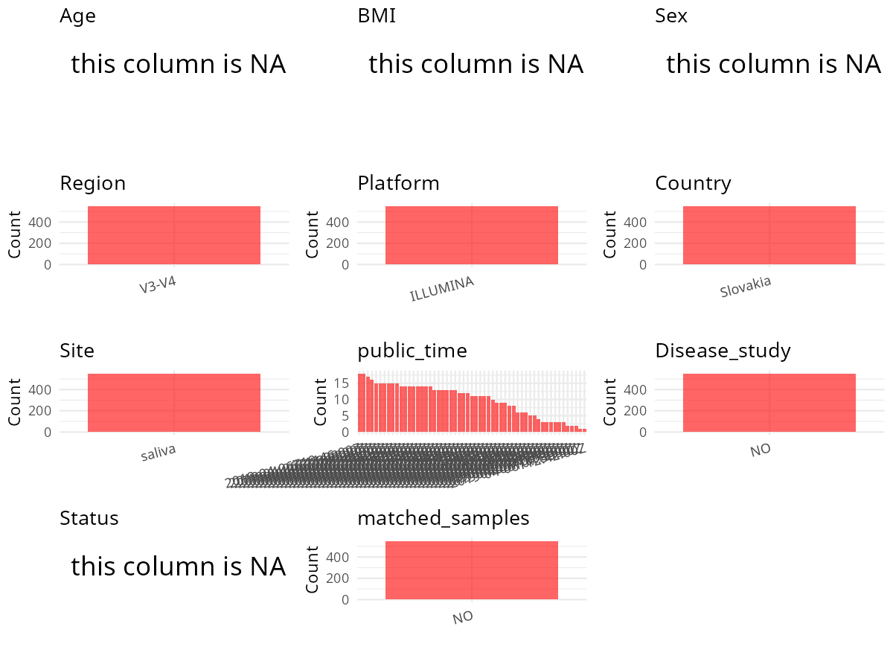

# Step 1: Obtain Initial Metadata from Each Project

To obtain the initial metadata:
1. Search for the BioProject ID (e.g., "PRJEBXXXX") on the [NCBI SRA website](https://www.ncbi.nlm.nih.gov/Traces/study/).
2. In the "Select" table, click on "Metadata" and download the file.
3. The downloaded file is typically named "SraRunTable.csv" and contains metadata for the project.

```{r message=FALSE, warning=FALSE}

library(dplyr)
## visualization
library(ggplot2)
library(gridExtra)
library(cowplot)
```

```{r}
setwd("/home/liuxuan/metadata/PRJEB20213")
initial_meta <- read.csv("SraRunTable.csv", header = TRUE)
head(initial_meta)
colnames(initial_meta)  
```

# Step 2: Create a Uniform Metadata Template

The uniform metadata should include the following columns:

1. **BioProject**: Project ID (e.g., "PRJNA339212")
2. **Run**: Sample ID (e.g., "ERRXXXXXX" or "SRRXXXXXX")
3. **sample_name**: Original sample name submitted by the authors (not the database-assigned ID)
4. **Age**: Age of the subject (if available)
5. **BMI**: Body Mass Index (if available)
6. **Sex**: Sex of the subject ("F" or "M")
7. **Region**: Targeted 16S rRNA region (e.g., "V3-V4")
8. **Platform**: Sequencing platform (e.g., "Illumina MiSeq")
9. **Country**: Country of sample origin (e.g., "China")
10. **Site**: Sample site (e.g., "saliva", "dental plaque")
11. **public_time**: Data release date (format: "YYYY-MM-DD")
12. **PCR_primers**: PCR primers used (e.g., "515F-806R")
13. **title**: Title of the associated publication
14. **Disease_study**: Whether the study involves a disease ("YES" or "NO")
15. **Status**: Disease status (e.g., "T2DM", "HC"). Note: If the study includes both disease and healthy samples, this must be specified per sample.
16. **matched_samples**: matched samples ("YES" or "NO")
```{r}
uniform_meta <- data.frame(
    BioProject = initial_meta$BioProject,
    Run = initial_meta$Run,
    sample_name = initial_meta$'sample_name',
    Age = NA,
    BMI = NA,
    Sex = NA,
    Region = "V3-V4",
    Platform = initial_meta$Platform,
    Country = initial_meta$'geographic_location_.country_and.or_sea.',
    Site = 'saliva',
    public_time = initial_meta$create_date,
    PCR_primers = 'F: TCGTCGGCAGCGTCAGATGTGTATAAGAGACAGCCTACGGGNGGCWGCAG; R: GTCTCGTGGGCTCGGAGATGTGTATAAGAGACAGGACTACHVGGGTATCTAATCC',
    title = 'Oxidative stress in the oral cavity is driven by individual-specific bacterial communities',
    Disease_study = "NO",
    Status = NA,
    matched_samples = 'NO')
print(length(unique(uniform_meta$Run)))
print(length(unique(uniform_meta$sample_name)))
```

```{r}
plot_data <- uniform_meta %>%
  select(-BioProject, -Run, -sample_name, -title)

create_simple_plots <- function(data) {
  plots <- list()
  
  for (col in colnames(data)) {
    if (all(is.na(data[[col]]))) {
      p <- ggplot() +
        annotate("text", x = 0.5, y = 0.5, label = "this column is NA", size = 6) +
        labs(title = col) +
        theme_void()
    } else if (is.numeric(data[[col]])) {
      p <- ggplot(data, aes(x = .data[[col]])) +
        geom_histogram(fill = "blue", alpha = 0.6, bins = 20, na.rm = TRUE) +
        labs(title = col) +
        theme_minimal()
    } else {
      count_data <- as.data.frame(table(data[[col]], useNA = "ifany"))
      p <- ggplot(count_data, aes(x = reorder(Var1, -Freq), y = Freq)) +
        geom_col(fill = "red", alpha = 0.6) +
        labs(title = col, x = NULL, y = "Count") +
        theme_minimal() +
        theme(axis.text.x = element_text(angle = 15, hjust = 1))
    }
    plots[[col]] <- p
  }
  return(plots)
}

plots <- create_simple_plots(plot_data)
p <- plot_grid(plots$Age, plots$BMI, plots$Sex, plots$Region, 
               plots$Platform, plots$Country, plots$Site,
               plots$public_time, plots$Disease_study,
               plots$Status, plots$matched_samples, 
               ncol = 3, align = "hv", axis = "lb")
p
ggsave("Metadata_Summary.png", plot = p, width = 8, height = 6, dpi = 150)
```

```{r}

```

## 保存结果

```{r save_results}
uniform_meta <- uniform_meta[, c("BioProject", "Run", "sample_name", "Age", "BMI", "Sex", "Region", "Platform", "Country", "Site", "public_time", "PCR_primers", "title", "Disease_study", "Status")]
write.csv(uniform_meta, file = "/home/liuxuan/metadata/PRJEB20213/metadata.csv", quote = F)
```