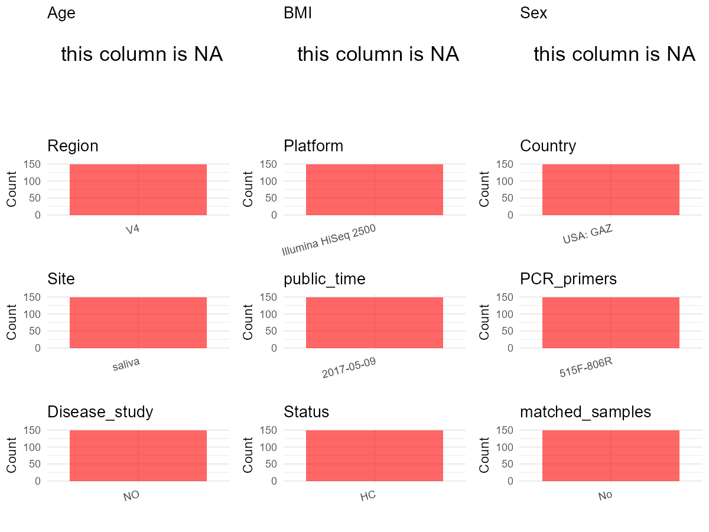

R Notebook: Metadata Processing Workflow
================

# Step 1: Obtain Initial Metadata from Each Project

To obtain the initial metadata: 1. Search for the BioProject ID (e.g.,
“PRJEBXXXX”) on the [NCBI SRA
website](https://www.ncbi.nlm.nih.gov/Traces/study/). 2. In the “Select”
table, click on “Metadata” and download the file. 3. The downloaded file
is typically named “SraRunTable.csv” and contains metadata for the
project.

``` r
# Load necessary libraries
library(dplyr)
library(ggplot2)
library(cowplot)

# Set working directory (update this path to your local directory)
setwd("D:/oral_project/PRJEB13898")

# Read the initial metadata files
initial_meta<-read.csv("SraRunTable.csv",header = T)

# Combine the two metadata files
#meta <- rbind(initial_meta, initial_meta1)

#Remove entries non-oral samples
#initial_meta <- subset(initial_meta,isolate %in% c("saliva","tongue coat"))

# Check the number of samples containing "HT" in Sample.Name (e.g., healthy controls)
#nrow(subset(meta, grepl("HT", Sample.Name)))

# Display the first few rows of the metadata
head(initial_meta)
```

    ##          Run altitude anonymized_name Assay.Type assigned_from_geo AvgSpotLen
    ## 1 ERR1404162        0        10031111      OTHER             False        149
    ## 2 ERR1404163        0        10031151      OTHER             False        149
    ## 3 ERR1404164        0        10031211      OTHER             False        149
    ## 4 ERR1404165        0        10041111      OTHER             False        149
    ## 5 ERR1404166        0        10041151      OTHER             False        149
    ## 6 ERR1404167        0        10041211      OTHER             False        149
    ##   Barcode..exp.    Bases BioProject    BioSample       body_habitat
    ## 1  GTAGTAGACCAT 10205126 PRJEB13898 SAMEA3959089 UBERON:oral cavity
    ## 2  CCGGACAAGAAG  9906776 PRJEB13898 SAMEA3959090 UBERON:oral cavity
    ## 3  TAAATATACCCT 12939948 PRJEB13898 SAMEA3959091 UBERON:oral cavity
    ## 4  CGTATAAATGCG 10878389 PRJEB13898 SAMEA3959092 UBERON:oral cavity
    ## 5  TGACTAATGGCC  8086524 PRJEB13898 SAMEA3959093 UBERON:oral cavity
    ## 6  GTGGAGTCTCAT 13106796 PRJEB13898 SAMEA3959094 UBERON:oral cavity
    ##    body_product    body_site   Bytes center_name..exp.
    ## 1 UBERON:saliva UBERON:mouth 5889974       Mayo Clinic
    ## 2 UBERON:saliva UBERON:mouth 5786655       Mayo Clinic
    ## 3 UBERON:saliva UBERON:mouth 7315554       Mayo Clinic
    ## 4 UBERON:saliva UBERON:mouth 6309720       Mayo Clinic
    ## 5 UBERON:saliva UBERON:mouth 4590772       Mayo Clinic
    ## 6 UBERON:saliva UBERON:mouth 7593789       Mayo Clinic
    ##                                          Center.Name center_name
    ## 1 UNIVERSITY OF CALIFORNIA SAN DIEGO MICROBIOME INIT         NCI
    ## 2 UNIVERSITY OF CALIFORNIA SAN DIEGO MICROBIOME INIT         NCI
    ## 3 UNIVERSITY OF CALIFORNIA SAN DIEGO MICROBIOME INIT         NCI
    ## 4 UNIVERSITY OF CALIFORNIA SAN DIEGO MICROBIOME INIT         NCI
    ## 5 UNIVERSITY OF CALIFORNIA SAN DIEGO MICROBIOME INIT         NCI
    ## 6 UNIVERSITY OF CALIFORNIA SAN DIEGO MICROBIOME INIT         NCI
    ##   center_project_name..exp. collection_timestamp           common_name Consent
    ## 1    Mayo_fecal_stability_2          5/7/15 0:00 human oral metagenome  public
    ## 2    Mayo_fecal_stability_2          5/7/15 0:00 human oral metagenome  public
    ## 3    Mayo_fecal_stability_2          5/7/15 0:00 human oral metagenome  public
    ## 4    Mayo_fecal_stability_2          5/7/15 0:00 human oral metagenome  public
    ## 5    Mayo_fecal_stability_2          5/7/15 0:00 human oral metagenome  public
    ## 6    Mayo_fecal_stability_2          5/7/15 0:00 human oral metagenome  public
    ##    COUNTRY DATASTORE.filetype DATASTORE.provider
    ## 1 USA: GAZ   fastq,run.zq,sra     ena,gs,ncbi,s3
    ## 2 USA: GAZ   fastq,run.zq,sra     ena,gs,ncbi,s3
    ## 3 USA: GAZ   fastq,run.zq,sra     ena,gs,ncbi,s3
    ## 4 USA: GAZ   fastq,run.zq,sra     ena,gs,ncbi,s3
    ## 5 USA: GAZ   fastq,run.zq,sra     ena,gs,ncbi,s3
    ## 6 USA: GAZ   fastq,run.zq,sra     ena,gs,ncbi,s3
    ##                           DATASTORE.region Day Depth dna_extracted elevation
    ## 1 ena,gs.us-east1,ncbi.public,s3.us-east-1   0     0          True       314
    ## 2 ena,gs.us-east1,ncbi.public,s3.us-east-1   4     0          True       314
    ## 3 ena,gs.us-east1,ncbi.public,s3.us-east-1   0     0          True       314
    ## 4 ena,gs.us-east1,ncbi.public,s3.us-east-1   0     0          True       314
    ## 5 ena,gs.us-east1,ncbi.public,s3.us-east-1   4     0          True       314
    ## 6 ena,gs.us-east1,ncbi.public,s3.us-east-1   0     0          True       314
    ##   emp_status..exp. ENA.FIRST.PUBLIC..run. ENA_first_public
    ## 1    EMP_Processed             2017-05-08       2017-05-08
    ## 2    EMP_Processed             2017-05-08       2017-05-08
    ## 3    EMP_Processed             2017-05-08       2017-05-08
    ## 4    EMP_Processed             2017-05-08       2017-05-08
    ## 5    EMP_Processed             2017-05-08       2017-05-08
    ## 6    EMP_Processed             2017-05-08       2017-05-08
    ##   ENA.LAST.UPDATE..run. ENA_last_update        env_biome
    ## 1            2018-11-16      2016-05-08 ENVO:urban_biome
    ## 2            2018-11-16      2016-05-08 ENVO:urban_biome
    ## 3            2018-11-16      2016-05-08 ENVO:urban_biome
    ## 4            2018-11-16      2016-05-08 ENVO:urban_biome
    ## 5            2018-11-16      2016-05-08 ENVO:urban_biome
    ## 6            2018-11-16      2016-05-08 ENVO:urban_biome
    ##                     env_feature  env_matter experiment_center..exp. Experiment
    ## 1 ENVO:human-associated_habitat ENVO:saliva                     NCI ERX1475421
    ## 2 ENVO:human-associated_habitat ENVO:saliva                     NCI ERX1475422
    ## 3 ENVO:human-associated_habitat ENVO:saliva                     NCI ERX1475423
    ## 4 ENVO:human-associated_habitat ENVO:saliva                     NCI ERX1475424
    ## 5 ENVO:human-associated_habitat ENVO:saliva                     NCI ERX1475425
    ## 6 ENVO:human-associated_habitat ENVO:saliva                     NCI ERX1475426
    ##         experiment_title..exp.  external_id extracted_dna_avail_now
    ## 1 Mayo_Fecal_Stability_round_2 SAMEA3959089                    True
    ## 2 Mayo_Fecal_Stability_round_2 SAMEA3959090                    True
    ## 3 Mayo_Fecal_Stability_round_2 SAMEA3959091                    True
    ## 4 Mayo_Fecal_Stability_round_2 SAMEA3959092                    True
    ## 5 Mayo_Fecal_Stability_round_2 SAMEA3959093                    True
    ## 6 Mayo_Fecal_Stability_round_2 SAMEA3959094                    True
    ##   extraction_method extraction_robot..exp. extractionkit_lot..exp.
    ## 1   Scope Mouthwash                 Carmen                  PS14H8
    ## 2   Scope Mouthwash                 Carmen                  PS14H8
    ## 3     OMNIGene Tube                 Carmen                  PS14H8
    ## 4   Scope Mouthwash                 Carmen                  PS14H8
    ## 5   Scope Mouthwash                 Carmen                  PS14H8
    ## 6     OMNIGene Tube                 Carmen                  PS14H8
    ##   has_extracted_data has_physical_specimen host_common_name host_subject_id
    ## 1               True                  True            human            1003
    ## 2               True                  True            human            1003
    ## 3               True                  True            human            1003
    ## 4               True                  True            human            1004
    ## 5               True                  True            human            1004
    ## 6               True                  True            human            1004
    ##   host_taxid INSDC_center_alias
    ## 1       9606             UCSDMI
    ## 2       9606             UCSDMI
    ## 3       9606             UCSDMI
    ## 4       9606             UCSDMI
    ## 5       9606             UCSDMI
    ## 6       9606             UCSDMI
    ##                                          INSDC_center_name   INSDC_first_public
    ## 1 University of California San Diego Microbiome Initiative 2017-05-08T17:01:56Z
    ## 2 University of California San Diego Microbiome Initiative 2017-05-08T17:01:56Z
    ## 3 University of California San Diego Microbiome Initiative 2017-05-08T17:01:56Z
    ## 4 University of California San Diego Microbiome Initiative 2017-05-08T17:01:56Z
    ## 5 University of California San Diego Microbiome Initiative 2017-05-08T17:01:56Z
    ## 6 University of California San Diego Microbiome Initiative 2017-05-08T17:01:56Z
    ##      INSDC_last_update INSDC_status          Instrument LATITUDE Library.Name
    ## 1 2016-05-08T09:21:28Z       public Illumina HiSeq 2500    44.02      10463.1
    ## 2 2016-05-08T09:21:28Z       public Illumina HiSeq 2500    44.02      10463.1
    ## 3 2016-05-08T09:21:29Z       public Illumina HiSeq 2500    44.02      10463.1
    ## 4 2016-05-08T09:21:29Z       public Illumina HiSeq 2500    44.02      10463.1
    ## 5 2016-05-08T09:21:29Z       public Illumina HiSeq 2500    44.02      10463.1
    ## 6 2016-05-08T09:21:29Z       public Illumina HiSeq 2500    44.02      10463.1
    ##   LibraryLayout LibrarySelection LibrarySource linker..exp. LONGITUDE
    ## 1        SINGLE              PCR   METAGENOMIC           GT  -92.4699
    ## 2        SINGLE              PCR   METAGENOMIC           GT  -92.4699
    ## 3        SINGLE              PCR   METAGENOMIC           GT  -92.4699
    ## 4        SINGLE              PCR   METAGENOMIC           GT  -92.4699
    ## 5        SINGLE              PCR   METAGENOMIC           GT  -92.4699
    ## 6        SINGLE              PCR   METAGENOMIC           GT  -92.4699
    ##   mastermix_lot..exp.              Organism
    ## 1           148042106 human oral metagenome
    ## 2           148042106 human oral metagenome
    ## 3           148042106 human oral metagenome
    ## 4           148042106 human oral metagenome
    ## 5           148042106 human oral metagenome
    ## 6           148042106 human oral metagenome
    ##                                   pcr_primers..exp. physical_specimen_location
    ## 1 FWD:GTGCCAGCMGCCGCGGTAA;_REV:GGACTACHVGGGTWTCTAAT                Mayo_Clinic
    ## 2 FWD:GTGCCAGCMGCCGCGGTAA;_REV:GGACTACHVGGGTWTCTAAT                Mayo_Clinic
    ## 3 FWD:GTGCCAGCMGCCGCGGTAA;_REV:GGACTACHVGGGTWTCTAAT                Mayo_Clinic
    ## 4 FWD:GTGCCAGCMGCCGCGGTAA;_REV:GGACTACHVGGGTWTCTAAT                Mayo_Clinic
    ## 5 FWD:GTGCCAGCMGCCGCGGTAA;_REV:GGACTACHVGGGTWTCTAAT                Mayo_Clinic
    ## 6 FWD:GTGCCAGCMGCCGCGGTAA;_REV:GGACTACHVGGGTWTCTAAT                Mayo_Clinic
    ##   physical_specimen_remaining Platform plating..exp. primer_date..exp.
    ## 1                        True ILLUMINA        JGGHGG           3/31/15
    ## 2                        True ILLUMINA        JGGHGG           4/12/15
    ## 3                        True ILLUMINA        JGGHGG           4/24/15
    ## 4                        True ILLUMINA        JGGHGG           2/22/15
    ## 5                        True ILLUMINA        JGGHGG            3/6/15
    ## 6                        True ILLUMINA        JGGHGG           3/18/15
    ##   primer..exp. primer_plate..exp. processing_robot..exp. public
    ## 1       PRIMER                  1                   JERE   True
    ## 2       PRIMER                  1                   JERE   True
    ## 3       PRIMER                  1                   JERE   True
    ## 4       PRIMER                  1                   JERE   True
    ## 5       PRIMER                  1                   JERE   True
    ## 6       PRIMER                  1                   JERE   True
    ##            ReleaseDate required_sample_info_status run_center..exp.
    ## 1 2017-05-09T00:00:00Z                   completed           UCSDMI
    ## 2 2017-05-09T00:00:00Z                   completed           UCSDMI
    ## 3 2017-05-09T00:00:00Z                   completed           UCSDMI
    ## 4 2017-05-09T00:00:00Z                   completed           UCSDMI
    ## 5 2017-05-09T00:00:00Z                   completed           UCSDMI
    ## 6 2017-05-09T00:00:00Z                   completed           UCSDMI
    ##   run_date..exp.          create_date version run_prefix..exp. samp_size..exp.
    ## 1         5/7/15 2017-06-21T23:56:00Z       1           Lane_1            .1,g
    ## 2         5/7/15 2017-06-21T23:56:00Z       1           Lane_1            .1,g
    ## 3         5/7/15 2017-06-21T23:56:00Z       1           Lane_1            .1,g
    ## 4         5/7/15 2017-06-21T23:56:00Z       1           Lane_1            .1,g
    ## 5         5/7/15 2017-06-21T23:56:00Z       1           Lane_1            .1,g
    ## 6         5/7/15 2017-06-21T23:57:00Z       1           Lane_1            .1,g
    ##   sample_center..exp.  Sample.Name                    Sample_name
    ## 1         Mayo_Clinic SAMEA3959089 qiita_sid_10463:10463.10031111
    ## 2         Mayo_Clinic SAMEA3959090 qiita_sid_10463:10463.10031151
    ## 3         Mayo_Clinic SAMEA3959091 qiita_sid_10463:10463.10031211
    ## 4         Mayo_Clinic SAMEA3959092 qiita_sid_10463:10463.10041111
    ## 5         Mayo_Clinic SAMEA3959093 qiita_sid_10463:10463.10041151
    ## 6         Mayo_Clinic SAMEA3959094 qiita_sid_10463:10463.10041211
    ##          sample_plate..exp. sample_type   sequencing_meth..exp. SRA.Study
    ## 1 Mayo_Fecal_Stability_II_1      saliva sequencing_by_synthesis ERP015481
    ## 2 Mayo_Fecal_Stability_II_1      saliva sequencing_by_synthesis ERP015481
    ## 3 Mayo_Fecal_Stability_II_1      saliva sequencing_by_synthesis ERP015481
    ## 4 Mayo_Fecal_Stability_II_1      saliva sequencing_by_synthesis ERP015481
    ## 5 Mayo_Fecal_Stability_II_1      saliva sequencing_by_synthesis ERP015481
    ## 6 Mayo_Fecal_Stability_II_1      saliva sequencing_by_synthesis ERP015481
    ##   study_center..exp. subject_id                   Submitter_Id
    ## 1                NCI       1003 qiita_sid_10463:10463.10031111
    ## 2                NCI       1003 qiita_sid_10463:10463.10031151
    ## 3                NCI       1003 qiita_sid_10463:10463.10031211
    ## 4                NCI       1004 qiita_sid_10463:10463.10041111
    ## 5                NCI       1004 qiita_sid_10463:10463.10041151
    ## 6                NCI       1004 qiita_sid_10463:10463.10041211
    ##   target_gene..exp. target_subfragment..exp. tm1000_8_tool..exp.
    ## 1          16S rRNA                       V4              31172B
    ## 2          16S rRNA                       V4              31172B
    ## 3          16S rRNA                       V4              31172B
    ## 4          16S rRNA                       V4              31172B
    ## 5          16S rRNA                       V4              31172B
    ## 6          16S rRNA                       V4              31172B
    ##   tm300_8_tool..exp. tm50_8_tool..exp. water_lot..exp.
    ## 1            111569B           311426B        RNDB2494
    ## 2            111569B           311426B        RNDB2494
    ## 3            111569B           311426B        RNDB2494
    ## 4            111569B           311426B        RNDB2494
    ## 5            111569B           311426B        RNDB2494
    ## 6            111569B           311426B        RNDB2494
    ##                                 well_designation..exp. well_id..exp.
    ## 1 Mayo_Fecal_Stability_II_1_Mayo_Fecal_Stability_II_E2            E2
    ## 2 Mayo_Fecal_Stability_II_1_Mayo_Fecal_Stability_II_F2            F2
    ## 3 Mayo_Fecal_Stability_II_1_Mayo_Fecal_Stability_II_G2            G2
    ## 4 Mayo_Fecal_Stability_II_1_Mayo_Fecal_Stability_II_B1            B1
    ## 5 Mayo_Fecal_Stability_II_1_Mayo_Fecal_Stability_II_C1            C1
    ## 6 Mayo_Fecal_Stability_II_1_Mayo_Fecal_Stability_II_D1            D1

# Step 2: Create a Uniform Metadata Template

The uniform metadata should include the following columns:

1.  **BioProject**: Project ID (e.g., “PRJNA339212”)
2.  **Run**: Sample ID (e.g., “ERRXXXXXX” or “SRRXXXXXX”)
3.  **sample_name**: Original sample name submitted by the authors (not
    the database-assigned ID)
4.  **Age**: Age of the subject (if available)
5.  **BMI**: Body Mass Index (if available)
6.  **Sex**: Sex of the subject (“F” or “M”)
7.  **Region**: Targeted 16S rRNA region (e.g., “V3-V4”)
8.  **Platform**: Sequencing platform (e.g., “Illumina MiSeq”)
9.  **Country**: Country of sample origin (e.g., “China”)
10. **Site**: Sample site (e.g., “saliva”, “dental plaque”)
11. **public_time**: Data release date (format: “YYYY-MM-DD”)
12. **PCR_primers**: PCR primers used (e.g., “515F-806R”)
13. **title**: Title of the associated publication
14. **Disease_study**: Whether the study involves a disease (“YES” or
    “NO”)
15. **Status**: Disease status (e.g., “T2DM”, “HC”). Note: If the study
    includes both disease and healthy samples, this must be specified
    per sample.
16. **matched_samples**: matched samples (“YES” or “NO”)

``` r
# Create a uniform metadata dataframe
metadata <- data.frame(
  BioProject = initial_meta$BioProject,
  Run = initial_meta$Run,
  sample_name = initial_meta$host_subject_id,
  Age = NA,
  BMI = NA,
  Sex = NA,
  Region = initial_meta$target_subfragment..exp.,
  Platform = initial_meta$Instrument,
  Country = initial_meta$COUNTRY,
  Site = initial_meta$sample_type,
  public_time = "2017-05-09",
  PCR_primers = "515F-806R",
  stringsAsFactors = FALSE
)
```

# Step 3: Manually Add Information from the Publication

Some information (e.g. PCR primers, study title, disease status) must be
manually extracted from the publication and added to the metadata.

``` r
# Add information obtained from the publication
metadata$title <- "Comparison of Oral Collection Methods for Studies of Microbiota"
metadata$Disease_study <- "NO"
# Assign disease status based on sample_name patterns
metadata$Status <- "HC"

#get subjects id with Saliva available
keep_subjects<-subset(metadata,Site %in% "saliva")
#remove subjects without Saliva samples
metadata<-subset(metadata,sample_name %in% keep_subjects$sample_name)
#get subjects sampling counts
sample_counts <- table(metadata$sample_name)
# Create matched_samples column, any subjects have >=2 samples will be label "YES", otherwise "NO"
metadata$matched_samples="No"
```

# Step 4: Summarize and Validate the Metadata

``` r
# Check the number of unique runs and sample names
print(paste("Number of unique runs:", length(unique(metadata$Run))))
```

    ## [1] "Number of unique runs: 149"

``` r
print(paste("Number of unique sample names:", length(unique(metadata$sample_name))))
```

    ## [1] "Number of unique sample names: 52"

# Step 5: Visualize the Metadata

``` r

```

<!-- -->

# Step 6: Finalize and Export the Metadata

``` r
# Reorder columns to match the desired format
metadata <- metadata[, c(
  "BioProject", "Run", "sample_name", "Age", "BMI", "Sex", 
  "Region", "Platform", "Country", "Site", "public_time", 
  "PCR_primers", "title", "Disease_study", "Status","matched_samples"
)]

# Export the uniform metadata to a CSV file
write.csv(metadata, file = "metadata.csv", quote = FALSE)
head(metadata)
```

    ##   BioProject        Run sample_name Age BMI Sex Region            Platform
    ## 1 PRJEB13898 ERR1404162        1003  NA  NA  NA     V4 Illumina HiSeq 2500
    ## 2 PRJEB13898 ERR1404163        1003  NA  NA  NA     V4 Illumina HiSeq 2500
    ## 3 PRJEB13898 ERR1404164        1003  NA  NA  NA     V4 Illumina HiSeq 2500
    ## 4 PRJEB13898 ERR1404165        1004  NA  NA  NA     V4 Illumina HiSeq 2500
    ## 5 PRJEB13898 ERR1404166        1004  NA  NA  NA     V4 Illumina HiSeq 2500
    ## 6 PRJEB13898 ERR1404167        1004  NA  NA  NA     V4 Illumina HiSeq 2500
    ##    Country   Site public_time PCR_primers
    ## 1 USA: GAZ saliva  2017-05-09   515F-806R
    ## 2 USA: GAZ saliva  2017-05-09   515F-806R
    ## 3 USA: GAZ saliva  2017-05-09   515F-806R
    ## 4 USA: GAZ saliva  2017-05-09   515F-806R
    ## 5 USA: GAZ saliva  2017-05-09   515F-806R
    ## 6 USA: GAZ saliva  2017-05-09   515F-806R
    ##                                                             title Disease_study
    ## 1 Comparison of Oral Collection Methods for Studies of Microbiota            NO
    ## 2 Comparison of Oral Collection Methods for Studies of Microbiota            NO
    ## 3 Comparison of Oral Collection Methods for Studies of Microbiota            NO
    ## 4 Comparison of Oral Collection Methods for Studies of Microbiota            NO
    ## 5 Comparison of Oral Collection Methods for Studies of Microbiota            NO
    ## 6 Comparison of Oral Collection Methods for Studies of Microbiota            NO
    ##   Status matched_samples
    ## 1     HC              No
    ## 2     HC              No
    ## 3     HC              No
    ## 4     HC              No
    ## 5     HC              No
    ## 6     HC              No

## Notes for Students:

1.  **Metadata Accuracy**: Always cross-check the metadata with the
    original publication to ensure accuracy.
2.  **Manual Entries**: Columns like `PCR_primers`, and `Status` often
    require manual entry based on the publication.
3.  **Disease Status**: Be careful when assigning `Status`—some studies
    include both disease and healthy samples.
4.  **Visualization**: The plots help quickly identify the distribution
    of values in each column, which is useful for quality control.
5.  **Reproducibility**: Update the working directory and file paths to
    match your local environment.
