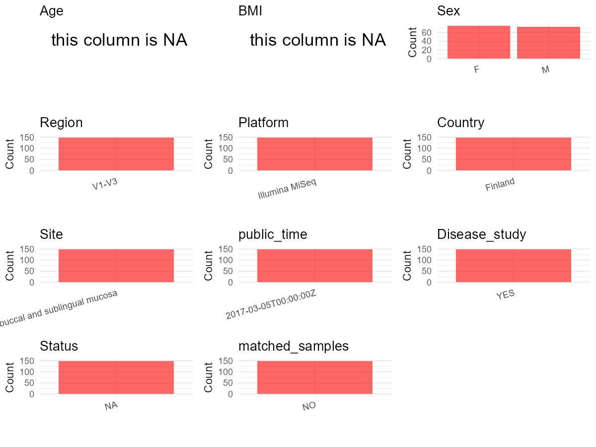

R Notebook: Metadata Processing Workflow
================

# Step 1: Obtain Initial Metadata from Each Project

To obtain the initial metadata: 1. Search for the BioProject ID (e.g.,
“PRJEBXXXX”) on the [NCBI SRA
website](https://www.ncbi.nlm.nih.gov/Traces/study/). 2. In the “Select”
table, click on “Metadata” and download the file. 3. The downloaded file
is typically named “SraRunTable.csv” and contains metadata for the
project.

``` r
# Load necessary libraries
library(dplyr)
library(ggplot2)
library(cowplot)

# Set working directory (update this path to your local directory)
setwd("E:/bioproject_YSD/PRJEB14536")

# Read the initial metadata files
initial_meta <- read.csv("SraRunTable.csv", header = T) 

# Remove entries non-oral samples
initial_meta <- initial_meta %>%
  filter(!grepl("nasal", environment_.material.))

# Display the first few rows of the metadata
head(initial_meta)
```

    ##          Run Assay.Type AvgSpotLen    Bases BioProject    BioSample    Bytes
    ## 1 ERR1466857   AMPLICON        612 47468556 PRJEB14536 SAMEA4044115 30765025
    ## 2 ERR1466858   AMPLICON        612 46306368 PRJEB14536 SAMEA4044116 29971020
    ## 3 ERR1466859   AMPLICON        612 40967280 PRJEB14536 SAMEA4044117 25873229
    ## 4 ERR1466860   AMPLICON        612 34786692 PRJEB14536 SAMEA4044118 22190071
    ## 5 ERR1466861   AMPLICON        612 41169240 PRJEB14536 SAMEA4044119 26589247
    ## 6 ERR1466862   AMPLICON        612 46821672 PRJEB14536 SAMEA4044120 29431882
    ##   Center.Name Collection_Date Consent DATASTORE.filetype DATASTORE.provider
    ## 1       UH/IB       2013/1/20  public   fastq,run.zq,sra     ena,gs,ncbi,s3
    ## 2       UH/IB       2013/1/20  public   fastq,run.zq,sra     ena,gs,ncbi,s3
    ## 3       UH/IB       2013/1/20  public   fastq,run.zq,sra     ena,gs,ncbi,s3
    ## 4       UH/IB       2013/1/20  public   fastq,run.zq,sra     ena,gs,ncbi,s3
    ## 5       UH/IB       2013/1/20  public   fastq,run.zq,sra     ena,gs,ncbi,s3
    ## 6       UH/IB       2013/1/20  public   fastq,run.zq,sra     ena,gs,ncbi,s3
    ##                           DATASTORE.region ENA.FIRST.PUBLIC..run.
    ## 1 ena,gs.us-east1,ncbi.public,s3.us-east-1               2017/3/3
    ## 2 ena,gs.us-east1,ncbi.public,s3.us-east-1               2017/3/3
    ## 3 ena,gs.us-east1,ncbi.public,s3.us-east-1               2017/3/3
    ## 4 ena,gs.us-east1,ncbi.public,s3.us-east-1               2017/3/3
    ## 5 ena,gs.us-east1,ncbi.public,s3.us-east-1               2017/3/3
    ## 6 ena,gs.us-east1,ncbi.public,s3.us-east-1               2017/3/3
    ##   ENA_first_public ENA.LAST.UPDATE..run. ena_last_update environment_.biome.
    ## 1         2017/3/3            2018/11/16      2016/10/21                oral
    ## 2         2017/3/3            2018/11/16      2016/10/21                oral
    ## 3         2017/3/3            2018/11/16      2016/10/21                oral
    ## 4         2017/3/3            2018/11/16      2016/10/21                oral
    ## 5         2017/3/3            2018/11/16      2016/10/21                oral
    ## 6         2017/3/3            2018/11/16      2016/10/21                oral
    ##   environment_.feature. environment_.material. Experiment  external_id
    ## 1                  oral                   oral ERX1537982 SAMEA4044115
    ## 2                  oral                   oral ERX1537983 SAMEA4044116
    ## 3                  oral                   oral ERX1537984 SAMEA4044117
    ## 4                  oral                   oral ERX1537985 SAMEA4044118
    ## 5                  oral                   oral ERX1537986 SAMEA4044119
    ## 6                  oral                   oral ERX1537987 SAMEA4044120
    ##   geo_loc_name_country geo_loc_name_country_continent
    ## 1              Finland                         Europe
    ## 2              Finland                         Europe
    ## 3              Finland                         Europe
    ## 4              Finland                         Europe
    ## 5              Finland                         Europe
    ## 6              Finland                         Europe
    ##   geographic_location_.country_and.or_sea. geographic_location_.latitude.
    ## 1                                  Finland                       65.00906
    ## 2                                  Finland                       65.00906
    ## 3                                  Finland                       65.00906
    ## 4                                  Finland                       65.00906
    ## 5                                  Finland                       65.00906
    ## 6                                  Finland                       65.00906
    ##   geographic_location_.longitude. host_sex
    ## 1                        25.51803     male
    ## 2                        25.51803   female
    ## 3                        25.51803     male
    ## 4                        25.51803   female
    ## 5                        25.51803     male
    ## 6                        25.51803     male
    ##   human_associated_environmental_package INSDC_center_alias
    ## 1                       human-associated              UH/IB
    ## 2                       human-associated              UH/IB
    ## 3                       human-associated              UH/IB
    ## 4                       human-associated              UH/IB
    ## 5                       human-associated              UH/IB
    ## 6                       human-associated              UH/IB
    ##                                      INSDC_center_name   INSDC_first_public
    ## 1 Institute of Biotechnology\\, University of Helsinki 2017-03-03T17:04:37Z
    ## 2 Institute of Biotechnology\\, University of Helsinki 2017-03-03T17:04:37Z
    ## 3 Institute of Biotechnology\\, University of Helsinki 2017-03-03T17:04:37Z
    ## 4 Institute of Biotechnology\\, University of Helsinki 2017-03-03T17:04:37Z
    ## 5 Institute of Biotechnology\\, University of Helsinki 2017-03-03T17:04:37Z
    ## 6 Institute of Biotechnology\\, University of Helsinki 2017-03-03T17:04:37Z
    ##      INSDC_last_update INSDC_status     Instrument investigation_type
    ## 1 2016-10-21T09:40:53Z       public Illumina MiSeq         metagenome
    ## 2 2016-10-21T09:40:53Z       public Illumina MiSeq         metagenome
    ## 3 2016-10-21T09:40:53Z       public Illumina MiSeq         metagenome
    ## 4 2016-10-21T09:40:53Z       public Illumina MiSeq         metagenome
    ## 5 2016-10-21T09:40:53Z       public Illumina MiSeq         metagenome
    ## 6 2016-10-21T09:40:53Z       public Illumina MiSeq         metagenome
    ##   Library.Name LibraryLayout LibrarySelection LibrarySource
    ## 1  unspecified        PAIRED              PCR   METAGENOMIC
    ## 2  unspecified        PAIRED              PCR   METAGENOMIC
    ## 3  unspecified        PAIRED              PCR   METAGENOMIC
    ## 4  unspecified        PAIRED              PCR   METAGENOMIC
    ## 5  unspecified        PAIRED              PCR   METAGENOMIC
    ## 6  unspecified        PAIRED              PCR   METAGENOMIC
    ##                Organism Platform                    project_name
    ## 1 human oral metagenome ILLUMINA Oral and nasal microbiome in PD
    ## 2 human oral metagenome ILLUMINA Oral and nasal microbiome in PD
    ## 3 human oral metagenome ILLUMINA Oral and nasal microbiome in PD
    ## 4 human oral metagenome ILLUMINA Oral and nasal microbiome in PD
    ## 5 human oral metagenome ILLUMINA Oral and nasal microbiome in PD
    ## 6 human oral metagenome ILLUMINA Oral and nasal microbiome in PD
    ##            ReleaseDate          create_date version  Sample.Name sample_name
    ## 1 2017-03-05T00:00:00Z 2017-03-05T11:16:00Z       1 SAMEA4044115          z1
    ## 2 2017-03-05T00:00:00Z 2017-03-05T11:16:00Z       1 SAMEA4044116          z2
    ## 3 2017-03-05T00:00:00Z 2017-03-05T11:16:00Z       1 SAMEA4044117          z3
    ## 4 2017-03-05T00:00:00Z 2017-03-05T11:16:00Z       1 SAMEA4044118          z4
    ## 5 2017-03-05T00:00:00Z 2017-03-05T11:16:00Z       1 SAMEA4044119          z5
    ## 6 2017-03-05T00:00:00Z 2017-03-05T11:16:00Z       1 SAMEA4044120          z6
    ##   Sequencing_method SRA.Study Submitter_Id
    ## 1    Illumina MiSeq ERP016180           z1
    ## 2    Illumina MiSeq ERP016180           z2
    ## 3    Illumina MiSeq ERP016180           z3
    ## 4    Illumina MiSeq ERP016180           z4
    ## 5    Illumina MiSeq ERP016180           z5
    ## 6    Illumina MiSeq ERP016180           z6

# Step 2: Create a Uniform Metadata Template

The uniform metadata should include the following columns:

1.  **BioProject**: Project ID (e.g., “PRJNA339212”)
2.  **Run**: Sample ID (e.g., “ERRXXXXXX” or “SRRXXXXXX”)
3.  **sample_name**: Original sample name submitted by the authors (not
    the database-assigned ID)
4.  **Age**: Age of the subject (if available)
5.  **BMI**: Body Mass Index (if available)
6.  **Sex**: Sex of the subject (“F” or “M”)
7.  **Region**: Targeted 16S rRNA region (e.g., “V3-V4”)
8.  **Platform**: Sequencing platform (e.g., “Illumina MiSeq”)
9.  **Country**: Country of sample origin (e.g., “China”)
10. **Site**: Sample site (e.g., “saliva”, “dental plaque”)
11. **public_time**: Data release date (format: “YYYY-MM-DD”)
12. **PCR_primers**: PCR primers used (e.g., “515F-806R”)
13. **title**: Title of the associated publication
14. **Disease_study**: Whether the study involves a disease (“YES” or
    “NO”)
15. **Status**: Disease status (e.g., “T2DM”, “HC”). Note: If the study
    includes both disease and healthy samples, this must be specified
    per sample.
16. **matched_samples**: matched samples (“YES” or “NO”)

``` r
# Create a uniform metadata dataframe
metadata <- data.frame(
  BioProject = initial_meta$BioProject,
  Run = initial_meta$Run,
  sample_name = initial_meta$Submitter_Id,
  Age = NA,
  BMI = NA,
  Sex = initial_meta$host_sex,
  Region = "V1-V3",
  Platform = initial_meta$Instrument,
  Country = initial_meta$geo_loc_name_country,
  Site = "buccal and sublingual mucosa",
  public_time = initial_meta$ReleaseDate,
  stringsAsFactors = FALSE
)

# Use abbreviations to indicate gender
metadata <- metadata %>%
  mutate(Sex = recode(Sex, "female" = "F", "male" = "M"))
```

# Step 3: Manually Add Information from the Publication

Some information (e.g. PCR primers, study title, disease status) must be
manually extracted from the publication and added to the metadata.

``` r
# Add information obtained from the publication
metadata$PCR_primers <- "F:5'-AGAGTTTGATCMTGGCTCAG-3';R:5'-GTATTACCGCGGCTGCTG-3'"
metadata$title <- "Oral and nasal microbiota in parkinsons disease"
metadata$Disease_study <- "YES"
# Assign disease status based on sample_name patterns
metadata$Status <- "NA"

# Check initial data distribution
cat("Initial sample distribution:\n")
```

    ## Initial sample distribution:

``` r
table(metadata$sample_name)
```

    ## 
    ##   z1  z10 z100 z101 z102 z103 z104 z105 z106 z107 z108 z109  z11 z110 z111 z112 
    ##    1    1    1    1    1    1    1    1    1    1    1    1    1    1    1    1 
    ## z113 z114 z115 z116 z117 z118 z119  z12 z120 z121 z122 z123 z124 z125 z126 z127 
    ##    1    1    1    1    1    1    1    1    1    1    1    1    1    1    1    1 
    ## z128 z129  z13 z130 z131 z132 z133 z134 z135 z136 z137 z138 z139  z14 z140 z141 
    ##    1    1    1    1    1    1    1    1    1    1    1    1    1    1    1    1 
    ## z142 z143 z144 z145 z146 z147 z148  z15  z16  z17  z18  z19   z2  z20  z21  z22 
    ##    1    1    1    1    1    1    1    1    1    1    1    1    1    1    1    1 
    ##  z23  z24  z25  z26  z27  z28  z29   z3  z30  z31  z32  z33  z34  z35  z36  z37 
    ##    1    1    1    1    1    1    1    1    1    1    1    1    1    1    1    1 
    ##  z38  z39   z4  z40  z41  z42  z43  z44  z45  z46  z47  z48  z49   z5  z50  z51 
    ##    1    1    1    1    1    1    1    1    1    1    1    1    1    1    1    1 
    ##  z52  z53  z54  z55  z56  z57  z58  z59   z6  z60  z61  z62  z63  z64  z65  z66 
    ##    1    1    1    1    1    1    1    1    1    1    1    1    1    1    1    1 
    ##  z67  z68  z69   z7  z70  z71  z72  z73  z74  z75  z76  z77  z78  z79   z8  z80 
    ##    1    1    1    1    1    1    1    1    1    1    1    1    1    1    1    1 
    ##  z81  z82  z83  z84  z85  z86  z87  z88  z89   z9  z90  z91  z92  z93  z94  z95 
    ##    1    1    1    1    1    1    1    1    1    1    1    1    1    1    1    1 
    ##  z96  z97  z98  z99 
    ##    1    1    1    1

``` r
table(metadata$Site)
```

    ## 
    ## buccal and sublingual mucosa 
    ##                          148

``` r
# Calculate sampling frequency per subject
sample_counts <- table(metadata$sample_name)
cat("\nNumber of samples per subject:\n")
```

    ## 
    ## Number of samples per subject:

``` r
print(sample_counts)
```

    ## 
    ##   z1  z10 z100 z101 z102 z103 z104 z105 z106 z107 z108 z109  z11 z110 z111 z112 
    ##    1    1    1    1    1    1    1    1    1    1    1    1    1    1    1    1 
    ## z113 z114 z115 z116 z117 z118 z119  z12 z120 z121 z122 z123 z124 z125 z126 z127 
    ##    1    1    1    1    1    1    1    1    1    1    1    1    1    1    1    1 
    ## z128 z129  z13 z130 z131 z132 z133 z134 z135 z136 z137 z138 z139  z14 z140 z141 
    ##    1    1    1    1    1    1    1    1    1    1    1    1    1    1    1    1 
    ## z142 z143 z144 z145 z146 z147 z148  z15  z16  z17  z18  z19   z2  z20  z21  z22 
    ##    1    1    1    1    1    1    1    1    1    1    1    1    1    1    1    1 
    ##  z23  z24  z25  z26  z27  z28  z29   z3  z30  z31  z32  z33  z34  z35  z36  z37 
    ##    1    1    1    1    1    1    1    1    1    1    1    1    1    1    1    1 
    ##  z38  z39   z4  z40  z41  z42  z43  z44  z45  z46  z47  z48  z49   z5  z50  z51 
    ##    1    1    1    1    1    1    1    1    1    1    1    1    1    1    1    1 
    ##  z52  z53  z54  z55  z56  z57  z58  z59   z6  z60  z61  z62  z63  z64  z65  z66 
    ##    1    1    1    1    1    1    1    1    1    1    1    1    1    1    1    1 
    ##  z67  z68  z69   z7  z70  z71  z72  z73  z74  z75  z76  z77  z78  z79   z8  z80 
    ##    1    1    1    1    1    1    1    1    1    1    1    1    1    1    1    1 
    ##  z81  z82  z83  z84  z85  z86  z87  z88  z89   z9  z90  z91  z92  z93  z94  z95 
    ##    1    1    1    1    1    1    1    1    1    1    1    1    1    1    1    1 
    ##  z96  z97  z98  z99 
    ##    1    1    1    1

``` r
# Create matched_samples column
metadata$matched_samples <- ifelse(metadata$sample_name %in% names(sample_counts[sample_counts >= 2]), "YES", "NO")

cat("\nMatched samples distribution:\n")
```

    ## 
    ## Matched samples distribution:

``` r
table(metadata$matched_samples)
```

    ## 
    ##  NO 
    ## 148

``` r
# Identify samples for removal: single samples excluding buccal and sublingual mucosa
single_samples <- names(sample_counts[sample_counts == 1])
samples_to_remove <- metadata$sample_name %in% single_samples & 
                     !(metadata$Site %in% c("buccal and sublingual mucosa"))

cat("\nNumber of samples to be removed:", sum(samples_to_remove), "\n")
```

    ## 
    ## Number of samples to be removed: 0

``` r
# Remove identified samples
metadata_clean <- metadata[!samples_to_remove, ]

cat("\nFinal sample distribution after cleaning:\n")
```

    ## 
    ## Final sample distribution after cleaning:

``` r
table(metadata_clean$sample_name)
```

    ## 
    ##   z1  z10 z100 z101 z102 z103 z104 z105 z106 z107 z108 z109  z11 z110 z111 z112 
    ##    1    1    1    1    1    1    1    1    1    1    1    1    1    1    1    1 
    ## z113 z114 z115 z116 z117 z118 z119  z12 z120 z121 z122 z123 z124 z125 z126 z127 
    ##    1    1    1    1    1    1    1    1    1    1    1    1    1    1    1    1 
    ## z128 z129  z13 z130 z131 z132 z133 z134 z135 z136 z137 z138 z139  z14 z140 z141 
    ##    1    1    1    1    1    1    1    1    1    1    1    1    1    1    1    1 
    ## z142 z143 z144 z145 z146 z147 z148  z15  z16  z17  z18  z19   z2  z20  z21  z22 
    ##    1    1    1    1    1    1    1    1    1    1    1    1    1    1    1    1 
    ##  z23  z24  z25  z26  z27  z28  z29   z3  z30  z31  z32  z33  z34  z35  z36  z37 
    ##    1    1    1    1    1    1    1    1    1    1    1    1    1    1    1    1 
    ##  z38  z39   z4  z40  z41  z42  z43  z44  z45  z46  z47  z48  z49   z5  z50  z51 
    ##    1    1    1    1    1    1    1    1    1    1    1    1    1    1    1    1 
    ##  z52  z53  z54  z55  z56  z57  z58  z59   z6  z60  z61  z62  z63  z64  z65  z66 
    ##    1    1    1    1    1    1    1    1    1    1    1    1    1    1    1    1 
    ##  z67  z68  z69   z7  z70  z71  z72  z73  z74  z75  z76  z77  z78  z79   z8  z80 
    ##    1    1    1    1    1    1    1    1    1    1    1    1    1    1    1    1 
    ##  z81  z82  z83  z84  z85  z86  z87  z88  z89   z9  z90  z91  z92  z93  z94  z95 
    ##    1    1    1    1    1    1    1    1    1    1    1    1    1    1    1    1 
    ##  z96  z97  z98  z99 
    ##    1    1    1    1

``` r
table(metadata_clean$Site)
```

    ## 
    ## buccal and sublingual mucosa 
    ##                          148

``` r
table(metadata_clean$matched_samples)
```

    ## 
    ##  NO 
    ## 148

``` r
# Use cleaned dataset for subsequent analysis
metadata <- metadata_clean
```

# Step 4: Summarize and Validate the Metadata

``` r
# Check the number of unique runs and sample names
print(paste("Number of unique runs:", length(unique(metadata$Run))))
```

    ## [1] "Number of unique runs: 148"

``` r
print(paste("Number of unique sample names:", length(unique(metadata$sample_name))))
```

    ## [1] "Number of unique sample names: 148"

# Step 5: Visualize the Metadata

``` r

```


# Step 6: Finalize and Export the Metadata

``` r
# Reorder columns to match the desired format
metadata <- metadata[, c(
  "BioProject", "Run", "sample_name", "Age", "BMI", "Sex", 
  "Region", "Platform", "Country", "Site", "public_time", 
  "PCR_primers", "title", "Disease_study", "Status", "matched_samples"
)]

# Export the uniform metadata to a CSV file
write.csv(metadata, file = "metadata.csv", quote = FALSE)
head(metadata)
```

    ##   BioProject        Run sample_name Age BMI Sex Region       Platform Country
    ## 1 PRJEB14536 ERR1466857          z1  NA  NA   M  V1-V3 Illumina MiSeq Finland
    ## 2 PRJEB14536 ERR1466858          z2  NA  NA   F  V1-V3 Illumina MiSeq Finland
    ## 3 PRJEB14536 ERR1466859          z3  NA  NA   M  V1-V3 Illumina MiSeq Finland
    ## 4 PRJEB14536 ERR1466860          z4  NA  NA   F  V1-V3 Illumina MiSeq Finland
    ## 5 PRJEB14536 ERR1466861          z5  NA  NA   M  V1-V3 Illumina MiSeq Finland
    ## 6 PRJEB14536 ERR1466862          z6  NA  NA   M  V1-V3 Illumina MiSeq Finland
    ##                           Site          public_time
    ## 1 buccal and sublingual mucosa 2017-03-05T00:00:00Z
    ## 2 buccal and sublingual mucosa 2017-03-05T00:00:00Z
    ## 3 buccal and sublingual mucosa 2017-03-05T00:00:00Z
    ## 4 buccal and sublingual mucosa 2017-03-05T00:00:00Z
    ## 5 buccal and sublingual mucosa 2017-03-05T00:00:00Z
    ## 6 buccal and sublingual mucosa 2017-03-05T00:00:00Z
    ##                                               PCR_primers
    ## 1 F:5'-AGAGTTTGATCMTGGCTCAG-3';R:5'-GTATTACCGCGGCTGCTG-3'
    ## 2 F:5'-AGAGTTTGATCMTGGCTCAG-3';R:5'-GTATTACCGCGGCTGCTG-3'
    ## 3 F:5'-AGAGTTTGATCMTGGCTCAG-3';R:5'-GTATTACCGCGGCTGCTG-3'
    ## 4 F:5'-AGAGTTTGATCMTGGCTCAG-3';R:5'-GTATTACCGCGGCTGCTG-3'
    ## 5 F:5'-AGAGTTTGATCMTGGCTCAG-3';R:5'-GTATTACCGCGGCTGCTG-3'
    ## 6 F:5'-AGAGTTTGATCMTGGCTCAG-3';R:5'-GTATTACCGCGGCTGCTG-3'
    ##                                             title Disease_study Status
    ## 1 Oral and nasal microbiota in parkinsons disease           YES     NA
    ## 2 Oral and nasal microbiota in parkinsons disease           YES     NA
    ## 3 Oral and nasal microbiota in parkinsons disease           YES     NA
    ## 4 Oral and nasal microbiota in parkinsons disease           YES     NA
    ## 5 Oral and nasal microbiota in parkinsons disease           YES     NA
    ## 6 Oral and nasal microbiota in parkinsons disease           YES     NA
    ##   matched_samples
    ## 1              NO
    ## 2              NO
    ## 3              NO
    ## 4              NO
    ## 5              NO
    ## 6              NO

## Notes for Students:

1.  **Metadata Accuracy**: Always cross-check the metadata with the
    original publication to ensure accuracy.
2.  **Manual Entries**: Columns like `PCR_primers`, and `Status` often
    require manual entry based on the publication.
3.  **Disease Status**: Be careful when assigning `Status`—some studies
    include both disease and healthy samples.
4.  **Visualization**: The plots help quickly identify the distribution
    of values in each column, which is useful for quality control.
5.  **Reproducibility**: Update the working directory and file paths to
    match your local environment.
