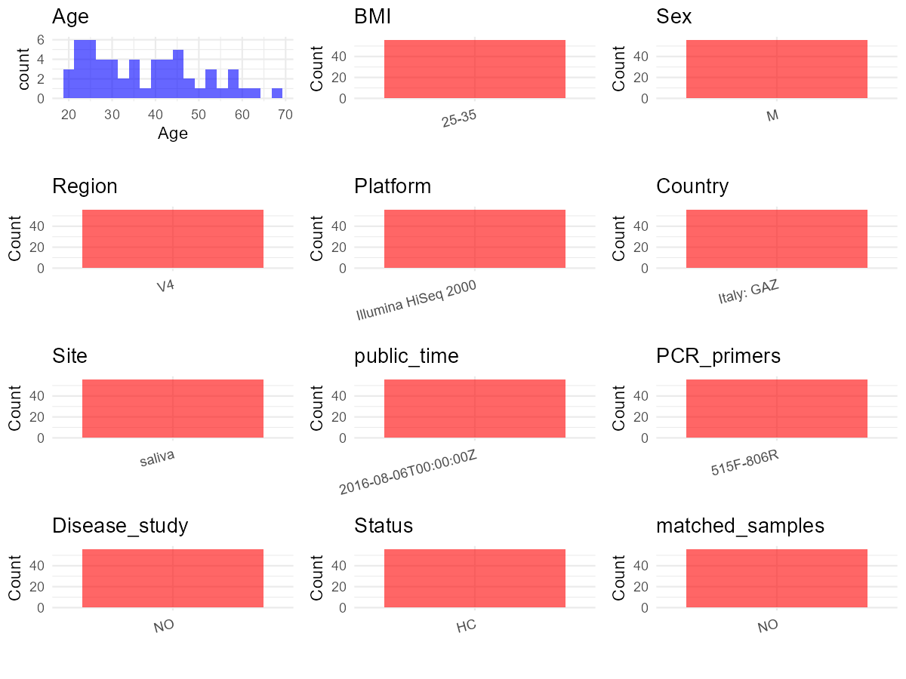

R Notebook: Metadata Processing Workflow
================

# Step 1: Obtain Initial Metadata from Each Project

To obtain the initial metadata: 1. Search for the BioProject ID (e.g.,
“PRJEBXXXX”) on the [NCBI SRA
website](https://www.ncbi.nlm.nih.gov/Traces/study/). 2. In the “Select”
table, click on “Metadata” and download the file. 3. The downloaded file
is typically named “SraRunTable.csv” and contains metadata for the
project.

``` r
# Load necessary libraries
library(dplyr)
library(ggplot2)
library(cowplot)

# Set working directory (update this path to your local directory)
setwd("D:/oral_project/PRJEB15057")

# Read the initial metadata files
initial_meta<-read.csv("SraRunTable.csv",header = T)

# Combine the two metadata files
#meta <- rbind(initial_meta, initial_meta1)

#Remove entries non-oral samples
#initial_meta <- subset(initial_meta,isolate %in% c("saliva","tongue coat"))

# Check the number of samples containing "HT" in Sample.Name (e.g., healthy controls)
#nrow(subset(meta, grepl("HT", Sample.Name)))

# Display the first few rows of the metadata
head(initial_meta)
```

    ##          Run AGE age_unit altitude anonymized_name Assay.Type assigned_from_geo
    ## 1 ERR1558867  39    years        0              LA      OTHER             FALSE
    ## 2 ERR1558868  51    years        0              CA      OTHER             FALSE
    ## 3 ERR1558869  23    years        0              GL      OTHER             FALSE
    ## 4 ERR1558870  34    years        0              CC      OTHER             FALSE
    ## 5 ERR1558871  21    years        0              AD      OTHER             FALSE
    ## 6 ERR1558872  22    years        0              MG      OTHER             FALSE
    ##   AvgSpotLen barcode..exp.    Bases BioProject    BioSample bmi_185_249
    ## 1        149  CGAGGGAAAGTC 10043074 PRJEB15057 SAMEA4369078        TRUE
    ## 2        147  CAAATTCGGGAT 10221542 PRJEB15057 SAMEA4369079        TRUE
    ## 3        146  AGATTGACCAAC 15118483 PRJEB15057 SAMEA4369080       FALSE
    ## 4        147  AGTTACGAGCTA 16581149 PRJEB15057 SAMEA4369081        TRUE
    ## 5        147  GCATATGCACTG 16444145 PRJEB15057 SAMEA4369082        TRUE
    ## 6        148  CAACTCCCGTGA 11284840 PRJEB15057 SAMEA4369083        TRUE
    ##   bmi_25_299 bmi_30_349 bmi_35_399 bmi_greater_40 bmi_less_184
    ## 1      FALSE      FALSE      FALSE          FALSE        FALSE
    ## 2      FALSE      FALSE      FALSE          FALSE        FALSE
    ## 3       TRUE      FALSE      FALSE          FALSE        FALSE
    ## 4      FALSE      FALSE      FALSE          FALSE        FALSE
    ## 5      FALSE      FALSE      FALSE          FALSE        FALSE
    ## 6      FALSE      FALSE      FALSE          FALSE        FALSE
    ##         body_habitat body_mass_index  body_product    body_site body_status
    ## 1 UBERON:oral cavity              22 UBERON:saliva UBERON:mouth      normal
    ## 2 UBERON:oral cavity              21 UBERON:saliva UBERON:mouth      normal
    ## 3 UBERON:oral cavity              25 UBERON:saliva UBERON:mouth      normal
    ## 4 UBERON:oral cavity              23 UBERON:saliva UBERON:mouth      normal
    ## 5 UBERON:oral cavity              19 UBERON:saliva UBERON:mouth      normal
    ## 6 UBERON:oral cavity              23 UBERON:saliva UBERON:mouth      normal
    ##      Bytes center_name..exp.                                        Center.Name
    ## 1  6351638               ANL UNIVERSITY OF CALIFORNIA SAN DIEGO MICROBIOME INIT
    ## 2  6639273               ANL UNIVERSITY OF CALIFORNIA SAN DIEGO MICROBIOME INIT
    ## 3  9949069               ANL UNIVERSITY OF CALIFORNIA SAN DIEGO MICROBIOME INIT
    ## 4 10830635               ANL UNIVERSITY OF CALIFORNIA SAN DIEGO MICROBIOME INIT
    ## 5 10708099               ANL UNIVERSITY OF CALIFORNIA SAN DIEGO MICROBIOME INIT
    ## 6  7207315               ANL UNIVERSITY OF CALIFORNIA SAN DIEGO MICROBIOME INIT
    ##   center_project_name..exp. collection_timestamp           common_name Consent
    ## 1      Ercolini_ObeseSaliva        12/11/11 0:00 human oral metagenome  public
    ## 2      Ercolini_ObeseSaliva        12/11/11 0:00 human oral metagenome  public
    ## 3      Ercolini_ObeseSaliva        11/15/11 0:00 human oral metagenome  public
    ## 4      Ercolini_ObeseSaliva        11/17/11 0:00 human oral metagenome  public
    ## 5      Ercolini_ObeseSaliva        11/16/11 0:00 human oral metagenome  public
    ## 6      Ercolini_ObeseSaliva        11/15/11 0:00 human oral metagenome  public
    ##      COUNTRY DATASTORE.filetype DATASTORE.provider
    ## 1 Italy: GAZ   fastq,run.zq,sra     ena,gs,ncbi,s3
    ## 2 Italy: GAZ   fastq,run.zq,sra     ena,gs,ncbi,s3
    ## 3 Italy: GAZ   fastq,run.zq,sra     ena,gs,ncbi,s3
    ## 4 Italy: GAZ   fastq,run.zq,sra     ena,gs,ncbi,s3
    ## 5 Italy: GAZ   fastq,run.zq,sra     ena,gs,ncbi,s3
    ## 6 Italy: GAZ   fastq,run.zq,sra     ena,gs,ncbi,s3
    ##                           DATASTORE.region Depth dna_extracted elevation
    ## 1 ena,gs.us-east1,ncbi.public,s3.us-east-1     0          TRUE        82
    ## 2 ena,gs.us-east1,ncbi.public,s3.us-east-1     0          TRUE        82
    ## 3 ena,gs.us-east1,ncbi.public,s3.us-east-1     0          TRUE        82
    ## 4 ena,gs.us-east1,ncbi.public,s3.us-east-1     0          TRUE        82
    ## 5 ena,gs.us-east1,ncbi.public,s3.us-east-1     0          TRUE        82
    ## 6 ena,gs.us-east1,ncbi.public,s3.us-east-1     0          TRUE        82
    ##   emp_status..exp. emp_status ENA.FIRST.PUBLIC..run. ENA_first_public
    ## 1              EMP        EMP             2016-08-05       2016-08-05
    ## 2              EMP        EMP             2016-08-05       2016-08-05
    ## 3              EMP        EMP             2016-08-05       2016-08-05
    ## 4              EMP        EMP             2016-08-05       2016-08-05
    ## 5              EMP        EMP             2016-08-05       2016-08-05
    ## 6              EMP        EMP             2016-08-05       2016-08-05
    ##   ENA.LAST.UPDATE..run. ena_last_update   env_biome              env_feature
    ## 1            2018-11-16      2016-08-05 urban biome human-associated habitat
    ## 2            2018-11-16      2016-08-05 urban biome human-associated habitat
    ## 3            2018-11-16      2016-08-05 urban biome human-associated habitat
    ## 4            2018-11-16      2016-08-05 urban biome human-associated habitat
    ## 5            2018-11-16      2016-08-05 urban biome human-associated habitat
    ## 6            2018-11-16      2016-08-05 urban biome human-associated habitat
    ##   env_material env_matter env_package Experiment  external_id host_common_name
    ## 1       saliva     saliva  human-oral ERX1629623 SAMEA4369078            human
    ## 2       saliva     saliva  human-oral ERX1629624 SAMEA4369079            human
    ## 3       saliva     saliva  human-oral ERX1629625 SAMEA4369080            human
    ## 4       saliva     saliva  human-oral ERX1629626 SAMEA4369081            human
    ## 5       saliva     saliva  human-oral ERX1629627 SAMEA4369082            human
    ## 6       saliva     saliva  human-oral ERX1629628 SAMEA4369083            human
    ##   host_scientific_name host_subject_id host_taxid illumina_technology..exp.
    ## 1         Homo sapiens              LA       9606                     HiSeq
    ## 2         Homo sapiens              CA       9606                     HiSeq
    ## 3         Homo sapiens              GL       9606                     HiSeq
    ## 4         Homo sapiens              CC       9606                     HiSeq
    ## 5         Homo sapiens              AD       9606                     HiSeq
    ## 6         Homo sapiens              MG       9606                     HiSeq
    ##   INSDC_center_alias                                        INSDC_center_name
    ## 1             UCSDMI University of California San Diego Microbiome Initiative
    ## 2             UCSDMI University of California San Diego Microbiome Initiative
    ## 3             UCSDMI University of California San Diego Microbiome Initiative
    ## 4             UCSDMI University of California San Diego Microbiome Initiative
    ## 5             UCSDMI University of California San Diego Microbiome Initiative
    ## 6             UCSDMI University of California San Diego Microbiome Initiative
    ##     INSDC_first_public    INSDC_last_update INSDC_status          Instrument
    ## 1 2016-08-05T17:05:35Z 2016-08-05T05:26:31Z       public Illumina HiSeq 2000
    ## 2 2016-08-05T17:05:35Z 2016-08-05T05:26:31Z       public Illumina HiSeq 2000
    ## 3 2016-08-05T17:05:35Z 2016-08-05T05:26:31Z       public Illumina HiSeq 2000
    ## 4 2016-08-05T17:05:35Z 2016-08-05T05:26:31Z       public Illumina HiSeq 2000
    ## 5 2016-08-05T17:05:35Z 2016-08-05T05:26:31Z       public Illumina HiSeq 2000
    ## 6 2016-08-05T17:05:35Z 2016-08-05T05:26:31Z       public Illumina HiSeq 2000
    ##   LATITUDE Library.Name LibraryLayout LibrarySelection LibrarySource
    ## 1   40.863     958.N.01        SINGLE              PCR   METAGENOMIC
    ## 2   40.863     958.N.02        SINGLE              PCR   METAGENOMIC
    ## 3   40.863     958.N.03        SINGLE              PCR   METAGENOMIC
    ## 4   40.863     958.N.04        SINGLE              PCR   METAGENOMIC
    ## 5   40.863     958.N.05        SINGLE              PCR   METAGENOMIC
    ## 6   40.863     958.N.06        SINGLE              PCR   METAGENOMIC
    ##   linker..exp. longitude obesity_degree obesity              Organism
    ## 1           GT    14.273              0   FALSE human oral metagenome
    ## 2           GT    14.273              0   FALSE human oral metagenome
    ## 3           GT    14.273              0   FALSE human oral metagenome
    ## 4           GT    14.273              0   FALSE human oral metagenome
    ## 5           GT    14.273              0   FALSE human oral metagenome
    ## 6           GT    14.273              0   FALSE human oral metagenome
    ##                                   pcr_primers..exp.
    ## 1 FWD:GTGCCAGCMGCCGCGGTAA; REV:GGACTACHVGGGTWTCTAAT
    ## 2 FWD:GTGCCAGCMGCCGCGGTAA; REV:GGACTACHVGGGTWTCTAAT
    ## 3 FWD:GTGCCAGCMGCCGCGGTAA; REV:GGACTACHVGGGTWTCTAAT
    ## 4 FWD:GTGCCAGCMGCCGCGGTAA; REV:GGACTACHVGGGTWTCTAAT
    ## 5 FWD:GTGCCAGCMGCCGCGGTAA; REV:GGACTACHVGGGTWTCTAAT
    ## 6 FWD:GTGCCAGCMGCCGCGGTAA; REV:GGACTACHVGGGTWTCTAAT
    ##                      physical_specimen_location physical_specimen_remaining
    ## 1 Universitat degli Studi di Napoli Federico II                        TRUE
    ## 2 Universitat degli Studi di Napoli Federico II                        TRUE
    ## 3 Universitat degli Studi di Napoli Federico II                        TRUE
    ## 4 Universitat degli Studi di Napoli Federico II                        TRUE
    ## 5 Universitat degli Studi di Napoli Federico II                        TRUE
    ## 6 Universitat degli Studi di Napoli Federico II                        TRUE
    ##   Platform          primer..exp.          ReleaseDate
    ## 1 ILLUMINA GTGTGCCAGCMGCCGCGGTAA 2016-08-06T00:00:00Z
    ## 2 ILLUMINA GTGTGCCAGCMGCCGCGGTAA 2016-08-06T00:00:00Z
    ## 3 ILLUMINA GTGTGCCAGCMGCCGCGGTAA 2016-08-06T00:00:00Z
    ## 4 ILLUMINA GTGTGCCAGCMGCCGCGGTAA 2016-08-06T00:00:00Z
    ## 5 ILLUMINA GTGTGCCAGCMGCCGCGGTAA 2016-08-06T00:00:00Z
    ## 6 ILLUMINA GTGTGCCAGCMGCCGCGGTAA 2016-08-06T00:00:00Z
    ##   required_sample_info_status run_center..exp. run_date..exp.
    ## 1                   completed              ANL        8/14/12
    ## 2                   completed              ANL        8/14/12
    ## 3                   completed              ANL        8/14/12
    ## 4                   completed              ANL        8/14/12
    ## 5                   completed              ANL        8/14/12
    ## 6                   completed              ANL        8/14/12
    ##            create_date version   run_prefix..exp. samp_collect_device
    ## 1 2016-08-24T23:20:00Z       2 lane1_NoIndex_L001         Falcon_tube
    ## 2 2016-08-24T23:20:00Z       2 lane1_NoIndex_L001         Falcon_tube
    ## 3 2016-08-24T23:20:00Z       2 lane1_NoIndex_L001         Falcon_tube
    ## 4 2016-08-24T23:20:00Z       2 lane1_NoIndex_L001         Falcon_tube
    ## 5 2016-08-24T23:20:00Z       2 lane1_NoIndex_L001         Falcon_tube
    ## 6 2016-08-24T23:20:00Z       2 lane1_NoIndex_L001         Falcon_tube
    ##   samp_size..exp. samp_store_dur samp_store_loc samp_store_temp
    ## 1            .1,g       3 months            ANL             -20
    ## 2            .1,g       3 months            ANL             -20
    ## 3            .1,g       3 months            ANL             -20
    ## 4            .1,g       3 months            ANL             -20
    ## 5            .1,g       3 months            ANL             -20
    ## 6            .1,g       3 months            ANL             -20
    ##   sample_center..exp.  Sample.Name            Sample_name sample_progress
    ## 1                 ANL SAMEA4369078 qiita_sid_958:958.N.01 Sequenced (16S)
    ## 2                 ANL SAMEA4369079 qiita_sid_958:958.N.02 Sequenced (16S)
    ## 3                 ANL SAMEA4369080 qiita_sid_958:958.N.03 Sequenced (16S)
    ## 4                 ANL SAMEA4369081 qiita_sid_958:958.N.04 Sequenced (16S)
    ## 5                 ANL SAMEA4369082 qiita_sid_958:958.N.05 Sequenced (16S)
    ## 6                 ANL SAMEA4369083 qiita_sid_958:958.N.06 Sequenced (16S)
    ##   sample_type   sequencing_meth..exp.  sex SRA.Study study_center..exp.
    ## 1      Saliva sequencing by synthesis male ERP016748               CCME
    ## 2      Saliva sequencing by synthesis male ERP016748               CCME
    ## 3      Saliva sequencing by synthesis male ERP016748               CCME
    ## 4      Saliva sequencing by synthesis male ERP016748               CCME
    ## 5      Saliva sequencing by synthesis male ERP016748               CCME
    ## 6      Saliva sequencing by synthesis male ERP016748               CCME
    ##             Submitter_Id target_gene..exp. target_subfragment..exp.
    ## 1 qiita_sid_958:958.N.01          16S rRNA                       V4
    ## 2 qiita_sid_958:958.N.02          16S rRNA                       V4
    ## 3 qiita_sid_958:958.N.03          16S rRNA                       V4
    ## 4 qiita_sid_958:958.N.04          16S rRNA                       V4
    ## 5 qiita_sid_958:958.N.05          16S rRNA                       V4
    ## 6 qiita_sid_958:958.N.06          16S rRNA                       V4
    ##   time_collection time_since_last_toothbrush chronic_condition disease_stat
    ## 1            noon                  1.5 hours              TRUE             
    ## 2            noon                  1.5 hours              TRUE             
    ## 3            noon                  1.5 hours              TRUE             
    ## 4            noon                  1.5 hours                NA             
    ## 5            noon                  1.5 hours                NA             
    ## 6            noon                  1.5 hours              TRUE             
    ##   dental_prosthesis smoker_n_cigarettes_day smoker  allergy hypertension
    ## 1                                         4   TRUE rhinitis           NA
    ## 2          capsules                      NA     NA rhinitis           NA
    ## 3                                         4   TRUE   pollen           NA
    ## 4                                        NA     NA                    NA
    ## 5                                        NA     NA                    NA
    ## 6                                         1   TRUE                    NA

# Step 2: Create a Uniform Metadata Template

The uniform metadata should include the following columns:

1.  **BioProject**: Project ID (e.g., “PRJNA339212”)
2.  **Run**: Sample ID (e.g., “ERRXXXXXX” or “SRRXXXXXX”)
3.  **sample_name**: Original sample name submitted by the authors (not
    the database-assigned ID)
4.  **Age**: Age of the subject (if available)
5.  **BMI**: Body Mass Index (if available)
6.  **Sex**: Sex of the subject (“F” or “M”)
7.  **Region**: Targeted 16S rRNA region (e.g., “V3-V4”)
8.  **Platform**: Sequencing platform (e.g., “Illumina MiSeq”)
9.  **Country**: Country of sample origin (e.g., “China”)
10. **Site**: Sample site (e.g., “saliva”, “dental plaque”)
11. **public_time**: Data release date (format: “YYYY-MM-DD”)
12. **PCR_primers**: PCR primers used (e.g., “515F-806R”)
13. **title**: Title of the associated publication
14. **Disease_study**: Whether the study involves a disease (“YES” or
    “NO”)
15. **Status**: Disease status (e.g., “T2DM”, “HC”). Note: If the study
    includes both disease and healthy samples, this must be specified
    per sample.
16. **matched_samples**: matched samples (“YES” or “NO”)

``` r
# Create a uniform metadata dataframe
metadata <- data.frame(
  BioProject = initial_meta$BioProject,
  Run = initial_meta$Run,
  sample_name = initial_meta$Library.Name,
  Age = initial_meta$AGE,
  BMI = "25-35",
  Sex=initial_meta$sex,
  Region = initial_meta$target_subfragment..exp.,
  Platform = initial_meta$Instrument,
  Country = initial_meta$COUNTRY,
  Site = initial_meta$env_material,
  public_time = initial_meta$ReleaseDate,
  stringsAsFactors = FALSE
)
```

``` r
metadata <- metadata %>%
  mutate(Sex = recode(Sex, "female" = "F", "male" = "M"))
```

# Step 3: Manually Add Information from the Publication

Some information (e.g. PCR primers, study title, disease status) must be
manually extracted from the publication and added to the metadata.

``` r
# Add information obtained from the publication
metadata$PCR_primers <- "515F-806R"
metadata$title <- "Whole-grain wheat consumption reduces inflammation in a randomized controlled trial on overweight and obese subjects with unhealthy dietary and lifestyle behaviors: role of polyphenols bound to cereal dietary fiber"
metadata$Disease_study <- "NO"
# Assign disease status based on sample_name patterns
metadata$Status <- "HC"

#get subjects id with Saliva available
keep_subjects<-subset(metadata,Site %in% "saliva")
#remove subjects without Saliva samples
metadata<-subset(metadata,sample_name %in% keep_subjects$sample_name)
#get subjects sampling counts
sample_counts <- table(metadata$sample_name)
# Create matched_samples column, any subjects have >=2 samples will be label "YES", otherwise "NO"
metadata$matched_samples <- ifelse(metadata$sample_name %in% names(sample_counts[sample_counts >= 2]), "YES", "NO")
```

# Step 4: Summarize and Validate the Metadata

``` r
# Check the number of unique runs and sample names
print(paste("Number of unique runs:", length(unique(metadata$Run))))
```

    ## [1] "Number of unique runs: 56"

``` r
print(paste("Number of unique sample names:", length(unique(metadata$sample_name))))
```

    ## [1] "Number of unique sample names: 56"

# Step 5: Visualize the Metadata

``` r

```


# Step 6: Finalize and Export the Metadata

``` r
# Reorder columns to match the desired format
metadata <- metadata[, c(
  "BioProject", "Run", "sample_name", "Age", "BMI", "Sex", 
  "Region", "Platform", "Country", "Site", "public_time", 
  "PCR_primers", "title", "Disease_study", "Status","matched_samples"
)]

# Export the uniform metadata to a CSV file
write.csv(metadata, file = "metadata.csv", quote = FALSE)
head(metadata)
```

    ##   BioProject        Run sample_name Age   BMI Sex Region            Platform
    ## 1 PRJEB15057 ERR1558867    958.N.01  39 25-35   M     V4 Illumina HiSeq 2000
    ## 2 PRJEB15057 ERR1558868    958.N.02  51 25-35   M     V4 Illumina HiSeq 2000
    ## 3 PRJEB15057 ERR1558869    958.N.03  23 25-35   M     V4 Illumina HiSeq 2000
    ## 4 PRJEB15057 ERR1558870    958.N.04  34 25-35   M     V4 Illumina HiSeq 2000
    ## 5 PRJEB15057 ERR1558871    958.N.05  21 25-35   M     V4 Illumina HiSeq 2000
    ## 6 PRJEB15057 ERR1558872    958.N.06  22 25-35   M     V4 Illumina HiSeq 2000
    ##      Country   Site          public_time PCR_primers
    ## 1 Italy: GAZ saliva 2016-08-06T00:00:00Z   515F-806R
    ## 2 Italy: GAZ saliva 2016-08-06T00:00:00Z   515F-806R
    ## 3 Italy: GAZ saliva 2016-08-06T00:00:00Z   515F-806R
    ## 4 Italy: GAZ saliva 2016-08-06T00:00:00Z   515F-806R
    ## 5 Italy: GAZ saliva 2016-08-06T00:00:00Z   515F-806R
    ## 6 Italy: GAZ saliva 2016-08-06T00:00:00Z   515F-806R
    ##                                                                                                                                                                                                                    title
    ## 1 Whole-grain wheat consumption reduces inflammation in a randomized controlled trial on overweight and obese subjects with unhealthy dietary and lifestyle behaviors: role of polyphenols bound to cereal dietary fiber
    ## 2 Whole-grain wheat consumption reduces inflammation in a randomized controlled trial on overweight and obese subjects with unhealthy dietary and lifestyle behaviors: role of polyphenols bound to cereal dietary fiber
    ## 3 Whole-grain wheat consumption reduces inflammation in a randomized controlled trial on overweight and obese subjects with unhealthy dietary and lifestyle behaviors: role of polyphenols bound to cereal dietary fiber
    ## 4 Whole-grain wheat consumption reduces inflammation in a randomized controlled trial on overweight and obese subjects with unhealthy dietary and lifestyle behaviors: role of polyphenols bound to cereal dietary fiber
    ## 5 Whole-grain wheat consumption reduces inflammation in a randomized controlled trial on overweight and obese subjects with unhealthy dietary and lifestyle behaviors: role of polyphenols bound to cereal dietary fiber
    ## 6 Whole-grain wheat consumption reduces inflammation in a randomized controlled trial on overweight and obese subjects with unhealthy dietary and lifestyle behaviors: role of polyphenols bound to cereal dietary fiber
    ##   Disease_study Status matched_samples
    ## 1            NO     HC              NO
    ## 2            NO     HC              NO
    ## 3            NO     HC              NO
    ## 4            NO     HC              NO
    ## 5            NO     HC              NO
    ## 6            NO     HC              NO

## Notes for Students:

1.  **Metadata Accuracy**: Always cross-check the metadata with the
    original publication to ensure accuracy.
2.  **Manual Entries**: Columns like `PCR_primers`, and `Status` often
    require manual entry based on the publication.
3.  **Disease Status**: Be careful when assigning `Status`—some studies
    include both disease and healthy samples.
4.  **Visualization**: The plots help quickly identify the distribution
    of values in each column, which is useful for quality control.
5.  **Reproducibility**: Update the working directory and file paths to
    match your local environment.
