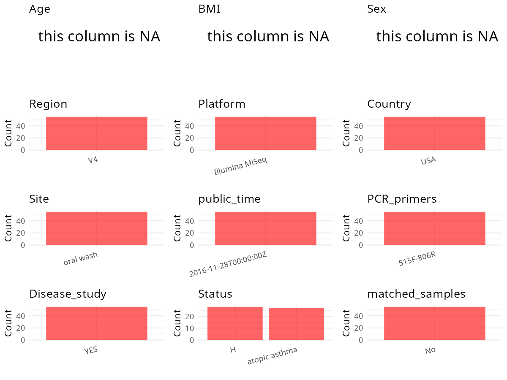

R Notebook: Metadata Processing Workflow
================

# Step 1: Obtain Initial Metadata from Each Project

To obtain the initial metadata: 1. Search for the BioProject ID (e.g.,
“PRJEBXXXX”) on the [NCBI SRA
website](https://www.ncbi.nlm.nih.gov/Traces/study/). 2. In the “Select”
table, click on “Metadata” and download the file. 3. The downloaded file
is typically named “SraRunTable.csv” and contains metadata for the
project.

``` r
# Load necessary libraries
library(dplyr)
library(ggplot2)
library(cowplot)

# Set working directory (update this path to your local directory)
setwd("/home/hby/oral_project/PRJEB15534")

# Read the initial metadata files
initial_meta <- read.csv("SraRunTable.csv", header = T)

# Combine the two metadata files
# meta <- rbind(initial_meta, initial_meta1)

# Remove entries non-oral samples
# initial_meta <- subset(initial_meta,isolate %in% c("saliva","tongue coat"))

# Check the number of samples containing "HT" in Sample.Name (e.g., healthy controls)
# nrow(subset(meta, grepl("HT", Sample.Name)))

# Display the first few rows of the metadata
head(initial_meta)
```

    ##          Run Assay.Type AvgSpotLen     Bases BioProject    BioSample     Bytes                              Center.Name chemical_administration Collection_Date Consent
    ## 1 ERR1662616   AMPLICON        251 291078174 PRJEB15534 SAMEA4470849 158552479 UNIVERSITY OF CALIFORNIA - SAN FRANCISCO baseline (no treatment)        2013/5/7  public
    ## 2 ERR1662617   AMPLICON        251 204126754 PRJEB15534 SAMEA4470850 113033303 UNIVERSITY OF CALIFORNIA - SAN FRANCISCO baseline (no treatment)        2013/6/5  public
    ## 3 ERR1662618   AMPLICON        251 217672722 PRJEB15534 SAMEA4470851 118929797 UNIVERSITY OF CALIFORNIA - SAN FRANCISCO baseline (no treatment)       2013/1/30  public
    ## 4 ERR1662619   AMPLICON        251 132364850 PRJEB15534 SAMEA4470852  72448422 UNIVERSITY OF CALIFORNIA - SAN FRANCISCO baseline (no treatment)       2013/3/11  public
    ## 5 ERR1662620   AMPLICON        251 197903962 PRJEB15534 SAMEA4470853 107344874 UNIVERSITY OF CALIFORNIA - SAN FRANCISCO baseline (no treatment)       2013/2/21  public
    ## 6 ERR1662621   AMPLICON        251 197440114 PRJEB15534 SAMEA4470854 108361350 UNIVERSITY OF CALIFORNIA - SAN FRANCISCO baseline (no treatment)       2013/4/10  public
    ##   DATASTORE.filetype DATASTORE.provider                         DATASTORE.region ENA.FIRST.PUBLIC..run. ENA_first_public ENA.LAST.UPDATE..run. ena_last_update environment_.biome.
    ## 1   fastq,run.zq,sra     ena,gs,ncbi,s3 ena,gs.us-east1,ncbi.public,s3.us-east-1             2016/11/27       2016/11/27            2018/11/16      2016/10/21         urban biome
    ## 2   fastq,run.zq,sra     ena,gs,ncbi,s3 ena,gs.us-east1,ncbi.public,s3.us-east-1             2016/11/27       2016/11/27            2018/11/16      2016/10/21         urban biome
    ## 3   fastq,run.zq,sra     ena,gs,ncbi,s3 ena,gs.us-east1,ncbi.public,s3.us-east-1             2016/11/27       2016/11/27            2018/11/16      2016/10/21         urban biome
    ## 4   fastq,run.zq,sra     ena,gs,ncbi,s3 ena,gs.us-east1,ncbi.public,s3.us-east-1             2016/11/27       2016/11/27            2018/11/16      2016/10/21         urban biome
    ## 5   fastq,run.zq,sra     ena,gs,ncbi,s3 ena,gs.us-east1,ncbi.public,s3.us-east-1             2016/11/27       2016/11/27            2018/11/16      2016/10/21         urban biome
    ## 6   fastq,run.zq,sra     ena,gs,ncbi,s3 ena,gs.us-east1,ncbi.public,s3.us-east-1             2016/11/27       2016/11/27            2018/11/16      2016/10/21         urban biome
    ##      environment_.feature. environment_material Experiment  external_id geo_loc_name_country geo_loc_name_country_continent geographic_location_.country_and.or_sea.
    ## 1 human-associated habitat            oral wash ERX1732937 SAMEA4470849                  USA                  North America                                      USA
    ## 2 human-associated habitat            oral wash ERX1732938 SAMEA4470850                  USA                  North America                                      USA
    ## 3 human-associated habitat            oral wash ERX1732939 SAMEA4470851                  USA                  North America                                      USA
    ## 4 human-associated habitat            oral wash ERX1732940 SAMEA4470852                  USA                  North America                                      USA
    ## 5 human-associated habitat            oral wash ERX1732941 SAMEA4470853                  USA                  North America                                      USA
    ## 6 human-associated habitat            oral wash ERX1732942 SAMEA4470854                  USA                  North America                                      USA
    ##   geographic_location_.latitude. geographic_location_.longitude. human_associated_environmental_package                       INSDC_center_alias                        INSDC_center_name
    ## 1                       42.36008                       -71.05888                       human-associated UNIVERSITY OF CALIFORNIA - SAN FRANCISCO UNIVERSITY OF CALIFORNIA - SAN FRANCISCO
    ## 2                       42.36008                       -71.05888                       human-associated UNIVERSITY OF CALIFORNIA - SAN FRANCISCO UNIVERSITY OF CALIFORNIA - SAN FRANCISCO
    ## 3                       39.73924                      -104.99025                       human-associated UNIVERSITY OF CALIFORNIA - SAN FRANCISCO UNIVERSITY OF CALIFORNIA - SAN FRANCISCO
    ## 4                       39.73924                      -104.99025                       human-associated UNIVERSITY OF CALIFORNIA - SAN FRANCISCO UNIVERSITY OF CALIFORNIA - SAN FRANCISCO
    ## 5                       39.73924                      -104.99025                       human-associated UNIVERSITY OF CALIFORNIA - SAN FRANCISCO UNIVERSITY OF CALIFORNIA - SAN FRANCISCO
    ## 6                       39.73924                      -104.99025                       human-associated UNIVERSITY OF CALIFORNIA - SAN FRANCISCO UNIVERSITY OF CALIFORNIA - SAN FRANCISCO
    ##     INSDC_first_public    INSDC_last_update INSDC_status     Instrument investigation_type               Library.Name LibraryLayout LibrarySelection LibrarySource
    ## 1 2016-11-27T17:01:49Z 2016-10-21T09:41:02Z       public Illumina MiSeq         metagenome AsthmaNet_BronchialBrushes        PAIRED              PCR   METAGENOMIC
    ## 2 2016-11-27T17:01:49Z 2016-10-21T09:41:02Z       public Illumina MiSeq         metagenome AsthmaNet_BronchialBrushes        PAIRED              PCR   METAGENOMIC
    ## 3 2016-11-27T17:01:49Z 2016-10-21T09:41:02Z       public Illumina MiSeq         metagenome AsthmaNet_BronchialBrushes        PAIRED              PCR   METAGENOMIC
    ## 4 2016-11-27T17:01:49Z 2016-10-21T09:41:02Z       public Illumina MiSeq         metagenome AsthmaNet_BronchialBrushes        PAIRED              PCR   METAGENOMIC
    ## 5 2016-11-27T17:01:49Z 2016-10-21T09:41:02Z       public Illumina MiSeq         metagenome AsthmaNet_BronchialBrushes        PAIRED              PCR   METAGENOMIC
    ## 6 2016-11-27T17:01:49Z 2016-10-21T09:41:02Z       public Illumina MiSeq         metagenome AsthmaNet_BronchialBrushes        PAIRED              PCR   METAGENOMIC
    ##       lungpulmonary_disorder             miscellaneous_parameter             Organism Platform project_name          ReleaseDate  Sample_Name Sample_name       Sequencing_method
    ## 1 control (no atopic asthma)       atopic non-asthmatic controls human gut metagenome ILLUMINA    AsthmaNet 2016-11-28T00:00:00Z SAMEA4470849        A048 Sequencing by synthesis
    ## 2              atopic asthma                   atopic asthmatics human gut metagenome ILLUMINA    AsthmaNet 2016-11-28T00:00:00Z SAMEA4470850        A050 Sequencing by synthesis
    ## 3 control (no atopic asthma) non-atopic asthmaticstopic controls human gut metagenome ILLUMINA    AsthmaNet 2016-11-28T00:00:00Z SAMEA4470851        A055 Sequencing by synthesis
    ## 4              atopic asthma                   atopic asthmatics human gut metagenome ILLUMINA    AsthmaNet 2016-11-28T00:00:00Z SAMEA4470852        A056 Sequencing by synthesis
    ## 5              atopic asthma                   atopic asthmatics human gut metagenome ILLUMINA    AsthmaNet 2016-11-28T00:00:00Z SAMEA4470853        A058 Sequencing by synthesis
    ## 6              atopic asthma                   atopic asthmatics human gut metagenome ILLUMINA    AsthmaNet 2016-11-28T00:00:00Z SAMEA4470854        A060 Sequencing by synthesis
    ##   SRA.Study Submitter_Id          create_date version
    ## 1 ERP017346         A048 2016-11-28T09:16:00Z       1
    ## 2 ERP017346         A050 2016-11-28T09:17:00Z       1
    ## 3 ERP017346         A055 2016-11-28T09:17:00Z       1
    ## 4 ERP017346         A056 2016-11-28T09:17:00Z       1
    ## 5 ERP017346         A058 2016-11-28T09:17:00Z       1
    ## 6 ERP017346         A060 2016-11-28T09:17:00Z       1

# Step 2: Create a Uniform Metadata Template

The uniform metadata should include the following columns:

1.  **BioProject**: Project ID (e.g., “PRJNA339212”)
2.  **Run**: Sample ID (e.g., “ERRXXXXXX” or “SRRXXXXXX”)
3.  **sample_name**: Original sample name submitted by the authors (not
    the database-assigned ID)
4.  **Age**: Age of the subject (if available)
5.  **BMI**: Body Mass Index (if available)
6.  **Sex**: Sex of the subject (“F” or “M”)
7.  **Region**: Targeted 16S rRNA region (e.g., “V3-V4”)
8.  **Platform**: Sequencing platform (e.g., “Illumina MiSeq”)
9.  **Country**: Country of sample origin (e.g., “China”)
10. **Site**: Sample site (e.g., “saliva”, “dental plaque”)
11. **public_time**: Data release date (format: “YYYY-MM-DD”)
12. **PCR_primers**: PCR primers used (e.g., “515F-806R”)
13. **title**: Title of the associated publication
14. **Disease_study**: Whether the study involves a disease (“YES” or
    “NO”)
15. **Status**: Disease status (e.g., “T2DM”, “HC”). Note: If the study
    includes both disease and healthy samples, this must be specified
    per sample.
16. **matched_samples**: matched samples (“YES” or “NO”)

``` r
# Create a uniform metadata dataframe
metadata <- data.frame(
  BioProject = initial_meta$BioProject,
  Run = initial_meta$Run,
  sample_name = initial_meta$Sample_name,
  Platform = initial_meta$Instrument,
  Country = initial_meta$geo_loc_name_country,
  Site = initial_meta$environment_material,
  public_time = initial_meta$ReleaseDate,
  Status = initial_meta$lungpulmonary_disorder,
  Sex = NA,
  Age = NA,
  BMI = NA,
  stringsAsFactors = FALSE
) %>%
  mutate(
    Status = case_when(
      Status == "control (no atopic asthma)" ~ "H",
      TRUE ~ as.character(Status)
    )
  ) %>%
  filter(Site != "bronchial brush")
```

# Step 3: Manually Add Information from the Publication

Some information (e.g. PCR primers, study title, disease status) must be
manually extracted from the publication and added to the metadata.

``` r
# Add information obtained from the publication
metadata$Region <- "V4"
metadata$PCR_primers <- "515F-806R"
metadata$title <- "Features of the bronchial bacterial microbiome associated with atopy，asthma and responsiveness to inhaled corticosteroid treatment"
metadata$Disease_study <- "YES"
metadata$matched_samples <- "No"


cat("\nFinal sample distribution:\n")
```

    ## 
    ## Final sample distribution:

``` r
table(metadata$sample_name)
```

    ## 
    ## A048 A050 A055 A056 A058 A060 A064 A066 A069 A071 A072 A073 A075 A077 A080 A082 A083 A084 A085 A086 A087 A094 A095 A096 A100 A101 A185 A186 A187 A188 A201 A202 A203 A204 A224 A225 A226 
    ##    1    1    1    1    1    1    1    1    1    1    1    1    1    1    1    1    1    1    1    1    1    1    1    1    1    1    1    1    1    1    1    1    1    1    1    1    1 
    ## A227 A229 A230 A232 A234 A235 A236 A237 A239 A240 A241 A290 A291 A296 A298 A299 A300 A301 
    ##    1    1    1    1    1    1    1    1    1    1    1    1    1    1    1    1    1    1

``` r
table(metadata$Site)
```

    ## 
    ## oral wash 
    ##        55

``` r
table(metadata$matched_samples)
```

    ## 
    ## No 
    ## 55

# Step 4: Summarize and Validate the Metadata

``` r
# Check the number of unique runs and sample names
print(paste("Number of unique runs:", length(unique(metadata$Run))))
```

    ## [1] "Number of unique runs: 55"

``` r
print(paste("Number of unique sample names:", length(unique(metadata$sample_name))))
```

    ## [1] "Number of unique sample names: 55"

# Step 5: Visualize the Metadata

``` r

```


# Step 6: Finalize and Export the Metadata

``` r
# Reorder columns to match the desired format
metadata <- metadata[, c(
  "BioProject", "Run", "sample_name", "Age", "BMI", "Sex",
  "Region", "Platform", "Country", "Site", "public_time",
  "PCR_primers", "title", "Disease_study", "Status", "matched_samples"
)]

# Export the uniform metadata to a CSV file
write.csv(metadata, file = "metadata.csv", quote = FALSE)
head(metadata)
```

    ##   BioProject        Run sample_name Age BMI Sex Region       Platform Country      Site          public_time PCR_primers
    ## 1 PRJEB15534 ERR1662616        A048  NA  NA  NA     V4 Illumina MiSeq     USA oral wash 2016-11-28T00:00:00Z   515F-806R
    ## 2 PRJEB15534 ERR1662617        A050  NA  NA  NA     V4 Illumina MiSeq     USA oral wash 2016-11-28T00:00:00Z   515F-806R
    ## 3 PRJEB15534 ERR1662618        A055  NA  NA  NA     V4 Illumina MiSeq     USA oral wash 2016-11-28T00:00:00Z   515F-806R
    ## 4 PRJEB15534 ERR1662619        A056  NA  NA  NA     V4 Illumina MiSeq     USA oral wash 2016-11-28T00:00:00Z   515F-806R
    ## 5 PRJEB15534 ERR1662620        A058  NA  NA  NA     V4 Illumina MiSeq     USA oral wash 2016-11-28T00:00:00Z   515F-806R
    ## 6 PRJEB15534 ERR1662621        A060  NA  NA  NA     V4 Illumina MiSeq     USA oral wash 2016-11-28T00:00:00Z   515F-806R
    ##                                                                                                                                 title Disease_study        Status matched_samples
    ## 1 Features of the bronchial bacterial microbiome associated with atopy，asthma and responsiveness to inhaled corticosteroid treatment           YES             H              No
    ## 2 Features of the bronchial bacterial microbiome associated with atopy，asthma and responsiveness to inhaled corticosteroid treatment           YES atopic asthma              No
    ## 3 Features of the bronchial bacterial microbiome associated with atopy，asthma and responsiveness to inhaled corticosteroid treatment           YES             H              No
    ## 4 Features of the bronchial bacterial microbiome associated with atopy，asthma and responsiveness to inhaled corticosteroid treatment           YES atopic asthma              No
    ## 5 Features of the bronchial bacterial microbiome associated with atopy，asthma and responsiveness to inhaled corticosteroid treatment           YES atopic asthma              No
    ## 6 Features of the bronchial bacterial microbiome associated with atopy，asthma and responsiveness to inhaled corticosteroid treatment           YES atopic asthma              No

## Notes for Students:

1.  **Metadata Accuracy**: Always cross-check the metadata with the
    original publication to ensure accuracy.
2.  **Manual Entries**: Columns like `PCR_primers`, and `Status` often
    require manual entry based on the publication.
3.  **Disease Status**: Be careful when assigning `Status`—some studies
    include both disease and healthy samples.
4.  **Visualization**: The plots help quickly identify the distribution
    of values in each column, which is useful for quality control.
5.  **Reproducibility**: Update the working directory and file paths to
    match your local environment.
