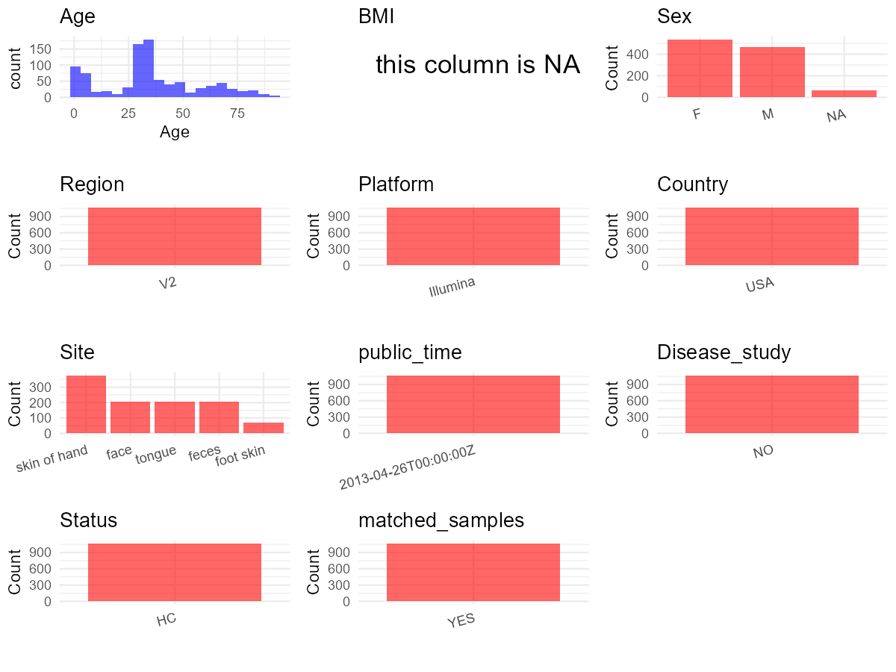

R Notebook: Metadata Processing Workflow
================

# Step 1: Obtain Initial Metadata from Each Project

To obtain the initial metadata: 1. Search for the BioProject ID (e.g.,
“PRJEBXXXX”) on the [NCBI SRA
website](https://www.ncbi.nlm.nih.gov/Traces/study/). 2. In the “Select”
table, click on “Metadata” and download the file. 3. The downloaded file
is typically named “SraRunTable.csv” and contains metadata for the
project.

``` r
# Load necessary libraries
library(dplyr)
library(ggplot2)
library(cowplot)

# Set working directory (update this path to your local directory)
setwd("D:/oral_project/PRJEB1799")

# Read the initial metadata files
initial_meta<-read.csv("SraRunTable.csv",header = T)

# Combine the two metadata files
#meta <- rbind(initial_meta, initial_meta1)

#Remove entries non-oral samples
#initial_meta <- subset(initial_meta,isolate %in% c("saliva","tongue coat"))

# Check the number of samples containing "HT" in Sample.Name (e.g., healthy controls)
#nrow(subset(meta, grepl("HT", Sample.Name)))

# Display the first few rows of the metadata
head(initial_meta)
```

    ##         Run age_unit altitude anonymized_name Assay.Type assigned_from_geo
    ## 1 ERR261869       78        0           FS_07   AMPLICON                 n
    ## 2 ERR261870       78        0          FS_183   AMPLICON                 n
    ## 3 ERR261871       78        0          FS_174   AMPLICON                 n
    ## 4 ERR261872       78        0           FS_10   AMPLICON                 n
    ## 5 ERR261873       78        0          FS_106   AMPLICON                 n
    ## 6 ERR261874       78        0           FS_44   AMPLICON                 n
    ##   AvgSpotLen   Bases BioProject    BioSample       body_habitat  body_product
    ## 1        125 1587121  PRJEB1799 SAMEA1881328        UBERON:skin  UBERON:sebum
    ## 2        127 2221431  PRJEB1799 SAMEA1881298        UBERON:skin  UBERON:sebum
    ## 3        125  788791  PRJEB1799 SAMEA1881262 UBERON:oral cavity UBERON:saliva
    ## 4        124 5670129  PRJEB1799 SAMEA1881238       UBERON:feces  UBERON:feces
    ## 5        128 7444348  PRJEB1799 SAMEA1878961        UBERON:skin  UBERON:sebum
    ## 6        125 3757028  PRJEB1799 SAMEA1878858        UBERON:skin  UBERON:sebum
    ##             body_site   Bytes   Center.Name            common_name Consent
    ## 1         UBERON:face 1278871 CCME-COLORADO  human skin metagenome  public
    ## 2         UBERON:face 1786807 CCME-COLORADO organismal metagenomes  public
    ## 3       UBERON:tongue  642184 CCME-COLORADO  human oral metagenome  public
    ## 4        UBERON:feces 4317148 CCME-COLORADO   human gut metagenome  public
    ## 5 UBERON:skin of hand 5867501 CCME-COLORADO  human skin metagenome  public
    ## 6         UBERON:face 2868918 CCME-COLORADO  human skin metagenome  public
    ##   DATASTORE.filetype DATASTORE.provider
    ## 1   fastq,run.zq,sra     ena,gs,ncbi,s3
    ## 2   fastq,run.zq,sra     ena,gs,ncbi,s3
    ## 3   fastq,run.zq,sra     ena,gs,ncbi,s3
    ## 4   fastq,run.zq,sra     ena,gs,ncbi,s3
    ## 5   fastq,run.zq,sra     ena,gs,ncbi,s3
    ## 6   run.zq,sra,fastq     ena,gs,ncbi,s3
    ##                           DATASTORE.region Depth elevation
    ## 1 ena,gs.us-east1,ncbi.public,s3.us-east-1     0    1624.1
    ## 2 ena,gs.us-east1,ncbi.public,s3.us-east-1     0    1624.1
    ## 3 ena,gs.us-east1,ncbi.public,s3.us-east-1     0    1624.1
    ## 4 ena,gs.us-east1,ncbi.public,s3.us-east-1     0    1624.1
    ## 5 ena,gs.us-east1,ncbi.public,s3.us-east-1     0    1624.1
    ## 6 ena,gs.us-east1,ncbi.public,s3.us-east-1     0    1624.1
    ##   ENA.FIRST.PUBLIC..run. ena_first_public ENA.LAST.UPDATE..run. ena_last_update
    ## 1             2013-04-17       2013-04-17            2018-11-16      2013-04-16
    ## 2             2013-04-17       2013-04-17            2018-11-16      2013-04-16
    ## 3             2013-04-17       2013-04-17            2018-11-16      2013-04-16
    ## 4             2013-04-17       2013-04-17            2018-11-16      2013-04-16
    ## 5             2013-04-17       2013-04-17            2018-11-16      2013-04-16
    ## 6             2013-04-17       2013-04-17            2018-11-16      2013-04-16
    ##                        env_biome                    env_feature  env_matter
    ## 1  ENVO:human-associated habitat  ENVO:human-associated habitat  ENVO:sebum
    ## 2 ENVO:animal-associated habitat ENVO:animal-associated habitat  ENVO:sebum
    ## 3  ENVO:human-associated habitat  ENVO:human-associated habitat ENVO:saliva
    ## 4  ENVO:human-associated habitat  ENVO:human-associated habitat  ENVO:feces
    ## 5  ENVO:human-associated habitat  ENVO:human-associated habitat  ENVO:sebum
    ## 6  ENVO:human-associated habitat  ENVO:human-associated habitat  ENVO:sebum
    ##   experiment_center..exp.
    ## 1                    CCME
    ## 2                    CCME
    ## 3                    CCME
    ## 4                    CCME
    ## 5                    CCME
    ## 6                    CCME
    ##                                              experiment_design_description..exp.
    ## 1 Explaining variability among and between the microbial communities of families
    ## 2 Explaining variability among and between the microbial communities of families
    ## 3 Explaining variability among and between the microbial communities of families
    ## 4 Explaining variability among and between the microbial communities of families
    ## 5 Explaining variability among and between the microbial communities of families
    ## 6 Explaining variability among and between the microbial communities of families
    ##   Experiment
    ## 1  ERX236387
    ## 2  ERX236388
    ## 3  ERX236389
    ## 4  ERX236390
    ## 5  ERX236391
    ## 6  ERX236392
    ##                                                           experiment_title..exp.
    ## 1 Explaining variability among and between the microbial communities of families
    ## 2 Explaining variability among and between the microbial communities of families
    ## 3 Explaining variability among and between the microbial communities of families
    ## 4 Explaining variability among and between the microbial communities of families
    ## 5 Explaining variability among and between the microbial communities of families
    ## 6 Explaining variability among and between the microbial communities of families
    ##    external_id family geo_loc_name_country geo_loc_name_country_continent
    ## 1 SAMEA1881328      4                  USA                  North America
    ## 2 SAMEA1881298     18                  USA                  North America
    ## 3 SAMEA1881262   1075                  USA                  North America
    ## 4 SAMEA1881238      5                  USA                  North America
    ## 5 SAMEA1878961     54                  USA                  North America
    ## 6 SAMEA1878858     25                  USA                  North America
    ##   geographic_location_.country_and.or_sea. host_common_name host_subject_id
    ## 1                                 USA: GAZ            human       797:FS_07
    ## 2                                 USA: GAZ              dog      797:FS_183
    ## 3                                 USA: GAZ            human      797:FS_174
    ## 4                                 USA: GAZ            human       797:FS_10
    ## 5                                 USA: GAZ            human      797:FS_106
    ## 6                                 USA: GAZ            human       797:FS_44
    ##   host_taxid
    ## 1       9606
    ## 2       9615
    ## 3       9606
    ## 4       9606
    ## 5       9606
    ## 6       9606
    ##                                                            INSDC_center_name
    ## 1 Colorado Center for Microbial Ecology\\, University of Colorado at Boulder
    ## 2 Colorado Center for Microbial Ecology\\, University of Colorado at Boulder
    ## 3 Colorado Center for Microbial Ecology\\, University of Colorado at Boulder
    ## 4 Colorado Center for Microbial Ecology\\, University of Colorado at Boulder
    ## 5 Colorado Center for Microbial Ecology\\, University of Colorado at Boulder
    ## 6 Colorado Center for Microbial Ecology\\, University of Colorado at Boulder
    ##     INSDC_first_public    INSDC_last_update INSDC_status  Instrument latitude
    ## 1 2013-04-17T17:01:49Z 2013-04-16T19:29:10Z       public unspecified    40.01
    ## 2 2013-04-17T17:01:49Z 2013-04-16T19:29:10Z       public unspecified    40.01
    ## 3 2013-04-17T17:01:49Z 2013-04-16T19:29:10Z       public unspecified    40.01
    ## 4 2013-04-17T17:01:49Z 2013-04-16T19:29:10Z       public unspecified    40.01
    ## 5 2013-04-17T17:01:50Z 2013-04-16T19:29:10Z       public unspecified    40.01
    ## 6 2013-04-17T17:01:50Z 2013-04-16T19:29:10Z       public unspecified    40.01
    ##   library_construction_protocol..exp.       Library.Name LibraryLayout
    ## 1                                none  04.HA.Forehead:37        SINGLE
    ## 2                                none 18.CB.Forehead:270        SINGLE
    ## 3                                none    1075.Tongue:130        SINGLE
    ## 4                                none     05.HB.Stool:55        SINGLE
    ## 5                                none 54.HA.LeftPalm:798        SINGLE
    ## 6                                none 25.HB.Forehead:371        SINGLE
    ##   LibrarySelection LibrarySource longitude num_sequences..exp.
    ## 1              PCR   METAGENOMIC   -105.27               12648
    ## 2              PCR   METAGENOMIC   -105.27               17461
    ## 3              PCR   METAGENOMIC   -105.27                6273
    ## 4              PCR   METAGENOMIC   -105.27               45395
    ## 5              PCR   METAGENOMIC   -105.27               57720
    ## 6              PCR   METAGENOMIC   -105.27               29898
    ##                           Organism
    ## 1 Parnassius szechenyii incognitus
    ## 2           organismal metagenomes
    ## 3            human oral metagenome
    ## 4             human gut metagenome
    ## 5 Parnassius szechenyii incognitus
    ## 6 Parnassius szechenyii incognitus
    ##                                                       pcr_primers..exp.
    ## 1 FWD:GCCTTGCCAGCCCGCTCAGTCAGAGTTTGATCCTGGCTCAG;REV:TGCTGCCTCCCGTAGGAGT
    ## 2 FWD:GCCTTGCCAGCCCGCTCAGTCAGAGTTTGATCCTGGCTCAG;REV:TGCTGCCTCCCGTAGGAGT
    ## 3 FWD:GCCTTGCCAGCCCGCTCAGTCAGAGTTTGATCCTGGCTCAG;REV:TGCTGCCTCCCGTAGGAGT
    ## 4 FWD:GCCTTGCCAGCCCGCTCAGTCAGAGTTTGATCCTGGCTCAG;REV:TGCTGCCTCCCGTAGGAGT
    ## 5 FWD:GCCTTGCCAGCCCGCTCAGTCAGAGTTTGATCCTGGCTCAG;REV:TGCTGCCTCCCGTAGGAGT
    ## 6 FWD:GCCTTGCCAGCCCGCTCAGTCAGAGTTTGATCCTGGCTCAG;REV:TGCTGCCTCCCGTAGGAGT
    ##   platform..exp. Platform          ReleaseDate    role row_number..exp.
    ## 1       Illumina ILLUMINA 2013-04-26T00:00:00Z Partner               37
    ## 2       Illumina ILLUMINA 2013-04-26T00:00:00Z     Pet              270
    ## 3       Illumina ILLUMINA 2013-04-26T00:00:00Z  Single              130
    ## 4       Illumina ILLUMINA 2013-04-26T00:00:00Z Partner               55
    ## 5       Illumina ILLUMINA 2013-04-26T00:00:00Z Partner              798
    ## 6       Illumina ILLUMINA 2013-04-26T00:00:00Z Partner              371
    ##   run_center..exp. run_date..exp. samp_size sample_center..exp. Sample_ID
    ## 1             CCME      4/17/2011    .1\\,g                CCME    321851
    ## 2             CCME      4/17/2011    .1\\,g                CCME    321852
    ## 3             CCME      4/17/2011    .1\\,g                CCME    321853
    ## 4             CCME      4/17/2011    .1\\,g                CCME    321854
    ## 5             CCME      4/17/2011    .1\\,g                CCME    321855
    ## 6             CCME      4/17/2011    .1\\,g                CCME    321856
    ##    Sample.Name                                   Sample_name
    ## 1 SAMEA1881328 04.HA.Forehead,qiime_study_797:04.HA.Forehead
    ## 2 SAMEA1881298 18.CB.Forehead,qiime_study_797:18.CB.Forehead
    ## 3 SAMEA1881262       1075.Tongue,qiime_study_797:1075.Tongue
    ## 4 SAMEA1881238       05.HB.Stool,qiime_study_797:05.HB.Stool
    ## 5 SAMEA1878961 54.HA.LeftPalm,qiime_study_797:54.HA.LeftPalm
    ## 6 SAMEA1878858 25.HB.Forehead,qiime_study_797:25.HB.Forehead
    ##   sequencing_meth..exp. SRA.Study study_center..exp.
    ## 1        pyrosequencing ERP002478               CCME
    ## 2        pyrosequencing ERP002478               CCME
    ## 3        pyrosequencing ERP002478               CCME
    ## 4        pyrosequencing ERP002478               CCME
    ## 5        pyrosequencing ERP002478               CCME
    ## 6        pyrosequencing ERP002478               CCME
    ##                     Submitter_Id target_gene..exp. target_subfragment..exp.
    ## 1 qiime_study_797:04.HA.Forehead          16S rRNA                       V2
    ## 2 qiime_study_797:18.CB.Forehead          16S rRNA                       V2
    ## 3    qiime_study_797:1075.Tongue          16S rRNA                       V2
    ## 4    qiime_study_797:05.HB.Stool          16S rRNA                       V2
    ## 5 qiime_study_797:54.HA.LeftPalm          16S rRNA                       V2
    ## 6 qiime_study_797:25.HB.Forehead          16S rRNA                       V2
    ##   taxon_id                            family_relationship agegroup
    ## 1   539665                               partner of FS_08    Adult
    ## 2   410656                         pet of FS_27 and FS_28       na
    ## 3   447426                                           none   Senior
    ## 4   408170              father of FS_09, partner of FS_11    Adult
    ## 5   539665 father of FS_107 abd FS_109, partner of FS_108    Adult
    ## 6   539665                               partner of FS_43    Adult
    ##   pet_farm_animal          create_date version PUBLIC INSDC_center_alias
    ## 1            none 2013-04-17T21:57:00Z       1      n      CCME-COLORADO
    ## 2             dog 2013-04-17T21:57:00Z       1      n      CCME-COLORADO
    ## 3            none 2013-04-17T21:57:00Z       1      n      CCME-COLORADO
    ## 4            none 2013-04-17T21:57:00Z       1      n      CCME-COLORADO
    ## 5            none 2013-04-17T21:57:00Z       1      n      CCME-COLORADO
    ## 6            none 2013-04-17T21:58:00Z       1      n      CCME-COLORADO
    ##   weight_loss_3_month sex
    ## 1                   n  47
    ## 2                   n  NA
    ## 3                   n  48
    ## 4                   n  47
    ## 5                   n  47
    ## 6                   n  47
    ##                                                      drug_usage         Diet
    ## 1 Klonopin, Prozac, Immipramine, Warfarin, Cozaar, Tenex, Calan regular.diet
    ## 2                                                                           
    ## 3                                                          none regular.diet
    ## 4                                                          none         diet
    ## 5                                                          none    no.gluten
    ## 6                                                         Advil regular.diet
    ##   AGE Collection_Date tot_mass sub_species public scientific_name
    ## 1  54         1/30/10  138.618  incognitus                       
    ## 2  NA         2/21/10       NA                                   
    ## 3  69                       NA                                   
    ## 4  35         1/30/10   58.890                                   
    ## 5  49          5/3/10   79.275  incognitus                       
    ## 6  28         4/18/10   83.805  incognitus

# Step 2: Create a Uniform Metadata Template

The uniform metadata should include the following columns:

1.  **BioProject**: Project ID (e.g., “PRJNA339212”)
2.  **Run**: Sample ID (e.g., “ERRXXXXXX” or “SRRXXXXXX”)
3.  **sample_name**: Original sample name submitted by the authors (not
    the database-assigned ID)
4.  **Age**: Age of the subject (if available)
5.  **BMI**: Body Mass Index (if available)
6.  **Sex**: Sex of the subject (“F” or “M”)
7.  **Region**: Targeted 16S rRNA region (e.g., “V3-V4”)
8.  **Platform**: Sequencing platform (e.g., “Illumina MiSeq”)
9.  **Country**: Country of sample origin (e.g., “China”)
10. **Site**: Sample site (e.g., “saliva”, “dental plaque”)
11. **public_time**: Data release date (format: “YYYY-MM-DD”)
12. **PCR_primers**: PCR primers used (e.g., “515F-806R”)
13. **title**: Title of the associated publication
14. **Disease_study**: Whether the study involves a disease (“YES” or
    “NO”)
15. **Status**: Disease status (e.g., “T2DM”, “HC”). Note: If the study
    includes both disease and healthy samples, this must be specified
    per sample.
16. **matched_samples**: matched samples (“YES” or “NO”)

``` r
# Create a uniform metadata dataframe
metadata <- data.frame(
  BioProject = initial_meta$BioProject,
  Run = initial_meta$Run,
  sample_name = initial_meta$anonymized_name,
  Age = initial_meta$AGE,
  BMI = NA,
  Sex = initial_meta$sex,
  Region = initial_meta$target_subfragment..exp.,
  Platform = initial_meta$platform..exp.,
  Country = initial_meta$geo_loc_name_country,
  Site = gsub("UBERON:", "", initial_meta$body_site),
  public_time = initial_meta$ReleaseDate,
  PCR_primers = initial_meta$pcr_primers..exp.,
  stringsAsFactors = FALSE
)
```

``` r
metadata$Age <- as.numeric(metadata$Age)
metadata$Age <- ifelse(metadata$Age > 100, NA, metadata$Age)
metadata <- metadata %>%
  mutate(Sex = recode(Sex, "47" = "M", "48" = "F"))
```

# Step 3: Manually Add Information from the Publication

Some information (e.g. PCR primers, study title, disease status) must be
manually extracted from the publication and added to the metadata.

``` r
# Add information obtained from the publication
metadata$title <- "Prevalence and Source of Fecal and Oral Bacteria on Infant Child and Adult Hands"
metadata$Disease_study <- "NO"
# Assign disease status based on sample_name patterns
metadata$Status <- "HC"

#get subjects id according to sample id
metadata$sample_name<-gsub("FS_","",metadata$sample_name)
#get subjects id with Saliva available
keep_subjects<-subset(metadata,Site %in% "tongue")
#remove subjects without Saliva samples
metadata<-subset(metadata,sample_name %in% keep_subjects$sample_name)
#get subjects sampling counts
sample_counts <- table(metadata$sample_name)
# Create matched_samples column, any subjects have >=2 samples will be label "YES", otherwise "NO"
metadata$matched_samples <- ifelse(metadata$sample_name %in% names(sample_counts[sample_counts >= 2]), "YES", "NO")
```

# Step 4: Summarize and Validate the Metadata

``` r
# Check the number of unique runs and sample names
print(paste("Number of unique runs:", length(unique(metadata$Run))))
```

    ## [1] "Number of unique runs: 1069"

``` r
print(paste("Number of unique sample names:", length(unique(metadata$sample_name))))
```

    ## [1] "Number of unique sample names: 206"

# Step 5: Visualize the Metadata

``` r

```


# Step 6: Finalize and Export the Metadata

``` r
# Reorder columns to match the desired format
metadata <- metadata[, c(
  "BioProject", "Run", "sample_name", "Age", "BMI", "Sex", 
  "Region", "Platform", "Country", "Site", "public_time", 
  "PCR_primers", "title", "Disease_study", "Status","matched_samples"
)]

# Export the uniform metadata to a CSV file
write.csv(metadata, file = "metadata.csv", quote = FALSE)
head(metadata)
```

    ##   BioProject       Run sample_name Age BMI  Sex Region Platform Country
    ## 1  PRJEB1799 ERR261869          07  54  NA    M     V2 Illumina     USA
    ## 2  PRJEB1799 ERR261870         183  NA  NA <NA>     V2 Illumina     USA
    ## 3  PRJEB1799 ERR261871         174  69  NA    F     V2 Illumina     USA
    ## 4  PRJEB1799 ERR261872          10  35  NA    M     V2 Illumina     USA
    ## 5  PRJEB1799 ERR261873         106  49  NA    M     V2 Illumina     USA
    ## 6  PRJEB1799 ERR261874          44  28  NA    M     V2 Illumina     USA
    ##           Site          public_time
    ## 1         face 2013-04-26T00:00:00Z
    ## 2         face 2013-04-26T00:00:00Z
    ## 3       tongue 2013-04-26T00:00:00Z
    ## 4        feces 2013-04-26T00:00:00Z
    ## 5 skin of hand 2013-04-26T00:00:00Z
    ## 6         face 2013-04-26T00:00:00Z
    ##                                                             PCR_primers
    ## 1 FWD:GCCTTGCCAGCCCGCTCAGTCAGAGTTTGATCCTGGCTCAG;REV:TGCTGCCTCCCGTAGGAGT
    ## 2 FWD:GCCTTGCCAGCCCGCTCAGTCAGAGTTTGATCCTGGCTCAG;REV:TGCTGCCTCCCGTAGGAGT
    ## 3 FWD:GCCTTGCCAGCCCGCTCAGTCAGAGTTTGATCCTGGCTCAG;REV:TGCTGCCTCCCGTAGGAGT
    ## 4 FWD:GCCTTGCCAGCCCGCTCAGTCAGAGTTTGATCCTGGCTCAG;REV:TGCTGCCTCCCGTAGGAGT
    ## 5 FWD:GCCTTGCCAGCCCGCTCAGTCAGAGTTTGATCCTGGCTCAG;REV:TGCTGCCTCCCGTAGGAGT
    ## 6 FWD:GCCTTGCCAGCCCGCTCAGTCAGAGTTTGATCCTGGCTCAG;REV:TGCTGCCTCCCGTAGGAGT
    ##                                                                              title
    ## 1 Prevalence and Source of Fecal and Oral Bacteria on Infant Child and Adult Hands
    ## 2 Prevalence and Source of Fecal and Oral Bacteria on Infant Child and Adult Hands
    ## 3 Prevalence and Source of Fecal and Oral Bacteria on Infant Child and Adult Hands
    ## 4 Prevalence and Source of Fecal and Oral Bacteria on Infant Child and Adult Hands
    ## 5 Prevalence and Source of Fecal and Oral Bacteria on Infant Child and Adult Hands
    ## 6 Prevalence and Source of Fecal and Oral Bacteria on Infant Child and Adult Hands
    ##   Disease_study Status matched_samples
    ## 1            NO     HC             YES
    ## 2            NO     HC             YES
    ## 3            NO     HC             YES
    ## 4            NO     HC             YES
    ## 5            NO     HC             YES
    ## 6            NO     HC             YES

## Notes for Students:

1.  **Metadata Accuracy**: Always cross-check the metadata with the
    original publication to ensure accuracy.
2.  **Manual Entries**: Columns like `PCR_primers`, and `Status` often
    require manual entry based on the publication.
3.  **Disease Status**: Be careful when assigning `Status`—some studies
    include both disease and healthy samples.
4.  **Visualization**: The plots help quickly identify the distribution
    of values in each column, which is useful for quality control.
5.  **Reproducibility**: Update the working directory and file paths to
    match your local environment.
