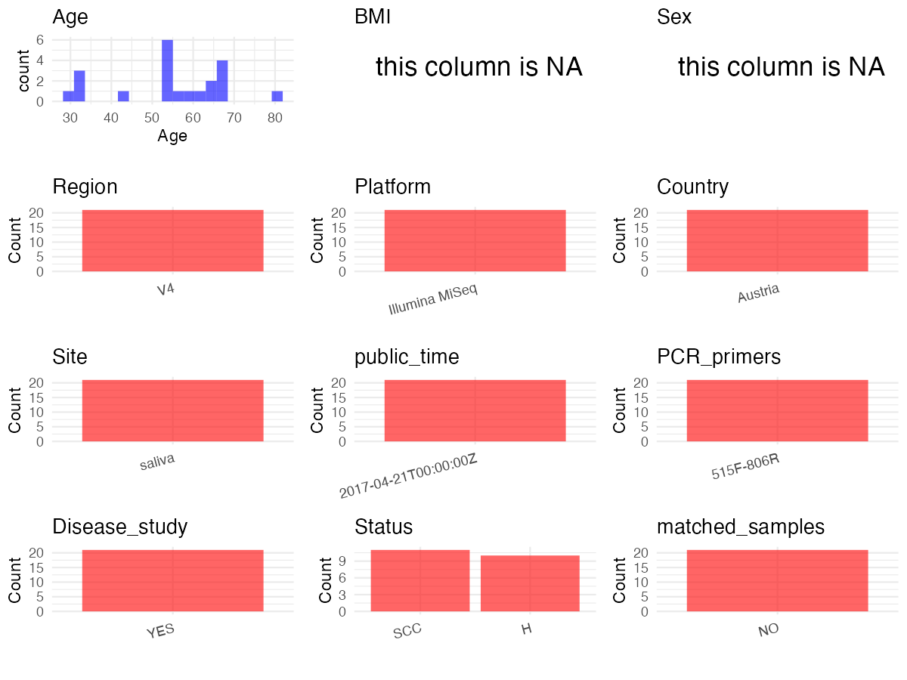

R Notebook: Metadata Processing Workflow
================

# Step 1: Obtain Initial Metadata from Each Project

To obtain the initial metadata: 1. Search for the BioProject ID (e.g.,
“PRJEBXXXX”) on the [NCBI SRA
website](https://www.ncbi.nlm.nih.gov/Traces/study/). 2. In the “Select”
table, click on “Metadata” and download the file. 3. The downloaded file
is typically named “SraRunTable.csv” and contains metadata for the
project.

``` r
# Load necessary libraries
library(dplyr)
library(ggplot2)
library(cowplot)
# Set working directory (update this path to your local directory)
setwd("/Users/dongbiao/Documents/oral/global-oral-microbiome/data/projects/PRJEB18476/")

# Read the initial metadata files
initial_meta<-read.csv("SraRunTable.csv",header = T) %>% filter(Sample_name != "b12ac170-2412-11e7-b93e-3c4a9275d6c8")

head(initial_meta)
```

    ##          Run Assay.Type AvgSpotLen    Bases BioProject     BioSample    Bytes
    ## 1 ERR1749153   AMPLICON        501 81665137 PRJEB18476 SAMEA19998418 46300563
    ## 2 ERR1749154   AMPLICON        501 84592392 PRJEB18476 SAMEA19999168 48376165
    ## 3 ERR1749155   AMPLICON        497 59372769 PRJEB18476 SAMEA19999918 33959974
    ## 4 ERR1749156   AMPLICON        500 79040439 PRJEB18476 SAMEA20000668 44760770
    ## 5 ERR1749157   AMPLICON        500 63194658 PRJEB18476 SAMEA20001418 35359318
    ## 6 ERR1749158   AMPLICON        500 86319922 PRJEB18476 SAMEA20002168 48800486
    ##   Center.Name common_name Consent DATASTORE.filetype DATASTORE.provider
    ## 1           E       human  public   fastq,run.zq,sra     ena,gs,ncbi,s3
    ## 2           E       human  public   fastq,run.zq,sra     ena,gs,ncbi,s3
    ## 3           E       human  public   fastq,run.zq,sra     ena,gs,ncbi,s3
    ## 4           E       human  public   fastq,run.zq,sra     ena,gs,ncbi,s3
    ## 5           E       human  public   fastq,run.zq,sra     ena,gs,ncbi,s3
    ## 6           E       human  public   fastq,run.zq,sra     ena,gs,ncbi,s3
    ##                           DATASTORE.region ENA.FIRST.PUBLIC..run.
    ## 1 ena,gs.us-east1,ncbi.public,s3.us-east-1             2017-04-20
    ## 2 ena,gs.us-east1,ncbi.public,s3.us-east-1             2017-04-20
    ## 3 ena,gs.us-east1,ncbi.public,s3.us-east-1             2017-04-20
    ## 4 ena,gs.us-east1,ncbi.public,s3.us-east-1             2017-04-20
    ## 5 ena,gs.us-east1,ncbi.public,s3.us-east-1             2017-04-20
    ## 6 ena,gs.us-east1,ncbi.public,s3.us-east-1             2017-04-20
    ##   ENA_first_public ENA.LAST.UPDATE..run. Experiment   external_id
    ## 1       2017-04-20            2018-11-16 ERX1818333 SAMEA19998418
    ## 2       2017-04-20            2018-11-16 ERX1818334 SAMEA19999168
    ## 3       2017-04-20            2018-11-16 ERX1818335 SAMEA19999918
    ## 4       2017-04-20            2018-11-16 ERX1818336 SAMEA20000668
    ## 5       2017-04-20            2018-11-16 ERX1818337 SAMEA20001418
    ## 6       2017-04-20            2018-11-16 ERX1818338 SAMEA20002168
    ##   INSDC_center_name    INSDC_last_update INSDC_status     Instrument
    ## 1                 E 2016-12-05T13:39:01Z       public Illumina MiSeq
    ## 2                 E 2016-12-05T13:39:01Z       public Illumina MiSeq
    ## 3                 E 2016-12-05T13:39:01Z       public Illumina MiSeq
    ## 4                 E 2016-12-05T13:39:01Z       public Illumina MiSeq
    ## 5                 E 2016-12-05T13:39:01Z       public Illumina MiSeq
    ## 6                 E 2016-12-05T13:39:01Z       public Illumina MiSeq
    ##   Library.Name LibraryLayout LibrarySelection LibrarySource     Organism
    ## 1  unspecified        PAIRED              PCR   METAGENOMIC Homo sapiens
    ## 2  unspecified        PAIRED              PCR   METAGENOMIC Homo sapiens
    ## 3  unspecified        PAIRED              PCR   METAGENOMIC Homo sapiens
    ## 4  unspecified        PAIRED              PCR   METAGENOMIC Homo sapiens
    ## 5  unspecified        PAIRED              PCR   METAGENOMIC Homo sapiens
    ## 6  unspecified        PAIRED              PCR   METAGENOMIC Homo sapiens
    ##   Platform          ReleaseDate          create_date version   Sample.Name
    ## 1 ILLUMINA 2017-04-21T00:00:00Z 2017-04-21T07:47:00Z       1 SAMEA19998418
    ## 2 ILLUMINA 2017-04-21T00:00:00Z 2017-04-21T07:47:00Z       1 SAMEA19999168
    ## 3 ILLUMINA 2017-04-21T00:00:00Z 2017-04-21T07:47:00Z       1 SAMEA19999918
    ## 4 ILLUMINA 2017-04-21T00:00:00Z 2017-04-21T07:48:00Z       1 SAMEA20000668
    ## 5 ILLUMINA 2017-04-21T00:00:00Z 2017-04-21T07:48:00Z       1 SAMEA20001418
    ## 6 ILLUMINA 2017-04-21T00:00:00Z 2017-04-21T07:48:00Z       1 SAMEA20002168
    ##   Sample_name SRA.Study Submitter_Id Collection_Date ENA_last_update
    ## 1      SCC_01 ERP020408       SCC_01            2016      2016-12-05
    ## 2      SCC_02 ERP020408       SCC_02            2016      2016-12-05
    ## 3      SCC_04 ERP020408       SCC_04            2016      2016-12-05
    ## 4      SCC_05 ERP020408       SCC_05            2016      2016-12-05
    ## 5      SCC_06 ERP020408       SCC_06            2016      2016-12-05
    ## 6      SCC_07 ERP020408       SCC_07            2016      2016-12-05
    ##   environment_.biome. environment_.feature. environment_.material.
    ## 1         human mouth            mouth cave                 saliva
    ## 2         human mouth            mouth cave                 saliva
    ## 3         human mouth            mouth cave                 saliva
    ## 4         human mouth            mouth cave                 saliva
    ## 5         human mouth            mouth cave                 saliva
    ## 6         human mouth            mouth cave                 saliva
    ##   geo_loc_name_country geo_loc_name_country_continent
    ## 1              Austria                         Europe
    ## 2              Austria                         Europe
    ## 3              Austria                         Europe
    ## 4              Austria                         Europe
    ## 5              Austria                         Europe
    ## 6              Austria                         Europe
    ##   geographic_location_.country_and.or_sea. geographic_location_.latitude.
    ## 1                                  Austria                       47.07667
    ## 2                                  Austria                       47.07667
    ## 3                                  Austria                       47.07667
    ## 4                                  Austria                       47.07667
    ## 5                                  Austria                       47.07667
    ## 6                                  Austria                       47.07667
    ##   geographic_location_.longitude. host_age host_disease_status
    ## 1                        15.42137 54 years                  4b
    ## 2                        15.42137 68 years                   1
    ## 3                        15.42137 57 years                  4a
    ## 4                        15.42137 54 years                   1
    ## 5                        15.42137 64 years                   2
    ## 6                        15.42137 61 years                   2
    ##   humam_oral_environmental_package INSDC_center_alias   INSDC_first_public
    ## 1                       human-oral                  E 2017-04-20T17:18:57Z
    ## 2                       human-oral                  E 2017-04-20T17:18:57Z
    ## 3                       human-oral                  E 2017-04-20T17:18:57Z
    ## 4                       human-oral                  E 2017-04-20T17:18:57Z
    ## 5                       human-oral                  E 2017-04-20T17:18:57Z
    ## 6                       human-oral                  E 2017-04-20T17:18:57Z
    ##   investigation_type
    ## 1         metagenome
    ## 2         metagenome
    ## 3         metagenome
    ## 4         metagenome
    ## 5         metagenome
    ## 6         metagenome
    ##                                              nucleic_acid_extraction
    ## 1 Magna Lyser instrument and the MagNA pure LC DNA Isolation Kit III
    ## 2 Magna Lyser instrument and the MagNA pure LC DNA Isolation Kit III
    ## 3 Magna Lyser instrument and the MagNA pure LC DNA Isolation Kit III
    ## 4 Magna Lyser instrument and the MagNA pure LC DNA Isolation Kit III
    ## 5 Magna Lyser instrument and the MagNA pure LC DNA Isolation Kit III
    ## 6 Magna Lyser instrument and the MagNA pure LC DNA Isolation Kit III
    ##      project_name sample_collection_device_or_method Sequencing_method
    ## 1 OSCC microbiome                Salivette® Cortisol    Illumina Miseq
    ## 2 OSCC microbiome                Salivette® Cortisol    Illumina Miseq
    ## 3 OSCC microbiome                Salivette® Cortisol    Illumina Miseq
    ## 4 OSCC microbiome                Salivette® Cortisol    Illumina Miseq
    ## 5 OSCC microbiome                Salivette® Cortisol    Illumina Miseq
    ## 6 OSCC microbiome                Salivette® Cortisol    Illumina Miseq
    ##     target_gene nose.mouth.teeth.throat_disorder ArrayExpress.Phenotype
    ## 1 16S rRNA gene                           cancer                       
    ## 2 16S rRNA gene                           cancer                       
    ## 3 16S rRNA gene                           cancer                       
    ## 4 16S rRNA gene                           cancer                       
    ## 5 16S rRNA gene                           cancer                       
    ## 6 16S rRNA gene                           cancer                       
    ##   ArrayExpress.SPECIES nucleic_acid_amplification phenotype Scientific_Name
    ## 1                                                                          
    ## 2                                                                          
    ## 3                                                                          
    ## 4                                                                          
    ## 5                                                                          
    ## 6                                                                          
    ##   subject_id
    ## 1           
    ## 2           
    ## 3           
    ## 4           
    ## 5           
    ## 6

# Step 2: Create a Uniform Metadata Template

The uniform metadata should include the following columns:

1.  **BioProject**: Project ID (e.g., “PRJNA339212”)
2.  **Run**: Sample ID (e.g., “ERRXXXXXX” or “SRRXXXXXX”)
3.  **sample_name**: Original sample name submitted by the authors (not
    the database-assigned ID)
4.  **Age**: Age of the subject (if available)
5.  **BMI**: Body Mass Index (if available)
6.  **Sex**: Sex of the subject (“F” or “M”)
7.  **Region**: Targeted 16S rRNA region (e.g., “V3-V4”)
8.  **Platform**: Sequencing platform (e.g., “Illumina MiSeq”)
9.  **Country**: Country of sample origin (e.g., “China”)
10. **Site**: Sample site (e.g., “saliva”, “dental plaque”)
11. **public_time**: Data release date (format: “YYYY-MM-DD”)
12. **PCR_primers**: PCR primers used (e.g., “515F-806R”)
13. **title**: Title of the associated publication
14. **Disease_study**: Whether the study involves a disease (“YES” or
    “NO”)
15. **Status**: Disease status (e.g., “T2DM”, “HC”). Note: If the study
    includes both disease and healthy samples, this must be specified
    per sample.
16. **matched_samples** : matched samples (“YES” or “NO”)

``` r
# Create a uniform metadata dataframe
metadata <- data.frame(
  BioProject = initial_meta$BioProject,
  Run = initial_meta$Run,
  sample_name = initial_meta$Sample_name,
  Age = as.integer(gsub("[^0-9]", "", initial_meta$host_age)),
  BMI = NA,
  Sex=NA,
  Region = "V4",
  Platform = initial_meta$Instrument,
  Country = initial_meta$geo_loc_name_country,
  Site = initial_meta$`environment_.material.`,
  public_time = initial_meta$ReleaseDate,
  stringsAsFactors = FALSE
)
```

# Step 3: Manually Add Information from the Publication

Some information (e.g. PCR primers, study title, disease status) must be
manually extracted from the publication and added to the metadata.

``` r
# Add information obtained from the publication
metadata$PCR_primers <- "515F-806R"
metadata$title <- "The salivary microbiome as an indicator of carcinogenesis in patients with oropharyngeal squamous cell carcinoma: A pilot study"
metadata$Disease_study <- "YES"

# Assign disease status based on sample_name patterns
metadata$Status <- sub("_.*", "", initial_meta$Submitter_Id)

# Create matched_samples column
metadata$matched_samples <- "NO"

# Check initial data distribution
cat("Initial sample distribution:\n")
```

    ## Initial sample distribution:

``` r
table(metadata$sample_name)
```

    ## 
    ##   H_15   H_16   H_17   H_18   H_19   H_20   H_21   H_23   H_24   H_25 SCC_01 
    ##      1      1      1      1      1      1      1      1      1      1      1 
    ## SCC_02 SCC_04 SCC_05 SCC_06 SCC_07 SCC_08 SCC_09 SCC_10 SCC_11 SCC_12 
    ##      1      1      1      1      1      1      1      1      1      1

``` r
table(metadata$Site)
```

    ## 
    ## saliva 
    ##     21

# Step 4: Summarize and Validate the Metadata

``` r
# Check the number of unique runs and sample names
print(paste("Number of unique runs:", length(unique(metadata$Run))))
```

    ## [1] "Number of unique runs: 21"

``` r
print(paste("Number of unique sample names:", length(unique(metadata$sample_name))))
```

    ## [1] "Number of unique sample names: 21"

# Step 5: Visualize the Metadata

``` r
# Select columns for visualization
plot_data <- metadata %>%
  select(-BioProject, -Run, -sample_name, -title)

# Function to create simple plots for each column
create_simple_plots <- function(data) {
  plots <- list()
  
  for (col in colnames(data)) {
    # Check if the column is all NA
    if (all(is.na(data[[col]]))) {
      # Create an empty plot with text indicating all NA
      p <- ggplot() +
        annotate("text", x = 0.5, y = 0.5, label = "this column is NA", size = 6) +
        labs(title = col) +
        theme_void()
    } else if (is.numeric(data[[col]])) {
      # Numeric variable: histogram
      p <- ggplot(data, aes(x = .data[[col]])) +
        geom_histogram(fill = "blue", alpha = 0.6, bins = 20, na.rm = TRUE) +
        labs(title = col) +
        theme_minimal()
    } else {
      # Categorical variable: bar plot (remove NA values)
      count_data <- as.data.frame(table(data[[col]], useNA = "ifany"))
      p <- ggplot(count_data, aes(x = reorder(Var1, -Freq), y = Freq)) +
        geom_col(fill = "red", alpha = 0.6) +
        labs(title = col, x = NULL, y = "Count") +
        theme_minimal() +
        theme(axis.text.x = element_text(angle = 15, hjust = 1))
    }
    plots[[col]] <- p
  }
  
  return(plots)
}

# Generate and arrange plots
plots <- create_simple_plots(plot_data)
p<-plot_grid(plots$Age, 
          plots$BMI, 
          plots$Sex, 
          plots$Region, 
          plots$Platform, 
          plots$Country, 
          plots$Site,
          plots$public_time, 
          plots$PCR_primers,
          plots$Disease_study,
          plots$Status,
          plots$matched_samples,# add 
          ncol = 3, align = "hv", axis = "lb")
ggsave("Metadata_Summary.png", plot = p, width = 8, height = 6, dpi = 150)
```

``` r

```


# Step 6: Finalize and Export the Metadata

``` r
# Reorder columns to match the desired format
metadata <- metadata[, c(
  "BioProject", "Run", "sample_name", "Age", "BMI", "Sex", 
  "Region", "Platform", "Country", "Site", "public_time", 
  "PCR_primers", "title", "Disease_study", "Status","matched_samples"
)]

# Export the uniform metadata to a CSV file
write.csv(metadata, file = "metadata.csv", quote = FALSE)
head(metadata)
```

    ##   BioProject        Run sample_name Age BMI Sex Region       Platform Country
    ## 1 PRJEB18476 ERR1749153      SCC_01  54  NA  NA     V4 Illumina MiSeq Austria
    ## 2 PRJEB18476 ERR1749154      SCC_02  68  NA  NA     V4 Illumina MiSeq Austria
    ## 3 PRJEB18476 ERR1749155      SCC_04  57  NA  NA     V4 Illumina MiSeq Austria
    ## 4 PRJEB18476 ERR1749156      SCC_05  54  NA  NA     V4 Illumina MiSeq Austria
    ## 5 PRJEB18476 ERR1749157      SCC_06  64  NA  NA     V4 Illumina MiSeq Austria
    ## 6 PRJEB18476 ERR1749158      SCC_07  61  NA  NA     V4 Illumina MiSeq Austria
    ##     Site          public_time PCR_primers
    ## 1 saliva 2017-04-21T00:00:00Z   515F-806R
    ## 2 saliva 2017-04-21T00:00:00Z   515F-806R
    ## 3 saliva 2017-04-21T00:00:00Z   515F-806R
    ## 4 saliva 2017-04-21T00:00:00Z   515F-806R
    ## 5 saliva 2017-04-21T00:00:00Z   515F-806R
    ## 6 saliva 2017-04-21T00:00:00Z   515F-806R
    ##                                                                                                                             title
    ## 1 The salivary microbiome as an indicator of carcinogenesis in patients with oropharyngeal squamous cell carcinoma: A pilot study
    ## 2 The salivary microbiome as an indicator of carcinogenesis in patients with oropharyngeal squamous cell carcinoma: A pilot study
    ## 3 The salivary microbiome as an indicator of carcinogenesis in patients with oropharyngeal squamous cell carcinoma: A pilot study
    ## 4 The salivary microbiome as an indicator of carcinogenesis in patients with oropharyngeal squamous cell carcinoma: A pilot study
    ## 5 The salivary microbiome as an indicator of carcinogenesis in patients with oropharyngeal squamous cell carcinoma: A pilot study
    ## 6 The salivary microbiome as an indicator of carcinogenesis in patients with oropharyngeal squamous cell carcinoma: A pilot study
    ##   Disease_study Status matched_samples
    ## 1           YES    SCC              NO
    ## 2           YES    SCC              NO
    ## 3           YES    SCC              NO
    ## 4           YES    SCC              NO
    ## 5           YES    SCC              NO
    ## 6           YES    SCC              NO

## Notes for Students:

1.  **Metadata Accuracy**: Always cross-check the metadata with the
    original publication to ensure accuracy.
2.  **Manual Entries**: Columns like `PCR_primers`, and `Status` often
    require manual entry based on the publication.
3.  **Disease Status**: Be careful when assigning `Status`—some studies
    include both disease and healthy samples.
4.  **Visualization**: The plots help quickly identify the distribution
    of values in each column, which is useful for quality control.
5.  **Reproducibility**: Update the working directory and file paths to
    match your local environment.
