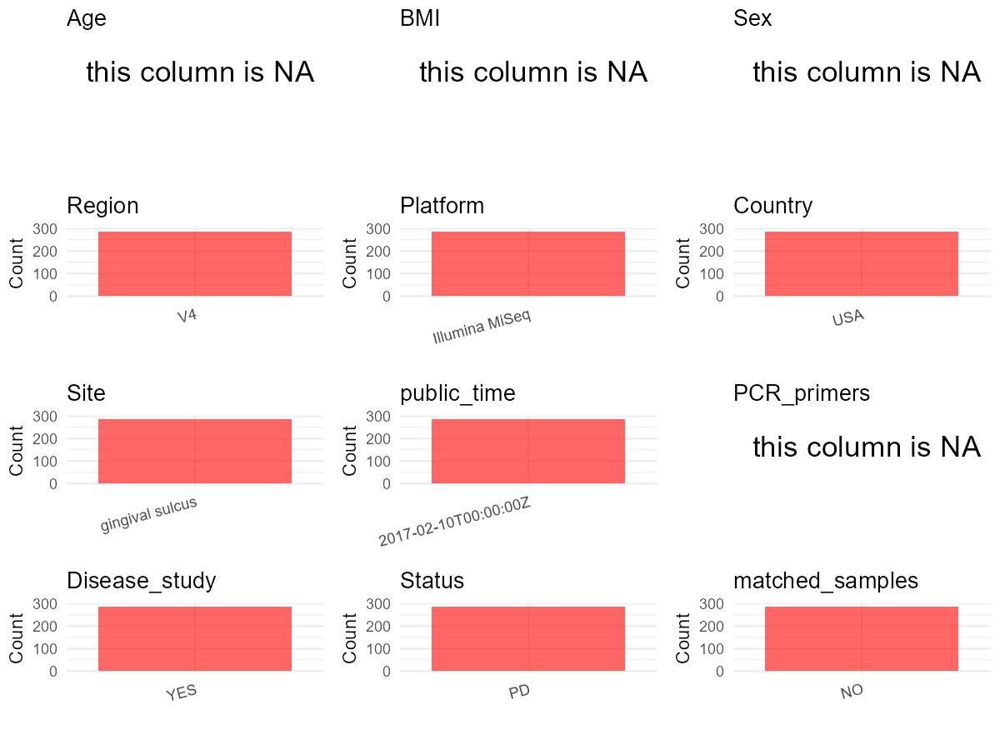

R Notebook: Metadata Processing Workflow
================

# Step 1: Obtain Initial Metadata from Each Project

To obtain the initial metadata: 1. Search for the BioProject ID (e.g.,
“PRJEBXXXX”) on the [NCBI SRA
website](https://www.ncbi.nlm.nih.gov/Traces/study/). 2. In the “Select”
table, click on “Metadata” and download the file. 3. The downloaded file
is typically named “SraRunTable.csv” and contains metadata for the
project.

``` r
# Load necessary libraries
library(dplyr)
library(ggplot2)
library(cowplot)

# Set working directory (update this path to your local directory)
setwd("D:/oral_project/PRJEB19122")

# Read the initial metadata files
initial_meta<-read.csv("SraRunTable.csv",header = T)

# Combine the two metadata files
#meta <- rbind(initial_meta, initial_meta1)

#Remove entries non-oral samples
#initial_meta <- subset(initial_meta,isolate %in% c("saliva","tongue coat"))

# Check the number of samples containing "HT" in Sample.Name (e.g., healthy controls)
#nrow(subset(meta, grepl("HT", Sample.Name)))

# Display the first few rows of the metadata
head(initial_meta)
```

    ##          Run anonymized_name Assay.Type AvgSpotLen Barcode..exp.   Bases
    ## 1 ERR1802858         R1.1.bx      OTHER        151  TGGAGCCTTGTC 4017355
    ## 2 ERR1802859         R1.1.by      OTHER        151  CTCGATGTAAGC 3372887
    ## 3 ERR1802860         R1.1.bz      OTHER        151  AGCTTCGACAGT 4015543
    ## 4 ERR1802861         R1.1.pa      OTHER        151  ATACGCATCAAG 3638496
    ## 5 ERR1802862         R1.2.bx      OTHER        151  AGATGTCCGTCA 3800519
    ## 6 ERR1802863         R1.2.bz      OTHER        151  GCACCTGTTGAA 2793802
    ##   BioProject     BioSample       body_habitat         body_product
    ## 1 PRJEB19122 SAMEA53439418 UBERON:oral cavity UBERON:dental plaque
    ## 2 PRJEB19122 SAMEA53440168 UBERON:oral cavity UBERON:dental plaque
    ## 3 PRJEB19122 SAMEA53440918 UBERON:oral cavity UBERON:dental plaque
    ## 4 PRJEB19122 SAMEA53441668 UBERON:oral cavity UBERON:dental plaque
    ## 5 PRJEB19122 SAMEA53442418 UBERON:oral cavity UBERON:dental plaque
    ## 6 PRJEB19122 SAMEA53443168 UBERON:oral cavity UBERON:dental plaque
    ##                body_site   Bytes center_name..exp.
    ## 1 UBERON:gingival sulcus 2480825      clorox_perio
    ## 2 UBERON:gingival sulcus 2108322      clorox_perio
    ## 3 UBERON:gingival sulcus 2499152      clorox_perio
    ## 4 UBERON:gingival sulcus 2287334      clorox_perio
    ## 5 UBERON:gingival sulcus 2377488      clorox_perio
    ## 6 UBERON:gingival sulcus 1738310      clorox_perio
    ##                                          Center.Name collection_timestamp
    ## 1 UNIVERSITY OF CALIFORNIA SAN DIEGO MICROBIOME INIT              6/19/14
    ## 2 UNIVERSITY OF CALIFORNIA SAN DIEGO MICROBIOME INIT              6/19/14
    ## 3 UNIVERSITY OF CALIFORNIA SAN DIEGO MICROBIOME INIT              6/19/14
    ## 4 UNIVERSITY OF CALIFORNIA SAN DIEGO MICROBIOME INIT              6/19/14
    ## 5 UNIVERSITY OF CALIFORNIA SAN DIEGO MICROBIOME INIT              6/19/14
    ## 6 UNIVERSITY OF CALIFORNIA SAN DIEGO MICROBIOME INIT              6/19/14
    ##   Consent DATASTORE.filetype DATASTORE.provider
    ## 1  public   fastq,run.zq,sra     ena,gs,ncbi,s3
    ## 2  public   fastq,run.zq,sra     ena,gs,ncbi,s3
    ## 3  public   fastq,run.zq,sra     ena,gs,ncbi,s3
    ## 4  public   fastq,run.zq,sra     ena,gs,ncbi,s3
    ## 5  public   fastq,run.zq,sra     ena,gs,ncbi,s3
    ## 6  public   fastq,run.zq,sra     ena,gs,ncbi,s3
    ##                           DATASTORE.region dna_extracted elevation
    ## 1 ena,gs.us-east1,ncbi.public,s3.us-east-1          TRUE       193
    ## 2 ena,gs.us-east1,ncbi.public,s3.us-east-1          TRUE       193
    ## 3 ena,gs.us-east1,ncbi.public,s3.us-east-1          TRUE       193
    ## 4 ena,gs.us-east1,ncbi.public,s3.us-east-1          TRUE       193
    ## 5 ena,gs.us-east1,ncbi.public,s3.us-east-1          TRUE       193
    ## 6 ena,gs.us-east1,ncbi.public,s3.us-east-1          TRUE       193
    ##   ENA.FIRST.PUBLIC..run. ENA_first_public ENA.LAST.UPDATE..run. ENA_last_update
    ## 1             2017-02-08       2017-02-08            2018-11-16      2017-01-20
    ## 2             2017-02-08       2017-02-08            2018-11-16      2017-01-20
    ## 3             2017-02-08       2017-02-08            2018-11-16      2017-01-20
    ## 4             2017-02-08       2017-02-08            2018-11-16      2017-01-20
    ## 5             2017-02-08       2017-02-08            2018-11-16      2017-01-20
    ## 6             2017-02-08       2017-02-08            2018-11-16      2017-01-20
    ##     env_biome              env_feature     env_material Env_package Experiment
    ## 1 urban biome human-associated habitat organic material  human-oral ERX1866589
    ## 2 urban biome human-associated habitat organic material  human-oral ERX1866590
    ## 3 urban biome human-associated habitat organic material  human-oral ERX1866591
    ## 4 urban biome human-associated habitat organic material  human-oral ERX1866592
    ## 5 urban biome human-associated habitat organic material  human-oral ERX1866593
    ## 6 urban biome human-associated habitat organic material  human-oral ERX1866594
    ##     external_id geo_loc_name_country geo_loc_name_country_continent
    ## 1 SAMEA53439418                  USA                  North America
    ## 2 SAMEA53440168                  USA                  North America
    ## 3 SAMEA53440918                  USA                  North America
    ## 4 SAMEA53441668                  USA                  North America
    ## 5 SAMEA53442418                  USA                  North America
    ## 6 SAMEA53443168                  USA                  North America
    ##   geo_loc_name host_common_name host_scientific_name host_subject_id host_taxid
    ## 1       USA:CA            human         Homo sapiens               1       9606
    ## 2       USA:CA            human         Homo sapiens               1       9606
    ## 3       USA:CA            human         Homo sapiens               1       9606
    ## 4       USA:CA            human         Homo sapiens               1       9606
    ## 5       USA:CA            human         Homo sapiens               1       9606
    ## 6       USA:CA            human         Homo sapiens               1       9606
    ##   ind_time_tooth Individual INSDC_center_alias
    ## 1       1.1.14DB          1             UCSDMI
    ## 2        1.1.3DL          1             UCSDMI
    ## 3       1.1.22DB          1             UCSDMI
    ## 4         1.1.NA          1             UCSDMI
    ## 5       1.2.14DB          1             UCSDMI
    ## 6       1.2.22DB          1             UCSDMI
    ##                                          INSDC_center_name   INSDC_first_public
    ## 1 University of California San Diego Microbiome Initiative 2017-02-08T17:02:58Z
    ## 2 University of California San Diego Microbiome Initiative 2017-02-08T17:02:58Z
    ## 3 University of California San Diego Microbiome Initiative 2017-02-08T17:02:58Z
    ## 4 University of California San Diego Microbiome Initiative 2017-02-08T17:02:58Z
    ## 5 University of California San Diego Microbiome Initiative 2017-02-08T17:02:58Z
    ## 6 University of California San Diego Microbiome Initiative 2017-02-08T17:02:58Z
    ##      INSDC_last_update INSDC_status     Instrument LATITUDE
    ## 1 2017-01-20T22:40:44Z       public Illumina MiSeq     32.5
    ## 2 2017-01-20T22:40:44Z       public Illumina MiSeq     32.5
    ## 3 2017-01-20T22:40:44Z       public Illumina MiSeq     32.5
    ## 4 2017-01-20T22:40:44Z       public Illumina MiSeq     32.5
    ## 5 2017-01-20T22:40:44Z       public Illumina MiSeq     32.5
    ## 6 2017-01-20T22:40:44Z       public Illumina MiSeq     32.5
    ##           Library.Name LibraryLayout LibrarySelection LibrarySource
    ## 1 10822.061914.R1.1.bx        SINGLE              PCR   METAGENOMIC
    ## 2 10822.061914.R1.1.by        SINGLE              PCR   METAGENOMIC
    ## 3 10822.061914.R1.1.bz        SINGLE              PCR   METAGENOMIC
    ## 4 10822.061914.R1.1.pa        SINGLE              PCR   METAGENOMIC
    ## 5 10822.061914.R1.2.bx        SINGLE              PCR   METAGENOMIC
    ## 6 10822.061914.R1.2.bz        SINGLE              PCR   METAGENOMIC
    ##   linker..exp. LONGITUDE old_names              Organism
    ## 1           CC   -117.25    1.1.bx human oral metagenome
    ## 2           CC   -117.25    1.1.by human oral metagenome
    ## 3           CC   -117.25    1.1.bz human oral metagenome
    ## 4           CC   -117.25    1.1.pa human oral metagenome
    ## 5           CC   -117.25    1.2.bx human oral metagenome
    ## 6           CC   -117.25    1.2.bz human oral metagenome
    ##   physical_specimen_location physical_specimen_remaining Platform
    ## 1                       SDSU                       FALSE ILLUMINA
    ## 2                       SDSU                       FALSE ILLUMINA
    ## 3                       SDSU                       FALSE ILLUMINA
    ## 4                       SDSU                       FALSE ILLUMINA
    ## 5                       SDSU                       FALSE ILLUMINA
    ## 6                       SDSU                       FALSE ILLUMINA
    ##                     pocketdepth           primer..exp. rd_code
    ## 1                             6 CCGGACTACHVGGGTWTCTAAT       0
    ## 2                             6 CCGGACTACHVGGGTWTCTAAT       0
    ## 3                             3 CCGGACTACHVGGGTWTCTAAT       0
    ## 4 Not applicable - suprgingival CCGGACTACHVGGGTWTCTAAT       0
    ## 5                             5 CCGGACTACHVGGGTWTCTAAT       0
    ## 6                             3 CCGGACTACHVGGGTWTCTAAT       0
    ##            ReleaseDate run_date..exp. run_prefix..exp.   Sample.Name
    ## 1 2017-02-10T00:00:00Z        6/19/14  6_19_14_S0_L001 SAMEA53439418
    ## 2 2017-02-10T00:00:00Z        6/19/14  6_19_14_S0_L001 SAMEA53440168
    ## 3 2017-02-10T00:00:00Z        6/19/14  6_19_14_S0_L001 SAMEA53440918
    ## 4 2017-02-10T00:00:00Z        6/19/14  6_19_14_S0_L001 SAMEA53441668
    ## 5 2017-02-10T00:00:00Z        6/19/14  6_19_14_S0_L001 SAMEA53442418
    ## 6 2017-02-10T00:00:00Z        6/19/14  6_19_14_S0_L001 SAMEA53443168
    ##                            Sample_name   sample_type SampleSite
    ## 1 qiita_sid_10822:10822.061914.R1.1.bx dental plaque         bx
    ## 2 qiita_sid_10822:10822.061914.R1.1.by dental plaque         by
    ## 3 qiita_sid_10822:10822.061914.R1.1.bz dental plaque         bz
    ## 4 qiita_sid_10822:10822.061914.R1.1.pa dental plaque         pa
    ## 5 qiita_sid_10822:10822.061914.R1.2.bx dental plaque         bx
    ## 6 qiita_sid_10822:10822.061914.R1.2.bz dental plaque         bz
    ##     sequencing_meth..exp. SRA.Study                         Submitter_Id
    ## 1 sequencing by synthesis ERP021114 qiita_sid_10822:10822.061914.R1.1.bx
    ## 2 sequencing by synthesis ERP021114 qiita_sid_10822:10822.061914.R1.1.by
    ## 3 sequencing by synthesis ERP021114 qiita_sid_10822:10822.061914.R1.1.bz
    ## 4 sequencing by synthesis ERP021114 qiita_sid_10822:10822.061914.R1.1.pa
    ## 5 sequencing by synthesis ERP021114 qiita_sid_10822:10822.061914.R1.2.bx
    ## 6 sequencing by synthesis ERP021114 qiita_sid_10822:10822.061914.R1.2.bz
    ##            surface_long target_gene..exp. target_subfragment..exp. time
    ## 1          disto-buccal          16S rRNA                       V4    1
    ## 2         disto-lingual          16S rRNA                       V4    1
    ## 3          disto-buccal          16S rRNA                       V4    1
    ## 4 Missing: Not provided          16S rRNA                       V4    1
    ## 5          disto-buccal          16S rRNA                       V4    2
    ## 6          disto-buccal          16S rRNA                       V4    2
    ##   timepoint      tooth_sampled_long         tooth_sampled diseasclass
    ## 1         1  upper left first molar                  14DB           A
    ## 2         1 upper right first molar                   3DL           A
    ## 3         1       lower left canine                  22DB           A
    ## 4         1   Missing: Not provided Missing: Not provided           A
    ## 5         2  upper left first molar                  14DB           A
    ## 6         2       lower left canine                  22DB           A
    ##   pocketclass          create_date version                   BoP
    ## 1           A 2017-02-10T15:12:00Z       1                     B
    ## 2           A 2017-02-10T15:13:00Z       1                     B
    ## 3           A 2017-02-10T15:13:00Z       1                     N
    ## 4           D 2017-02-10T15:13:00Z       1 Missing: Not provided
    ## 5           A 2017-02-10T15:13:00Z       1                     B
    ## 6           A 2017-02-10T15:13:00Z       1                     B
    ##           pdepthreclass tx_ctl          Inflammation improve
    ## 1                     B      T                     2       n
    ## 2                     B      T                     2       y
    ## 3                     A      T                     1       n
    ## 4 Missing: Not provided      T Missing: Not provided        
    ## 5                     B      T                     2       n
    ## 6                     A      T                     2       n

# Step 2: Create a Uniform Metadata Template

The uniform metadata should include the following columns:

1.  **BioProject**: Project ID (e.g., “PRJNA339212”)
2.  **Run**: Sample ID (e.g., “ERRXXXXXX” or “SRRXXXXXX”)
3.  **sample_name**: Original sample name submitted by the authors (not
    the database-assigned ID)
4.  **Age**: Age of the subject (if available)
5.  **BMI**: Body Mass Index (if available)
6.  **Sex**: Sex of the subject (“F” or “M”)
7.  **Region**: Targeted 16S rRNA region (e.g., “V3-V4”)
8.  **Platform**: Sequencing platform (e.g., “Illumina MiSeq”)
9.  **Country**: Country of sample origin (e.g., “China”)
10. **Site**: Sample site (e.g., “saliva”, “dental plaque”)
11. **public_time**: Data release date (format: “YYYY-MM-DD”)
12. **PCR_primers**: PCR primers used (e.g., “515F-806R”)
13. **title**: Title of the associated publication
14. **Disease_study**: Whether the study involves a disease (“YES” or
    “NO”)
15. **Status**: Disease status (e.g., “T2DM”, “HC”). Note: If the study
    includes both disease and healthy samples, this must be specified
    per sample.
16. **matched_samples**: matched samples (“YES” or “NO”)

``` r
# Create a uniform metadata dataframe
metadata <- data.frame(
  BioProject = initial_meta$BioProject,
  Run = initial_meta$Run,
  sample_name = initial_meta$Library.Name,
  Age = NA,
  BMI = NA,
  Sex = NA,
  Region = initial_meta$target_subfragment..exp.,
  Platform = initial_meta$Instrument,
  Country = initial_meta$geo_loc_name_country,
  Site = gsub("UBERON:", "", initial_meta$body_site),
  public_time = initial_meta$ReleaseDate,
  PCR_primers = NA,
  stringsAsFactors = FALSE
)
```

# Step 3: Manually Add Information from the Publication

Some information (e.g. PCR primers, study title, disease status) must be
manually extracted from the publication and added to the metadata.

``` r
# Add information obtained from the publication
metadata$title <- "Multi-omics analysis of periodontal pocket microbial communities pre- and posttreatment."
metadata$Disease_study <- "YES"
# Assign disease status based on sample_name patterns
metadata$Status <- "PD"

#get subjects id with Saliva available
keep_subjects<-subset(metadata,Site %in% "gingival sulcus")
#remove subjects without Saliva samples
metadata<-subset(metadata,sample_name %in% keep_subjects$sample_name)
#get subjects sampling counts
sample_counts <- table(metadata$sample_name)
# Create matched_samples column, any subjects have >=2 samples will be label "YES", otherwise "NO"
metadata$matched_samples <- ifelse(metadata$sample_name %in% names(sample_counts[sample_counts >= 2]), "YES", "NO")
```

# Step 4: Summarize and Validate the Metadata

``` r
# Check the number of unique runs and sample names
print(paste("Number of unique runs:", length(unique(metadata$Run))))
```

    ## [1] "Number of unique runs: 287"

``` r
print(paste("Number of unique sample names:", length(unique(metadata$sample_name))))
```

    ## [1] "Number of unique sample names: 287"

# Step 5: Visualize the Metadata

``` r

```

<!-- -->

# Step 6: Finalize and Export the Metadata

``` r
# Reorder columns to match the desired format
metadata <- metadata[, c(
  "BioProject", "Run", "sample_name", "Age", "BMI", "Sex", 
  "Region", "Platform", "Country", "Site", "public_time", 
  "PCR_primers", "title", "Disease_study", "Status","matched_samples"
)]

# Export the uniform metadata to a CSV file
write.csv(metadata, file = "metadata.csv", quote = FALSE)
head(metadata)
```

    ##   BioProject        Run          sample_name Age BMI Sex Region       Platform
    ## 1 PRJEB19122 ERR1802858 10822.061914.R1.1.bx  NA  NA  NA     V4 Illumina MiSeq
    ## 2 PRJEB19122 ERR1802859 10822.061914.R1.1.by  NA  NA  NA     V4 Illumina MiSeq
    ## 3 PRJEB19122 ERR1802860 10822.061914.R1.1.bz  NA  NA  NA     V4 Illumina MiSeq
    ## 4 PRJEB19122 ERR1802861 10822.061914.R1.1.pa  NA  NA  NA     V4 Illumina MiSeq
    ## 5 PRJEB19122 ERR1802862 10822.061914.R1.2.bx  NA  NA  NA     V4 Illumina MiSeq
    ## 6 PRJEB19122 ERR1802863 10822.061914.R1.2.bz  NA  NA  NA     V4 Illumina MiSeq
    ##   Country            Site          public_time PCR_primers
    ## 1     USA gingival sulcus 2017-02-10T00:00:00Z          NA
    ## 2     USA gingival sulcus 2017-02-10T00:00:00Z          NA
    ## 3     USA gingival sulcus 2017-02-10T00:00:00Z          NA
    ## 4     USA gingival sulcus 2017-02-10T00:00:00Z          NA
    ## 5     USA gingival sulcus 2017-02-10T00:00:00Z          NA
    ## 6     USA gingival sulcus 2017-02-10T00:00:00Z          NA
    ##                                                                                      title
    ## 1 Multi-omics analysis of periodontal pocket microbial communities pre- and posttreatment.
    ## 2 Multi-omics analysis of periodontal pocket microbial communities pre- and posttreatment.
    ## 3 Multi-omics analysis of periodontal pocket microbial communities pre- and posttreatment.
    ## 4 Multi-omics analysis of periodontal pocket microbial communities pre- and posttreatment.
    ## 5 Multi-omics analysis of periodontal pocket microbial communities pre- and posttreatment.
    ## 6 Multi-omics analysis of periodontal pocket microbial communities pre- and posttreatment.
    ##   Disease_study Status matched_samples
    ## 1           YES     PD              NO
    ## 2           YES     PD              NO
    ## 3           YES     PD              NO
    ## 4           YES     PD              NO
    ## 5           YES     PD              NO
    ## 6           YES     PD              NO

## Notes for Students:

1.  **Metadata Accuracy**: Always cross-check the metadata with the
    original publication to ensure accuracy.
2.  **Manual Entries**: Columns like `PCR_primers`, and `Status` often
    require manual entry based on the publication.
3.  **Disease Status**: Be careful when assigning `Status`—some studies
    include both disease and healthy samples.
4.  **Visualization**: The plots help quickly identify the distribution
    of values in each column, which is useful for quality control.
5.  **Reproducibility**: Update the working directory and file paths to
    match your local environment.
